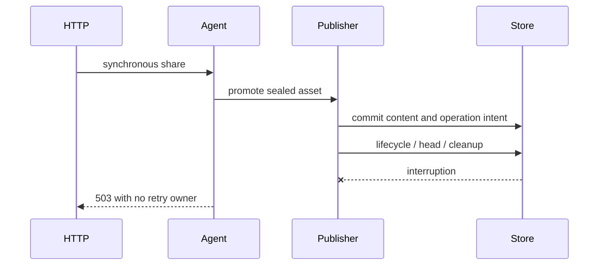
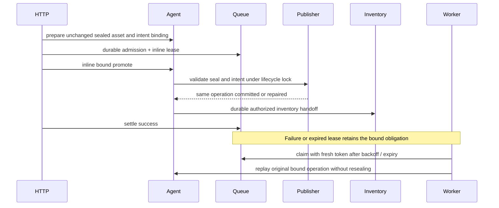

# Durable synchronous share recovery — #2963

## Executive summary and status

The synchronous share path can commit sealed content and lose its lifecycle/catalog tail without a durable retry owner. Manual replay validates and resumes the immutable operation, but neither the HTTP error nor restart creates a worker obligation. Establish a live baseline on the optimized publisher before changing production code, then add durable ownership of this narrowly validated recovery path. The principal risk is replaying a different asset version, bypassing authority, or repeating uncertain side effects.

Status: PR #3300 remains open and unmerged. Historical baseline4/candidate11 matched live and actual-restart results are preserved at their exact revisions; later ownership and lease-fencing changes need new live validation. Round24 addresses the lifecycle-lock wait regression, a CI routing omission and a newly discovered cross-checkout fault-preload error. Baseline6 retains all outcomes and its original fixed deadline despite missing injected coverage. Baseline7 will repeat on clean optimized `31599fc08`, followed by candidate12 with the same corrected hook and actual restart. Required code-owner approval remains unconfirmed. Single implementation owner: this chat; no merge is authorized.

## Sources and branch

- [Issue and acceptance criteria](https://github.com/OriginTrail/dkg/issues/2963).
- [Live partial commit and manual recovery](https://github.com/OriginTrail/dkg/issues/2963#issuecomment-6217273362): original failing store call unknown. Missing lifecycle state is consistent with delete/insert interruption, not proof of that exact original call.
- [Related investigation](https://github.com/OriginTrail/dkg/issues/3252).
- [Performance PR](https://github.com/OriginTrail/dkg/pull/3253) merged at 2026-10-16T18:08:57Z, original tested head `9436b5c927f9fc8e5eb0cd5523da785dfa1cdd75`. Our separate [PR #3300](https://github.com/OriginTrail/dkg/pull/3300), branch `codex/2963-durable-share-recovery`, was retargeted from the parent branch to `testnet-canary` and merged base `2aba84de35754e5663b52018f9781a6e6c8b948d`. Never merge either PR ourselves.
- Baseline includes diagnosticCode, requeued retryable flags, clear protection and post-commit 503 mapping already. Verify rather than duplicate them.

## Inspected architecture and causal chain

`knowledge-assets.ts` calls `agent.assertion.promote` directly for synchronous shares (including one-shot create). Agent sealing and authority/recipient checks precede `publisher.assertionPromote`; the publisher owns an immutable operation intent and exact graph replay validation. `assertion-promote-finalization.ts` performs separate lifecycle delete/insert, snapshot/head writes, WM cleanup and completion marking. Agent pointer/observer work follows. Async jobs have a persistent queue and recovery sweep; synchronous calls do not.

Root cause proven by source/evidence: no durable synchronous retry owner. Original exact store-call failure remains unknown. Deterministic injection must label its selected boundary and must not be presented as reconstructing the original call.

## Approach and decisions to resolve before implementation

1. Prefer reusing existing durable operation and queue ownership, with immutable coordinate/version/operation binding and real worker recovery. Record ownership before any share mutation; recording only in a catch misses process death and store outages.
2. Do not blindly enqueue arbitrary failed HTTP mutations. Recovery must validate the original seal, exact content and operation, retain original author/access/curator intent, recheck current authority, and refuse corrupt or superseded identities.
3. A durable dedicated recovery outbox is an alternative if the existing queue cannot represent inline ownership safely. Compare lease takeover, crash ambiguity, cleanup/cancel races, and compatibility before selecting the final design.
4. Atomic lifecycle metadata replacement alone reduces one boundary but does not recover pointer/catalog failures or process death; insufficient as the sole fix.
5. Keep the normal synchronous API success contract. Failure responses must state whether automatic recovery is durably owned, expose a safe observation handle, and explain temporary descriptor absence and zero newly promoted content on replay. Never promise recovery if admission failed.
6. Keep #3253's performance scope unchanged. No publisher transaction retry, nonce reset, authority relaxation or arbitrary write fallback.

## Execution chunks

| Chunk | Work and files | Dependency / completion evidence |
|---|---|---|
| C1 | Establish native macOS runtime, pinned Blazegraph, isolated home, owned wallet batch; preserve source evidence and environment manifest | Before production edits; SQLite actual open, CLI help, chain bindings, funds, nonce/ownership checks |
| C2 | Build reproducible live harness and deterministic partial-commit injection; baseline from exact parent head | C1; preserve all HTTP outcomes, jobs, RDF/intent snapshots and fixed deadlines before implementation |
| C3 | Finalize design around agent promote, publisher intent, queue and daemon worker; review authority and crash schedules | C2; update this plan with exact ownership/compatibility decision and concrete modules |
| C4 | Implement durable synchronous recovery and retain existing acceptance contracts; lifecycle docs | C3; focused source tests plus real queue/worker/restart checks |
| C5 | Candidate live runs in fresh home/namespace under identical resources/workload/deadlines and identical faults | C4; full denominator comparison, exact content and identity proof, nonce and transaction reconciliation |
| C6 | Sanitized report, coherent stacked PR, complete remote review sweeps and fixes | C5; current-head checks/review completion, all comments addressed, unresolved gaps explicit |

## Baseline/candidate protocol

Native macOS arm64, Node 22.23.3, pnpm 10.28.1. Pinned repository Blazegraph image (multi-architecture), Docker store limited to 4 CPUs / 4 GiB, actual JVM maximum heap 1 GiB (verified by `jcmd VM.flags`; image ignores `JAVA_OPTS`); native daemon heap limit 4 GiB. Host scheduling is not CPU-isolated: record this limitation identically for both arms. Six publishers from one exclusively claimed prepared batch, sequential arms, separate fresh homes/namespaces and context graphs. Immutable source bundles, authenticated API and checkout-pinned auto-update disabled. Never alter another owner's home or claim. Carry only the monotonic author-number allocator high-water mark between homes so unpublished sealed identities cannot be reused; do not copy content, catalog state or jobs.

Target workload: 180 initial catalog identities, 48 prepared publication assets, 256 concurrent synchronous catalog shares (8 triples each), private registered context graph, six funded publishers. Preserve setup failures separately. Use a readiness barrier before timing; freeze actual concurrency/pacing and publication observation deadline in the harness before baseline. Fixed catalog drain: 20 minutes after submission traffic ends, no extension to turn a failed run into a pass. Record all 256 requests including timeout/503/unknown outcomes and all 48 publication jobs including failures/incompletes. Do not silently repair setup or timed failures.

Run the natural workload with separately labelled identical deterministic lifecycle-insertion faults in both arms. Cover pointer maintenance through real queue/worker regressions, and supplement the matched workload with a separately reported process-crash/restart scenario after content commit. At least one real process restart with persisted state is required. Neither a successful candidate without a matching fault nor unit tests establishes recovery.

Measure HTTP and durable-admission clocks separately, publication p50/p90 and full-cohort makespan (no full-cohort throughput if incomplete), recovery time from fault to verified completion, descriptors, lifecycle state/head/completion, exact expected inventory/catalog identity sets and convergence time. Compare canonical RDF/root, seal, operation envelope, version, WM cleanup, transaction carriers, receipts and all used signer pending/latest nonces. Manual repair is a separate result and never automatic success.

## Failure handling, compatibility and review

- Establish original operation identity before replay; ambiguous/corrupt/superseded state fails closed and remains observable.
- Persistent dependency failure retains a durable obligation with bounded backoff and explicit exhaustion policy; restart must not discard it.
- Queue ownership and lifecycle locks must serialize inline execution against recovery, manual replay and competing writes; stale claims cannot settle another owner's attempt.
- Preserve old queue records/API consumers with additive fields and version-gated recovery. Old binaries may not understand new recovery records: document downgrade limits and retain data.
- Catalog completion requires current accepted authority and exact coverage, not a success count or row count. Observer admission and convergence must be verified against real backend behavior.
- Stop owned submissions/writers, reconcile jobs/transactions, compare pending/latest nonces, stop owned daemon/store, then release matching wallet claim. Retain claim on ambiguous signing activity. Preserve failures before cleanup.
- Self-review lenses before implementation: design (durable owner precedes mutation), security (author/current authority), validation (both arms faulted), operations (crash/takeover), compatibility (old rows/downgrade). Remote review follows PR driver, up to 10 response rounds with bounded 30-minute observation windows; pending human approval remains a gap.

## Current ledger

- C1 complete: runtime build, CLI help and actual SQLite open passed. Acquired batch-1, six funded publishers, all ten signers initially pending=latest. Base Sepolia 84532; Hub/token bindings captured. API 9296 authenticated (200 with native token / 401 without). Pinned Blazegraph on 9996. Source bundles untouched. Ownership record `.tmp/2963/evidence/batch-claim.json` must remain private/local.
- C2: first attempt prepared 180 exact catalog/inventory identities and 256 sealed drafts without preparation failure. Readiness restart lost the benchmark graph from runtime subscription selection; a shell without `set -e` continued after the failed readiness assertion and started traffic. Marked **invalid for controlled performance comparison**, retaining full workload/fault evidence and no manual repairs. Harness now checks readiness internally before measured mutations. Repeat with fresh namespace/home and graph persisted in config after reconciling this attempt. No recovery production code changed.
- Baseline regression: 44 cases passed across real worker/queue and routes using CLI unit config. Initial default-config invocation unnecessarily started Hardhat setup and was stopped; its log retained. Recreated modern-allocator lifecycle deletion/insertion characterization passes 2 cases (typed not-started and untyped); explicit manual replay preserves identity/content and repairs descriptor. These are characterization, not automatic success.
- C3 design refinement: synchronous route retains inline execution. Prepare/seal through existing agent semantics, capture an exact seal fingerprint through a publisher helper, then atomically enqueue-and-claim a version-gated recovery request. Run the existing worker attempt runner inline with the original request options; ordinary supervisor owns subsequent attempts. Publisher checks the pinned seal under its lifecycle lock before any mutation; recovery skips resealing. The existing durable intent is authoritative for operation ID/timestamp/policy; absent intent is permitted only on the unchanged sealed first-attempt path that has never claimed an operation. Re-run current authority and curator checks. Crash reclaim is enabled only for this explicit bound request format; legacy ambiguous jobs remain fail-closed. Cover standalone share and one-shot create. Require durable inventory handoff before success for bound requests, leaving catalog projection itself asynchronous. Do not clear/cancel a bound obligation that may have committed content. Remaining design checks: exact failure budget behavior, source-file size extraction, callback API/export compatibility, and strict observer handling of inactive versus temporarily unresolved authority.
- C3–C6 implementation/validation/review remain pending. Next action: preserve first attempt outcomes, reconcile transactions, prepare fresh matched baseline with fail-closed readiness, then close baseline before production edits.

## Design review before implementation

The chosen queue binding must include the canonical author-seal digest **and the full immutable operation intent** (operation ID, timestamp, publisher peer, confirmation requirement, access policy and allowed peers). Pinning only the seal would leave a gap if the intent write were interrupted or later absent: a retry could recreate the same operation ID with a different envelope. Admission reads any existing intent under the publisher lifecycle lock; otherwise it constructs the exact future intent. Publisher replay checks the binding under that same lock, rejects mismatched/corrupt intent or seal, and uses the pinned intent on the first write. It never replaces a conflicting claim. Author sealing occurs before admission and is not repeated by the bound worker. Known completed-VM no-ops retain their existing behavior after identity validation.

The queue will atomically admit and lease the inline attempt, so the supervisor cannot win between enqueue and the synchronous call. Version 4 bound records alone permit expired started attempts to re-enter the validated immutable operation; version 2/3 and unbound records retain current ambiguity rules. Storage-lane compatibility must remain pinned to its actual introduction in version 3, rather than comparing against a newly bumped current version. Unknown future formats and malformed bindings must fail closed. Retryable bound obligations remain durable beyond the ordinary attempt cap, with the existing capped backoff; permanent integrity/authority refusals remain visible and are not converted to transient successes. Cancellation/clear must not erase an unfinished bound obligation. Downgrading while these records remain is unsupported and must be documented.

Catalog ownership transfers only after a successful/existing inventory CAS under current authority. The existing projection supervisor seeds work for selected local-author scopes on startup and reads the durable inventory. A bound share therefore need not wait for an entire signed catalog, but cannot acknowledge completion while only a detached observer owns its inventory row. Inactive legacy lanes and already confirmed public VM rows need explicit treatment; authority transition/read failure and failed inventory writes retain the obligation. Policy mismatch must fail closed.

Implementation modules planned: a publisher binding helper, queue types/parser/admission/recovery policy, an extracted agent promotion helper, strict bound inventory handoff, an inline daemon attempt helper using the existing worker runner, the two synchronous route call sites, worker option propagation, and lifecycle documentation. Keep the existing publisher failure-disposition union intact; bound queue policy owns immediate post-commit requeue. Test with the actual queue and worker runner, including durable readback into new instances, stale claim rejection, current-authority denial, changed seal/intent refusal, repeated outage beyond budget, pointer failure and post-success bookkeeping ambiguity. A real daemon process-exit/restart scenario supplements those tests and the main live comparison.

## Baseline attempt ledger

- Attempt 0 (`baseline`) is invalid for controlled performance comparison because readiness was bypassed. Complete request denominator: 48/48 publication admissions and finalizations, 254/256 synchronous HTTP 200 and two injected 503s. Independent RPC reconciliation: 48 successful receipts, 48 distinct hashes and wallet/nonce pairs, all ten signer pending/latest counts equal. No manual repairs. Observation stopped early with its reason recorded; final snapshot had 434 inventory rows and 393 catalog rows while projection was still draining. These are retained failure/characterization results, not a fixed-deadline performance arm.
- Owned daemon and container for attempt 0 were stopped, listeners/processes checked, and its matching claim released. A fresh claim owns `baseline2-home`; only the monotonically increasing KA-number floor was carried forward. Fresh graph subscription is persisted before startup. Baseline 2 uses the same six wallets, pinned store image/resources and unchanged production build; preparation and a fail-closed readiness controller precede measured traffic. The frozen harness includes identical 15-second descriptor observations of both injected assets for both future arms.

### Proposed ownership flow

Before:

After (implemented):

The main live protocol is frozen at baseline-2 traffic start. Preparation completed without failure; exact starting catalog/inventory both contain 180 entries. Read-only evidence reducers additionally compare every original seal predicate, exact payload graph sets, catalog identity/version/seal digests, all 48 transaction carriers, and decoded `KnowledgeAssetCreated` events. Attempt 0's 48/48 canonical chain identities and 436/436 original seals are independently verified; its readiness invalidity remains unchanged.

A further queue audit found a durability prerequisite: the legacy queue writer permits subject-scoped delete/insert fallback. Bound synchronous obligations must require atomic subject replacement for **every** state transition, otherwise a crash between that fallback's delete and insert could erase the only repair owner. Blazegraph and Oxigraph expose the required capability. Unsupported/refusing stores must fail before sharing, retaining any existing row; no fallback is allowed for bound records. Add a capability-refusal and uncertain-ack persistence regression. Ordinary unbound queue behavior is unchanged.

Security/compatibility review refinement: capture whether the accepted request owes catalog inventory alongside its recovery binding. A later authority transition, unsubscribe or kill switch must not silently discharge an already-owned catalog obligation. Deliberate legacy and named-subgraph lanes keep their existing behavior. Persist the resolved curator-confirmation requirement so a changed daemon default after restart cannot weaken it. Bound recovery skips re-signing; original storage-lane casing, author attestation and nonce allocation stay pinned. The additional inline admission API should be an optional queue capability so custom legacy queue implementations remain type-compatible; unsupported capability fails before SWM mutation.

## Baseline closure and implementation progress

Controlled baseline2 completed on unchanged production revision 9436b5c927f9fc8e5eb0cd5523da785dfa1cdd75 before production edits. At the fixed deadline, 48/48 publications finalized and 254/256 synchronous requests succeeded; both injected partial commits remained incomplete (0/2 automatic recovery, zero manual repairs). Exact catalog/inventory count 434/436, descriptor count 434/436. All 436 seals and 48 chain identities preserved; all 98 signer transactions reconciled without nonce gaps. Same-runtime restart retained the incomplete state. Owned daemon and store stopped and matching claim released before candidate acquisition.

Implemented the version-4 bound queue design, atomic inline admission, pinned seal/intent validation, started-lease reclaim, continued transient/post-commit retry beyond the normal cap, protected unfinished obligations, original-author worker propagation and synchronous/one-shot route integration. The catalog handoff now awaits the validated inventory CAS for bound obligations; detached observation remains the legacy path. Worker-disabled synchronous admission fails before sharing with an explicit 503 rather than promising an absent recovery owner. Permanent integrity failures remain visible; they cannot be cleared or cancelled as completed obligations. Candidate live run and remote review are still required. No merge authorized.

### Compatibility review during the fixed candidate observation

Self-review identified a completed pre-intent SWM case that the new admission binding rejected although the existing publisher supports a non-mutating no-op. Add a read-only verification under the existing lifecycle lock, return the original operation ID without a queue job, and continue rejecting incomplete or changed pre-intent content. This is not permission to reconstruct a missing immutable intent. Verify complete/no-op, incomplete and changed-content cases through the real agent/queue entry point. The running measured candidate remains compiled at `7dfc334200bb2a716e7dc11cf25ec7a033cd9481`; source edits are not rebuilt into that live daemon. Any later runtime revision is identified separately and needs live validation before the final claim.

## Base integration adjustment — 2026-10-16 18:09 UTC

#3253 merged as 8aa7b3ab82ff8ebac3771d7898bafb69e570ea26 while review response was underway. Retarget #3300 to testnet-canary and merge its current head 2aba84de3 (do not rebase). The base also includes substantial v14 sync/storage work, so the prior 9436b5c baseline / 7dfc334 candidate comparison remains preserved but cannot isolate the recovery fix on that new runtime. Run an additional clean baseline from 2aba84de3 in a separate managed worktree before running the integrated candidate. Use the frozen 48-publication/256-share workload and identical two faults, resources, six wallets, fresh home/namespace, exact starting set and fixed deadlines. Carry only allocator floors; release/reclaim batch ownership after complete quiescence. No prior failures are removed from the report.

After the new baseline, run the integrated candidate and normal-lease actual process-exit/restart regression. Report both matched pairs separately and all exact revisions. Re-run runtime builds and affected integration regressions for the merged base. Keep the unresolved original incident call-site gap and CI/review status explicit.

## Round 3 review changes (unvalidated source, baseline 3 remains isolated)

- Serialize strict inventory preparation and CAS with the existing per-asset inventory boundary and author-lane accounting, so concurrent public VM confirmation cannot remove first and then be resurrected. A real inventory/confirmation race regression pauses after preparation.
- Reject `awaitCuratorAck: true` with `KA_PROMOTE_ACK_REQUIREMENT_CONFLICT` when an existing immutable intent did not require acknowledgement; do not rewrite the intent or silently downgrade the caller. Test the real agent/queue admission and HTTP 409 contract.
- Use one typed seal/lifecycle/operation evidence reader for ordinary and bound promotion. Operation decoding remains deferred until after stale-marker cleanup, preserving legacy no-op and typed corruption behavior. Update the two-process claim race barrier to intercept the shared evidence read.
- Classify HTTP failures into status/body/headers once, then add observation metadata at the synchronous share boundary. Preserve permanent statuses, store uncertainty, curator fields, sanitized transport errors and one-shot partial results.
- Register the Python full-graph evidence regressions in the repository test inventory; the remote build gate failed on this missing route, not on compilation.
- Strengthen the separate process-exit evidence reducer to compare exact RDF terms and cardinality, complete lifecycle/pointer and WM cleanup, and the identical daemon revision/peer across restart. No crash test has run yet.

Validation is deliberately deferred until baseline 3's fixed observation deadline (2026-10-16T18:50:43.016Z) and preserved readback. No heavy build or test may compete with that measured arm.

## Baseline 3 closure and round 3 local verification

Baseline 3's deadline readback retained exactly the two injected incomplete assets: 434/436 catalog, inventory and descriptors; zero share jobs; 0/2 automatic and zero manual recoveries. All 436 seals/full payloads, all 48 publication identities/carriers and the complete 98-transaction nonce interval passed. Daemon and container stopped; matching claim released after reconciliation. A fresh candidate2 claim owns a new home/namespace and the same six wallets; only the monotonic author allocator floor was carried forward.

The third-round source fixes passed full runtime build, 257 HTTP/worker tests, nine agent tests, 105 publisher lifecycle tests, 153 queue/intent/replay tests, 74 actual-daemon tests, four Python evidence tests, test inventory, lint and file-size checks. One stale parser reference failed the initial build and was corrected to use the shared literal decoder. Next: push this substantive review round, freeze a clean build, complete the matched candidate and the normal-lease process-exit/restart proof, then drive current-head remote review. Restart findings remain open until real evidence exists.

## Round 4 execution plan

Fresh review on `6fc212c92` found a real temporary-authority retry gap, terminal-owner conflicts misreported as pending, and incomplete restart catalog/inventory identity verification. It also requested explicit bound-request and recovery-observation contracts. No candidate2 measured traffic has begun. Preserve its preparation-only attempt and natural startup recovery, then use a fresh final candidate after these fixes; never discard or repair its failures to manufacture a result.

1. Add a typed catalog-authority readiness error at the exact missing service/accepted-policy decisions. The durable inventory adapter may wrap those known temporary causes as retryable, while missing deployment configuration, policy mismatch and integrity failures remain permanent. Exercise real queue/worker completion when accepted policy arrives.
2. Model ordinary and bound promote requests as distinct union members. A bound request requires `entities: all`, storage lane and immutable binding; narrow inline admission and returned job. Centralize boundary validation and policy narrowing, retaining wire format 4, unknown-format refusal and legacy queue behavior.
3. Replace exception mutation with a typed recovery failure envelope containing original cause and an explicit observation state. Derive existing-owner state from the actual persisted job; terminal owners require inspection, unknown reads must not promise scheduled recovery. Construct status URLs only at the HTTP boundary; classify the cause once and preserve permanent statuses, transient headers, uncertain admission and one-shot partial responses.
4. Extract a pure restart identity verifier. Derive expected catalog/inventory tuples from the immutable crash seal plus the 436 preserved main-run seals; reject wrong IDs, versions, digests, duplicates, missing or unexpected entries. Add negative verifier tests and retain real process-exit/restart execution as required evidence.
5. Run build/type/export checks, targeted real inventory/worker and HTTP regressions, publisher queue/intent/lifecycle suites and actual-daemon integration. Preserve failed attempts, rerun current-head CI/review, then run the fresh six-wallet matched candidate and normal 15-minute-lease crash recovery. Final review convergence remains required; no merge.

Round-4 CI diagnosis: current-head CLI and browser tests exposed an effective-acknowledgement regression: self-curator requests explicitly ask for acknowledgement but correctly produce no remote confirmation callback. Compare the admitted immutable requirement against the effective current callback requirement, not the raw API boolean. Preserve rejection when a remote callback would strengthen a previously unconfirmed operation; preserve required=true on replay. A route fixture also needs to assert the newly added inspection metadata without losing its original 409 fields. CI agent shard cancellation and consequential coverage/gate failure remain recorded separately.

Round-4 implementation and targeted verification completed: explicit request variants and typed admission/observation envelope; terminal conflict readback; typed catalog service/policy readiness; exact all-row restart identity tuple verifier plus 15 negative/positive checks; effective acknowledgement self-curator regression fixed. 75 real-daemon tests passed. Candidate2 preparation is preserved, stopped and reconciled (0 measured jobs, 2 setup transactions, 180 successful share owners); claim handed to isolated candidate3 after ownership-safe release. Next: clean committed runtime, candidate3 six-wallet comparison with fixed deadlines, actual process exit and ordinary-lease recovery, sanitized proof export and remaining remote review. No merge authorization.

### Round 5: final ownership gaps (execution plan)

New review on 9180f2222 found that a bound VM no-op can acknowledge success without durable private placement ownership, and legacy message-based classification can turn permanent curator rejection into unlimited retry based on a graph name. The final candidate3 preparation is therefore preserved without measured traffic; finish its in-flight preparation, read back all owners, reconcile its two setup transactions, stop owned writers and retain/release the claim only when quiescent. Do not build while its daemon is active.

1. Make terminal typed curator rejection precede text classification. Bound recovery must not gain unlimited retry from arbitrary diagnostic prose; retain legacy unbound compatibility and typed store/producer retry dispositions. Verify keyword-bearing graph IDs over real HTTP and real queue execution, and curator non-confirmation remains retryable.
2. Keep SWM pointer stamping conditional on promotedAllRoots. For an inventory-required binding whose verified publisher replay is already VM, independently verify the exact original seal and confirmed version, then establish the appropriate durable catalog handoff: private finalized placement repair ownership or public inventory removal. Temporary missing authority/persistence retains the bound owner; permanent policy/seal conflicts fail closed. Never issue a chain transaction or stamp an SWM pointer for this VM no-op. Reuse existing authority and placement APIs but do not accept their best-effort/inactive-lane success as proof of a durable obligation.
3. Add the failure sequence regression: original SWM share/inventory failure, VM confirmation whose repair admission fails, fresh agent/queue state from persisted storage, automatic bound recovery, one correct placement owner/catalog tuple and unchanged VM/chain effect. Also retain public VM no-op and policy/integrity refusal cases.
4. Change admission-failure tests to call durableSynchronousShare with a live recovery worker flag, observing typed admission uncertainty, no inline promote invocation, unchanged WM and absent SWM. Retain refusal/lost-ack queue persistence checks and eventual lease recovery.
5. Make the shared attempt runner return a typed generic promotion result or original cause alongside its bookkeeping outcome; inline HTTP consumes that result directly. Test success, retryable/terminal failure, failure-bookkeeping uncertainty and success-bookkeeping uncertainty without weakening fencing.
6. Expose the canonical intent object validation boundary; parse JSON only at persisted-text boundaries. Separate non-allocating validity checks from immutable snapshot construction, preserving canonical peer validation and copied frozen collections. Run malformed intent, bound queue, replay and type regressions.
7. Build and validate relevant agent/publisher/CLI suites, actual daemon cases, lint and source budgets. Push one cohesive round-5 batch, answer findings with evidence, and use a new isolated candidate for the fixed six-wallet comparison. Then execute the actual process-exit/ordinary-lease restart proof and publish reviewer-safe full-denominator evidence. No merges.

### Review response round 6

- Preserve candidate4 as preparation-only before measured submissions; retain its natural startup failure/readback/recovery and finish or reconcile preparation before wallet handoff.
- Emit a typed transport-failure disposition only from syntactically read-only store queries. Recognize actual fetch/socket failure identities, keep malformed responses/integrity and arbitrary mutation errors terminal, and test an original bound partial commit recovering after a one-time replay read reset.
- Preserve typed inventory input/history/signature/corruption failures before the replay-safe CAS recovery wrapper. Exercise a real invalid predecessor signature, alongside failed and unacknowledged CAS regressions.
- Replace confirmation's strict-mode branches with one throwing ownership-transfer core and explicit outcomes. Legacy observation logs/translates errors; durable completion consumes phase-specific errors. Public removal must use a throwing boundary, preserving authority checks and asset/scope ordering. Durable private marker precedes best-effort notification.
- Validate these boundaries and the existing legacy observer contracts, build/lint, push one coherent revision, then start a fresh comparable candidate and actual crash/restart test. Do not count preparation-only runs toward the measured acceptance evidence.

### Round 7 refinement

Preserve the legacy public-only authoring exclusion using accepted policy, never request-supplied policy; reject ambiguous fallback admission before SWM mutation. Bind strict handoff parameters to the original recovery binding alone. Keep the throwing confirmed-removal result separate from observer accounting and preserve upstream typed SPARQL HTTP contracts. Candidate5 remains preparation-only with exact starting-state and nonce reconciliation evidence. The next clean candidate must still complete the frozen six-wallet comparison and process-exit regression. The existing foreground supervisor automatically respawns an exited worker; observe its actual PID replacement and normal 15-minute lease recovery without manually restarting or replaying HTTP.

### Round 8 refinement

Use a typed queue cancellation conflict and preserve ordinary cancellation. Consolidate deliberate catalog exclusions into one applicability decision, leaving runtime readiness in lane resolution. Classify each one-shot share failure once into response, recovery observation and continuation disposition; preserve terminal 207 accumulation and VM continuation. Proven typed read transport failures must retain bound retry ownership even when upstream diagnostic prose resembles a payload limit. Validate real queue HTTP cancellation, all partial-response states, mixed-policy/native catalog behavior and actual daemon routes. Preserve candidate6 preparation evidence, then use a fresh isolated clean revision for the unchanged measured workload and automatic supervisor restart proof.

### Round 9 execution plan

1. Preserve candidate7 preparation before traffic, reconcile it and hand off only after quiescence. Treat draft reopening while inventory recovery is pending as a correctness defect, not an operator-repair case. Extend the existing publisher lifecycle mutation guard to inspect durable bound owners, including terminal inspection holds. Serialize validated bound admission with that same lifecycle lock so reopening cannot race between preparation and owner persistence. Retain strict original seal/intent checks, ordinary async behavior, author-lane isolation and reopening after successful ownership transfer. Test real queue/agent inventory failure, attempted reopen, worker completion and subsequent reopen, plus admission/reopen ordering.
2. Represent inventory persistence provenance at the canonical read/CAS boundary. Keep signature/history/input verification outside the persistence error wrapper, preserve uncertain CAS recovery and conflict retry bounds, and let promotion consume the domain distinction rather than producer/database error-code lists. Preserve legacy observer cause/accounting behavior and run real invalid-signature and lost-ack persistence regressions.
3. Make restart observations carry request-start and response-completion timestamps. Only completed observations within the fixed cutoff may establish deadline success. Test delayed successful responses across the cutoff deterministically.
4. Use the existing identity-tuple normalizer/verifier for starting-set and final comparisons; export precomputed results rather than reimplementing comparison in Python. Preserve exact baseline missing identities, artifact fields and full denominators. Regenerate completed-arm artifacts and compare them.
5. Validate targeted and actual-daemon regressions, runtime build/types, lint/size and coverage, then push this coherent response. Complete the fresh six-wallet candidate and actual supervisor process-exit proof before replying to the remaining restart evidence findings. Record unresolved gaps and never merge.

### Round 10 execution plan

Preserve candidate8 as preparation-only before measurement; complete its admitted preparation and reconcile before shutdown/claim handoff. Restrict ownership evidence to the default queue control graph plus explicit custom graphs registered by queue construction, never user RDF. Move selection, payload validation, lane scope and unfinished-bound lifetime into a queue-owned reader shared with conflict/clear/cancel paths. Test spoofed metadata in another author's content, genuine custom-graph owners, corrupt trusted records and lane isolation. Split bound and legacy error policies at entry while preserving precedence and all existing classifications. Carry native SQLite busy/I/O reopen provenance through wrapper and unavailable-handle errors, but never schema/identity/integrity failures; preserve verified-reopen fail-stop and uncertain-COMMIT resolution. Test actual failed native reopening, later healthy persisted restart and real-worker completion of the same job. Validate locally before a final clean measured candidate and actual process exit. The ten-round review response cap remains explicit; further unresolved review must be reported rather than hidden.

## Final live validation checkpoint

Candidate9 at `f7fdbdfaedc9bb3b8e1ff2307ec50a856d4010e7` completed the unchanged six-wallet Blazegraph comparison: 48 publications, all 256 share requests retained, 2/2 injected automatic recoveries, exact 436-entry catalog/inventory/descriptor set, original content/seals/publication effects and 98-transaction nonce interval intact. The matched merged baseline remains 0/2 and 434/436. Candidate publication latency was higher; follow-up #3310 preserves this unresolved attribution/performance concern.

The separate actual process-exit test completed without replay or manual restart. The existing supervisor replaced the exited worker, the unchanged 15-minute lease expired, and attempt two completed the original owner. Exact 437-entry readback preserves the full binding, seal, intent, payload, lifecycle, publication effects and all ten nonces. The fixed 20-minute observation is complete. Final evidence is allowlisted; raw claim capabilities remain private. Owned-process shutdown, final nonce reconciliation and matching claim release are complete. Submit round 10 with the self-contained report and respond to the preserved review findings. Current-head remote review/check readiness remains required; no merge is authorized.

## Review response round 11

New remote findings on `5f39ab6993946a4abacbd09615e5de1fa1fb21d6` expose two correctness gaps and two ownership-composition gaps. The user explicitly requires iteration until validation and review convergence; continue that scope beyond the skill's default ten-round limit, recording round 11 without resetting history or extending an old observation window. Candidate9 remains successful evidence for its exact runtime, not proof of these new changes.

1. Introduce a producer-certified no-publication-effects rejection for the deterministic gossip-size cap, only when the publisher establishes a fresh operation with no committed/resumed SWM or external confirmation. Persist that proof with the original immutable binding in the fenced failure transition. Permit retirement/clear and seal-changing mutations only for that proven failed owner; retain all uncertain, committed, inspection-held and unbound protections. Do not infer safety from error wording or generic cap classification. Start conservatively with the original first attempt; missing/unacknowledged proof remains protected. Verify real synchronous oversize rejection can be discarded, mismatched/fake proofs cannot release ownership, and partial-commit or uncertain owners remain fenced.
2. Type the temporary authority-unavailable result at the confirmed-removal scope-lock recheck. Translate that domain readiness through the existing durable handoff retry boundary; policy/scope/integrity changes remain terminal. Pause a real worker removal before scope-lock acquisition, withdraw and restore authority, then require automatic completion of the same original job and inventory state.
3. Remove the ambient WeakMap graph registry. Configure a queue-owned ownership reader explicitly in publisher/agent composition, with default and custom graph scope determined independently of lazy queue construction. Keep shared parsing, lane matching, unreadable-record refusal and lifecycle locking. Test lazy construction/configuration order and independent publishers sharing one store.
4. Add one canonical admitted-request executor used by inline and background attempts. Derive all durable coordinates, author lane, entities and recovery binding from `job.request`; keep intentionally transient options separate and unable to override durable fields. Preserve legacy worker mappings, inline responses and acknowledgement timeout behavior; test both entry points.
5. Run targeted real worker/queue/authority/native/HTTP and actual-daemon regressions, build/types/export/lint/size checks. Reuse the preserved unchanged clean merged baseline and run a fresh isolated six-wallet candidate with identical workload/resources/deadlines, plus actual process-exit recovery. No result from candidate9 substitutes for this new runtime. Preserve all intermediate failures, release wallets only after quiescence/reconciliation, and submit one coherent review response with exact revised evidence. No merge.

Round 11 local verification: 132 publisher ownership/queue/disposition tests, 33 agent preparation/observer tests, 118 CLI recovery/worker tests, one real VM-inventory worker test, 204 HTTP/error-contract tests and 105 daemon/error-mapping tests (including 69 running-daemon cases) passed. Runtime packages, type/export checks, lint, unchanged file-size ratchets, 2,598-file routing inventory and SPARQL self-test/query check passed. Two initial oversized-payload fixture assumptions were corrected (literal encoding limit and void discard return); the final cases exercise the real producer certificate. The new live candidate and remote review remain pending.

Round 11 live verification completed on `a76cb38a5aacf2261d888c69c7e2abd5dbb0878c`: 48/48 publications, 256 shares with 254 HTTP 200 and two injected 503, 2/2 automatic recovery (74.723/52.968 seconds), exact 436 identities/descriptors and unchanged content/seals/publication effects with 98 accounted transactions. The separate real process exit recovered the original job on attempt two after its normal lease (901.561 seconds); the fixed 20-minute window and exact 437-identity/content/nonce proof passed. All failures and 79 restart observations remain preserved. Submit the coherent evidence response after final quiescent reconciliation and matching claim release; current-head CI/review remains required.

## Round 12: integrate advancing canary before final readiness

GitHub reports the round-11 head conflicts with new canary `e3d134dd7`, which merged #3309's confirmed-publication refactor and #3236 UI fixes. The conflict touches the same confirmed-catalog handoff, so the previous successful candidate remains evidence for its exact revision only. Preserve it and the released wallet state. Integrate the base without weakening the throwing ownership-transfer core, typed temporary-authority retries, durable private placement or public-removal semantics; use the new explicit immutable scope-base dependency rather than restoring its removed callback. Reconcile both suites, retain observer logging versus strict ownership contracts, and run publisher/agent/worker/HTTP plus actual-daemon regressions and runtime builds. Before final submission, run a fresh optimized-publisher baseline from the new base and an isolated merged candidate with the frozen six-wallet/Blazegraph workload and fixed deadlines, followed by real candidate process exit. Preserve failures and incomplete baseline operations, all source revisions and resource limits. Count this as response round 12 without resetting history; the prior observation window is not extended by local work. No merge is authorized.

Round 12 integration verification: runtime build/types/exports, 69 confirmed observer/queued-finalization/applicability tests, 45 real recovery/worker cases, 12 durable preparation cases and 105 daemon/error-mapping cases (69 actual daemon) passed. Lint, unchanged file-size ratchets and 2,617-file routing inventory passed. Authority refusal is now exercised at the real agent transfer boundary; the removed scope callback is not restored. Baseline4 is running the separately built clean `e3d134dd7c5fef1b479362bcc91a9de620b31277`, with preparation separated from gated measurement. The earlier dirty baseline stamp was rejected before wallet acquisition; only its local untracked test harness was excluded before the clean rebuild. Both new live arms remain pending.

## Round 13: competing execution, start bookkeeping and exact evidence

Five new comments arrived while canary integration was being validated, before the new review window began; collect by comment identity/update across all threads, not only window timestamp. Hold the measured-baseline gate (preparation may finish) while this batch is implemented and verified. Under the publisher lifecycle lock, reject an unbound promotion when the explicit ownership reader finds an unfinished bound owner; ordinary unowned promotion and original bound worker execution remain valid. Treat the pre-promotion start marker as queue bookkeeping: retry only known-not-started writes, retain the leased bound owner on uncertainty, stop heartbeats when returning, and let ordinary expiry/reclaim resume without a failure transition or mutation replay. Cover both uncommitted and lost-ack marker writes with real queue/worker behavior and unchanged claims/bindings.

Make SWM inventory outcomes a discriminated union: successful identities non-null, dormant reason required and exhaustively handled, with existing policy-conflict/VM-confirmed/readiness distinctions preserved. Retain concrete nullable catalog placement result types and return the lock result directly, preserving publication before marker deletion and failure propagation. Fix the evidence verifier to compare canonical full RDF terms (kind, lexical value, datatype, language), with negative changed-term cases; rerun it for every preserved arm and regenerate only corrected evidence, retaining originals privately. These evidence changes do not change the frozen workload or injection. Validate source, type contracts and real workers/daemon, then reopen the baseline gate and use a clean candidate revision for final live/restart comparison. Count response round 13; no merge.

Round 13 additional review disposition: preserve the running frozen protocol rather than change its definitions during the pair. File #3316 for one immutable manifest and #3315 for a distinct agent execution plan; both are valid maintainability follow-ups with existing runtime safeguards, and their review threads remain open pending agreement. The first excluded baseline has no metadata/content-at-fault preimage, so full-term revalidation is unavailable for that arm; five completed comparison arms pass all ten injected preimages. The two initial short-lease test attempts failed supervisor configuration checks (heartbeat, then bookkeeping budget); fix fixture timings without changing production lease defaults and retain those failed logs.

Round 13 final local verification passed: 145 synchronous-share/real-daemon/error-mapping cases (40/69/36), 63 agent inventory/placement cases, 112 publisher queue/ownership/post-commit cases, the additional worker/native/VM suites, runtime/type/export build, compile-time inventory contracts, 31 evidence-reducer tests, lint, source-size ratchets and 2,618-file test routing. Full-term proof revalidation passed for all ten captured faults across five completed comparison arms. No measured baseline traffic ran during these checks. Commit the coherent correction, stamp a clean runtime and release the baseline gate; final current-runtime live/restart validation remains pending.

## Round 14: metadata-graph proof and native permanent failures

New review on `3a39aa84a` identifies a false-positive restart proof when identical metadata is relocated to another graph, and unconditional SQL persistence provenance that can classify native corruption as retryable. Baseline4 measurement is active: prepare source/evidence changes now, but run no builds or regression suites until its full fixed observation finishes. Extract a pure restart metadata verifier that scopes seal, immutable intent and lifecycle to the captured authoritative metadata graph and compares full RDF terms; add relocated-metadata negative cases and re-evaluate preserved restart snapshots without rerunning their historical workloads. At the native persistence boundary exclude closed, structured SQLite corruption/schema/integrity codes from retry provenance, preserving I/O, busy, verified-reopen and uncertain-commit recovery. Exercise native corruption during actual inventory reading through the real queue/worker, requiring inspection hold with original binding retained. Keep existing transient reopen regression. A repeated manifest comment is the same valid maintainability follow-up #3316; re-evaluate its deferral separately without mutating the in-flight frozen protocol. Round count 14 retains the full prior history and review deadline; only a substantive pushed response starts a new window. Candidate11 must use the final clean source; previous candidates remain historical evidence only.

Round 14 manifest decision: the repeated review request makes consolidation preferable to leaving #3316 deferred. Add one persisted campaign manifest containing the original author, graph, explicit cohorts, fault targets and fixed concurrency/deadlines; collectors/reducers in both languages read it and derive totals. Fresh public-harness runs create it before preparation. Existing executed frozen arms require an explicit historical-import mode verified against their recorded protocol; mark that provenance honestly, never imply they consumed a manifest before it existed. Keep the actual baseline/candidate frozen private runner and injection byte-identical for comparability. After the active deadline, compare all regenerated reductions with preserved outputs, prove unchanged workload fields and record the versioned evidence-only transition. Do not broaden into a benchmark framework.

Round 14 CI diagnosis: publisher shard 4 failed the existing first-pre-insert-read diagnostic regression. The new ownership read correctly ran first but was not tagged. Add its explicit producer-owned step name, tag that read without changing error identity or classification, and test both the new first read and the existing lifecycle read. This is a real diagnostic regression, not infrastructure flakiness; validate locally after the baseline deadline and in the next CI revision.

Round 14 type-boundary decision: implement #3315's narrow distinction now rather than leave an open architectural concern. Preserve the public `AssertionPromoteOptions` name as an ordinary/bound union, reject contradictory bound inputs at compile time, normalize once into a typed execution plan, and materialize authority/acknowledgement options solely from the validated binding. Untyped subset/skipSeal rejection, acknowledgement-conflict behavior, legacy sealing, attempt-only timeout and original binding propagation remain covered. Inline/background execution carries the queue distinction into the agent. Run runtime and compile-time regressions after the baseline observation window; close the follow-up only after the change and verification are present remotely.

Round 14 submission is intentionally before local regression execution: remote CI can check the prepared changes while the active baseline's resource isolation is preserved. No findings are resolved or follow-up issues closed until the fixes pass verification. The next action after baseline observation/reconciliation is exact baseline proof, preserved incomplete operations, owned shutdown/release, then the queued local checks and clean candidate build. Source changes after this submission require another recorded tested revision.

### Round 14 continuation: main evidence authority and explicit worker stages

The subsequent review identified the main-run metadata graph gap as well as the restart gap. Before candidate measurement, index both pre/post metadata only in the manifest Context Graph's authoritative `/_meta` graph; derive payload coordinates from original seals so missing final metadata is reported rather than silently filtered. Reject relocated non-injected seal/lifecycle fixtures, and re-reduce all preserved completed arms, retaining baseline incompletes. Consolidate captured-to-binding exact payload equality, including term kinds, literal datatypes/languages, cardinality and explicit scoped-CONSTRUCT graph provenance.

Move start-marker persistence into `runPromoteJob` before the promotion executor. Keep a dedicated marker failure boundary: bounded retries only for typed definitely-not-started writes; bound uncertain writes retain their owner/lease and stop heartbeats; legacy marker failures follow the existing classified failure path. Remove the marker callback and mutable exception side channel. Run real-queue lost-acknowledgement and not-started regressions plus all affected worker diagnostics/bookkeeping/publisher recovery suites. No measured candidate starts until those checks and the runtime build pass.

Baseline4 completed its fixed window at 2026-10-17T01:19:39.143Z. The controller finished readback/reconciliation at 01:20:34.926Z. It retained two injected incompletes, zero manual repairs, 48 finalized publications, and 434 catalog entries. Original seals/content and all 98 transactions were verified. Final writer shutdown and fresh nonce reconciliation precede wallet release; the candidate uses the same frozen workload and resource limits in a fresh home/namespace.

### Final candidate comparison and restart observation

Candidate11 uses clean runtime `92fb35e4d218c8151a36dd61b779b11129bbb9ce` (10.0.25, build 2026-10-17T01:32:57.983Z) against baseline4 `e3d134dd7c5fef1b479362bcc91a9de620b31277`. Its manifest was persisted before preparation; actual runner, snapshot and fault-hook bytes remain identical to the baseline. The measurement gate verified exact 180-entry readiness, original 436 seals, six publishers, unchanged resources, current authority and runtime provenance before traffic. No local tests or builds overlapped the measured window.

The main candidate completed 48/48 publications and all 256 synchronous requests (254 natural HTTP 200, two injected 503). Both original owners completed on attempt two in 61.058/62.121 seconds without HTTP replay. Catalog/inventory/descriptors reached exactly 436; all original seals, complete payload graphs, operation identities, 48 publication effects and 98 transactions passed independent proof. Publication p50/p90 were 182.113/319.903 seconds, makespan 356.022 seconds, throughput 0.134823/s. First complete catalog observation was 02:01:10.155 UTC, before the fixed 02:16:34.474 deadline. Full snapshot at 02:16:35.469 and assertions at 02:19:22.794322 passed. A separate preparation startup 503 recovered automatically in 60.829 seconds; it is excluded from the measured natural denominator.

The actual process-exit trial fired at 02:20:02.367 UTC. The existing supervisor replaced the exited daemon automatically; the original job retained its normal lease expiry at 02:35:01.118. The ordinary worker completed attempt two at 02:35:03.821 (901.454 seconds after the fault), without replay or lease editing. Observe through 02:40:02.367, then verify full 437-entry content/identity, unchanged original 436 metadata/payload graphs, original binding, publication effects and ten signer nonces. New evidence-only whole-cohort checks are queued after the observation window, along with historical snapshot revalidation; no production source has changed since the tested build.

Next: complete restart proofs; stop only owned supervisor/worker/store; reconcile fresh pending/latest nonces before matching claim release; export allowlisted, hashed and secret-scanned artifacts; run static checks; commit/push evidence and tests. Round 15's bounded remote window closed with 69 successful and four skipped checks, all 58 threads addressed and human/code-owner review still requested/unconfirmed. Final substantive evidence submission starts counted round 16; do not reset history, infer approval, merge, or claim full completion while approval remains unconfirmed.

Final restart observation closed successfully at 02:40:02.370 UTC with 78 observations and zero read failures. Full 437-entry catalog/descriptor convergence occurred at 02:35:48.399 (946.032 seconds); readback at 02:40:09.744 and independent proof at 02:40:18.492 verified every original identity, payload and authoritative lifecycle/intent record, plus unchanged publication effects and all ten nonces. All 43 Node/nine Python evidence tests and both historical whole-cohort restart revalidations passed after the fixed window. Lint, size and 2,621-file test routing passed. Owned processes/store stopped at 02:40:34.012723; fresh reconciliation at 02:41:15.961 preceded matching claim release. No product source changed after the tested clean build. Remaining work is final evidence submission/current-head remote review and required approval.

### User-directed evidence packaging, 2026-10-17

The user superseded remote full-evidence publication: retain the concise repository report and archive generated exports locally in `Projects/dkg-archive`. Preserve all 244 files from `ee2fe18ec` byte-for-byte with checksums before removing them from the current PR tree; retain private raw evidence/homes and existing Git history. Exporters now target ignored `.tmp/2963/exported-evidence` so regeneration does not refill the diff. Measure the remaining source/test/harness diff before deciding whether a PR split is warranted. The user also requests render verification and repair of Mermaid diagrams in the PR description and changed Markdown. No implementation split or merge is performed in this packaging step.

Packaging verification: all 244 archived file hashes passed; both exporters regenerated 40 candidate files byte-for-byte under ignored `.tmp`. Reproduced four Mermaid sequence parse failures caused by unescaped semicolons, corrected the labels in the plan and PR body, and visually verified all five changed-document/PR diagrams render with Mermaid 10.9.3. Relative report/harness links and diff whitespace checks passed. Production source and package tests remain unchanged from `ee2fe18ec`.

### Round 17: correctness-focused convergence

The user explicitly renewed convergence work while permitting minor/structural deferrals. Preserve the accumulated round count. Fix the stale completion certificate during rejected durable admission, false-positive WM cleanup evidence, and incomplete original-identity captures. Do not broaden this into queue-format or reducer architecture refactors.

1. Integrate current `testnet-canary` to reproduce its sub-graph HTTP regression. The new route fixture lacks the durable queue/worker and preparation method, so it currently stops at the intentional worker-unavailable 503. Update the fixture to exercise the refusal at preparation, retaining its 400 assertions and checking no admission occurs; verify real preparation continues to resolve sub-graph authority.
2. Under the existing publisher lifecycle lock, retire completion evidence before rejecting corrupt operation metadata or an incomplete pre-intent tail. Supply an explicit publisher-owned cleanup callback; do not retry arbitrary mutations, alter the original seal/operation, or clear verified completed legacy no-ops. Add real synchronous admission regressions for both corrupt and incomplete states, including publication gating and no queued owner.
3. Extend payload proof with explicit WM-family absence for completed assets. Feed it into main and restart verdicts; keep incomplete baseline failures and raw captures. Require complete valid seal plus exactly one original operation ID/intent before fault preservation can succeed. Add negative fixtures, then rerun both arms and preserved restart reductions without altering observation timestamps or the original local archive.
4. Run targeted publisher/agent/HTTP/worker and evidence regressions, builds and size/lint/routing checks. Review safety and compatibility separately from test completeness. Existing live runs remain tied to their exact tested revision; these rejection/evidence fixes must not be misrepresented as a new live campaign.
5. File nonblocking follow-ups for queue capability predicates, pure reducer extraction, and RDF normalization consolidation; reply to every new thread with concrete evidence or the deferral. Push one coherent batch and request current-head remote review, observing CI/review for up to 30 minutes per substantive round. No merge.

Self-review: cleanup occurs only for proven invalid persisted operation state, under the existing lock and authorization boundary. Cleanup failure propagates, not a false successful admission. Evidence reducers must fail closed on missing captures and leftover WM, but preserve full baseline denominators. The remote reviewer supplies independent review; local implementation/test review remains the lead's responsibility.

Round 17 validation passed: 117 publisher lifecycle/mutation cases; 71 HTTP/synchronous/worker cases (then 51 affected cases rerun after the final validation cleanup); 41 agent inventory/sub-graph cases plus 12 durable-preparation cases; 64 actual-daemon/native-reopen cases; 49 Node and 10 Python evidence cases. Counts overlap and must not be summed. Runtime build, final publisher build, lint, file-size guard and routing of 2, 646 test files passed. All seven historical main arms and three completed restart proofs retain their prior conclusions under stricter reduction. Initial negative cases failed as expected; a new RDF fixture was corrected to use a consistent language datatype, and old built package exports were refreshed after base integration. Full generated revalidation stays in the local archive. Follow-ups #3322/#3323/#3324 cover the three structural requests. Next: submit round 17, reply to all six new findings and verify current-head CI/review without merging.

### Round 18: finish legacy cleanup and enforce starting-state authority

The completed legacy VM admission shortcut validates content but bypasses the ordinary promotion path's WM cleanup. Consolidate that cleanup after exact VM seal validation under the existing lifecycle lock, and propagate cleanup failures before returning success. Keep already-clean legacy reads mutation-free, without synthesizing an operation intent or queue owner. Add real agent/synchronous-share regressions for leftover WM, clean VM, corrupt VM and cleanup failure, including successful subsequent pull-from. A larger legacy replay redesign is unnecessary and would invent unavailable operation identity.

The starting-state reducer currently groups seals by assertion name across all graphs. Restrict it to the campaign's authoritative metadata graph and exact author/name subjects; reject missing, extra or malformed prepared seals. Add entry-point fixtures that relocate a valid seal or change its subject while leaving catalog/inventory identities untouched. Revalidate all seven archived pre-workload captures, preserving original artifacts and timestamps.

Add real publisher/queue negative regressions for oversized payload rejection after a durable intent or SWM write exists while the queue's outer swmInserted marker is still false. Such rejection must carry no retirement certificate; terminal clear and draft discard must remain fenced. Only change production retirement logic if these tests reveal a defect.

The lead owns these focused edits and separate correctness/coverage self-review; current-head remote review remains the independent check. Run affected publisher, real agent/HTTP and native worker tests, evidence tests, build, lint, size and test-routing checks. Update the concise report and local archive; push one batch and respond to each finding. Repeated structural requests stay deferred in #3322–#3324 per user direction. No fresh live campaign is claimed, and no merge is authorized.

Round 18 outcome: the VM and starting-gate negative fixtures reproduced the old failures before passing with the fixes. No-effect partial-commit cases pass without a production retirement-policy change. Validation: 107 lifecycle plus 13 mutation/retirement tests, 74 HTTP/worker, 64 daemon/native, 50 Node and 10 Python evidence tests; publisher build/exports, lint, size and 2, 647-file routing passed. Seven starting-state reductions remain byte-identical; no fresh live run is claimed. The previous head's complete remote CI is green (69 successful/four skipped checks). Submit the focused revision, reply to all new findings, then inspect its own CI/review. Structural deferrals and code-owner approval remain explicit.

### Round 19: revoke invalid replay certificates and verify original operation authority

A bound replay validates its immutable binding before reaching ordinary marker cleanup. Add the same locked completion-retirement callback to that validation, scoped to synchronous parsing/comparison of persisted operation state; dependency reads and caller/header/seal checks stay outside the catch. Exercise real inventory-handoff failure followed by corrupt/missing/changed intent and real worker replay: retain the owner, revoke the marker, reject publication. A transient evidence read must preserve the marker.

The main-run reducer records but does not enforce original operation identity. Compare unique original operation ID and complete intent records for every pre-existing operation, and export mismatches in an explicit summary list. Add entry-point changed/missing/duplicate-intent and changed-ID cases; preserve absent pre-workload operations and intentional baseline incompletes. Re-reduce the seven historical main snapshots without changing captures or times.

Add a real bound queue/worker test for failed success bookkeeping after swmInserted=true, reconstruct the queue after lease expiry, and require automatic completion with unchanged content/binding and stale-token rejection. Keep ordinary-job inspection behavior. No policy change unless the test exposes a defect. The lead owns implementation and separate safety/coverage review; remote review remains independent. Run targeted tests/build/guards, archive full results locally, reply and request current-head review. Structural follow-ups remain deferred and no merge is authorized.

Round 19 outcome: real worker reproductions failed before the marker fix and pass afterward, including publication-gate refusal and temporary-read preservation. The main proof reproducer accepted a changed original intent before the fix and now reports it, missing/duplicate intents and changed/missing IDs in operationErrors. Seven historical reductions have zero operation errors and every prior field unchanged. Validation: 107 lifecycle + 16 mutation/retirement, 68 synchronous/worker, 64 daemon/native, 12 agent preparation, 50 Node/10 Python; publisher build/exports, lint, size and 2, 647-file routing. One test invocation selected an excluding unit configuration; rerun with the package's default configured lane. Next: publish the focused fixes and observe their CI/review, leaving structural follow-ups deferred.

### Round 20: distinguish stale admission and final operation validity

The round-19 catch was too broad: two prepared bindings may legitimately differ before either owns a job. Separate admission from replay validation. Reject a different valid persisted intent during stale admission without revoking its certificate; retain deterministic corruption cleanup and admitted-replay mismatch cleanup. Reproduce two prepared requests, complete the first through the real queue, reject the second and require the first's actual publication intent to remain unchanged. This supersedes round 19's assumption that every admission mismatch proves corruption.

Separate original-record preservation from final-record validity in the evidence helper. Completed SWM/VM assets must have exactly one well-formed, mutually consistent operation ID/intent even when no operation existed before traffic. Incomplete baseline operations remain explicit lifecycle failures without being misrepresented as completed. Extend entry-point negatives for missing, malformed, duplicate and mismatched new operation records; re-reduce all seven captures. Keep structural follow-ups deferred, test the targeted contracts, archive evidence locally and request review of one focused push. No merge.

Round 20 validation passed: 124 publisher, 69 synchronous/worker, 64 actual-daemon/native, 50 Node/10 Python; publisher build/exports, lint, size and 2, 647-file routing. The two-request race failed before the phase distinction and now preserves the winner's actual publication intent. All seven existing captures pass final-record validation (436 completed candidate operations/434 baseline, with incompletes preserved). Full logs and before/after proofs are archived locally. Submit, reply and inspect current-head CI/review; broad structural work remains deferred.

### Round 21: fence domain execution across lease takeover

The reviewer reproduced an old bound executor resuming after replacement success and clearing the winner's publication marker. Queue claim tokens currently fence bookkeeping only; the admitted binding itself grants no attempt authority. Trace runPromoteJob → executePromoteRequest → agent preparation/publisher/tail. A check only before the asynchronous agent call is insufficient: the request can wait for dependencies or a lifecycle lock after that check.

Selected direction under investigation: pass an in-memory attempt-authority capability (never persisted or accepted from HTTP) from the real queue runner into bound agent/publisher execution. Check current persisted claim/state/expiry at the actual mutation boundary, and serialize active mutation sections across replacement attempts so a check-then-await window cannot allow the loser to mutate after the replacement completes. Existing publishers sharing one TripleStore already share lifecycle write locks via store-write-locks.ts. Preserve these locks and their order; ensure post-publisher pointer/inventory/gossip work is covered too. Do not hold the queue mutation mutex across promotion (heartbeats/bookkeeping would deadlock), and do not claim process-local fencing is a distributed-store CAS. Verify supported single-daemon/restart behavior and explicitly retain any cross-process/indeterminate-write limitation rather than inventing safety. Additional inspection is required before finalizing this chunk.

Required regressions: pause attempt A before publisher execution, expire/reclaim to B, let B complete, then resume A with a would-fail mutation hook and require no marker/content/tail write plus stale-token refusal. Also pause inside an active mutation section and demonstrate that replacement execution cannot race its unfinished domain work. Preserve ordinary-job behavior and real native restart recovery.

Other concrete findings: connect both restart queue snapshots' immutable binding to the captured original operation ID and complete canonical intent (not merely the seal digest); add mismatched ID/timestamp/confirmation/policy/peer fixtures and revalidate the three saved restart captures offline. Give stale prepared admissions a typed HTTP conflict/verified-owner observation instead of an unclassified 500, with an HTTP race regression. Broad reducer extraction remains deferred to #3323. No merge; substantive new runtime fencing will require relevant build/worker/daemon tests and an honest live-validation assessment before readiness.

Round 21 implementation decision: an ephemeral queue-claim capability serializes publisher and post-publisher mutation sections by durable job ID across executor/queue instances in the daemon. Each section freshly checks persisted state, token and expiry; the publisher checks again after acquiring its existing lifecycle lock. Lock ordering is execution section → lifecycle/inventory; the queue mutation mutex is held only by its ordinary short operations. Waiting replacement attempts continue heartbeating. An expired section already executing must settle before replacement execution; a stale attempt entering later cannot clear a winning marker or run its tail. Ordinary jobs and persisted job/binding formats remain unchanged. Supported execution remains one daemon per queue namespace, including supervisor process replacement; this is not a distributed CAS for multiple independently running daemons, nor cancellation of an already dispatched indeterminate remote write. Existing uncertain-write handling is retained.

Current-head CI for 231f7ef81 is green (69 success/four skipped). The new runtime build passes. Two real queue takeover regressions cover an old executor paused before the publisher and a failed partial mutation inside it; the HTTP race covers both an observable completed owner and temporary queue-observation failure. Restart proof now requires both before/after queue bindings to match the captured original operation's complete canonical intent. Baseline5 uses clean optimized canary 31599fc08, six wallets and the frozen prior workload in a fresh home/Blazegraph namespace. Measurement remains gated until local heavy checks finish; the forthcoming candidate will use another fresh home/namespace after baseline shutdown, nonce reconciliation and matching claim release.

Round 21 local verification passed: 124 publisher, 186 HTTP/worker, 64 actual-daemon/native-reopen, 51 Node/10 Python evidence tests, runtime build, lint, size and 2, 647-file routing. Three existing restart captures match both original queue bindings to the original complete RDF operation. Test setup initially mixed source/built agent registries and expected a nonpersisted queue-result field; fixtures now use one source registry and the actual persisted binding. No production workaround was added for either fixture error. Next: submit this coherent batch, rebuild clean provenance before measurement, complete baseline5 then a matched fenced candidate and actual process-exit trial, and inspect current-head review/CI. Keep structural findings deferred and no merge.

### Round 22: protect legacy recognition and test the inventory-tail fence

A missing persisted intent is not a genuine legacy operation when trusted queue ownership still identifies an unfinished bound share. Before the completed-legacy shortcut, read that ownership under the existing publisher lifecycle lock; confirmed ownership revokes the stale completion marker and refuses the shortcut while preserving the job. A dependency-read failure propagates without claiming deterministic corruption. Cover the real HTTP inventory-failure → deleted-intent → repeated-share sequence, while retaining genuine ownerless legacy no-op cases.

Evidence indexes must require IRI subjects and predicates as well as the authoritative graph. Add main-entry and restart negatives for lifecycle blank-node subjects/non-IRI predicates with unchanged lexical values; re-reduce preserved captures without changing observations.

Extend the real execution schedules to pause after publisher success but before the tail guard, and inside an active inventory tail. A stale tail must perform no gossip/pointer/inventory work after replacement success. An active tail must serialize the replacement independently of the publisher lifecycle lock, while the replacement can heartbeat. Existing queue/publisher behavior should not need changes for these cases. Defer queue-format, authority-layer relocation and broad reducer refactors to focused follow-ups. Run targeted tests/build/guards before push; resume the same measured baseline/candidate protocol only after heavy local checks finish. No merge.

Fresh baseline5 preparation was preserved before measured traffic: all 180 initial requests succeeded but only 150 entered durable catalog/inventory, with 30 legacy-read-only entries while graph authority transitioned to finalized chain state. No replay/repair was performed. Its owned writers/store are stopped, two setup transactions and all ten signer nonces accounted for, and the matching claim released. Baseline6 uses the same clean315 runtime and workload with a pre-asset finalized-authority gate; an empty catalog legitimately has no inventory/head and reports bootstrapping, so the gate accepts that strictly empty state only after catalog mode/current finalized authority are accepted. The later exact180 readiness gate remains unchanged. Candidate will use identical setup-gate bytes.

Round 22 verification passed: 124 publisher, 189 HTTP/worker, 64 actual-daemon/native-reopen, 52 Node/10 Python evidence tests; publisher build, lint, unchanged size and 2, 647-file routing. Controlled negative runs remove only the relevant guard: the HTTP legacy test reproduces 200 and the stale-tail test detects unauthorized tail execution. Source was restored in finally blocks. Seven main reductions are field-for-field unchanged; three restart metadata proofs remain valid. #3325 records nonblocking authority-layer consolidation. Next: push this batch, clean-build its exact revision, then release the baseline6 measurement gate after local heavy checks finish. Preserve baseline5's preparation-only failure and never count it as a completed measured arm.

### Round 23: restore the merge-result size guard without changing behavior

CI for 4bce34878 fails before compilation because current base 069f3dbdf (#3320) adds four net lines to http-utils.ts while this PR previously ratcheted its budget down. The synthetic merge has 2166 lines against 2162; the standalone branch and base each pass their own limits. Extract this PR's already-pure reconcile classifier byte-for-byte into a focused module, retaining its http-utils export/import and unchanged responder. Do not increase the budget or alter the newly merged write-readiness behavior. Verify the merged file with the actual size-guard functions and exercise the extracted pure classifier directly; defer heavier package regressions/builds until baseline6's fixed observation closes. Remote CI can verify the prepared mechanical change independently. Keep the active baseline runtime 315 and its measurement untouched.

Round 23 lightweight verification: classifier extraction is byte-identical, eight direct typed/legacy/deterministic cases pass, and the actual guard evaluator accepts the clean three-way merge against 069f3dbdf at 2145 lines within the unchanged 2162 budget. No package build/test overlaps baseline6's measured window. Submit the mechanical CI fix now; run existing reconcile/HTTP regressions and clean runtime build after the fixed baseline observation. The last fully tested runtime remains 4bce34878; no new live success is claimed for the pending candidate.

## Current review continuation: round 24

The remaining concrete concurrency gap is a regression schedule, not a new mutation policy: hold the publisher lifecycle lock, let the real queue executor pass section-entry validation, expire/reclaim its lease, then release the lock. Assert no old marker/content/tail mutation, replacement success and unchanged binding; prove the test detects removal of the post-lock check. Keep structural queue-format/reducer/authority refactors deferred in #3322–#3325. CI also requires the extracted reconcile classifier to select the EVM chain scope that imports it.

The fresh baseline6 used clean optimized runtime `31599fc08`, but its preload imported storage from the candidate harness checkout. Neither designated injection fired. Preserve all 256 outcomes (including three natural authority-unavailable 503s), publication results and its original fixed catalog deadline, 2026-10-17T10:55:32.951Z. Do not count it as a matched injected baseline, alter its running hook, replay failed shares or discard its incomplete state. After readback, stop only owned writers and release only after fresh nonce/receipt reconciliation.

Repeat as baseline7 before candidate12. Resolve the identical preload through each launched runtime root, record loaded module hashes/PID, and require both fsynced fault latches. Keep baseline7's product revision, setup gate, workload, resource limits and deadlines unchanged from baseline6; use the same corrected hook for candidate12. Preserve baseline6 separately as a failed instrumentation attempt with natural-failure evidence. Build/test the candidate outside measured traffic windows. Run the actual supervised restart regression after candidate12's fixed deadline with its original lease and no manual replay.

Round24 local verification passed all 124 publisher, 196 HTTP/worker, 64 daemon/native, 53 Node/10 Python evidence cases and the routing/lint/size/inventory checks. Removing only the post-lock assertion reproduces a stale marker mutation. Baseline6 is preserved in 32 hashed local artifacts, with exact 433 catalog identities, three unchanged eight-triple WM drafts, all 48 publications and 98 accounted transactions. Owned processes/store stopped and the matching wallet claim was released after fresh reconciliation. Baseline7 preparation uses a new exclusive claim and corrected runtime-bound preload; clean candidate build and matched live/restart validation remain pending.

### Round 25: integrate current canary after #3320

- Merge current `testnet-canary` (`069f3dbdf`) without rewriting PR history. The sole textual conflict is the identity-wallet EVM lane's import closure: retain both the recovery classifier and upstream write-readiness/catch-up modules. Preserve upstream shutdown/cancellation and bounded catch-up behavior.
- Verify full CI routing, the upstream write-readiness/restart/shutdown tests, and the durable synchronous-share worker/API tests together; check lint, file-size budgets, inventory and runtime build. Push only after these pass.
- Baseline7 was still preparing when the base changed. Preserve it as preparation-only, stop only owned writers after preparation, reconcile all signer nonces and release its matching claim. Run the next matched pair from the updated optimized baseline and integrated candidate in fresh homes/namespaces. Neither partial preparation nor historical runtime validation establishes current-head live success.
- Keep minor structural suggestions in the existing follow-up issues; do not merge this PR.

Round25 integration checks passed: complete CI routing, 241 combined write-readiness/worker/API tests, 64 daemon/native-reopen tests, lint, unchanged size budgets and test inventory. Runtime build follows the merge commit. The newly reported preparation race (4302457705) is a separate pending blocker; structural requests remain deferred.

### Round 26: fence mutating preparation (review 4302457705)

The agent's real `prepareAtomicAssertionShare` calls `assertionFinalize`, which can re-materialize canonical WM even when a seal already exists. The previous guard at durable admission was too late: preparation could overlap an owner's cleanup. Put share-seal preparation inside the publisher lifecycle lock and check the trusted unfinished-owner reader before invoking finalization. This applies to ordinary and durable share preparation; bound replay continues skipping seal preparation. Keep admission's later binding check and execution-lease fence unchanged.

Verify with the real finalizer, canonical materialization, durable queue and worker: an existing owner prevents a competing finalizer from running; a preparation already in progress holds promotion out until its materialization completes. Check the final succeeded job has no WM and retains its original binding, seal and SWM payload. Exercise a paused materialization and paused inventory tail with explicit barriers, plus controlled removal of the preparation guard. An owner-read failure must fail before mutating finalization. Re-run existing share/API regression tests and package checks; update the live candidate only after a clean tested build. Structural decomposition remains deferred under the user's scope direction.

The focused negative run reproduced the reported outcome exactly: the real worker succeeded with one WM triple left behind when only the preparation fence was removed. With the fence, the competing request retains the existing conflict response, the worker leaves zero WM and the original SWM payload/seal/operation remain publishable. An initial compatibility check caught that refusing before binding validation bypassed missing-intent certificate retirement; durable preparation now skips resealing for an existing owner and continues the original validation/admission path. The ordinary unbound path still refuses before finalization. The new tests are in a separate focused module. The publisher's unchanged lifecycle-key function moved into its existing lock module to stay within the ratcheted size budget.

### Round 27: shared finalization boundary and decisive lock schedule

Reviews4302527991/4302527998 identify a remaining explicit-finalize entry point and a weak scheduling assertion. Put the lifecycle/unfinished-owner fence on `assertionFinalize` itself, which both `/wm/finalize` and share-triggered finalization call. Remove the outer share-only lock to avoid recursion. A typed publisher-owned unfinished-obligation error lets durable preparation skip resealing and continue existing binding validation/admission; ordinary and explicit finalization remain refused. The finalizer body stays behaviorally unchanged inside this shared boundary, preserving idempotent sealing and uncertain-write ordering.

Test explicit finalization with the real agent/publisher/queue while the owner runs, and a finalizer already paused at canonical materialization when a newly admitted worker reaches the lifecycle lock. Signal the actual lock request after claim validation, then hold finalization until either mutation occurs (defect) or the lock promise is observably queued. Removing only the lifecycle lock must fail the test; removing the ownership check must also fail. Keep exact content, original seal/operation, no leftover WM and publishability assertions. Run package-owned finalization/guard tests so coverage does not rely solely on CLI integration.

Baseline8 remains on clean069f3dbdf through11:57:40.080Z. Source edits and read-only review can continue, but builds/tests and candidate setup wait until its fixed deadline/readback completes. Preserve the current4399b1487 build as pre-round27; never label it final-runtime live success.

Round27 positive checks passed:201 HTTP/real-worker,14 preparation/handoff,107 broader finalization/policy (one pre-existing skip),128 publisher tests; routing/lint/size/2652-file inventory pass. Three separate guard-removal controls fail on leftover WM, missing actual predecessor gate, and an allowed reseal respectively; none relies on a timeout. All source guards were restored. Baseline8 completed with0/2 automatic recoveries,434/436 exact catalog identities,48 finalized publications and98 accounted transactions. Its38-artifact local archive passed hash and actual-secret checks; all owned writers stopped and the matching claim was released. Clean candidate build, daemon/native checks and candidate12 live/restart remain next.

### Round 28: retry projection readiness after acknowledged inventory

Review 4302630168 identifies a boundary after successful durable inventory CAS: projection admission can lose temporary authority and throw outside the recovery classifier. The queue then records a terminal failure even though the original inventory row remains committed. Route projection exceptions through the existing typed inventory recovery classifier. Known authority-readiness and proven persistence failures retain a retryable original owner; permanent/unknown integrity refusals remain inspection-held. Never replay arbitrary mutations or weaken authority checks.

Code inspection rejects merely swallowing the notification: periodic projection only retries failed scopes, so a missed initial wakeup is not guaranteed to rediscover a new inventory row. Retaining the original queue retry until projection admission succeeds is the safer minimal change. Verify real CAS followed by actual accepted-policy loss, real queue/worker retry, original binding and unchanged single inventory row/head, then automatic signed catalog convergence after authority returns. Add package-owned projection-error tests and a controlled negative that removes only the new translation and reproduces terminal failure. Candidate12 is preparation-only; preserve its starting snapshot, stop/reconcile/release and run a fresh candidate13. Baseline8 remains valid; six-wallet resources, workload and deadlines stay unchanged.

Round28 local verification passed 208 HTTP/real-worker and37 agent inventory/observer cases, routing/lint/size and2652-file inventory. Removing only notification error translation reproduces failed_terminal instead of failed_retrying after real CAS. Source restored. Candidate12 completed preparation only, passed exact180 starting identities/436 seals/180 succeeded owners, then stopped and released after two setup transactions reconciled across all ten signers;20 local artifacts are hash/secret checked. Clean build and64 daemon/native cases precede fresh candidate13.

### Round 29: retain ownership on nonthrowing projection refusal

Reviews4302678376/4302678379 identify the boolean refusal sibling of round28's thrown readiness failure. Require accepted projection admission before completing the share owner; false means a retryable original obligation. Accepted/coalesced requests remain successful. The actual lane dependency accepts both supported catalog lanes; no private-lane exception or authority bypass is needed. Unknown thrown integrity failures keep their existing classification.

Use true in the ordering fixture. Parameterize the real native-CAS/queue/worker regression for lost accepted policy and inactive authoring authority, starting from an already reconciled signed catalog. Assert the actual projection method returns false in the inactive case, the original job stays retryable, and restoration lets the ordinary worker complete the same binding with unchanged inventory rows/head and exact two-row catalog convergence. Removing only the boolean check must reproduce incorrect success without a timeout. Candidate13 is preparation-only: preserve its exact starting state, stop owned writers, reconcile all ten signers and release its matching claim. Fresh candidate14 uses baseline8's fixed six-wallet protocol after current checks and a clean build.

Round29 targeted checks passed209 HTTP/real-worker and38 agent inventory/observer cases. The inactive-authority negative control reproduces succeeded instead of failed_retrying when only the boolean admission guard is removed. Source restored; lint, routing, unchanged file-size budgets and test inventory pass. Current clean build/daemon checks and fresh candidate14 live/restart remain pending.

### Round 30: require public projection handoff after confirmed-VM removal

Review4302718144 identifies the parallel confirmed-public-VM path: its strict transfer swallowed projection exceptions and ignored false admission after committed inventory removal. A successful removal does not itself wake the catalog. Keep strict ownership separate from legacy observation: report a distinct projection-pending outcome for refused public admission and preserve typed thrown projection failures at a dedicated boundary. Bound recovery accepts only owned and uses its existing retry classifier; the legacy best-effort observer retains its previous boolean/logging behavior after committed removal. Private placement still owns recovery once its durable marker commits, regardless of notification refusal. Do not turn unknown projection errors into blind retries.

Verify accepted success fixtures, false/typed/unknown projection cases, legacy compatibility, and private marker-backed ownership. Exercise actual public removal CAS and actual projection authority loss through commitConfirmedDurableShareInventory, real queue and worker; restore authority and require the original binding plus exact remaining inventory/catalog and no extra publication effect. Include a control that restores premature ownership and fails on incorrect job success. Candidate14 remains preparation-only and will be preserved/reconciled/released. Wait for the next code-review response before starting another candidate; baseline8 stays unchanged.

Round30 passed209 HTTP/real-worker,40 inventory/observer and3 confirmed-VM worker cases (including marker-backed restart), routing, lint, unchanged size budgets and2,652-file inventory. Restoring premature public projection ownership makes both new cases incorrectly succeed; the correct source is restored. Initial fixture failures from assuming catalog generation1 and RDF query order are preserved locally; final assertions use the observed starting generation and exact unordered RDF tuples. Candidate14 preparation and its20-file archive are preserved, with all ten signer nonces reconciled and matching claim released. Clean runtime build/daemon checks and candidate15 live/restart remain pending.
