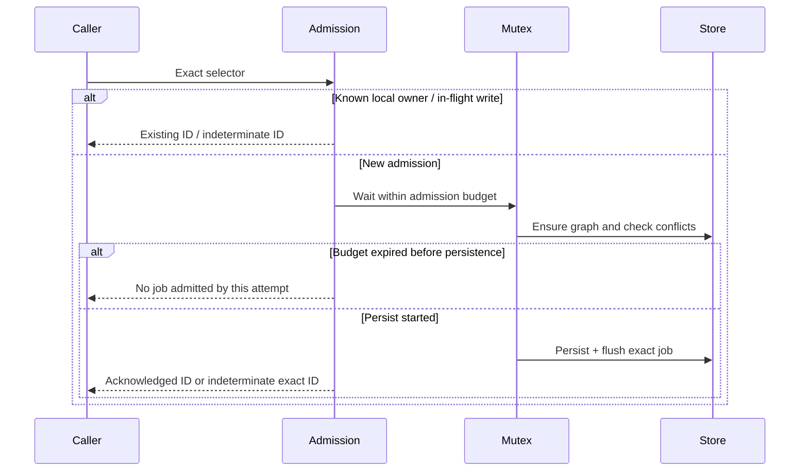

# Issue 3331: bounded async share admission and reconciliation

Status: PR #3358 open; remote reviewer converged; live validation passed; CI assertion alignment under verification. Owner: Codex. Base: `testnet-canary` at `b82918e8e8e40cdc30aa0e6d32ad4119e3d6c985`; branch `codex/3331-share-admission-pressure`.

## Outcome and evidence

Async SWM admission currently waits without an operation deadline behind a graph-wide mutation mutex, then performs graph setup, conflict lookup, persistence and flush. Replays repeat this path; status/list also take the mutex. A caller can disconnect while admission continues. Nested store errors reach the generic HTTP mapper, whose `not_started` describes one store operation, not the admission transaction. The intended result is bounded, truthful admission responses and prompt reconciliation of a locally known owner without relaxing durable conflict checks.

[Issue 3331](https://github.com/OriginTrail/dkg/issues/3331) establishes a conflict-query scheduler timeout in case B and a late successful admission in case A. It does **not** identify case A's slow phase or prove that catalog reads caused both failures. Current code retains these mechanisms after #3300 (durable synchronous sharing) and #3341 (partial-seal recovery). Related [2893](https://github.com/OriginTrail/dkg/issues/2893) concerns producer pressure and [3270](https://github.com/OriginTrail/dkg/issues/3270) concerns fresh graph-prefix queries; neither justifies bypassing validation or increasing store capacity here.

Primary context: `packages/publisher/src/async-promote-queue-impl.ts`, `async-promote-ownership.ts`, `bound-promote-job.ts`, `subject-atomic-write.ts`; `packages/agent/src/dkg-agent.ts` (`promoteAsync`); `packages/cli/src/daemon/routes/knowledge-assets.ts` and `knowledge-assets-async-share.ts`; `packages/storage/src/store-priority-scheduler.ts` and `store-operation-outcome.ts`.

## Decision and invariants

Preserve the mutation mutex and durable conflict query for every **new** admission. Add an admission coordinator scoped to store object and control graph, with a bounded number of pending operations and bounded positive owner observations. A positive observation can only return an existing job handle; it can never authorize new work. Queue writes/clear invalidate the observation before mutation and refresh it only after persistence and flush are acknowledged. Terminal ordinary jobs are not active owners; failed bound obligations remain owners under #3300. Cache expiry/eviction, a fresh process and unknown selectors fall back to the durable check. External store changes remain authoritative; cached replies are explicitly observations, not fresh job state.

A 10-second queue-admission deadline includes lock wait, graph initialization, conflict lookup and persistence. Before persistence starts, expiry prevents the operation from subsequently writing a job. Once persistence starts, expiry or any write/flush error is indeterminate and retains the exact tentative job ID; it must not claim non-admission from an inner scheduler error. In-flight same-selector requests share the admission attempt instead of adding another conflict read. Once known, the owner handle can be returned without the congested mutex/store path. Retain bounded pending entries until underlying operations settle so timeout cannot build an unbounded detached lock backlog.

The queue budget begins after HTTP authorization, context-graph readiness and selected-author resolution. Those checks remain mandatory and can independently fail; do not claim a whole-HTTP 10-second SLA. HTTP errors expose the admission phase and outcome with their scope, and safe replay/observation guidance. Successful response remains compatible; existing-owner response remains 409 with `existingJobId`. No new durable format, caller key, chain operation, concurrency setting, reserved scheduler lane, or automatic retry is introduced.

Alternatives considered: raising timeouts/concurrency hides overload and violates scope; moving admission to reserved health/ACK capacity steals capacity from critical work; removing read locks breaks non-atomic fallback visibility; selector-only durable idempotency would confuse a new WM version with replay; a separate durable admission database is a much larger migration. The selected approach bounds uncertainty while preserving current ownership and recovery semantics. Its main limit is that cold/restarted or evicted observations still need the store and can reject under pressure.

## Execution and verification

1. **Characterize (lead):** real queue with delayed graph, conflict query, write and flush; demonstrate late admission after caller timeout and replay blocked on unrelated queue work. Save failing-before evidence. Exercise the real scheduler separately to distinguish queue wait from admitted execution.
2. **Queue implementation (lead):** extract bounded admission state/deadline and sanitized phase timing into small modules; integrate with enqueue, acknowledged job writes and terminal clear. Keep synchronous bound admission and its recovery invariants intact. Test contention, same-selector replay, snapshot isolation, failure before/during/after persistence, cancellation, multiple queue instances, distinct stores, capacity/expiry, restart, legacy lanes and failed bound owners.
3. **HTTP integration (lead):** shared typed admission-error renderer for live and standalone async-share routes; map before generic validation/store errors. Test wire evidence and unchanged 200/409 behavior, including nested `not_started` after commit. Preserve authentication and author selection. Document budget, observation lifetime, restart limitations and reconciliation.
4. **Local verification and PR (lead, independent remote reviewer):** run affected publisher/CLI tests, durable bound-owner regressions, runtime build, lint and file-size checks. Inspect actual diff size before submission; expected one cohesive PR roughly 500–900 authored lines, with split reconsidered near 1,000. Open against `testnet-canary`, attach, and use github-pr-driver full review collection and bounded review rounds. No merge authorized.
5. **Live validation after convergence (lead):** prepare a separate live run plan using dkg-testnet. Claim an available wallet batch before use; use a new isolated home/ports and real Blazegraph. Run sustained concurrent synthetic share/publication load without increasing ordinary concurrency. Record counts, incomplete work, admission phase durations and scheduler queue/admitted timings without payloads or credentials. Include lost-response same-selector replay, known-owner reconciliation under pressure, no duplicate jobs, terminal/recovery/cleanup regressions and publication progress. Compare a bounded baseline where feasible; report any unrelated chain/quorum blockers rather than counting them as passes. Stop only owned resources and release claims after quiescence/nonce checks.

## Review, recovery and completion

Self-review (not independent): concurrency and admission evidence require tests at the write/flush boundary, not just HTTP error assertions; observations must never admit a new job or survive local terminal clear; timeout must prevent late pre-write mutation and cannot release the integrity lock while writes are in flight; observations/pending operations require hard memory bounds; auth checks stay ahead of any cached reply. These constraints are included above. Independent remote review is required before live validation.

No durable schema migration is needed. Rollback removes the admission wrapper/observations while retaining existing RDF jobs; uncertain jobs remain inspectable/recoverable through native queue semantics. Do not clear or retry an ambiguous job automatically. Completion requires current-head reviewer completion, required CI, and recorded live evidence for the issue and relevant regressions. A testnet infrastructure blocker must remain an explicit limitation, never be relabeled success.

## Execution evidence (2026-10-18)

- Four characterization tests failed against the unmodified queue (unbounded pre-write/persist waits, replay blocked by unrelated locked read, and nested post-commit `not_started` leakage). The same tests pass after implementation.
- Queue regression group: 140 passed across admission (18 at that run), queue behavior (95), atomic writes (7), terminal clear (17) and format-3 compatibility (3). Two additional observation-capacity/telemetry tests subsequently passed with all 20 admission tests.
- HTTP/worker/durable synchronous group: 126 passed (4 admission route, 36 error mapping, 14 supervisor bookkeeping, 72 durable synchronous sharing).
- Bound lifecycle ownership: 23 passed, including the new failed-bound-owner cache regression.
- Runtime packages build, lint, and file-size guard passed; a final runtime rebuild follows the last small coordinator/diagnostic edits. No scheduler priority/concurrency change or durable format change.
- Self-review added three material protections: canonical atomic `replaceSubject/not_started` is usable only at the primary persistence boundary before flush; uncertain admissions also fence synchronous/explicit/automatic reactivation paths; deadline telemetry distinguishes response expiry from eventual store completion. Fresh external status reads invalidate stale observations, while absent rows do not erase unresolved write uncertainty.
- One cohesive PR: approximately 700 authored lines including tests, documentation and this plan. Splitting the coordinator, HTTP evidence and tests would separate the safety contract from its validation; keep them together. Remote independent review and live testnet evidence remain outstanding.

### Remote review round 1

All four reviewer threads were actionable. Admission errors now carry `partialDisposition: unavailable`, so one-shot create/share returns the original scoped 503 and never continues to optional publication. Pending and durable ownership share one activation-conflict lookup (including lane/exclusion handling). Primary persistence and flush return explicit evidence through `persistPromoteJobWithEvidence`; ordinary worker writes still throw their original causes. Tentative job identity is no longer cleared to encode outcome.

New real-queue tests cover inline admission, explicit recovery and automatic recovery against retained uncertainty with no visible new row, plus competing status/claim operations after both write and flush deadlines. HTTP tests cover one-shot creation with and without optional VM publication. Validation: 147 queue tests, 128 HTTP/worker/durable tests and 23 bound-owner tests passed; publisher and CLI compilation, lint and file-size checks passed. Remote re-review and live validation remain outstanding.

### Remote review round 2

A validated terminal clear now reconciles retained admission uncertainty before deleting the supporting durable record. Absent, malformed, mismatched-ID and unknown-state rows do not settle uncertainty. The new regression commits a job, loses its flush acknowledgement, completes it through an independent store handle, then clears directly through the original queue and successfully admits the selector again.

The admission model now has private discriminated pre-persistence/persistence state, a `beginPersistence(jobId)` transition, and immutable discriminated error evidence. Indeterminate evidence always requires its original handle; HTTP rendering narrows that same evidence. Compile-time negative fixtures reject missing IDs, inappropriate phases, non-admission with a handle, and public mutation. Validation: 151 queue tests, 128 HTTP/worker/durable tests, 23 bound-owner tests, publisher/CLI compilation, negative type fixtures, lint and file-size checks passed. The expanded diff remains one admission/reconciliation contract; type, terminal-clear and HTTP integration tests belong with the implementation rather than a separately mergeable partial fix.

### Remote review round 3

Added the missing primary-write regression: `replaceSubject` commits, then surfaces a nested query `not_started` error. The real queue retains indeterminate evidence and the persisted ID across immediate replay and authoritative read, with exactly one write and one durable job. The canonical primary `replaceSubject/not_started` rejection/retry test remains. All 30 admission tests passed; no production behavior changed.

### Live validation and CI follow-up

Remote review completed without findings on `b63a71d5b`. The subsequent isolated native macOS/Blazegraph/Base Sepolia run passed: delayed persistence plus caller disconnect retained one handle, competing pre-write timeout never wrote late, 32 concurrent 61-triple shares completed, and four VM publications finalized with matching chain roots/membership. Canonical payload, terminal clear/new admission, actual daemon/store restart and fresh post-restart sharing passed. All ten transactions were reconciled, owned resources stopped and batch released. Original Gnosis coverage and naturally reproducing the conflict scheduler timeout remain explicit limits.

The full CI sweep found one existing CLI route assertion still requiring fresh-active wording for a positive owner observation. Update it to require `observedAdmission: true` and the intentionally qualified wording, while retaining the 409 and exact owner-ID assertions. Production code is unchanged from the live-tested commit. Current-head review and CI must be confirmed again.
