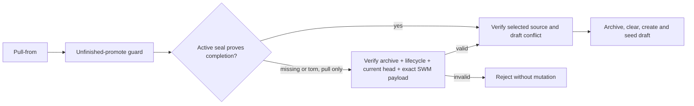

# Issue 3332: recover interrupted WM pull-from

Status: In progress. Owner: Codex. Base: `testnet-canary` (user requested), initial SHA `2361a863d`. Branch: `codex/3332-partial-seal-recovery`.

## Executive summary

An interrupted active-seal clear leaves a completed SWM asset unable to reopen: the unfinished-promote guard reads only the active seal before the existing archive loader runs. Add a narrowly scoped recovery check for pull-from, proving the archived commitment against the exact completed operation and current SWM head before any mutation. Preserve ordinary mutation guards and draft conflict handling. The main risk is admitting a stale or unrelated archive as authorization.

## Evidence and analysis

- [Issue 3332](https://github.com/OriginTrail/dkg/issues/3332) reports v10.0.24 missing the first four seal predicates while retaining the complete private archive. Its store-timeout attribution is correlation, not proof. No issue comments at investigation time.
- `packages/publisher/src/dkg-publisher.ts`: pull-from calls `assertNoUnfinishedAssertionPromote` before `loadAssertionSeals`; clear/archive use sequential predicate deletions. The loader already tolerates torn candidates, but is unreachable in this failure.
- `packages/core/src/assertion-seal.ts`: missing root yields no seal; other incomplete shapes may throw.
- `workspace-resolution.ts` provides strict, snapshot-consistent head/operation decoding, including equivalent operation aliases and corruption detection. Reuse it rather than add a permissive metadata query.
- `BlazegraphStore.replaceSubject` uses a single transactional update. An atomic clear alone cannot repair historical partial clears and cannot atomically cover subsequent lifecycle/WM/private writes through the existing interface. Prefer safe resumption without a storage API redesign. Verify real Blazegraph behavior, rather than relying on the adapter comment alone.
- Existing pull-from tests cover dirty drafts, source integrity and archive reuse after completed pull/discard, but do not inject interruption during clear. Regression window beyond the reported release remains unproven.

## Design

Only pull-from may request archive-based completion proof when its active seal is missing/torn. Require a complete v2 archive, selector/lifecycle identity, surviving active seal fields consistent with the archive, a completion marker, a strict current head matching KA/version and operation (or a clean consumed lifecycle pointer), matching public digest/count and private commitment/count, and validated exact public/private SWM source. Never accept missing metadata as generic authorization. No archive fallback for create/write/discard.

After proof, existing source selection and conflict checks still run before archive/clear/draft replacement. A normal retry is the recovery action; SWM-share cannot repair a removed active seal by itself. Genuine unfinished shares continue to use the existing share recovery response.

## Work and acceptance

1. **C1: deterministic reproduction and implementation.** Owner Codex. Add failure injection at every active predicate deletion boundary, including fully cleared before create; recreate publisher to remove in-memory state. Assert the original failure before the fix, then successful exact public/private recovery. Add negative tests for tampered archive, operation/digest mismatch, newer head, missing marker and dirty draft. Keep authored code/tests cohesive, target approximately 500 changed lines.
2. **C2: real store validation.** Owner Codex, after C1. Run the same behavioral matrix against an isolated real Blazegraph namespace; include actual container restart and archive-write failures. Preserve stage-attributed evidence without payloads/signatures. Build runtime and run affected publisher tests, type checks and repository lint checks.
3. **C3: PR/review.** Owner Codex, after local checks. Open one PR into `testnet-canary`, attach it, identify/request the remote reviewer, collect all comments/reviews/threads/checks with pagination. Address up to ten response rounds; observe each substantive revision for up to 30 minutes at two-minute intervals. Do not merge. Track head, deadline and rounds here.
4. **C4: live testnet.** Owner Codex, after review changes stabilize. Follow dkg-testnet macOS runbook, claim a prepared batch, isolate home and ports, disable auto-update, check native SQLite and signer balances. Use real Blazegraph for this issue-specific scenario. Create/finalize/share a synthetic named KA, verify source/head, inject clear interruption and restart, retry and compare exact public/private content. Exercise normal next-version lifecycle and relevant async VM publication/readback if network prerequisites allow. Reconcile jobs/transactions, stop owned writers and release only when quiescent. Save sanitized report in `run-reports/` and raw evidence outside tracked files.

## Review and operational limits

Pre-implementation self-review: narrow the exception to pull-from; compare remaining fields to prevent a newer draft being mistaken for an interrupted clear; strict head decoding prevents superseded/ambiguous operations. Validate source before mutation, and assert negative tests preserve storage. Remote reviewer supplies independent implementation review. No subagents assigned.

No schema migration or new wire contract. Rollback retains existing data formats but reintroduces inability to retry old partial clears. Do not reset operator state or remove genuine promote intents. User authorized PR/review and live testnet transactions, not funding or merge. If a store/network prerequisite fails, preserve evidence and resolve setup where possible; report the exact boundary rather than claiming a pass.

## Execution ledger

- Dependencies installed with pinned pnpm; runtime build in progress.
- Wallet pool configured; Docker available; no batch claimed yet.
- C1 next: write regression and demonstrate pre-fix rejection.
- Review rounds: 0. PR/head/deadline: not yet submitted.

### Review and validation update

- PR: https://github.com/OriginTrail/dkg/pull/3341. Initial head `647eb2a9b`; remote reviewer expected from repository PR automation (`otReviewAgent` / `branarakic-agent`, as observed on recent merged PRs). Initial observation deadline 2026-10-18 00:43:38 Europe/Belgrade.
- C1: pre-fix regression fails at four deletions with `KA_PROMOTE_RECOVERY_REQUIRED`; fixed matrix passes 69 tests. Focused promote/create regression group passes 140 tests. Runtime and publisher builds, SQLite construction and lint pass.
- C2: real Blazegraph passes the 66-case matrix and 3 archive/consumed-pointer cases; additional container restarts at boundaries 4 and 34 pass. A real multi-statement DELETE/INSERT followed by failing LOAD rolled back to the original subject, confirming backend transaction support. Safe resumption remains required for legacy partial clears and subsequent multi-step draft seeding.
- Round 1 (CI): file-size guard rejected growth of the publisher monolith. Extracted the recovery proof and existing payload validator into `assertion-seal-recovery.ts`; build and file-size guard pass. No storage-policy change. Revalidate focused tests and push this cohesive revision.
- C4 prepared: batch-1 claimed for `issue-3332-20261018`; isolated `.scratch/3332/home`, API 19233, Blazegraph 18999. Base Sepolia 84532, expected Hub/token verified, auth 401/200 verified, four peers connected. No scenario transactions submitted yet. Claim remains held.
- Recovery contract: rejection on an already seeded draft remains intentional. A lost success response does not make `onConflict=reject` idempotently return success; verify both public and private drafts before deciding materialization completed. No new read-only recovery readiness API is introduced.

### Remote review round 2

`otReviewAgent` reviewed `ad450b504` and identified two valid issues: the newer-head fixture was merely corrupt, and recovery discarded verified data before repeating source reads. Added a coherent version-2 head/operation with unchanged content and consumed lifecycle pointer; strict resolution succeeds and pull rejects unchanged storage. Removing only the version comparison makes this regression fail. Recovery now returns a typed seal/scope/normalized payload; SWM consumes that proof once, while VM validates its own source. The new VM mismatch/read-count test and reviewer cases pass on embedded Oxigraph and real Blazegraph. Pull suite: 71 passing tests.

Live daemon test reproduced four committed deletions after native async share succeeded (attempt 1/5), preserved the archive/source, restarted daemon and Blazegraph, then recovered exact public/private data. A second pull correctly returns draft conflict; editing and re-finalizing works. Unpublished mint drafts intentionally retain assertion version 1 until VM confirmation.

A subsequent finalized-unpublished-edit -> discard -> pull failed with a source count mismatch. A deterministic characterization against unchanged base `2361a863d` reproduces the same failure (3 sealed vs 2 SWM triples), so this is a pre-existing adjacent archive/discard defect, not introduced by this fix. Preserve and disclose this limitation rather than resetting live fixture metadata or claiming the whole lifecycle is regression-free. Final live fault/restart proof will be rerun on the reviewed revision using a fresh synthetic name.

### Final implementation/live validation

- Code head `40521b894`: both remote findings addressed and replied with evidence; review threads resolved after fixes were pushed. Re-review requested. Round count 2; observation window for that revision ends approximately 2026-10-18 00:55 Europe/Belgrade (exact timestamps in ignored review-state evidence). Documentation updates do not reset it.
- Final full publisher suite passes 2,211 tests / 120 files. Real testnet fault/restart replay on that code passes exact public/private equality and conflict preservation.
- [Sanitized live report](../../run-reports/2026-10-18-issue-3332.md) records setup, reproducible harness, checks, baseline limitation and cleanup.
- Both live share jobs succeeded; zero VM jobs or pending finalizations. Daemon/store stopped, ports closed, all nine signer nonces unchanged with pending=latest, batch-1 released. No monitoring automation created.
- Remaining: confirm remote re-review and required CI gates on the final PR revision; inspect all threads including resolved ones for new feedback. Do not merge.
