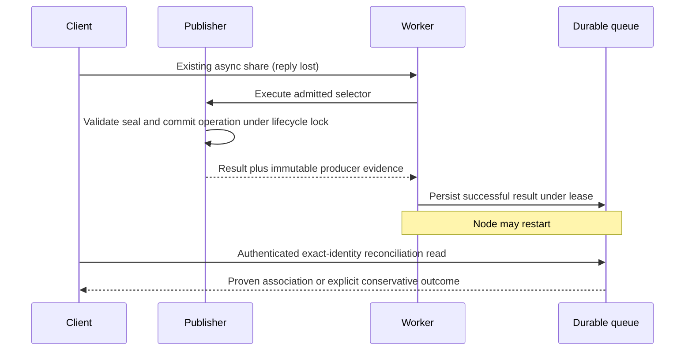

# Issue 3388: durable association after lost share replies

Status: implemented; local validation in progress, remote review and live validation pending. Owner: lead agent. Branch `codex/3388-share-reconciliation`, base `testnet-canary` pinned at `693be6317`. User authorizes implementation, PR creation/review convergence and live testnet validation; no merge authorization. High risk: an incorrect positive association could authorize a client to act on the wrong private asset or share epoch.

## Outcome and evidence

[Issue #3388](https://github.com/OriginTrail/dkg/issues/3388) is a capability request, separate from admission latency #3331. Current canary still persists ordinary requests with context/name/lane/selector, but successful `PromoteResult` contains only count/time; `runPromoteJob` discards the publisher's operation ID. The producer knows the validated immutable seal and operation under the lifecycle lock, but neither reaches durable queue result evidence. The flat HTTP job view omits lane and immutable identity. List results are capped and not completeness-certified. These observed boundaries explain why joining a descriptor to a same-name succeeded job is not proof.

#3331 is already delivered by merged PR #3358 (base testnet-canary, final head 58bb29d77, merge f3b33cffb, 56 successful checks and six skipped). Its live/report audit is retained in the original checkout; do not create a duplicate PR or alter that work.

Desired behavior: a client retains the exact finalized native KA identity, assertion version, content root, author, storage lane and full/partial/subgraph selector before sending a share. After losing all share replies, it makes an authenticated read-only reconciliation request. A positive result binds one retained queue job to producer-owned immutable completion evidence, including the actual share operation. Restart does not remove this evidence. Nothing in reconciliation enqueues/retries work or treats absence as non-admission.

Current context: publisher `assertionPromoteUnlocked` validates the complete graph-scoped seal and persists immutable operation metadata under the lifecycle lock; atomic KAs reject partial entity shares. Agent `internal/promote/durable-assertion-share.ts` passes only a subset of producer results upward. CLI worker persists success using the current lease. Queue serializes the job as one subject payload. Existing read authority is context-scoped; new proof reads must additionally enforce the exact agent lane.

## Selected approach and boundaries

Add versioned, producer-created completion evidence to the promotion result. Construct it from the actual validated seal and operation inside the publisher lifecycle lock after successful durable completion, propagate through agent/worker, and persist alongside the job's successful result under its existing lease. Do not derive evidence from a later mutable descriptor, client correlation metadata, timestamps, or a name-only join. Preserve all existing admission/ownership/recovery behavior and scheduler capacity.

Add a separate bounded, read-only reconciliation query and authenticated API/SDK method. Require an exact expected identity: context, assertion name, storage lane, signing author, native KA UAL, assertion version, Merkle root, explicit entity selector and optional subgraph. Return the producer seal digest and share operation ID as association evidence. A client may supply an expected operation ID if already known; it is a filter, never authority. Exact epoch/version and content must match. Two independently retained matching job records are ambiguous even if their operation/content is identical.

Read canonical queue payloads with their subject identity; do not reuse list(), which drops malformed records and silently slices. Bound the query and read budget, report an incomplete inventory if the cap is reached, detect duplicate/conflicting payloads and unknown evidence versions, and never claim uniqueness from a truncated/failed read. Positive results require a complete considered inventory, exactly one matching succeeded job with strict producer evidence, no competing unresolved/legacy candidate for that selector, and matching request/evidence scope. Return conservative discriminated outcomes for absent-or-pruned evidence, unsupported legacy records, unfinished jobs, mismatched identity, conflicting/ambiguous candidates, incomplete inventory and unavailable storage. Every outcome states that it does not authorize a new mutation. Retention expiry cannot be distinguished from never-admitted work after all records are deleted; explicitly say absent-or-pruned, never invent a tombstone or non-admission verdict.

Completion evidence uses its own schema version and is additive to the existing queue record. It does not change replay authority or the queue recovery format. Verify old readers tolerate the optional field; malformed new evidence is unprovable, not silently upgraded. Existing jobs without producer completion evidence remain diagnostic-only, including older bound jobs; do not backfill them by guessing from current content. Pending/crashed jobs without completion evidence cannot yet prove a completed association and remain explicitly unproven. No-op VM paths without an actual proven operation must not fabricate evidence.

Alternatives: adding lane to the flat view is insufficient because content/epoch/operation remain unbound. Caller-generated correlation alone only proves an echoed request, not what executed. A second durable correlation ledger would add cross-record atomicity/retention and recovery duties. Producer evidence in the existing atomic result preserves the architecture and associates actual execution, with the accepted limitation that older or incomplete results require operator confirmation.

## Execution and verification

1. **Characterization and contract (lead):** add real-store regression tests showing the present success record lacks association evidence; test exact query identity/schema and pre-change failure. Inspect native UAL/author normalization and finalize fields before fixing the wire contract. Save evidence under `.scratch/3388`.
2. **Producer and persistence (lead):** small evidence module in publisher, producer return in dkg-publisher, propagation through agent promote and CLI worker, optional typed result field. Test real producer-to-queue flow, serialization/reinstantiation, failed bookkeeping, absent proof on unproven no-op, malicious extra request metadata not copied, mismatched request/evidence refused. Preserve existing bound-owner and admission tests.
3. **Reconciliation and API (lead):** dedicated strict query module, queue/agent method, GET collection reconciliation route dispatched before job IDs, SDK method and documentation. Authorize context then lane before reading records. Operator may select a lane; agent token cannot query another lane even in a readable graph. Avoid leaking rejected candidate IDs/metadata. No changes to existing diagnostic list scope as part of this capability.
4. **Acceptance matrix (lead):** (A1) lost response + real store reopen + exact association with zero second enqueue; (A2) other lane/author, earlier version, different root/UAL, partial and subgraph mismatches; (A3) multiple matching jobs, malformed/forged/echo-only metadata and duplicate payloads; (A4) terminal pruning, bounded inventory and typed unavailable reads; (A5) legacy records and context/lane authentication. Test real HTTP dispatch and SDK decoding, not just pure predicates. Mutation-check critical comparison/producer-provenance guards where practical.
5. **PR and independent review:** build runtime, affected publisher/agent/CLI suites, type/lint/file-size and CI checks. Estimate 700–1,000 authored lines for this cohesive producer/storage/read/auth contract; review actual size before submission and split only along independently sound boundaries. Open against testnet-canary and use complete paginated remote review collection, at most ten response rounds. Remote review provides independent correctness/regression assessment; local design review is self-review only.
6. **Live validation:** save detailed platform run plan after implementation/review; claim an available testnet wallet batch using dkg-testnet, isolated node home/ports and real Blazegraph. Finalize exact intended assets, discard enqueue replies, let jobs complete, restart actual daemon/store, reconcile by exact native identity without posting a second share. Verify one retained job, operation binding, negative lane/version/content/subgraph cases, pruning/legacy conservative outcomes and publication/readback progress. Reconcile jobs/nonces, stop only owned resources and release claim. Record synthetic transport faults and chain/network limits honestly. Add full devnet regression coverage where changed execution/persistence warrants it; preserve raw pre-existing failures.

## Self-review and recovery

Design lens: identity must come from execution, not request echo; ordinary requests can outlive draft changes, so proof records the actual validated seal. Security lens: context membership is insufficient for private lane metadata; require caller-lane equality before querying. Concurrency lens: evidence must be captured inside the publisher lock and stored with the leased queue result, not read afterward from mutable lifecycle state. Validation lens: list cap, malformed rows and legacy data must defeat a positive uniqueness claim; tests must prove no hidden mutation. These are material design constraints, incorporated above. No independent plan reviewer has run; remote implementation review remains required.

Rollback removes the optional evidence/read surface without changing queue execution format; existing share jobs remain inspectable. It cannot recreate evidence for pruned/old jobs. Do not clear an uncertain job or publish again to make the test pass. If producer proof cannot be kept atomic with its actual operation, or current finalize identity cannot distinguish epochs, stop that implementation chunk and revise this design.

## Resources and next action

| Resource | Owner/purpose | Cleanup condition |
|---|---|---|
| Existing managed task checkout | This chat; reused clean checkout for #3388 after all prior networks stopped and evidence moved out | Preserve new source/report/evidence before archival after review/live completion |
| `.scratch/3388` | This task; reproductions, review and live receipts | Retain useful evidence; no credentials in commits/public artifacts |
| Prior #3362 evidence outside this checkout | Completed prior task | Preserve; not disposable in this task |

Characterization failed before the change: worker success discarded producer evidence. The new real-publisher test proves committed graph identity, durable queue reconstruction and stable operation evidence on replay. Initial validation: 232 publisher queue/admission/recovery/reconciliation checks and 233 CLI SDK/route/auth/worker checks passed. Full runtime build passed, followed by a fresh runtime package build after extracting collection routing and query formatting. Lint and file-size checks pass. Broader worker/recovery routes and malformed-evidence checks are running; remote and live validation remain pending. Raw local logs are under `.scratch/3388`.

Implementation self-review: retained-inventory uniqueness is deliberately narrower than historical request uniqueness. Documentation makes that boundary explicit, keeps `mutationRetryAllowed: false` on every result, and documents SDK HTTP errors, legacy/no-op evidence and pruning. Share-job routing was mechanically extracted before adding the reserved reconciliation read; existing route tests cover collection behavior. No queue admission/recovery policy, scheduler slots or wallet behavior changed.

### Submission checkpoint

All targeted failures are resolved. The broad CLI group passed 365 checks with one strict old-result assertion failing; the updated assertion now checks the actual admitted seal digest/operation and all 94 durable synchronous-share tests pass. The new reconciliation matrix passes 28 tests, including malformed records, unknown versions and mismatched bound admission. Existing VM no-op/supersession checks pass 13/13. Publisher queue/admission/replay group passed 232 checks before the five additional reconciliation cases. HTTP/SDK authorization group passed 233 checks; extracted collection routes pass 36 checks. Full runtime and subsequent runtime package builds passed; final publisher rebuild, lint and ratcheted file-size checks are recorded locally.

Size review: approximately 900 authored changed lines including tests, documentation, the plan and mechanical collection extraction. This is one producer-to-durable-record-to-authorized-reader contract; splitting the evidence writer from strict interpretation/access-control tests would make review less complete. No generated files, keys, raw logs or ignored artifacts are included. Remote response rounds used: 0/10. Current-head review/CI and live validation remain pending.

### Remote review round 1

All six findings were actionable. Reconciliation now shares the queue mutation lock so fallback delete/insert replacements cannot hide competing retained jobs; the raw unlocked reader is no longer exported from the package API. Input is normalized before waiting for the lock. Optional evidence eligibility is computed before commit, and previously supported noncanonical legacy seals complete without evidence. A separate queue-success transition module owns state/lease changes. Agent-owned queue types require reconciliation while standalone queue implementations retain the optional capability.

Tests now use 1,001 real Oxigraph records and retain a valid matching job beside each corrupt candidate. A paused fallback replacement across two queue handles cannot produce an early association. The ordinary missing-reserved-ID seal completes successfully without proof. Five deliberate mutations (unlocked read, missing overflow, silently dropped malformed row, silently dropped unsupported proof, legacy rejection) each trigger assertion failures; sources restored afterward. Negative TypeScript coverage requires the agent capability. Runtime package build (including the new negative agent type fixture), 140 publisher/atomicity/recovery tests, 183 CLI worker/durable/route tests, lint and file-size checks passed.

First live candidate `905ba917e`: a response-dropping proxy forwarded exactly one async share POST; exact association survived a real daemon and Blazegraph restart with identical persisted job/operation/seal. Seven negative identities remained unproven, forged metadata was rejected, anonymous reads refused, six concurrent shares and one-shot create/share completed, two retained matching jobs were ambiguous, and pruning stayed conservative. Two initial publications and one version-two update finalized with successful receipts, matching chain roots/membership and canonical readback. Owned writers are stopped; wallet claim retained for final-revision validation. This is prior-candidate evidence, not a claim that the review fixes have been live-tested.

### Remote review round 2

Re-review caught that the round-one edit missed the package barrel export of the unlocked reader; the earlier statement that it was removed was incorrect. The package now exports only the synchronized queue capability, and a namespace-export regression test enforces that boundary. The internal helper is explicitly named `reconcileRetainedShareUnlocked` with its lock precondition.

A second finding showed a missing context index could hide a canonical competing payload. Discovery now scans all subjects in the control graph, validates each payload/subject/context-index identity, and only then filters by context. The 1,000-row limit consequently applies across the retained queue, exposed as `retained_queue_jobs`; a large unrelated context can make the result incomplete. Missing or inconsistent indexes refuse proof. Tests use a valid match beside the hidden candidate and also cover valid unrelated-context records.

Validation: 128 publisher queue/reconciliation tests and 12 HTTP route checks passed. Three deliberate mutations (re-exporting the unlocked helper, requiring the context index during discovery, and removing the overflow row) each failed their regression assertion; source restored. Lint and file-size checks passed. Runtime package build, including package export and type fixtures, also passed. Final-revision live validation remains pending.

Live revision `717511d8d` completed another lost-reply/cold-restart pass, six concurrent shares, one-shot create/share, ambiguity/pruning, two publications and a version-two update with verified chain receipts/roots/membership and canonical readback. A startup identity assertion initially caught a `-dirty` stamp caused by an untracked local audit report; the report was moved to ignored evidence, the clean revision restamped, and a fresh cold restart passed. These results precede the round-two reader fixes. All six publication jobs across both live passes finalized; writers and the store were stopped for rebuilding, with wallet ownership retained.

### Remote review round 3

The reviewer identified a valid producer/bookkeeping gap: an ordinary request can carry author A while finalization reuses an existing author-B seal. The strict success-evidence check would then reject after the share committed. A new real agent/publisher/queue/worker test reproduced `partial_promote_ambiguity` before the fix. The explicit author expectation now reaches the publisher and is checked against the seal under the lifecycle lock before encoding, confirmation, SWM mutation or gossip. The queue's strict evidence guard remains intact. Existing seal preconditions were extracted into a small helper, reducing the oversized publisher file rather than growing it. The regression now yields a terminal precommit failure, intact WM, empty SWM and no gossip; a matching mixed-case hint succeeds with evidence.

The second finding replaces parallel address/digest/u64 regex definitions with the canonical core scalar validators, retaining lowercase normalization and a positive assertion-version requirement. Tests cover mixed case, zero, leading zeros, overflow and malformed input. All 96 durable-share tests and 140 publisher queue/reconciliation/recovery tests pass. Runtime package build, lint and file-size checks pass. Agent boundary verification and final-revision live checks are recorded before completion.

Revision `8c7c3d7b6` passed the live lost-reply, exact cold-restart, 16 retained-proof upgrade, four ambiguity/pruning and missing-index fault/restoration checks, plus a fresh publication and canonical VM readback. Across the first three revisions: 21 asset heads, 23 versions, 25 completed shares (two intentionally pruned), seven finalized publications and 13 successful reconciled transactions. All nine signers had equal latest/pending nonces; the original batch claim was released after stopping owned writers/listeners. A new claim of the same prepared batch is required before any further signing in this retained home. This is prior-revision evidence after the round-three producer change.
