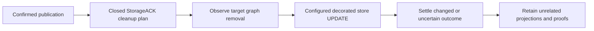

# Issue 3252 — scope post-publication cleanup observations

Status: ready for implementation. Owner: Codex. Base: `testnet-canary` at `abb89dff7`; branch `codex/3252-publish-store-tail`. User authorized investigation, implementation, PR/review and live testnet validation; no merge.

## Executive summary

The original issue is a multi-stage latency report, already partially addressed by merged PR #3253. Current cleanup still issues the known, graph-scoped StorageACK-copy deletion through the agent's opaque UPDATE wrapper. That wrapper invalidates every context-graph projection and recipient-key proof, even when the deletion only touches one SWM metadata graph. Compose this closed operation with an explicit graph removal descriptor, preserving the actual deletion query, mutation decorators and uncertain-write fencing. The expected improvement is fewer unrelated authority reloads and fewer cache fences during publication; end-to-end throughput improvement must be measured, not inferred.

## Evidence and boundaries

- [Issue and latest measurements](https://github.com/OriginTrail/dkg/issues/3252): cleanup, lifecycle stamping and terminal persistence remain material. They overlap; do not add their distributions.
- [Prior PR #3253](https://github.com/OriginTrail/dkg/pull/3253) merged; its all-workload acceptance failed. Existing claim and completion changes must be preserved.
- `published-snapshot-retirement.ts` invokes `clearDischargedStorageAckCopies` after SWM graph removal and before deleting the original operation rows. Its UPDATE is bounded to `input.metaGraph`, retaining newer versions and unrelated assets.
- `context-graph-cache-invalidating-store.ts` treats all raw UPDATEs as `everything`; `ContextGraphMetaProjection.dirtyAll` invalidates every projection; `RecipientKeyRouteFence.begin` rejects otherwise reusable recipient proofs during opaque writes and forces rediscovery afterward.
- Existing `createPublishedNamedKaVmLifecycleWriter` and ledger timestamp writer establish explicit composition without inspecting/unwrapping arbitrary store objects.
- Current scheduler already exports queue-wait/execution histograms by operation and active-operation snapshots. This patch does not duplicate those metrics or increase concurrency.
- [#2962](https://github.com/OriginTrail/dkg/issues/2962) separately tracks incomplete inline finalization. This performance fix must not relax local completion requirements or claim to resolve that defect.

## Approach

Choose a publisher-owned closed cleanup plan (SPARQL, target graph, stable label) and writer type. Direct publisher users retain the existing store behavior. Agent construction composes a writer over its configured decorated storage plus the shared mutation observer, describing removal of any subject in exactly that graph. Pass the same writer into every daemon wallet publisher. Do not trust a caller-provided arbitrary SPARQL string or mutation descriptor. Generic UPDATEs remain opaque.

Alternatives rejected: broadly trusting `touchedGraphs` would let arbitrary callers weaken authority fences; skipping cleanup loses snapshot retirement; increasing scheduler capacity changes host pressure without fixing unnecessary work. Batching more cleanup writes is deferred because it is a separate change and can itself introduce opaque invalidation.

## Work and acceptance

1. **C1 — reproduction/design (lead):** deterministic real-store test proves current cleanup advances unrelated projection/recipient revisions and blocks their reuse. Use actual operation rows and compare complete resulting RDF. Save failing-before output. No production change until this distinguishes old/new behavior.
2. **C2 — implementation (lead):** publisher closed plan/type, default retirement writer, agent composed writer and construction, daemon runtime propagation. Preserve cleanup ordering/deadline, one execution, original errors, graph-index/changelog wrappers, empty input no-op and standalone compatibility. Target one PR below roughly 600 authored code/test lines.
3. **C3 — regression checks (lead):** successful/no-match cleanup; empty input; malformed IRIs; absent capability; before/after-commit errors; graph containing real recipient facts; concurrent key introduction into a pending removal; generic opaque UPDATE; decorated store behavior; actual per-wallet wiring. Run existing cleanup/version/retirement and lifecycle/fence suites, package builds/types and repository static gates. A valid fix leaves unrelated cache identities stable but invalidates affected proofs, including ambiguous writes.
4. **C4 — live validation (lead):** claim an available prepared batch only after native build/SQLite readiness. Isolated macOS home and oxigraph-server, no wallet funding. Verify testnet bindings, balances, auth and peers. Run bounded private graph async VM publications and readback, capture all jobs including failures, exact payload/root/receipt and cleanup metadata. Use matched repeated baseline/candidate cleanup observation experiments under the real daemon to attribute avoided reloads, plus all-job wall-clock results; report small-sample/provider limits. If funds/quorum prevent publication, preserve the boundary and do not call it passed. Additional Blazegraph characterization is desirable because the reported incident used that backend.
5. **C5 — PR and convergence (lead/remote reviewer):** create PR into `testnet-canary`, use non-closing issue link unless full acceptance actually passes. Full paginated comments/reviews/threads/check sweeps, at most ten response rounds, 30-minute observation window per substantive revision. Explicitly request `otReviewAgent` if automation does not. Revalidate affected checks after fixes; do not merge.

## Risks and review

Medium risk: the optimization changes cache/authority fencing. Self-review (not independent) requires that the graph descriptor comes from the exact query plan, real key writes remain fenced, indeterminate outcomes retain graph-scoped uncertainty, and no underlying wrapper is bypassed. Remote reviewer provides independent implementation review. No schema migration. Rollback restores conservative invalidation and reads existing data unchanged. Never suppress persistence or replay an uncertain update.

## Resource ledger and progress

| Resource | Owner/purpose | Cleanup condition |
| --- | --- | --- |
| Existing managed checkout | This chat, implementation/PR | Retain for review |
| `.tmp/3252/` | This chat, isolated home and raw evidence | Stop owned processes, reconcile jobs/transactions, release matching claim; preserve compact evidence |
| `/tmp/dkg-4582-*.log` | This chat, build/test logs | Retain relevant evidence through review |

Native Node 22.23.3 arm64, pinned pnpm install, runtime build and SQLite construction passed on the unchanged base. No wallets claimed yet. Next: failing-before authority invalidation reproduction, then implementation.

## Implementation and validation update

C1–C3 complete. Failing-before evidence: unchanged cleanup advances the unrelated recipient revision from 0 to 1. The composed writer now retains unrelated proofs and keeps real key/uncertain-write fences. The real two-wallet runtime test invokes each publisher's retirement path with the identical configured writer.

Executed: 78 publisher cleanup/retirement cases; 188 agent cases across cleanup, recipient-fence and queued-finalization suites (187 before adding the repeated-arm case); 36 existing lifecycle/timestamp writer cases; 11 CLI runtime/recovery cases. Twelve new cleanup cases pass on embedded Oxigraph and an isolated real Blazegraph server. Repeated control/candidate/candidate/control arms, each with eight warm unrelated projections and four cleanup calls, yield **192 / 0 / 0 / 192** projection reads on both backends. These are controlled cache-read counts, not chain throughput or client latency measurements.

Native runtime build/types, lint, source-size guard and test inventory pass. Source budgets are lowered only for the two changed files whose nearby comments were condensed; unrelated baseline changes from the generator were discarded.

C4 pending: the attempted claim acquired nothing. Both prepared batches are held by other active tasks. No wallet files were copied, no live daemon launched and no testnet transactions sent. User was asked whether another pool exists; otherwise retry ownership after other work. This is a live-validation prerequisite, not a product failure.

Owned `dkg-3252-blazegraph` container (`127.0.0.1:19452`, pinned image digest recorded in report) supplies disposable isolated test namespaces. Tests dispose their namespaces; stop/remove this container after validation/review. An accidentally selected CLI default test config started a local Hardhat fixture; its owned process tree was stopped and the intended unit config rerun successfully. No real keys or network transactions were involved.
