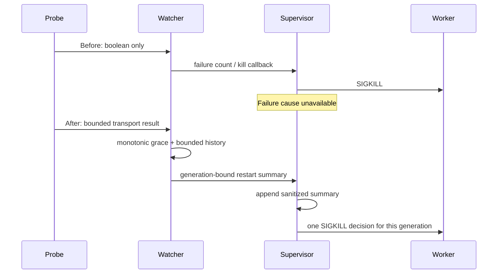

# #3394 — watchdog diagnostics and availability investigation

Status: implementation and live validation complete, with an explicit partial recovery verdict; PR gates tracked on GitHub. Owner: this session. Base: `testnet-canary` at `bec73c5ceacc3fcb36641898511eb173e2d09ed8`, explicitly requested by the user. Branch: `codex/3394-watchdog-diagnostics`. Risk: medium/high because the observer can terminate a worker with in-flight durable work.

## Executive summary

The confirmed defect is that the HTTP liveness probe reduces every transport failure to `false`, and the supervisor discards the distinguishing evidence before restarting its worker. Add bounded, sanitized, monotonic probe observations and a generation-bound restart summary without changing production deadlines, intervals, shutdown grace or HTTP-status acceptance. Investigate availability under sustained synthetic workload and controlled interruption separately: telemetry alone cannot establish or fix the cause of the historical incident.

## Evidence and scope

- Issue #3394 reports exact release `7563618d2`, Blazegraph/Gnosis, five failed probes and an 11.915-second kill-to-listener interval. Historical probe durations, CPU stack, OOM and corruption are not established.
- Current canary's `supervisor-liveness.ts` and `cli-supervisor.ts` are identical to those files at the reported release. Every parsed status, including 401/404/503, intentionally counts as alive.
- Existing tests cover boolean policy, overlap suppression and shutdown grace but discard classification. They also permit repeated kill callbacks for one watcher; acceptance requires one decision per worker generation.
- The existing status API exposes event-loop delay and scheduler/backpressure observations; use these for the owned workload rather than introducing an unrelated metrics subsystem.
- Requested the original private evidence/workload recipe from the deployment session with explicit user authorization. Read only; no deployment mutation or private identity in public artifacts.
- The original checkout and unrelated services/worktrees are excluded. Owned workspace: the isolated `3394-watchdog-diagnostics` worktree. Evidence: `.scratch/3394`; final report: `run-reports/2026-10-21-issue3394-validation.md`.

## Selected approach

Keep HTTP HEAD and native Node HTTP parsing; separate transport observation from watcher policy. A TCP-only probe would miss blocked JavaScript; threshold increases/disabling protection would hide the incident without causal evidence. Broad event-loop/store changes are deferred unless a reproducible cause is established.

The transport result contains only a fixed outcome/class, allowlisted error code, bounded monotonic elapsed milliseconds, connection/header booleans and parsed status. Never retain errors/messages/URLs/headers/bodies/endpoints. Keep the existing boolean helper as a compatibility adapter if callers still use it; production watcher consumes structured results.

The watcher keeps at most eight observations, each with generation, consecutive count and bounded shutdown-grace state. Healthy probes reset the streak. Suppressed shutdown probes remain observable. A threshold trip stops further decisions for that generation; stopped/in-flight results cannot kill a replacement. The supervisor writes structured failure observations and the full bounded restart summary to its existing append-only log before requesting SIGKILL, so the evidence outlives the child. Generation identifiers are generated internally, not taken from private endpoints. Logging must not change restart policy or throw the watchdog out of service.

## Execution and checks

1. **Baseline and private evidence.** Install native dependencies, run existing supervisor/shutdown tests; preserve the issue and baseline source SHA. Read the private diagnostic bundle when located. Record observed evidence separately from hypotheses.
2. **Transport contract.** Implement a structured probe and exhaustive deterministic local-server tests: parsed 200/401/404/503, refused connection, connected/no headers, incomplete/malformed response, premature close, setup/end failure, cancellation, bounded elapsed, no arbitrary error text, one settlement and closed sockets/timers. Establish a regression that fails against the original boolean-only contract.
3. **Watcher/supervisor integration.** Preserve defaults and grace semantics, add bounded history and generation identity, retain success and suppressed failures, ensure one threshold decision and cancellation after stop (including during async shutdown detection). Test real supervisor wiring/log persistence across worker replacement, and privacy/callback failure behavior. Run targeted shutdown, foreground supervisor and recovery suites plus CLI build/types, lint, file-size and changed-line coverage.
4. **Controlled workload and live testnet.** Use an isolated node home, pinned Blazegraph container and claimed prepared wallet batch only after native build readiness. Confirm chain/Hub/addresses/balances; no funding or unrelated profiles. Record exact source/backend/runtime, workload rate/size/concurrency, probe outcomes, event-loop delay, scheduler activity, worker PID/generation and transaction receipts. Attempt the exact release workload where feasible and compare with the PR runtime. A different network/runtime must be disclosed, not called exact incident reproduction. Run sustained share/publication load for at least 10 minutes with sequential and bounded-concurrency phases, canonical readback and updated versions. Inject a controlled worker stall/interruption only in the owned node, retaining one original admission per fixture; reconcile durable job IDs and receipts rather than replay ambiguous writes. Validate healthy probes, restart summary persistence, replacement readiness and interrupted-job recovery separately. If attribution is not reproduced, say so explicitly.
5. **PR and convergence.** One cohesive diagnostics PR to `testnet-canary`; estimate 600–900 changed authored/test/doc lines, reassess actual size before opening. Full paginated reviewer sweeps, grouped fixes and current-head CI/coverage, using the PR-driver's bounded rounds. Do not merge or message other parties without authorization. Use non-closing issue wording if historical availability causality remains unresolved.
6. **Cleanup/report.** Reconcile all active jobs and transaction nonces, stop only owned supervisors/workers/container, preserve raw evidence outside disposable checkout, release wallet claim only after quiescence. Report successful checks, failures, exact reproduction limits, unresolved cause and PR/review/CI state.

## Review and recovery

Distinct self-review passes cover: transport resource retirement and monotonic timing; watcher cancellation/generation races; privacy and bounded serialization; live attribution/admission ambiguity. No independent planning reviewer is claimed. Remote PR review provides independent implementation review. Material pre-execution findings incorporated: shutdown-detector awaits need a post-await stop guard; healthy probes and grace-suppressed failures must be retained; error objects must never enter summaries; repeated callbacks must not target a new generation.

Rollback is the prior runtime; no durable job schema change is planned. Stop/re-plan if the diagnostic path materially changes watchdog timing, exceeds bounded logging, exposes private information, or workload reveals a production cause requiring broader behavior changes. Live interruption retains wallet ownership until transactions/jobs reconcile; missing responses never authorize duplicate mutation.

## Resource ledger

| Resource | Owner/purpose | Cleanup condition |
| --- | --- | --- |
| Managed task worktree | This session; implementation/review | Keep until review and evidence preservation complete |
| `.scratch/3394` | This session; private reproduction and test evidence | Preserve compact useful evidence before disposable cleanup |
| Future isolated node home/container/claim | This session; live testnet | Record exact IDs on creation; quiesce and reconcile before removal/release |

Progress: structured transport results, bounded generation history, cancellation and supervisor logging implemented. Focused regression run: 174 tests passed across six files. Runtime/CLI build, types, lint and file-size checks passed. The initial root-config baseline test attempt was stopped during unnecessary chain setup; it is not a passing baseline claim. Current watchdog code was confirmed byte-identical to the incident release before changes.

Private bundle inspection confirmed the published restart chronology and ambiguous failed responses; it did not supply pre-restart per-probe classes or a causal stack. Subsequent sync activity belongs to replacement startup and cannot establish the preceding stall's cause.

Live setup: isolated `.tmp/issue3394-live`, owned container `dkg3394-blazegraph`, loopback API/store ports 19394/19395, prepared batch-1 claimed as `issue3394-20261021`. The pool is Base Sepolia, unlike the Gnosis incident. Use this as controlled validation, explicitly not exact historical reproduction. No deployment wallets or services will be used.

Review round 1: classify native parser failures before sanitizing their codes; add valid-status/malformed-header coverage; remove the superseded count-only callback. The initial live load ran on `9855f8f72`; the owned supervisor was subsequently rebuilt/restarted on `a2f740ded` for interruption validation.

Review round 2: keep raw monotonic grace expiry separate from formatted diagnostic duration. Ten-minute initial live load and publication/update verification passed; see the validation report. A dirty-label preflight prevented interruption; its admitted jobs were reconciled before rebuilding from a clean commit.

Final validation: the 608.903-second load passed, and the clean runtime retained five deadline failures and one restart summary across actual worker replacement. The interrupted publication recovered; the unbound async share failed conservatively at its unchanged 15-minute lease expiry. This is an existing downstream limitation, not an all-green recovery result. Final inventory: 83 successful / one failed share jobs, 19 finalized publications, 39 successful transaction receipts. Owned node/container/home removed, journal preserved and verified, wallet claim released. Round 3 added a fractional-time boundary regression and demonstrated that reverting the fix fails it; runtime code is unchanged from the live-tested `a2f740ded`. Full results and limitations: `run-reports/2026-10-21-issue3394-validation.md`.
