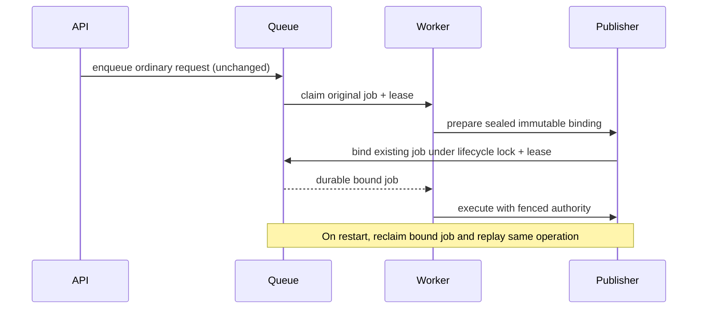

# Recover interrupted async shares under their original job

Status: implementation and local regression validation complete; remote review/live validation pending. Owner: primary agent. Base: `testnet-canary` at `a3dfbe53d`, selected by the user. One cohesive PR; anticipated 450–650 authored code/test lines. High risk: crash recovery, immutable content and stale-worker fencing.

## Problem and evidence

The controlled #3395 live interruption retained an async share with `promoteStarted=true`, `swmInserted=false`, no recovery binding. Its 15-minute lease expired and the queue correctly refused unsafe replay. Read-only inspection found its payload in WM, but that observation cannot authorize arbitrary retries. Synchronous sharing already persists a binding (seal digest, immutable operation intent, inventory obligation) before mutation; `assertion.promoteAsync` only enqueues an ordinary request. The daemon executes it without establishing the same recovery authority. The gap predates #3395. Existing queue/worker tests cover conservative legacy recovery and synchronous bound recovery separately, missing this production async composition.

## Design and alternatives

Keep HTTP admission bounded and unchanged. After claiming an ordinary async job, the daemon prepares its sealed share and atomically binds the existing job under both the publisher lifecycle lock and the current queue lease, before recording promoteStarted or touching SWM. Run through the existing bound executor and recovery policy. This preserves job ID, lane, graph, author, subgraph and immutable operation across retries.

Preparing at HTTP admission would increase latency and bypass the existing admission budget. Relaxing recovery based on coarse outer markers is unsafe because they lag internal writes. Automatically upgrading already ambiguous legacy attempts would invent authority after possible side effects; those records remain inspection-required. No repair of historical failed jobs is included. Older queued records without current version/lane evidence retain their original execution and conservative recovery semantics; only new eligible jobs acquire a binding.

A lease-checked internal queue operation attaches only a binding to a current-format, unstarted, all-entity request with a retained lane. It atomically replaces the row; an uncertain acknowledgement prevents execution and retains the owner for lease recovery. Preparation errors before binding use ordinary failure classification. Already-bound jobs skip preparation; verified completed legacy assets can return their verified no-op result without replaying promotion.

## Execution

1. Add narrow queue binding transition with validation, lease checks and atomic persistence. Reject started/legacy/missing-lane/subset records and mismatched authority. Keep old failure policy unchanged.
2. Add agent preparation/binding method and daemon preparation hook before promoteStarted. Preserve heartbeat, cancellation and uncertain-write semantics. Avoid holding queue lock while acquiring publisher lifecycle lock (publisher → queue order).
3. Test real agent + store + queue + worker composition: kill-equivalent interruptions before/after internal commit, same job/operation recovery, unchanged payload/root; stale claim, binding-write uncertainty, failed preparation and legacy ambiguity. Keep admission and synchronous regression tests.
4. Build/typecheck/lint/file-size checks. Open PR into testnet-canary, request established remote reviewer, respond in bounded rounds; require CI and report maintainer approval separately.
5. Live Base Sepolia run with claimed prepared pool, isolated home and Blazegraph (matches observed backend): ordinary async and synchronous share, publication/update/readback; deliberate whole-worker interruption after durable binding, original job automatic recovery after real lease, no client replay; verify receipts/roots/membership and fresh work. Retain all failures. Reconcile jobs/nonces, stop owned processes/container, release batch, preserve report/evidence.

## Acceptance and safeguards

- Async admission returns existing job shape and does not perform seal/store preparation inline.
- No SWM mutation until binding acknowledgement; failed/uncertain persistence does not authorize execution.
- Original job succeeds after interruption, with identical operation/seal and content; no alternate job or blind replay.
- Expired/stale workers cannot bind or mutate; ambiguous old running/failed jobs stay fenced.
- Scoped token lanes, subgraphs, author identity and inventory requirements remain effective.
- Normal share/publication/update/readback pass; no assertion of global regression freedom or exact Gnosis reproduction.

Self-review (design, concurrency, validation): added uncertainty boundary, strict unstarted/version checks and completed-legacy handling. Independent implementation review will be provided by the remote PR reviewer; no independent plan reviewer used. If preparation requires migration or fails to preserve lock ordering, stop dependent work and revise this plan.

## Resource ownership and rollback

Task checkout: `.codex/worktrees/async-share-recovery/dkg`; scratch `.scratch/async-share-recovery`; keep until PR review completes. Live home/container/batch will be recorded in run state before creation and removed/released only after reconciliation. Prior task evidence and unrelated services remain untouched. No schema bump: bound format-4 recovery is already understood by the base. Rollback does not repair already ambiguous old jobs; those need separate evidence-based operational recovery. No deployment or merge authorized.

## Progress

- Confirmed #3395 merged; closed #3394 as requested with explicit unresolved stall attribution.
- Source diagnosis and preserved prior-run evidence agree on missing async binding.
- Implemented queue transition, agent preparation and production worker hook. 203 CLI regressions and 152 publisher queue/admission/atomicity regressions passed. Removing the production hook reproduces the missing binding in the new integration test. Runtime builds/type tests, lint, file-size and native SQLite checks passed.
- Next: open PR, run isolated live interruption and normal lifecycle checks while remote CI/review executes.

## Review round 1

Remote review found that preparation-only retries inflated the existing first-execution rejection guard. The fix records only a contiguous prefix of current-format unbound attempts whose durable markers prove promotion never started, then discounts that prefix when checking a producer-certified no-effect rejection. Any missing evidence, earlier execution, or bound retry keeps the conservative guard. Manual recovery constructs a new attempt record and drops the prefix. Old readers ignore the additive field and remain more conservative: after rollback they may retain an owner that the new version can retire; re-upgrade to complete that retirement. No old reader gains replay authority. Proven unstarted lease expiry also retains this prefix before markers are cleared. Tests cover safe rejection after two preparation failures and refusal after an additional bound attempt.

The compatibility exclusions now have independent persisted-worker cases (older format with lane, current format without lane). Merged updated testnet-canary `abb89dff7`; resolved only file-size-budget conflict by keeping the stricter budgets. First live campaign continues on its original compiled runtime; rebuild only after it finishes, then repeat the interruption and lifecycle validation on the revised runtime.

Round-1 verification: 113 focused CLI tests and 152 publisher tests passed. Independent legacy exclusions run persisted jobs through the worker. Safe oversized rejection after two preparation failures releases the asset; a prior bound execution prevents retirement. An expired unstarted claim also permits certified first-execution retirement.

## Review round 2

The reviewer identified mutable preparation before the first lease-checked queue write. Preparation now receives the same execution authority as promotion, serializes by job, checks it inside the lifecycle fence, and rechecks before canonical materialization, seal/lifecycle writes and draft cleanup. Publisher preparation/admission cleanup callbacks are also guarded. This preserves publisher-to-queue lock order and refuses expired/reassigned/cancelled claims and shutdown even after lock waits. Real mutable-draft tests hold the lifecycle fence, then expire/reassign/cancel or shut down before releasing it; neither seal nor source removal is permitted. The eligibility gate uses the shared format constant.

Initial live candidate succeeded: original job recovered after the real 900,000 ms lease on attempt 2; all 17 shares and five publications finalized successfully with verified canonical payload/root/receipt. The node is stopped, wallet batch and owned store retained for a second run on the reviewed runtime.

## Review round 3

Added an initially unfinalized draft through the real supervisor and finalizer, with a real ephemeral test signer. Interruption before SWM mutation retains the original bound job; recovery completes it under the identical binding. All 19 recovery tests pass. The revised live runtime is `21b3a3338`; this response adds test/plan coverage only and does not rebuild or alter that running runtime.

## Review round 4

Consolidated fresh-seal and existing-seal finalization into one ordered commit routine: canonical materialization, private content, optional fresh seal, lifecycle pointers, public source cleanup and private draft cleanup. The routine checks authority before each step; lifecycle stamping still checks between its individual writes. Four real-finalizer barriers revoke/reassign authority after materialization or lifecycle stamping, for both fresh and existing seals. The stale worker cannot persist a new seal after the first barrier or clean sources after either barrier; the replacement completes the original payload. All 31 focused recovery/domain tests and 21 abandoned-update/version tests pass. Removing the helper's authority checks causes three new cases to fail; restored-source verification follows. Reduced the large agent file's budget to its new measured size. Finish the existing live run before rebuilding; repeat live validation on this final runtime.

## Review round 5

Centralized compatibility and unsafe-transition eligibility in publisher-owned classifyQueuedSharePreparation. The agent uses it before seal preparation; binding reuses it under the queue lock after lease validation. Already bound jobs bypass preparation, old format/missing-lane jobs preserve legacy execution, and current unsafe marker/subset/blank-lane records are rejected before any seal work. All 27 recovery cases pass, including rejection at both boundaries. Preserve the third live run's pending bound job while stopping/rebuilding to this revision, then verify recovery on the new runtime plus a fresh normal lifecycle/draft matrix. This also exercises a controlled upgrade with a durable pending job, without replaying its request or shortening the lease.

## Review round 6

Repaired the original stale-preparation fixture to use the real finalizer, signer and chain capabilities. A current-authority control completes; cancelled/reassigned/shutdown cases assert the actual preparation promise's authority error, unchanged draft and absent seal. Removing authority propagation makes all three revoked cases fail while the current-authority control passes. Consolidated finalization now executes directly in the shared local routine; removed the callback-only forwarding module while retaining ordering and per-mutation checks. Preserve the pending live job through this final rebuild and add fresh unfinalized, synchronous and repeated-finalization smoke checks before final inventory reconciliation.

## Review round 7

Added leased queued-preparation coverage for verified pre-intent VM assets, with current/revoked authority and with/without leftover WM. The stale preparation directly rejects authority loss, preserves WM and completion evidence, and the replacement completes the same job without promotion replay or binding. Removing graph-deletion fencing or marker-removal fencing separately fails the corresponding revoked case. Restoring source passes all 130 recovery/synchronous-share tests (32 recovery cases). This response changes tests and plan only; the live-tested production tree remains exactly the final routine build `1fa0000ff`. Live validation completed with 73 successful share jobs, 20 finalized publications and three original-job recoveries on attempt two; cleanup and final review/CI remain to be recorded in the external report.

## Review round 8

Flattened publisher preparation bodies into explicit authority checks after lifecycle-lock acquisition and before graph deletion. A named concrete completion-marker cleanup method owns its own check and deletion; removed the generic callback-only check wrapper. Lock ordering and mutation order remain unchanged. Rerun the stale-preparation, mid-finalization, completed-legacy and synchronous recovery regressions, then validate the final production revision with a fresh small live lifecycle run.

### Review round 9 — fence destructive cleanup internally

Pass optional execution authority into canonical-source and completed-legacy scoped-graph cleanup. Recheck after graph enumeration and immediately before every graph deletion, including root graphs. Preserve synchronous callers without authority. Regressions revoke an actual queued claim inside enumeration and after the first deletion; stale workers must not delete further graphs. Rebuild after stopping the live worker and exercise the final revision on the retained isolated testnet home.

### Review round 10 — fence lifecycle pointer internals

Carry optional execution authority through the divergence lookup and pointer delete/insert helpers. Check after the VM lookup outside its fallback catch and before each mutation. Real-store barriers cover revocation during lookup and after deletion for fresh/existing seals; metadata must not change further, and the replacement job must recover. Preserve synchronous callers and validate the final revision with the live lifecycle smoke if a prepared wallet batch is available.
