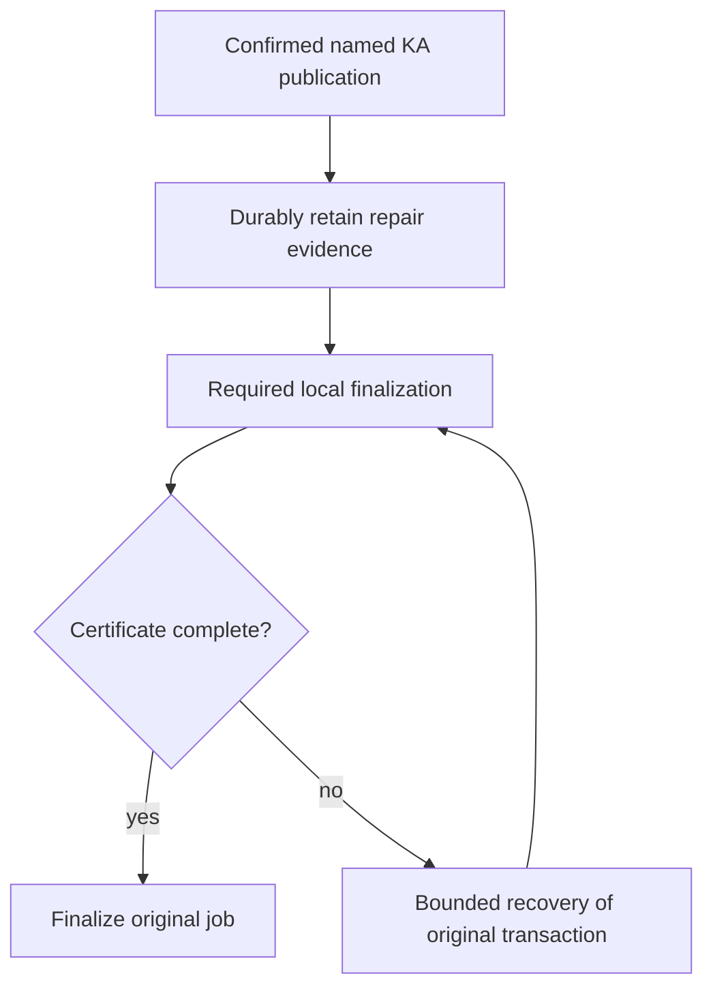

# PR 3017 lifecycle recovery takeover

## Outcome and scope

Take over https://github.com/OriginTrail/dkg/pull/3017 for issue https://github.com/OriginTrail/dkg/issues/2962, including the 2026-10-21 live reproduction. Resolve conflicts with testnet-canary, close remaining correctness and review gaps with regression tests, obtain completed remote review and green CI, then prove recovery on live testnet without a second publication. Report readiness; do not merge.

Initial PR head: 126b02816304417609bc3aa482ba97e3c324336c. Base fetched at f3b33cffb. Original workspace was clean and detached at the base. Working branch is the existing PR branch codex/fix-issue-2962-20261004. No applicable AGENTS.md found.

## Evidence and selected approach

The issue's latest reproduction shows inline named-KA completion terminalizing an uncertified local result after a scheduler queue timeout, while detached completion checks localFinalizationComplete. Current base extracted the queued tail into queued-publish-finalization.ts; the old PR still modifies the previous inline tail. Preserve that extraction and route required lifecycle projection through the PR's durable confirmed repair owner. Enforce the certificate specifically for named-KA completion, retaining raw-lift compatibility. Recover from original chain/receipt/content evidence through bounded durable job recovery, never replay publication to fix metadata.

Use the existing repair journal and publisher job recovery rather than another queue. Maintain deployment binding, per-KA serialization, persistence commitments, divergent drafts, and canonical provenance. Seven open remote threads cover retirement versus admission errors, historical records versus new commands, HTTP projection ownership, bounded repair concurrency, persistence docs, durable replacement reuse, and structured confirmation tails. Read all 61 threads, including resolved history, before replies. Remote reviewer observed: otReviewAgent; trigger/completion discovery remains required.

## Work and acceptance

1. Integrate base (owner: primary): inspect all 19 conflicting files and preserve both behavior sets; install native pinned dependencies. Build affected packages to detect cross-package changes.
2. Fix lifecycle completion (primary): add failing-before inline certificate/recovery tests; check detached success, missing/contradictory authority, cleanup failures, bounded backoff and restart. Assert exact descriptor roots/state/UAL and one original transaction.
3. Address seven outstanding findings (primary): verify each against integrated code, add meaningful regressions, simplify contracts without weakening durability or compatibility. Self-review concurrency, error precedence, and regression coverage in distinct passes; remote reviewer supplies independent review.
4. Validate and submit (primary): focused cohorts, package/type boundaries, lint/source caps/scalability and necessary integration. Inspect ignored paths and change-set size. Update coherent PR description and push normally; no force push. Reply with evidence and resolve addressed findings after checking new replies.
5. Remote convergence: up to 10 response rounds, two-minute sweeps and 30-minute observation window per substantive revision. Record head, deadline and round state here. Inspect all review/comment/check collections, including replies on resolved threads. No readiness claim for unconfirmed review or pending CI.
6. Live testnet (primary): native macOS Node 22/pnpm, configured DKG_TESTNET_POOL, isolated home, claimed batch after native build/SQLite verification. Inject required lifecycle writes failing after confirmed mint/update; restore and verify convergence without another publication, including restart. Cover normal sync/queued paths, divergent drafts and reads. Verify chain deployment, original receipt and version counts. Reconcile pending activity, stop owned writers, release claim; keep sanitized evidence/report.

## Flow

## Risks and review

A journal-retirement failure must retain automatic recovery instead of claiming admission failed. New commands require deployment proof; historical unbound entries remain retained without mutation. Concurrent independent repairs must retain same-KA fences and shutdown drain. Never substitute a second chain transaction for reconciliation. Live tests use only a claimed prepared wallet batch; no funding or production deployment is authorized. Durable storage certification remains strict for filesystem hosts. Rollback of source cannot undo a confirmed chain transaction; retain original evidence until reconciliation is proved.

Planning review: self-reviewed diagnosis, compatibility, durability and operational boundaries. Independent plan review not performed. Source inspection and targeted pre-fix tests will refine the exact implementation before edits.

## State and resources

- Discovery: issue and latest reproduction read; complete remote thread data downloaded (61 threads, no paginated replies); seven open threads enumerated. Historical threads reviewed, including new findings in resolved threads.
- Merge: 19 conflicts resolved; integrated with current base and pushed 9ac3465f0. GitHub reports mergeable.
- Response rounds: round 2/10 in progress. Round 1 head 9ac3465f0 observed from 2026-10-21T10:49:24Z to a planned 11:19:24Z deadline; otReviewAgent completed that revision at 10:56:59Z with five actionable findings. Round 2 groups those findings with CI failures; its next observation window begins only after substantive push.
- Checks: native runtime build passed; agent lifecycle cohort 180 passed; queued tail 61 passed; storage 51 passed; full publisher unit run 2295 passed/22 failed on obsolete fake certificates, followed by all 329 affected tests passing after compatibility fixes. CLI 62 passed plus managed WAL crash test passed on rerun. Graph marker producer regression failed before fix and all 90 affected lifecycle tests now pass. Lint and file-size guard pass. Further CI and live validation pending.
- New gaps closed: inline certificate enforcement, legacy handler receipts retained as tx-bearing work, journal retirement backoff, bounded 4-KA concurrency, explicit historical unbound records, domain/HTTP separation, shared durable replacement, stable journal encoding independent of lock namespace, real promote graph-marker destinations.
- Live setup: batch-2 claimed by lifecycle-recovery-3017-20261021; isolated .tmp/pr-3017-live; ownership .tmp/pr-3017-takeover/live/batch-claim.json. Base Sepolia 84532, authenticated 401/200, Hub/token verified, 7 checked signers funded with equal latest/pending nonces. Setup daemon stopped before exact revision validation. Detached mint KA 107 recovered across restart and inline mint KA 108 recovered without restart, each with original transaction, one chain root, exact VM payload and no extra publisher nonce. KA 108 update is staged for validation after the next commit. Node is stopped while rebuilding; batch claim remains held.

| Resource | Owner | Purpose | Cleanup condition |
| --- | --- | --- | --- |
| Current attached workspace | this task | PR integration | Retain for review/continuation |
| .tmp/pr-3017-takeover | this task | GitHub evidence and test logs | Retain compact diagnostic evidence through completion |
| Native dependencies | this task | builds/tests | Retain while workspace needed |
| .tmp/pr-3017-live + batch-2 claim | this task | live validation | Reconcile transactions and stop owned activity before release/removal |

## Round 2 and reviewability

Remote review and CI identified a tentative-result compatibility regression, duplicated lifecycle projection, repeated recovery ownership resolution, and stale restart/deployment fixtures. Restore no-chain/private-no-ACK/tentative-receipt transitions while keeping confirmed certificates. Consolidate projection, rendering and fallback into one mutation builder; share lock/current-version/commit policy between journal and queue recovery. Resolve ownership once after currency proof under the nonblocking lock. Strengthen restart testing to recover the original job to finalized.

The user authorized splitting into a stack when useful. Retain this PR: approximately two-thirds of changed lines are regression tests; source changes enforce one durability-to-finalization contract across storage, agent, publisher and CLI, and splitting would scatter the established review history. Keep a review map in the PR description. No separate PR is needed merely to reduce line count.

Owned container `dkg-pr3017-blazegraph`, localhost 57500, validates the real Blazegraph backend on native arm64. Remove it after local integration checks; it is not the testnet node store.

Round 2 executed: full publisher unit suite 126 files/2,322 tests passed; repair journal 89 tests passed; consolidated descriptor/lock/graph/policy cohort 92 tests initially exposed three obsolete mutation-count expectations, corrected and 22 projection tests passed; explicit real-EVM restart finalization, stale-promote, private-no-ACK and identityless-wallet cases passed; CLI route suite 122 passed; Blazegraph 2 passed; builds, lint and source-size guard passed.

Round 2 head 1c17a9129 pushed 2026-10-21T11:15:16Z; planned observation deadline 11:45:16Z. All five round-1 remote findings were addressed and replied to. Live update, healthy mint, inline failed-tail recovery and restart persistence passed on this runtime revision. CI exposed the new agent test's relative CLI helper import missing from delta routing; round 3 adds that route and its explicit routing test without changing runtime packages. All 17 routing tests pass. Round 3's observation begins at its substantive CI-fix push.

## Round 4

Round 3 head 4b24df864 completed routing/build checks; the reviewer identified a malformed legacy receipt still able to leave a job validated, plus two explicit-contract improvements. Save a usable transaction hash and flush before result mapping, propagate persistence errors without rolling back an accepted send, and suppress mapping errors only with recorded transaction evidence. Add certified/uncertified regressions that fail on the previous head and reopen disk before closing the original store, then expire the lease and recover without another execute.

Normalize journal and queue admission into one commit description; queue ownership translation stays at the queue caller. Carry confirmed/tentative/verified-descriptor discriminants, explicit workspace policy and one proof-preservation value through the mutation planner. Negative type contracts cover omitted versions, mixed graph coordinates, descriptor misuse and implicit policy. The CI catalog fixture now supplies the queued seal's actual lifecycle deployment before the shared currency check; its real catalog observer and failure cases remain intact.

Live validation through runtime 1c17a9129 passed detached/restart recovery, inline recovery, update recovery, healthy sync mint, readback/root checks and a reopened draft. All owned writers and the temporary Blazegraph container were stopped, and batch-2 was released with nine quiescent signing wallets. Round 4 will revalidate the final runtime after a fresh batch-2 claim. The current live home is retained but must not sign without that claim.

## Round 5: worker replacement certification

Remote review of 998969959 found acknowledged worker writes can be lost before a later flush reaches a replacement worker. Capture a persistence barrier before each lifecycle mutation attempt, bound to the current worker identity. Decorators must capture the inner barrier before their awaited drains; all stale barriers reject after replacement, even if another repair has since committed. A fresh attempt captures the replacement, reapplies its metadata and persists it before journal retirement. Preserve the unscoped commit API conservatively: it cannot certify across worker replacement. Prove the actual failure with a real worker killed while changelog era-guard save is paused, snapshots faulted, durable repair evidence retained, and restart readback after a successful retry.

The same response batch moves certificate policy into a typed named-KA result mapper, removes the shared transition override flag, and changes lifecycle fallback to explicit ordered replacement/removal operations plus append-only provenance. Correct two obsolete callback assertions without changing their shutdown/admission behavior. Validate focused worker/decorator/journal tests, projection equivalence/faults, publisher compatibility, builds and CI before another push. Live validation on 998969959 has completed and its batch is released; final-runtime readback will follow any additional runtime revision.

Round 5 validation: real-worker regression fails on the prior implementation with `repaired` instead of `pending`, then passes after fencing. It confirms metadata was acknowledged and actually lost, retains the journal, retries/reapplies with a fresh barrier, reopens durable data before close, and rejects multiple stale barriers after another writer progresses. Storage persistence/respawn/platform/directory-sync cohort: 34 passed; final focused rerun 32 passed. Agent worker/dispatch/projection/durable-file cohort: 38 passed; expanded journal/lock/process-local/descriptor cohort: 113 passed. Full publisher suite: 126 files / 2,325 tests passed. Builds/types, lint and source-size guard passed. The previous CI matrix's only test failure was the corrected callback assertion; coverage/gate failures were downstream of that failed shard. Batch-2 has been freshly reacquired for final-runtime validation.

## Round 6: one persistence protocol and checked evidence ownership

Make capture required on every certified adapter and remove the unscoped commit API. Stable adapters return their existing barrier; replaceable workers bind each captured barrier to its owner. Decorators capture synchronously before any queued drain. Migrate callers and retain the real worker crash/reapply/reopen regression with multiple stale barriers.

Narrow executor admission to resolved lifecycle author and proof-preservation policy. The executor constructs the applied command from the publication it checked, so admission cannot replace root, version, packed ID or deployment evidence. Add negative type contracts. Register the generated worker regression script with the repository load-closure audit; all 17 routing tests already pass with this declaration. Validate affected storage/agent/CLI cohorts, type contracts and builds before pushing this single response batch.

Round 6 checks passed: storage persistence/platform/respawn/Blazegraph cohort 114 tests; agent worker/process-local/recurring/journal/lock/dispatch/catalog cohort 125 tests; real managed-store WAL/SIGKILL regression one test; builds, negative type contracts, package-root boundary, lint, source-size guard, and all 17 CI routing tests. The real worker regression retains two independent stale-barrier rejections and successful durable reopen after reapply. Live round-5 validation completed and batch-2 was released; a fresh claim will precede final-runtime validation.

## Round 7: required confirmed identity and discoverable worker fixtures

Require the caller-resolved packed KA identity in executable confirmed commands and coordinates. Remove receipt identity fallbacks and impossible deployment-undefined handling from currency checks. Retain incomplete legacy identity/deployment only in historical journal records, which remain pending rather than executable. Verify normalization, old journal migration, synchronous/queued ownership and version fencing with negative type contracts and regressions.

Extract the three child-process worker scenarios and their preload hooks into checked-in fixture modules, passing temporary paths and input via arguments. Preserve built-package imports, real worker execution and crash/reapply/reopen assertions. Remove generated-script load-closure exceptions and validate normal fixture dependency discovery. Round-6 live inline recovery on c3a887636 passed with original transaction, one root and nonce 53→54; restart readback/cleanup is being completed before source rebuild.

Round 7 verification: 150 agent tests passed across journal, identity/evidence, deployment replay, real worker loss, shutdown, lock fences, graph markers and catalog recovery; 24 storage fixture/persistence tests passed. Builds, negative type contracts, lint, size guard and 17 routing tests passed. Legacy records missing either packed identity or deployment are retained without execution; new submissions reject missing identity. Live c3a887636 restart readback passed at block 48408577 for seven assets, six original jobs and both drafts; owned writers stopped, nine signing wallets quiescent, batch-2 released (`batch-release-round6.json`).

## Round 8: target-branch integration

Target testnet-canary advanced to 651607954 (PR #3343 write-preflight attribution) during round-7 review, leaving GitHub conflicting and CI unable to start. Merge the new base; the sole conflict is adjacent additions to the agent unit-test include list. Preserve both the three lifecycle tests and the new write-preflight attribution test. Check the automatically merged CLI test inclusion and routing, then run builds/types, both write-preflight suites plus lifecycle dispatch/lock/recovery, and routing before pushing. No runtime conflict requires choosing one implementation over another.

Integration review found a legacy admission edge: complete matching evidence resubmitted for an identity-less historical record reused that non-executable entry forever. The new regression fails before the fix (`pending` instead of `repaired`). Allow complete normalized evidence to replace a same-version historical entry after the existing root/version checks; unknown deployment records still use a distinct key and remain retained. Recheck deployment replay, journal replacement and lock fencing.

Round 8 checks passed: merged agent/preflight/lifecycle cohort 39 tests; CLI preflight + managed WAL/SIGKILL 23 tests; final legacy replay/journal/lock cohort 112 tests. The new legacy identity regression failed before the change and passed afterward. Agent/CLI builds and type checks, 17 routing tests, lint and size guard passed. The PR-relative diff has no whitespace errors; an existing EOF blank line belongs to the newly merged base.

## Round 9: complete the durability test fixture migration

CI reached 52 successful checks but agent shard 1 found three durable-file tests whose shared fixture omitted the newly required packed identity; fail-fast canceled shard 9. Correct the shared fixture and its wire-format assertion, type it as a confirmed command, and include this file in the agent type-check suite so future contract changes cannot silently leave the fixture stale. Preserve the actual EPERM/EIO fault and ancestry assertions. Runtime source stays identical to the live-validated 19783e1aa revision. Final live evidence passed on that runtime across faulted and clean restarts; all resources are stopped and the wallet batch released.

The fixture audit also found the same omission in the command-contract test, which was in the canceled/uncompleted matrix scope. Type-check both affected files, preserve explicit invalid-wire tests with string-encoded identities, and keep the valid tentative fixture free of confirmed-only fields. Existing negative root/version type contracts now supply a valid packed identity so their expected errors remain specific to the intended forbidden fields.

Round 9 validation passed: both fixture files (23 tests), the expanded agent type suite, lint, and diff hygiene. All runtime source is unchanged from the eight-asset live-validated 19783e1aa head. Previous CI's coverage/gate failures are downstream of the fixture failure and fail-fast cancellation; its EVM, native/platform, publisher, storage, CLI, UI and other completed agent checks passed.

## Round 10: integrate publisher control and respect its new size budget

Target branch advanced to bdcef4c07 with publisher live pause/resume controls and an AskStorage event fix. The clean synthetic merge reduced async-lift-publisher-impl's ratcheted budget to 3747 lines; CI failed that guard before tests. Merge the updated base and extract this PR's named-KA completion/checkpoint logic into a focused module, preserving the outer claim→job lock ownership, pre-mapping durable hash checkpoint, uncaught persistence faults, typed mapping and original-claim fencing. Keep mapping errors distinct from storage errors. Verify full publisher compatibility, new claim pause/resume tests, affected agent/CLI paths, routing/builds/types/lint/size, then revalidate final runtime on testnet. This is the tenth response batch; retain that count across any interruption.

Round 10 also integrates target 23ccf2fd3 (readiness shutdown cancellation and prefix evaluation) with no conflicts. Validation passed: all 128 publisher unit files / 2336 tests, 69 targeted agent tests including real worker replacement and durable-file faults, 60 CLI publisher-control/startup/preflight tests, 27 readiness shutdown tests, builds/types, 17 routing tests, lint and size guard (publisher implementation 3739 lines against 3747 budget). The two type-checked fixture regressions still reach their intended faults. Final live run is in progress on this runtime: one original broadcast retained alongside its repair journal, all six publisher claim gates paused, then restart while the fault remains held.

## Round 11: crash-safe payload certification and catalog recovery

User authorized continued convergence after round 10. Keep one PR: journal, queue completion and store ownership form one completion contract; splitting now creates unsafe intermediate merges. Merge target c1230bc0a (clean, currently staged) without dropping its catalog ownership/private-access/ACK changes.

Confirmed reproduction: after an acknowledged VM insert and failed snapshot, terminate the actual Oxigraph worker. Existing replay removes the journal and publishes lifecycle metadata while VM has zero quads, including a separate reopen before close. Evidence: `.tmp/pr-3017-takeover/payload-loss-diagnostic/result.log`. This invalidates readiness despite the successful nine-asset live timeout/restart matrix.

Selected design: carry the already verified public snapshot and canonical confirmed UAL metadata in the fsynced repair obligation. No private plaintext is journaled. Validate the snapshot's counts/private commitment/root; use the publisher materialization lock and version guard, restore missing/wrong VM data atomically, then stamp lifecycle metadata and commit under one captured worker fence. Preserve existing exact confirmed metadata and newer workspace drafts. Old entries without recovery snapshots may complete only after verifying existing VM content and its confirmed envelope; otherwise remain pending. A fresh complete same-version admission upgrades an old snapshot-less entry. This costs bounded-to-publication payload duplication in the journal; it avoids unsafe reliance on mutable SWM, which confirmation cleanup can already have removed. A new spool format or peer-fetch protocol would be a larger independent redesign.

Implementation owner: lead; independent correctness/regression review: existing remote reviewer. Steps: (1) add snapshot serialization/verification and producer wiring, shared materialization ownership/barrier, with fail-before/pass-after real-worker regression; (2) cover missing/tampered/old/private-commitment payloads, newer versions/drafts, legacy pending and worker replacement; (3) narrow queued stamp request type; (4) fix catalog fixture deployment evidence and run all 12 affected tests rather than raising CI timeout; (5) builds/types/routing/size and affected integration suites, push and request remote review; (6) fresh wallet claim and final-runtime testnet fault/restart/readback, stop/reconcile/release. No merge authorized. Review and CI must converge, then report readiness and remaining owner approval.

Rollback/recovery: retain failed obligations; never resubmit transactions from replay. Unsupported atomic graph replacement stays pending. Stale worker barriers cannot certify replacement-worker state. Newer confirmed versions are never replaced. Snapshot-less historical obligations are preserved when their payload cannot be independently verified. Testnet resources remain stopped until a fresh batch claim.

Round-11 implementation refinements: snapshot metadata uses the canonical seal KA UAL, distinct from the publication receipt label; packed identity remains authoritative for graph routing. Restore missing local access controls from the same admitted snapshot. Journal writes use version 3 so older metadata-only readers refuse new obligations; versions 1/2 remain readable with payload verification required. Catalog fixtures now supply deployment/version evidence, durable storage and real confirmed content; batch setup no longer drains a deliberately parked private-placement worker, and timing checks await completion with placements held instead of treating 250 ms of disk I/O as placement delay.

Round-11 pre-push evidence: focused lifecycle repair suite 90 passed; catalog completion suite 12 passed; lock fence 15 passed; queued tail 39 passed; foreign-author 36 passed; finalized-agent-lane 6 passed; snapshot/legacy/deployment contracts 25 passed; construction/recurring/catalog-applicability 14 passed. Live local Blazegraph 3 passed including SIGKILL/restart with restored VM payload; owned container removed. CLI build, expanded agent type checks, lint and size guard passed; routing 30 passed. Initial full agent run found only nine affected fixture/contract files (531 other files passed); their fixes are under a fresh complete 540-file run. Final real-worker replay check is also running after the final build. No live-testnet writer or wallet claim is active yet.

### Round 12 — exact access anchors and one persistence owner

Reviewer c75da429 identified inherited older access controls falsely satisfying recovery. Extend the publisher-owned selector with an exact-version/root selection mode, retain its existing inheritance default for sync, and use exact selection before restoring admitted controls. Add public-v1/restricted-v2 retry and durable reopen tests plus same-version preservation. Extract the lifecycle metadata mutation so the complete materialized attempt captures and invokes one barrier; preserve standalone durability behavior and worker-loss regressions. Freeze copied admission/decode evidence and encode only wire conversions, with a regression proving unrelated snapshots are not rehashed during settlement. Integrate base f73314e6f (async share recovery), preserving its execution authority import. Re-run focused agent/publisher/type/build/lint checks and review/CI. Live c75 recovery restored deliberately lost payload without republishing; repeat final-runtime validation after this revision. Windows Gate 0 timed out before networking on c75 CI; diagnose or rerun, and do not label CI green until verified.

Round 12 validation: 112 focused materialization/repair/command tests, 15 lifecycle lock tests, 39 queued-tail tests, 2 descriptor-recovery tests, 89 publisher metadata/control tests, 33 bound-share guards and 133 CLI worker/share recovery tests passed. The descriptor integration fixture now supplies its real content root and canonical confirmed envelope; its interrupted ordered writer and same-job/no-republication assertions remain intact. Two real worker-loss/reopen tests passed. Type checks, CLI dependency build, lint and size checks passed before final hygiene. The previous c75 full agent unit run passed 540 files / 10,037 tests (5 skipped); remote integration CI identified the descriptor fixture gap above and a Windows pre-network startup timeout, which remains pending a fresh CI run. c75 live testnet restored deliberately deleted KA119 content from its retained journal, finalized job b83a28d7-1785-4592-aa7c-d170698095bb on original tx 0x65cf1e3a018b5e04984edd43d22925a73003dc04be9088311f1f4ceee8a63829, one root, publisher nonce 60; approval nonce 58 and publication nonce 59 reconcile exactly. All ten assets, two retained drafts, and nine jobs read back correctly. No merge authorized.

### Round 13 — visible authorization and compact durable bookkeeping

Current-head review ce1860f48 identified a remaining visible-policy gap: immutable metadata/content equality does not establish equality of access policy read by AccessHandler. Reconcile visible controls inside the same captured materialization barrier, selecting exact-version trusted controls or the admitted snapshot, while preserving receipt/provenance and unrelated metadata. Verify unauthorized access denial after durable reopen when v2 content is already present with inherited public controls.

Persist immutable public recovery snapshots once in a content-addressed owned subdirectory. Version-4 retry journal records contain a hash reference; admission fsyncs snapshot first, then the compact journal, before graph I/O. Retry/failure/retirement update only compact metadata. Decode v1–v3 in-place, hydrate/hash-check v4 snapshots before canonical validation, and migrate historical inline snapshots on the next successful persistence. Remove blobs only after durable settlement no longer references them; failed journal persistence retains payloads. Test write-ahead failures, missing/tampered references, migration, independent settlement without rewriting other payloads, and restart restoring original content.

Remove the unused production metadata-only confirmed commit wrapper. Retain the shared metadata mutation and tentative entry point; move narrow projection-test convenience to fixtures, with runtime confirmed tests using the materialization owner. Preserve actual worker replacement and durability fault coverage. Run targeted cohorts/build/types/lint/CI, then final-runtime live replay/readback. ce1860f48 testnet completed successfully (eleven assets, two drafts, nine jobs), all wallets reconciled and batch released; claim freshly before further live work.

Round 13 additionally fixes the real curator/member EVM CI regression: preserve the authenticated member's exact-version sidecar instead of appending the curator identity, and capture that original publisher in both synchronous and queued recovery snapshots. The real two-agent EVM regression passes, including snapshot ownership. Focused validation passed 150 lifecycle/projection tests, then 42 final materialization/journal/lock/deployment tests (seven compact snapshot cases), 90 publisher controls/metadata tests, two actual worker-loss/reopen tests, agent build/types and package-root checks. Size guard passed. No production metadata-only confirmed entry point remains. New runtime live proof and remote review/CI remain pending.

### Round 14 — complete envelope and admission boundaries

Remote review of cb279da57 found four actionable gaps: optional remaining-SWM cleanup precedes repair admission; matching version/root/graph does not establish matching immutable counts/private commitment/identity; one-shot snapshot writers lose failed ancestor-sync state; and the CLI managed-WAL test still imports the removed metadata-only writer. Two maintainability requests concern repeated snapshot validation and repeated control selection. Keep one implementation owner and the remote reviewer for independent review; all live services are stopped and batch released.

1. Admit synchronous confirmed recovery before optional cleanup, preserve confirmation if cleanup fails, and keep independent tail execution. Reproduce cleanup timeout with a held lifecycle fault, then autonomous repair without a second publication.
2. Separate wire snapshot from immutable validated execution evidence. Retain a typed proof with copied/frozen quads at construction/admission/decode; reuse only objects produced by the validation boundary with matching coordinates. Encode only historical wire fields. Verify malformed/tampered evidence rejection and reuse across retries.
3. Reconcile the full immutable envelope (counts, private commitment, version, graph, root, packed identity), preserving existing same-version receipt provenance and unrelated rows. Verify durable reopen through the real confirmed-VM resolver, not only RDF field assertions.
4. Give the snapshot directory a long-lived DurableDirectory owner. It creates before any file writes and completes all retained ancestor fsyncs before a snapshot becomes durable. Fault an ancestor of initially absent nested dataDir, retry and assert every pending ancestor sync precedes apply.
5. Add a publisher-owned exact-control reconciliation operation that selects once, persists a validated admitted fallback only when missing, and returns rows for pure visible overlay. Preserve inherited selection for existing sync paths. Count control-history selections in regressions.
6. Migrate the real managed-Oxigraph held-WAL/SIGKILL test to complete materialization evidence and the production owner. Keep journal-retention, WAL barrier, payload/metadata and reopened-store assertions.

Run targeted agent/publisher/CLI durability and type/build/lint/size checks, then submit one coherent revision and repeat remote review/CI. Re-run final-runtime live recovery after the new source changes. cb279da57 passed twelve-asset/two-draft/nine-job clean-restart readback with only the original KA121 transaction, but does not establish the fixes above.

Round 14 verification: 181 targeted lifecycle/materialization/journal/deployment/lock/queued-tail tests passed, including seven immutable-envelope corruptions with real resolver readback and cleanup-fault recovery for synchronous mint/update. Both actual worker-loss tests and 15 durable-file tests passed, including same/different snapshot retries after ancestor-sync failure. 92 publisher metadata/control tests passed with one-selection checks. The current production managed WAL/SIGKILL regression passed; the previous-head CI timeout is confirmed to be that removed-writer test (102 other CLI files / 2,177 tests passed on the shard). Expanded types, publisher/agent compilation, package-root, lint and size checks passed. Final CLI rerun passed all three tests (curator/member EVM plus managed WAL/SIGKILL); the managed test now also fails immediately if repair returns before its held barrier. Review/CI/live validation remain pending.

Round 14 follow-up self-review reproduced a valid-receipt loss when a corrupt public count accompanies a semantically equal uppercase/0x-prefixed root literal. The strengthened corruption regression failed before the fix (receipt readback false). Same-version recovery now uses the publisher's canonical envelope parser to compare the stored root against admitted proof, preserving receipt/provenance across equivalent encodings. All 21 materialization tests pass after the fix; agent compilation passed. The live node was stopped before any new publication, retaining the batch claim for the final candidate.

### Round 15 — publisher-owned metadata reconciliation and shared content verification

Review of 7030f9205 found matching receiptless metadata could retire an admitted transaction receipt. Add a fail-before/pass-after durable-reopen regression, restoring admitted provenance only when no valid current provenance exists. Move immutable proof projection/comparison and RDF reconciliation into the publisher metadata layer; agent retains orchestration, locking, atomic replacement and the captured barrier. Use the existing exact graph verifier for count/root checks, preserving store error propagation. Retain corruption, access-policy, legacy, worker-loss and queued completion coverage; validate builds/types and affected integrations before pushing. Final 7030f9205 live sync and queued recovery passed with no second publication, fourteen assets, two drafts and ten jobs after clean restart; all nine signers reconciled and batch-2 released. Repeat relevant live validation on the revised runtime. User's continued-convergence authorization remains active; no merge.

Round 15 validation: receiptless exact-content regression failed before the fix, then all 23 materialization tests passed including durable reopen and actual receipt-backed evidence consumption. 92 repair tests, 68 lock/deployment/journal/queued-tail tests, 39 descriptor tests, 15 durability tests, two actual worker-loss tests, 92 publisher metadata/control tests and three managed-WAL/curator-member EVM tests passed. Exact-content store failures retain evidence without replacement. Publisher/agent compilation, expanded types, package exports/root, lint, size and diff checks passed. Final runtime live validation, new remote review and CI remain pending.

### Round 16 — explicit validated command boundary and direct canonical root parsing

Review of fb8ac5b9a requests removing the object-identity validation cache and synthetic-envelope root parsing. Normalize unknown admission/disk input once into a frozen validated internal command carrying bound coordinates and typed materialization proof; journal/executor/materialization consume that type directly, with explicit wire conversion and no execution-time normalization. Publication producers construct immutable admission evidence, while queue-owned legacy recovery normalizes at its admission boundary. Add compile-time rejection of raw execution commands and preserve tampering, coordinate binding, legacy retention, retry reuse and disk-roundtrip tests. Extract the existing canonical bytes32 literal parser for both envelope parsing and narrow stored-root comparison; test equivalent, missing, duplicate, malformed and different roots without unrelated envelope dependence. Re-run affected contracts, real worker/managed-store/EVM tests, builds/types/hygiene, then review/CI and final-runtime live proof. fb8ac5b9a live recovery and clean restart passed fifteen assets, two drafts and eleven jobs; services stopped and all nine signers reconciled before releasing batch-2. No merge authorized.

Round 16 validation: 201 focused command/evidence/materialization/journal/repair/lock/deployment/tail tests passed; 39 queue/foreign-author/descriptor-recovery tests, 39 descriptor-repair tests, 15 durability tests, two actual worker-loss tests, 92 publisher metadata/control tests and three managed-WAL/curator-member EVM tests passed. The retry regression observes one admission normalization and the same frozen proof across attempts; round-trip decoding reconstructs a fresh equal proof. Type tests reject raw execution commands and mutable coordinates. Four added root-ambiguity regressions preserve fail-closed receipt handling; the existing equivalent-root/corrupt-count regression still preserves valid provenance. Builds/types/package-root, lint, size and diff checks pass; final type-only refinements are being checked before push.

### Round 17 — persistence-independent lifecycle evidence ownership

The fd8bbe685 review requests separating executable evidence from journal migration. Consolidate raw/validated command and materialization models, fresh admission validation, immutable snapshot construction and wire projection in the lifecycle evidence module. Queue admission, repair admission and materialization execution depend on that domain boundary. Journal decoding alone handles optional historical deployment/identity, retained legacy records and disk-version/reference migration; complete records invoke the same strict fresh normalizer, without casting through historical unions. Shared field validators keep historical facts canonical without imposing disk compatibility on fresh commands. Preserve all command types, tampering/coordinate rejection, retry reuse, legacy retention and round-trip tests; rerun affected integration and durability cohorts before push, then review/CI and final-runtime live validation. fd8 live proof passed all sixteen assets, two drafts and twelve jobs, with all services stopped and batch-2 reconciled/released. No merge.

Round 17 validation: 208 focused evidence/command/materialization/repair/journal/lock/deployment/tail/integrity tests, 39 queue/foreign-author/descriptor-recovery tests, 39 descriptor-repair tests, 15 durability tests, two actual worker-loss tests and three managed-WAL/curator-member EVM tests passed (306 distinct targeted tests). Final serialization ownership refinements were rechecked with 46 boundary tests, all 17 worker/durability tests and all three CLI integrations. Builds, expanded types, package-root, lint, size and diff hygiene pass. Fresh evidence validation has no journal dependency; historical decoding produces a tagged retained/executable result without casting fresh commands through legacy unions. Runtime live validation and current-head review/CI remain pending.

### Review response round 18 — canonical identity conversion

Reuse `packKnowledgeAssetIdFromIdentity` at evidence admission and materialization execution. Both scopes are already parsed; retain mismatch rejection and run existing binding/materialization/identity regressions, builds/types and lint. Resume the pending live repair on this final runtime and verify clean restart without another publication.

Validation: 276 existing identity/evidence/materialization/repair/journal tests passed. Agent build, expanded command type checks, package-root validation, repository lint and diff hygiene passed. Both checks retain the same parsed scope and mismatch error behavior.

### Review response round 19 — partial directory creation and control ownership

Capture and retain the first existing parent before recursive mkdir can partially fail; preserve that pending range across retry and failed fsync. Add a failing-before regression that creates one parent then throws ENOSPC and requires its parent barrier before certification. Consolidate exact-anchor select/admit and pure control overlay in metadata's canonical control owner; publication and lifecycle recovery delegate, with low-level writer/predicate sets private. Preserve restoreMissing=false and inherited-selection defaults. Run storage directory/blob/persistence tests, publisher controls/metadata, agent materialization/repair/durability and real worker/curator tests; build dependents, lint and verify size. Revalidate final live runtime and complete review/CI.

Validation: the new partial-mkdir regression failed before the fix because preparation resolved despite an injected failure syncing the original existing parent. After the fix, 293 distinct targeted tests passed: 42 storage, 93 publisher metadata/control, 153 agent materialization/repair/command/journal/durability, two actual worker-loss, and three managed-WAL/SIGKILL/curator-member EVM tests. Storage/publisher/agent builds, expanded types, package root, lint, size and diff hygiene passed.

### Review response round 20 — legacy authorization and typed wire decoding

Require an exact-version trusted control selection before snapshot-less recovery may certify completion; leave missing authority pending. Add a failing-before regression with matching private v2 content, inherited public v1 policy and no v2 sidecar, retain the obligation across reopen, then admit authenticated v2 owner-only controls and verify durable access denial without publication. Preserve the successful snapshot-less path when exact controls exist. Move all journal version/tuple/key/reference validation into a typed wire decode stage; snapshot ownership only reads/hashes referenced payloads and caches verified references. Reuse the typed stage for synchronous historical decoding. Run command/journal/snapshot/materialization and real worker/CLI regressions, builds/types/lint/size, then final testnet/readiness checks.

Validation: the new snapshot-less v2 regression failed before the guard (reported repaired instead of pending), then passed with durable missing-authority retention and actual AccessHandler denial after exact-control recovery/reopen. All 297 distinct targeted tests passed: 144 materialization/command/journal/repair, 92 queue/tail/foreign-author/lock, 41 descriptor repair, 17 durability/actual-worker-loss and three managed-WAL/curator-member EVM tests. Successful snapshot-less fixtures now provide authenticated exact controls; a missing-controls queue case remains rejected. Build/types/package root/lint/size pass. Full agent unit suite is running after fixture failures justified broader coverage; results remain pending.

Round20 broader-suite follow-up: catalog-placement tests exposed another staged materializer that wrote visible metadata without authenticated controls. Its fixture now installs the exact-anchor controls alongside the simulated verified content. All 12 catalog-placement tests pass (11 failed before fixture correction); repository lint and diff hygiene pass. Runtime code is unchanged from 747236b2c. Full-suite collection continues; the current live original-job recovery has passed and clean-restart readback remains in progress.

### Review response round 21 — complete queued-writer fixture prerequisites

Seed authenticated exact-version/root control envelopes in process-local queued recovery and configured-store construction fixtures. Preserve their persistence-policy and injected atomicUpdate failure assertions; keep explicit missing-controls rejection tests. Run both fixture suites and lint; runtime code remains unchanged. Continue collecting broader agent-suite results and final live readback.

Validation: both configured-store writer success/failure cases and all six process-local persistence-policy tests pass. Construction still reaches exactly one atomic lifecycle update and propagates the injected writer error. Repository lint, file-size guard and diff hygiene pass. No runtime source changes.

## Round 22

Current-head review found a cross-admission ancestry gap: failed snapshot admission can leave newly created dataDir parents unsynced, then a snapshot-less admission skips the snapshot owner and loses that obligation. Make directory preparation an unconditional prerequisite to every compact journal encoding, using the existing long-lived directory durability owner and preserving private modes. Regression: fail the original ancestor sync, submit a different snapshot-less repair while the barrier still fails (no apply/journal), then release it and verify ancestor sync precedes apply and survives reopen. Also separate exact-anchor control lookup from ordinary inherited-history selection while sharing row validation and retaining owner/restoreMissing behavior. Validate affected durability, repair, authorization, queue and integration cohorts; push, reply, and revalidate the final runtime on live testnet before readiness. User extension until convergence remains active; no merge.

The preceding dc29 revision passed all test jobs and EVM integration, but publisher changed-line coverage was 65/79 (82.28%, required 90%). Add package-owned proof/reconciliation tests for immutable-field divergence, equivalent roots, repaired counts/identity, original/missing receipt provenance and unrelated metadata. Targeted tests pass; the partial coverage invocation correctly fails the package-wide floor because only two files ran. A full publisher coverage run is now in progress. The snapshot-less directory fixture now expects the prepared empty snapshot directory while still checking durable write-ahead bytes before apply.

Round22 targeted verification: 443 distinct tests pass (126 publisher metadata/control/proof, 140 agent materialization/repair/construction/catalog, 146 command/lock/tail/foreign-author/descriptor/worker-loss, 28 durability/snapshot, three managed-WAL/curator EVM). Publisher and agent builds, type contracts, package exports/root, lint and file-size checks pass. The cross-admission regression fails on dc29 before the fix. The full publisher coverage run remains in progress.

## Stack reassessment after user follow-up

The user renewed authorization through convergence and asked to reconsider a stack after the long review cycle. Reassessment identifies a stable additive foundation: all storage persistence capability/adapter/durable-file changes, plus managed Oxigraph WAL integration and unit tests. Extract these 43 paths (~1,741 changed lines) into `codex/pr3017-storage-durability` based on f73314e6f. Keep lifecycle journaling, exact metadata/control recovery, queue completion, CLI response contracts and end-to-end regressions together above it. Following the user’s request for two fresh PRs, create a new upper branch/PR and close #3017 with explicit successor links. Preserve its review history and carry every outstanding finding into the successor; the foundation merge preserves byte-for-byte runtime equivalence. Both PRs need their own reviewer completion and green required gates; report the stack readiness before any merge.

Foundation worktree `/Users/richardsutton-tracer/.codex/worktrees/pr3017-storage-foundation/dkg` belongs to this task, is isolated at the base plus extracted foundation files, and is retained for independent validation/review. Its exact manifest is `.tmp/pr-3017-takeover/stack-foundation.json`. It can be archived only after preserving the foundation and resolving review/reproduction needs.

## Round 23 — stack and CI routing

Foundation #3405 (`1426564df`) contains 43 paths / 1,741 changed lines. Its isolated full runtime build passed, as did 1,591 storage tests (44 skipped), 62 managed CLI tests, lint and size; changed storage coverage is 138/140 (98.57%). A local merge preserves #3017 history and has byte-identical packages/scripts/docs to 10e8 before the routing fix. CI found the new publisher anchor parser missing from the UI metadata dependency route; include it in the existing owner and explicit routing regression, without changing runtime. Full publisher coverage passes 3,992 tests (11 skipped), all package floors, and changed lines 105/110 (95.45%). Final-runtime live KA129 recovery and clean restart passed on 10e8; source-equivalent stack heads use that proof.

Round23 routing, lint and size verification passed (17 routing tests). The final original-PR sweep completed review of 10e8 and found three new items, carried into the fresh upper PR: (1) preserve/recover named reservation and seal across worker loss, and prove real named-API reopen/edit without overwriting newer drafts; (2) consolidate trusted control reconciliation into one owning module with compatibility exports; (3) restrict production journal encoding to v4 references while keeping historical decoding and test fixtures. These are unresolved; existing live payload/readback evidence does not prove named reservation/seal recovery. No readiness claim.

## Stack execution order — user confirmation

Fresh foundation #3405 and upper #3406 replace closed #3017. The user confirmed: converge foundation review/CI first, then converge upper review/CI, then perform final live testnet validation on the combined tip. Neither PR may merge before readiness is reported. Foundation revision cbbe66587 addresses four findings: retained managed DB ancestry, actual WAL/directory sync-failure tests, removing the unused one-shot durability wrapper, and deterministic/real worker-ownership invalidation regressions. Independent full runtime build/types/lint/size and 71 focused tests pass; current-head review/CI pending.

Upper work remains local and unpushed while foundation converges. Control consolidation and v4-only production encoder passed 97 publisher and 132 agent tests plus builds/types. Named seal/reservation recovery is in progress with an expanded real worker-loss reopen/edit regression; it is not yet validated and must not be reported complete. Use current local sources/results when resuming, not the initial #3406 source-equivalence claim. Final testnet remains stopped/unclaimed pending convergence.

Foundation round3 (be32c127e) fixes binary-install shared ancestry by creating the retained database directory owner before binary resolution; moves persistence into existing trusted runtime hooks; keeps the primitive strictly POSIX-failing with the existing Windows rule; and exercises a real pinned server certificate, failed outer-parent sync, retry and production SIGKILL/reopen. All 100 focused tests pass (47 storage, 53 CLI), independent full runtime build/types, lint and size pass. Restoring late ancestry capture makes the real regression fail because the certificate resolves despite a held outer-parent EIO. Remote review/CI pending. Upon integrating foundation into #3406, restore source-worker.ts's original compatibility implementation from f73314e6f and remove its one-shot helper re-export, keeping that legacy boundary out of the strict durability primitive. Upper seal recovery initial 30 materialization/real-worker tests and build/types pass; further binding/legacy/fixture checks remain pending.

Foundation round4 addresses the remaining review: disable worker background flushing and observe snapshots/file-sync traces before either worker closes; make DurableDirectory the sole platform-policy owner; and verify acknowledged UPDATE plus N-Quads writes across SIGKILL/reopen of an isolated supported Blazegraph image. The deployed DiskRW journal uses the loaded library default ForceMetadata. The new image dependency is explicitly routed to both storage lanes. The previous CI CLI failure used a hard-coded /data fixture; use an owned temporary directory now that startup creates directories before mocked launch. Worker tests pass and fail under a no-op-barrier negative control; all 19 live Blazegraph tests and 17 routing checks pass. CLI follow-up and remote review/CI are pending. Routing changes require a code-owner approval under the protected-base rules.

Foundation round4 published as 2d1f09030. All 64 managed-server/launch/WAL tests pass, including actual pinned-server crash/reopen. The full runtime build/types, lint, size, 17 routing tests, two pre-close worker regressions and 19 real Blazegraph integration tests pass. Three review findings have evidence-based replies and are resolved; fresh otReviewAgent and branarakic code-owner review requested. Current-head CI is running. Owned exploration and per-test Blazegraph containers are removed with logs retained.

Final combined-tip live validation will reclaim the original batch before resuming the retained isolated home. Capture baseline of 20 existing assets, two newer drafts and 16 jobs; use a fresh named asset to inject a typed lifecycle write failure after the original chain transaction, retain the exact job/journal across fault-held restart, remove only task-owned unpersisted named reservation/seal/payload projections, and recover by ordinary retry with no new publication. Verify canonical content, original receipt/transaction, restored named identity/seal, real named pull/edit (preserving a newer draft), private access controls where applicable, and durable clean restart. Compare prior assets/drafts/jobs byte-for-byte where stable; reconcile all signer nonces before releasing the batch. Record all material deviations and do not claim live validation for runtime changes made afterward.

Foundation round5: remote review of 2d1f09030 requests direct forwarding through transparent graph-index/literal-blob decorators and a required drain argument for the composition helper. Apply that simplification without changing synchronous capture, cancellation or option forwarding, then validate the existing persistence/worker-replacement suites and dependent builds before replying.

Foundation round5 d8c184ac9: all 38 persistence/decorator/worker-replacement/platform tests pass; full runtime build/types and lint pass. Direct capability forwarding retains receiver-dependent capture, option forwarding, cancellation and actual replacement rejection. Current-head review/CI pending.

Upper implementation follow-up (queued behind foundation convergence): use the existing publisher recovery-seal coordinate functions as the single owner rather than duplicating their URI convention in agent. Normalize materialization first and bind the retained named seal to its admitted proof (UAL, version, counts, private root and deployment); validate historical active/archive fallback against the verified materialization proof before certifying. Exercise actual named create/write/finalize setup in the worker-loss fixture, then durable reopen/pull/edit and a newer-draft preservation case. Add malformed/mismatched seal and legacy-missing-seal retention regressions. Preserve authenticated controls, atomic payload/metadata restoration and one captured final barrier.

## Foundation round6 — reconstruct durability after owner replacement

Review of d8c184ac9 found that an existing path does not prove its parent entries were ever synced: failed in-memory obligations vanish with a worker or daemon owner. Reconstruct ancestry conservatively for every new DurableDirectory owner: its first successful certificate must sync the directory through the filesystem root, even when the path already exists. Retain that range through every failure; after success use the existing narrow repeated barrier and continue tracking subsequent creation. This adds bounded first-certificate I/O per owner, avoids a new on-disk protocol, and preserves strict POSIX failures and the existing Windows policy. Keeping state only in the parent process would miss daemon restart; a durable pending-obligation marker would itself need the ancestry guarantee. Stable filesystem paths during a certificate remain the existing ownership assumption.

Single implementation owner: this task. First add a failing-before owner-replacement regression; extend the real worker directory-fault fixture to fail an ancestor, replace the worker, reapply and require the new capture to reject while the ancestor remains faulty. Then initialize full adoption ancestry in file-durability.ts and adjust exact filesystem trace expectations. Run storage directory/blob/worker regressions and current CLI WAL tests.

Move the real managed persistence scenario and its delegated filesystem fault instrumentation to oxigraph-managed-persistence.test.ts, restore the launch suite's original focused endpoint tests, register the new module in vitest.unit.config.ts, and share existing real-server port/wait helpers. The dedicated test also replaces the managed owner with an existing DB under held ancestor failure, then certifies successfully and exercises the production SIGKILL/reopen path. Preserve all original endpoint, activity and shutdown assertions in the launch suite.

Self-review lenses: old owner obligations cannot transfer through existence alone; no success may follow a held ancestor failure; cancellation/Windows behavior must remain unchanged; cleanup must stop owned servers before removing their directories. Independent remote review remains required after implementation. Validate fail-before evidence, targeted storage and both managed suites, full runtime build/types, routing, lint and size before push. No merges; upper work remains queued.

Foundation round6 66609a10c: replacement-owner regression fails before the fix and passes after full-ancestry adoption. All 73 targeted storage tests and 65 CLI tests pass, including actual worker replacement and managed owner replacement under held ancestor failure plus SIGKILL/reopen. Full storage suite passes 101 files / 1,600 tests (45 skipped); all floors and changed lines 136/137 (99.27%) pass. Full runtime build/types, 17 routing tests, lint, size and diff checks pass. The 986-line launch suite is restored to its original scope; a new 76-line managed persistence suite owns fault instrumentation. Current-head remote review/CI pending.

Foundation round7: review of 66609a10c requests a distinct post-replacement sentinel so earlier graceful shutdown cannot satisfy the final crash readback, and removal of obsolete pre-binary directory creation now that adoption certifies root ancestry. Construct the owner from canonical plan.location, leave creation to the existing launcher, restore the launch-option fixture to its original mocked-only form, and assert sentinel absence before mutation plus presence after SIGKILL before cleanup. Strengthen the actual worker fixture with a fresh second subject too. Re-run both managed suites, WAL/options, worker ancestry and full runtime build/types/lint.

Foundation round7 27612094a: all 65 managed-server/options/WAL tests and the strengthened actual worker ancestry test pass. Full runtime build/types and lint pass. The crash checks verify a distinct post-replacement sentinel before any cleanup; the original mutation remains intact. Startup constructs the persistence owner from canonical plan.location without early filesystem work. Storage runtime is unchanged from the full 1,600-test/99.27%-changed-coverage round6 run. Review/CI pending.

Foundation round8 assessed current-head review 5605721414 on 27612094a: no correctness findings; one explicitly optional suggestion to separate barrier wrapping from capability construction. Deferred this cosmetic allocation cleanup, with evidence-based reply, to keep the tested runtime fixed while CI finishes. The suggestion stays visible and reviewer acceptance of the deferral is not claimed. No new revision or observation deadline; existing window ends 20:47 UTC. Required CI and code-owner approval remain pending.

Stack CI constraint verified: ci.yml and evm-integration.yml pull_request triggers target only main/testnet-canary; #3406 currently has ancillary checks but no main/EVM gates. Both workflows explicitly support workflow_dispatch as a full-CI safety net. After pushing each substantive upper revision, dispatch ci.yml and evm-integration.yml with ref=codex/issue2962-lifecycle-recovery, record run IDs and head SHA, and verify completion on that exact combined tip. Keep the PR based on the foundation for incremental review. After eventual authorized lower merge and upper retarget, recheck protected-base policy and the final merge candidate; no merge is authorized in this task.

### Upper integration checkpoint (20:45 UTC)

Foundation base merge `1f35375df` has exactly the tree (`818e1df8`) of the green current-base CI candidate; repeat checks and code-owner approval remain pending. Integrated into upper at `6ff3cd77b`, retaining both distinct CLI persistence suites. Restore the original source-worker compatibility writer and consume only the persistent file owner API. Upper remaining work binds named seal evidence to immutable materialization counts/private commitment, shares publisher archive coordinates, and adds real create/write/finalize → crash → original-confirmation retry → independent reopen/pull/edit regressions, including a durably saved newer draft. No new publication during recovery. Verify legacy absent-seal retention and matching active/archive fallback. Then push upper for remote review and explicitly dispatch full main/EVM CI on the feature base. Final combined-tip live test and approval readiness remain outstanding.

### Named recovery validation and foundation path correction (21:02 UTC)

Upper local fixes now pass 302 confirmed-lifecycle/queue/lock/cache regressions, 65 real EVM memory-layer tests and 199 publisher metadata/control/pull tests, plus builds/types/lint and 17 routing checks. Two actual named create/write/finalize → worker crash → original-evidence replay → independent reopen/pull/edit scenarios pass, preserving a newer durable draft in one case; removing named restoration fails with LEGACY_KA_READ_ONLY and UNSEALED_PULL_FROM_BLOCKED. Legacy RDF reservation forms remain accepted, and current queued requests supply their original signed seal even if local named records are lost. Historical seal-less evidence remains pending until authenticated seal evidence is available.

Fresh foundation review on `1f35375df` found lexical resolve() could sync a different file from the snapshot writer when a symlink precedes `..`. Two real snapshot/replacement regressions reproduce false certification against an existing decoy. Round 9 preserves traversal for file operations and resolves actual directories before walking ancestry. This must converge and integrate before upper review/CI and final live validation. No merge authorized.

### Foundation round 10: managed WAL identity and work ownership

The remote review of ac98e4bbd found that WAL enumeration preserves symlink/.. traversal but path.join normalizes the filename open, potentially syncing an unrelated database. Resolve the managed database directory physically inside each barrier attempt before listing or opening WALs; keep the retained directory owner for ancestry durability. Add real-filesystem absent/present-decoy regressions and demonstrate failure before the fix.

Route the trusted managed persistence callback through SparqlHttpStore.runStoreWork so scheduler admission, caller/close cancellation, activity and draining use the existing owner. Verify both flush and captured commitment with a held callback during close, refusal during closing/recovery, preserved options/errors and reusable admission after drain. This is an architecture-preserving correction; no second work tracker. Re-run focused storage/CLI tests, real managed SIGKILL persistence, builds/lint; push lower and obtain a fresh current-head review/CI before publishing the upper integration.

Foundation round 10 published as 8900eb9de: 127 focused storage tests and 29 managed-WAL/launcher tests pass. Four real-filesystem WAL traversal cases fail before the fix and pass afterward. Store build/types/lint/size pass. Full current-head review and CI are pending. Upper integration rebuild passes, and its real lifecycle/WAL/SIGKILL test passes after making its fault fixture target the physical temporary directory (macOS /var alias). The underlying managed callback now participates in normal work admission, activity, cancellation and close drainage.

Upper compatibility sweep found two healthy-store fixture assertions omitted the newly required named reservation, and an existing catalog-placement test exposed case-sensitive comparison of otherwise identical signed EVM seals. Use the existing canonicalGraphScopedAuthorSealFromAssertionSealV1 representation to compare active/archive seals, preserving journal wire compatibility and avoiding redundant archive writes. Keep the construction test's single-lifecycle-write guarantee by seeding its complete healthy named reservation/seal before installing write spies. The 21 focused named/construction/placement cases pass; all 302 recovery cases and agent build/types/package-root/lint pass again. Other selected compatibility cases passed (122/125 initially; the three failures now pass). Foundation remote review 5606379496 on 8900eb9de reports no issues; Windows inventory CI failure is under investigation.

### Upper round 2 — complete same-version evidence and publisher-owned reconstruction

Review5606825906 on521d4fb96 identifies a real evidence-upgrade bug: matching submission reuses a legacy materialized entry and discards its newly supplied named seal. Preserve established root/identity/deployment/materialization, accept only monotonic additions of a missing typed seal/snapshot, persist the upgrade before execution, and reset retry timing for newly actionable evidence. Add a failing-before test that loads a seal-less materialized journal, admits the complete original evidence, restarts again, recovers durably and independently reopens without a publication. Reject contradictory same-version snapshots, seal or identity.

Move reservation/seal reconstruction into a focused publisher reconciliation operation. Reuse the publisher lifecycle reservation decoder and stored-seal parsing used by ordinary named operations. Keep journal admission, locks and captured barrier in agent. At admission decode RDF wire into core's immutable CanonicalGraphScopedAuthorSealV1; executable commands carry typed namedSeal, and explicit codec functions preserve v1-v4 journal wire compatibility. Hydration must compare typed seals against late materialization proof without re-parsing RDF on every retry. Render RDF only for journal persistence or store writes. Preserve missing-seal retention, checksum/legacy RDF acceptance and newer draft/archive fencing.

Single implementation owner: this task. Remote review independently assesses the coherent revision. Verify failure-before, disk round trips, malformed/mismatched seal and proof cases, snapshot-less late proof checks, actual worker loss/reopen/pull/edit, managed WAL/SIGKILL and publisher named lifecycle/control suites; build/types/lint/routing before push. Foundation8900 remains unchanged and technically converged. User explicitly waived observation limit; continue through convergence and final live validation, no merge.

Round2 validation: the new loaded-journal seal-upgrade regression fails before the change because the apply callback is never reached. The corrected revision passes309 recovery tests across21files (including actual worker loss and independent reopen/pull/edit),125 compatibility tests,144 publisher reconciliation/lifecycle/control/metadata tests and73 ordinary pull tests. The real managed WAL/SIGKILL lifecycle integration passes. Publisher and agent builds, immutable typed-command contracts, package exports/root, lint and source-size checks pass. Typed commands exclude RDF quads; disk encoding retains namedSealQuads and round-trips canonical seal fields. Late snapshot-less proof checks reject conflicting counts and UAL namespaces. Existing journal snapshots are preserved on monotonic upgrades; contradictory seal/identity/snapshot submissions leave the journal unchanged.

The previous head's CI failure is a Playwright Chromium CDN download error before UI tests execute, plus its dependent gate. EVM full workflow passed. Push the coherent round2 change, request fresh review, dispatch full main/EVM workflows on its exact head and verify the fresh UI lane. Live remains stopped/unclaimed. Test-only live fault hook now gates all relevant confirmed atomic mutation methods during deliberate projection loss, because the shared publisher archive uses replaceSubject rather than atomicUpdate. This does not change production code.

### Upper round3 — typed fresh admission and pure evidence upgrades

Review5606979350 on7b9c370cb requests eliminating the remaining fresh AssertionSeal→RDF→canonical detour and moving the retry owner's evidence comparison/upgrade validation into the evidence module. Fresh confirmed inputs will carry canonical namedSeal directly, using core's converter on original confirmation/queued seal. Only the journal codec decodes legacy namedSealQuads; only journal/store writers render RDF. Keep exact old wire validation and v1-v4 compatibility. A pure evidence reconciliation operation owns version/root/identity/seal/snapshot consistency and returns unchanged/upgraded/superseded; retry bookkeeping retains unchanged entry identity, resets only on new actionable evidence, and persists before execution.

Self-review also found a small compatibility regression from the shared decoder: normal lifecycle reservedUal reads lost their historical whitespace trim. The added regression fails on7b9c370cb; restore the existing read normalization while keeping confirmed reconciliation strict. The targeted42 publisher tests and publisher build/lint already pass after that correction. Group all three changes in this response revision. Re-run typed/disk/mismatch/upgrade tests,309 recovery scenarios, ordinary named pull/lifecycle/control tests, builds/types/lint and managed WAL crash integration as affected. No live work until fresh remote review and CI converge; user explicitly extends observation limit.

Round3 validation:317 recovery tests/21files,218 publisher tests,125 compatibility tests and the real managed WAL/SIGKILL integration all pass. Agent build/type/package-root, publisher build/exports, lint, source-size and diff checks pass. The whitespace regression fails on the previous revision and passes after preserving the normal read trim. New pure-operation tests require unchanged input identity, preserve the retained snapshot on seal upgrade, fence older versions and reject different domains. Five malformed seal-wire cases reject before snapshot I/O. Fresh admission uses typed canonical seals; only the journal module owns the synthetic subject, RDF decoding and rendering. The redundant agent named-evidence module is removed. Caller-resolved packed identity remains authoritative and conflicting typed evidence rejects before execution.

Publish this revision for fresh review and full exact-head CI. Existing prior-head checks had no product failures at last sweep; the browser download issue cleared on that new run. Final live test remains unstarted and batch2 unclaimed.

Self-review follow-up before live validation: a core-canonical seal parsed from strict JCS has valid but different object property order from the converter's object. Publisher's JSON.stringify equality falsely reports the intact original active seal missing; a newer archive then blocks recovery. The new failing-before regression uses only the existing core converter/canonicalizer/parser and real store, reproducing the false pending result. Compare through core's canonical seal representation instead, preserving the newer archive and idempotence. This is a correctness correction to round3's typed boundary, not cosmetic churn; verify the full publisher and recovery suites before push/re-review.

Round4 (independent review5607115355 confirms the same equality issue): canonical property-order regression fails before the fix and passes afterward. Publisher219, recovery317, compatibility125 and actual managed-WAL/SIGKILL1 all pass against the correction; publisher build/exports and lint pass. This is a three-line runtime comparison correction plus the regression. Push and obtain fresh current-head review/full CI, then execute final live validation; no merge.

### Upper round5 — one compatibility RDF primitive owner

Review5607170901 on49cf82a66 identifies five RDF helpers copied into knowledge-asset-controls.ts from metadata.ts. Move the existing implementations into publisher-internal metadata-rdf-terms.ts and consume them from both modules. Core/RDF literal escapers additionally escape tabs/control characters, and core IRI validators reject empty/control forms that the existing helper accepts; switching to those would change the requested wire/validation compatibility. Preserve the current lexical decoder (JSON escape handling with suffix-tolerant lexical extraction), literal bytes, integer terms and graph validation, without widening its public package API. The quad constructor remains the same shared primitive. No lifecycle or persistence flow changes. Single implementation owner: this task; remote reviewer checks the coherent revision.

Verify existing metadata/control/reconciliation/lifecycle suites, explicit escaped-literal round trips through the real store, accepted plain/typed/language lexical forms and graph validation compatibility. Build publisher/types/exports and full runtime, lint/diff, then publish, reply and request fresh exact-head review/full CI. Foundation8900 is unchanged and technically converged; final live remains stopped/unclaimed until the upper revision converges.

Round5 validation: all248 selected publisher tests,17 RDF compatibility cases,317 recovery tests and the actual managed WAL/SIGKILL integration pass. New real-store coverage verifies that legacy metadata and typed trusted controls emit identical escaped terms and decode the original quote/backslash/line-break values. Publisher build/helper-types/package exports, source/test lint baseline, size and diff checks pass. The first recovery invocation used a nonexistent root unit-config path and failed before loading tests; rerunning with the existing focused config passed all21files. Full runtime rebuild, CLI help and actual SQLite construction pass. No behavior or public package export changes.

### Upper round6 — canonical restored reservation ownership and dependency routing

Review5607285223 on50e96d8bd found that reconstructed reservations omit prov:wasAttributedTo/subgraph ownership coordinates, so normal explicit allocation can give another name the same physical KA slot. Restore the canonical owner DID and optional subgraph name, reject conflicting surviving ownership/scope, and run the existing slot-ownership query under the publisher's existing per-store allocation lock (writeLocksForStore + assertionAllocationLockKey). Keep named/materialization locks and newer drafts intact; do not broaden the recurring worker's locks over unrelated currency reads. Reconcile and fence the named reservation before any VM payload/metadata/control replacement so a conflicting existing claimant cannot have its graph rewritten. The shared store map avoids a second lock registry/API. Journal retirement still follows the captured barrier over the complete attempt.

Add failing-before normal create-after-recovery tests in root/subgraph scope, rejection of existing claimant/contradictory owner, and a held allocation concurrency regression proving recovery and another name cannot both claim. Extend the real named worker-loss test so an independent reopened publisher rejects another name using the recovered packed ID before the original reopens/edits. Verify a conflict leaves payload/control mutations untouched and the journal retained.

The same review and full CI's load-closure test identify a missing metadata-rdf-terms UI dependency. Add it to the existing metadata routing rule and explicit regression; reproduce the load-closure failure before correction, then run the complete ci-delta-routing suite. Group these corrections, run publisher/recovery/crash/build/lint checks, then push and request fresh exact-head review/fullCI. Final live remains stopped/unclaimed. Single implementation owner: this task; remote reviewer verifies the revision.

Round6 validation: six new publisher allocation/ownership/concurrency cases fail on50e96d8bd and all30 named-reconciliation cases pass after the fix. All268 selected publisher tests,318 recovery tests/21files,17 routing tests and773 full script tests pass; this clears the exact load-closure failure from remote CI. The actual managed WAL/SIGKILL integration and both independent real-worker crash/reopen cases pass; the latter reject a competing explicit reservation before reopening the original. The new materialization regression retains the journal and leaves another claimant's complete store snapshot unchanged, then recovers after the conflict is removed. The fully initialized single-commit fixture now seeds its canonical owner row; its original no-extra-insert assertion passes. Publisher/agent builds/types/exports, full runtime/CLI/SQLite, lint baseline, size and diff checks pass. No live services or wallet claim are held. Publish the coherent revision for fresh review/fullCI before final live.

### Upper round7 — lifecycle owner versus physical KA author

Review5607412291 on7b8cf9b4e proves that peer-owned lifecycle names can carry wallet-authored packed identities. prov:wasAttributedTo remains the lifecycle owner; it cannot choose the physical graph/allocation namespace. Derive recovery's physical author/number from its required canonical KA UAL, bind it to packedKaId, and fence/lock using that wallet. Extend the existing slot helper to match surviving reserved-UAL wallet components with the bound KA number independent of lifecycle attribution, with the existing attribution/number fallback only for legacy reservations lacking UAL. Preserve subgraph boundaries and valid legacy UAL address/zero-padded-number aliases.

Normal named create must use the same physical fence and lock: resolve its allocation or retained reserved UAL before acquiring the single allocation lock, then check and write under the physical author key. Keep the per-name lifecycle lock, atomic allocator and all preservation rules. Do not nest different lifecycle-owner and wallet allocation locks; crossed owner/wallet pairs would deadlock. Pass the resolved physical author to the created-metadata graph pointer while keeping the lifecycle subject and attribution under the owner. This also makes the new WM graph agree with the existing reserved-UAL reader when a peer owns a wallet-authored asset.

Tests first: two peer-owned names with different wallets/same number succeed with distinct writable graphs; different peers using one wallet/number conflict; crossed owner/wallet concurrent creates terminate; same physical slot across normal create and recovery serializes. Recovery for peer P/W2 ignores P/W1, rejects another peer's W2 reservation before any payload/control write, preserves peer attribution and newer drafts. Repeat root/subgraph, ordinary slot/lifecycle/pull and actual crash/reopen tests; keep routing/load-closure checks current if imports change. Single owner this task, remote reviewer verifies; no live/signing until fresh convergence, no merge.

Round7 validation: five peer/physical-identity cases fail on7b8cf9b4e and pass after the shared-domain correction. The final focused49 cases pass, including same-peer/different-wallet independence, cross-peer physical conflicts, normal/recovery serialization, crossed owner/wallet deadlock avoidance, legacy UAL aliases and case-sensitive peer identities. All319 recovery tests/21files,303 broader publisher tests/11files,125 compatibility tests and the actual managed WAL/SIGKILL integration pass. Both real worker crash/reopen cases still reject an impostor reservation and permit original pull/edit; the new peer-owned materialization conflict also leaves its store unchanged and retains the journal. Publisher/agent builds/types/package contracts,17 routing tests, full runtime/CLI/actual SQLite, lint baseline, size and diff pass.

The old head's PR-triggered CI had one external signer Unix-socket EPIPE failure; its coverage/gate failures were downstream of that shard. The independent full manual workflow39692146907 passed on the same exact7b8head, including the signer lane. A targeted6-case built-CLI signer journey is still running locally against round7 while the coherent revision is submitted for fresh review/fullCI; no signer transport changes or test weakening are made. Keep this check in readiness rather than delay the independent remote validation. Final live remains stopped/unclaimed.

### Upper round8 — one reservation projection and typed identity policy

Review5607607893/5607608172 on ea272e354 finds that presence-based UAL filtering misses the legacy graph fallback for malformed/mismatched UALs, strict lexical recovery comparison rejects valid UAL aliases, and stable reservation writers remain duplicated. Stop extending textual SPARQL matching. Extract one publisher reservation module with the stable projection from ordinary creation and the physical identity decoder shared by graph routing, allocation checks and recovery validation. Keep RDF lexical reading in assertion-lifecycle-record.ts and core's canonical UAL/graph-identity functions authoritative.

Identity outcomes are reserved (valid UAL/number), legacy fallback (missing/invalid/mismatched UAL with a coherent known lifecycle owner), unallocated, or conflict (ambiguous/unresolvable facts). Normal graph routing preserves existing valid fallback behavior and diagnostics; ownership selects candidates by exact number/subgraph and compares typed physical identities. Read candidate identity/name/attribution rows, derive a legacy lifecycle owner only when its stable fields agree with its native lifecycle URI, and refuse ambiguity before mutations. Do not impose LIMIT1 before decoding potentially non-conflicting candidates. Equivalent UAL aliases normalize through the established core parser; preserve their stored RDF spelling. Genuine different identities and contradictory fields remain refused. Keep the existing physical allocation lock.

Extract generateAssertionReservationMetadata from generateAssertionCreatedMetadata so ordinary creation and confirmed restoration use the same stable owner/name/number/UAL/subgraph schema and literal builders. Preserve creation's RDF encodings/order, mutable graph/state/layer/events, recovery-only scope/version handling, newer drafts and archives. Recovery compares the generated projection semantically and inserts only missing fields. Add the new helper and its shared record reader to UI dependency routing, with explicit regression cases, because metadata.ts loads them.

Tests first: normal invalid/mismatched retained UAL still routes to its fallback graph and cannot admit a competing name; unrelated physical wallets remain independent. Confirmed alias recovery completes/journal retires without republishing while retaining whitespace/checksum/zero-pad spelling. Verify genuine conflicts, multiple contradictory identities, missing-owner ambiguity, coherent legacy peer identities, and ordinary/recovery stable projection equivalence without resetting newer draft state. Re-run ownership/reconciliation,319+ recovery,125 compatibility, real worker loss and managed WAL/SIGKILL, builds/types/exports, routing/load closure/lint. Single owner this task; fresh remote review/fullCI afterward. All live services stopped/no wallet claim. No merges; user explicitly waives observation/round limits.

Round8 validation: the four malformed/mismatched-UAL and alias cases fail on ea272e354 and pass after the shared-policy extraction. All62 focused ownership/restoration cases,317 publisher tests/11files,320 recovery tests/21files,125 named lifecycle/catalog/encryption compatibility tests and the real managed WAL/SIGKILL test pass. The stable fields produced by real normal creation and recovery are identical in root/subgraph scopes; newer draft state/version/content and accepted alias spelling survive. Ambiguous candidates and genuinely conflicting UAL/number fields refuse all mutation. Publisher/agent builds, types/exports, full runtime/UI/CLI, actual SQLite,17 routing and773 full script tests, lint baseline, source size and diff checks pass.

Foundation8900eb9de remains unchanged with clean remote review and56green checks (6intentionally skipped), one documented optional cleanup deferral and outstanding human code-owner approval. Upper ea272e354 has58green PR checks/6skipped and green full EVM; its manual main workflow39695228955 was canceled at the agent2 shard after tests logged passed, leaving coverage/gate incomplete. This is not counted as a full green run. Require fresh exact-head remote review and both full workflows for this revision; do not recycle old-head results. All live services remain stopped and no wallet batch is held.

### Upper round9 — explicit allocation identity and observable publication attempts

Review5607813157 on8e007e969 identifies an ineffective worker-loss fixture guard: MockChainAdapter publishes through createKnowledgeAssets/updateKnowledgeCollectionV10, not publishKnowledgeAssets. Replace the invented guard with recorded, throwing guards on both real methods, assert zero attempts after recovery and named reopen/pull/edit for both variants, and use negative controls that deliberately call each method during the chain-evidence read and catch its error. The fixture must still fail on the recorded attempt even when recovery swallows the publication error. Report explicit zero counters from the child for positive cases.

The review also requires lifecycle coordinates and physical identity to be distinct required inputs at allocation. Introduce named coordinates plus required AssertionPhysicalIdentity and one withAssertionAllocation operation that captures both inputs, derives the shared store lock from the physical identity, fences that same identity, and then runs creation/restoration under the lock. Remove the lifecycle-owner default and independent lock/fence setup from both callers. Unallocated name-only creation has no physical slot to lock/fence and retains its per-name lifecycle lock. Preserve the existing physical author lock scope, coherent legacy fallback, normal/recovery concurrency and crossed-owner/wallet behavior. Add compile-time contracts rejecting omitted physical identity and a direct operation regression proving the fence runs before the mutation callback. Update live ownership helper for the explicit API before any validation.

Verify focused ownership/restoration/type contracts, all actual worker-loss and negative-control cases, and recovery/lifecycle suites affected by allocation ordering; rebuild runtime and repeat fresh review/fullCI on the new revision. Foundation remains unchanged, all live services stopped and no batch claim held. User has explicitly extended observation/round limits; do not merge.

Round9 validation: all63 focused ownership/restoration cases and the new compile-time allocation contract pass. All324 recovery tests/21files pass, including both real worker-loss variants with explicit zero createKnowledgeAssets/updateKnowledgeCollectionV10 counters and all4 deliberately swallowed mint/update attempt negative controls. All318 broader publisher tests/11files and125 lifecycle/catalog/encryption compatibility tests pass. Full runtime/UI/CLI, publisher/agent types and package contracts,17 routing tests, lint baseline, source size and diff checks pass. The prior revision's773 full script tests remain valid for unchanged scripts; no scripts were edited this round. The prepared live ownership proof now uses the required physical identity API. Fresh current-head remote review and full CI are still required; no live services or wallet claim are active.

### Upper round10 — explicit owner-resolution boundary

Review5607892594 on8006c27e8 identifies the all-optional ReservationCoordinates contract. Split the two contracts instead of adding another mode inference: normal graph routing and confirmed recovery pass their already known lifecycle owner directly to the physical identity decoder; ownership candidate handling calls a separate resolveStoredAssertionLifecycleOwner with required contextGraphId/lifecycleUri and optional root/subgraph coordinate, then passes its resolved owner (or explicit unresolved result) to the same identity decoder. The decoder must no longer inspect coordinate-field presence to choose its contract. Preserve all normalization, fallback, alias and ambiguous-record outcomes. Extend the existing compile-time allocation contract with positive calls and negative empty/partial stored-context and omitted-owner cases. Re-run focused ownership/restoration, materialization/worker-loss, publisher type/exports and runtime verification before fresh review/fullCI. Foundation remains clean/green; live services stopped/no claim. User extensions remain active; no merge.

Round10 validation: all63 focused ownership/restoration tests,324 recovery tests/21files (including both actual worker-loss variants and4 swallowed-attempt negative controls),318 publisher tests/11files and125 lifecycle/catalog/encryption compatibility tests pass. Expanded type contracts reject empty/partial stored-subject context, omitted resolved owner, and coordinate-mode inference at the identity decoder. Publisher/agent builds/types/package contracts, full runtime/UI/CLI,17 routing tests, lint baseline, source size and diff checks pass. No ownership normalization/fallback/ambiguity behavior is changed; the three production callers now state their owner-resolution contract explicitly. Fresh current-head remote review and fullCI are required; live remains stopped/unclaimed.

### Upper round11 — fresh allocation uses the pure identity policy

Review5607942926 ondd2e70974 has one non-blocking suggestion: avoid constructing an empty RDF lifecycle record for a fresh allocation. Take the small separation because the pure policy already exists. Export it with named, explicit number/reservedUal/lifecycleOwner inputs; stored-record decoding retains ambiguity validation before calling the policy, and fresh allocation calls it directly. Share the existing outcome-to-graph/warning mapping for both paths so ordinary fallback behavior and diagnostics stay identical. Add fresh-allocation missing/invalid/mismatched UAL cases proving writable graph consistency and slot protection, then re-run focused ownership/restoration, full recovery/publisher/lifecycle compatibility and builds before fresh review/fullCI. User extensions cover this round; foundation unchanged; no live services/claim and no merge.

Round11 validation: all66 focused ownership/restoration cases pass, including three fresh-allocation missing/invalid/mismatched-UAL cases proving consistent writable graph routing and refusal of a competing physical slot. All324 recovery tests/21files (with the real zero-mint/update worker-loss assertions and4 swallowed-attempt controls),321 publisher tests/11files and125 lifecycle/catalog/encryption compatibility tests pass. Publisher/agent builds/types/contracts, full runtime/UI/CLI, actual SQLite,17 routing tests, lint baseline, size and diff checks pass. This is a non-blocking boundary cleanup with unchanged policy outcomes; no failing-before behavior claim is made. Request fresh review/fullCI; all live services remain stopped/unclaimed; no merge.

### Upper round12 — live-discovered concurrent metadata replacement

At3cf47320a both remote reviews were clean and all PR/main/EVM CI passed (main39702002964, EVM39702005976). Live batch2 case stack-final-identity/KA130 confirmed tx0xe400484319c8226fd7ae17a44cd93d5fe55d7d06e700f85747ed8221c926ec8a at block48550305. Held lifecycle faults retained the original broadcast job8acd8a57-ebdb-4e7a-ad44-037aa4e1f509 and a durable v4 journal. Deliberately removed payload/reservation/seal stayed absent through restart; ordinary retries finalized the original job with zero recovery sends. Content/root/count/receipt and restored native slot ownership are correct. The strict live metadata proof nevertheless failed because the unrelated urn:pr3017:receipt-note predicate disappeared.

Logs and unchanged Git blobs establish a pre-existing but interacting writer: periodic chain reconciliation fetched VM at01:21:40Z; queued receipt-backed FinalizationHandler repaired its metadata at01:21:51Z by replacing the whole KA metadata subject with generated fields. It dropped the annotation before the journal due attempt at01:22:09Z. Both finalization-handler.ts and graph-knowledge-asset-metadata.ts are byte-identical to testnet-canary a8df45838. Fix this interaction rather than weaken the live proof. All17 jobs finalized/journal0, both approval74/publication75 receipts succeeded, all9 nonce deltas explained; owned services stopped and original batch2 released. Evidence: .tmp/pr-3017-takeover/live/first-live-attempt-gap.json and first-attempt-send-audit.json. No live process/claim remains.

Implementation: strengthen the existing publisher same-version metadata merge to retain same-subject/same-graph local annotations outside the generated DKG/PROV predicate namespaces when incoming metadata does not supply that predicate. Never retain obsolete protocol controls, private commitments, routing or attribution from the prior projection. Keep the existing stable publishedAt and valid receipt preservation policy. Have FinalizationHandler use this merge only when its existing exact-root/version guard establishes the same authenticated assertion, under the existing materialization lock and before the atomic payload/subject replacement. Fail closed if the bounded exact-subject metadata read is unavailable. Do not merge annotations across different assertion anchors or scopes.

Tests first: receipt-backed and receiptless chain metadata repair must retain an unrelated annotation and local receive time while restoring correct counts/controls/receipt; the old implementation must fail those cases. Pure merge tests cover wrong graph/subject rejection, incoming precedence for an explicit annotation, and removal of obsolete access/allowed-peer/private-root fields. Run full finalization/receiptless/private-policy/sync same-version regressions, existing324 lifecycle recovery and ownership, builds/types/exports/routing/lint/size. Fresh remote review/fullCI required after the fix.

After convergence, freshly claim original batch2 and resume the retained home (never copy wallets). KA130 is now an additional healthy published asset and job17; take a new baseline including it. Use fresh names stack-final-identity-v2 and stack-final-draft (derive numbers, likely131/132). Repeat strict live faults/restart/ordinary-retry cases on the new tip; preserve default background reconciliation so the discovered race is exercised. Adapt final-state/job/audit helpers to three original publications across the whole campaign, or separate the already reconciled first-attempt audit from the two new-tip publications with a fresh send-log segment and nonce baseline. Retain original failed-proof evidence and report the discovered fix honestly. No merge authorization; user extensions cover continued rounds/observation.

The initial inline addition correctly passed all4 annotation cases but failed the one-way source-size ratchet: FinalizationHandler is already at2783lines and cannot grow. Move ordering-stamp assembly plus the bounded same-assertion read/merge into a dedicated finalization-metadata.ts operation. The handler delegates with named required inputs under its existing lock and stays within its original2783line budget. The publisher's existing same-version merge remains the sole annotation/receive-time/receipt policy owner. Add a store-read-unavailable regression that retains the entire store and performs no atomic replacement. Do not raise size budgets.

A new targeted ordering test caught a potential side effect before publication: the existing receipt-preserving merge can return the older receipt's materialization stamp (123:4) over the finalizer's already fenced later ordering stamp (200:0). The preparation owner now reapplies the caller's effective ordering after the merge while keeping the authenticated original receipt and local annotation. This case fails before that correction and passes afterward. Preserve the same RDF row position and do not alter the shared sync merge's existing receipt policy.

Round12 validation: the three live-derived annotation regressions fail on3cf47320a and pass after the fix. All200 finalization/metadata tests pass, including receipt-backed/receiptless repair, annotation scope/precedence, unavailable-read refusal with an unchanged store, and retaining an original receipt without lowering a newer ordering stamp. All324 recovery tests/21files,244 sync/lifecycle/catalog/encryption compatibility tests/9files and323 publisher tests/11files pass. Existing66 ownership/restoration cases are included in the publisher run. Full runtime/UI/CLI, agent/publisher builds/types/package contracts, actual SQLite,17 routing tests, lint baseline, size and diff checks pass. FinalizationHandler stays exactly2783lines; no budget increases.

The first-attempt send/fault logs and clean runtime manifest are preserved with first-attempt- prefixes. Future new-tip validation uses a separate fresh send-log segment and nonce baseline, so the existing strict two-publication audit remains applicable. baseline-v2-additions.json includes healthy published KA130, yielding21 prior assets/17 finalized jobs; final new-tip A-v2/B adds two assets/jobs (23/19 total). compare-final-stack.mjs now derives prior job count from the baseline and requires exactly two added finalized jobs. The strict payload/root/receipt/annotation proof is unchanged. No live services or batch claim remain; fresh review/fullCI and then new-tip live validation are still required.

### Upper round13 — single retention policy owner and core URI inverse

Review5608392392 on ef9e035e1 has two maintainability findings: lifecycle recovery and verified finalization still classify retained fields in separate implementations, and the publisher infers lifecycle ownership using core URI serialization details. Consolidate retention mechanics in graph-knowledge-asset-metadata.ts behind an explicit required lane policy. Recovery keeps its current-value precedence for non-immutable fields and valid receipt provenance after its existing root/version check; verified projection keeps incoming-value precedence, validated local receive time, receiptless provenance upgrade and only omitted non-protocol local annotations. Shared selection/order mechanics and classification live in one owner. Keep root validation and trusted-control selection at their existing boundaries; keep the finalizer's fenced ordering restamp. Add a regression documenting the intentional annotation precedence difference and root-guard behavior. Preserve all existing semantics and RDF row order.

Move assertionLifecycleUri and its scoped lexical inverse into one core-owned module, re-exporting through constants to preserve the existing API. Share prefix/name-suffix serialization between builder and inverse rather than invoking the builder with empty components. Require context graph and assertion name in the inverse's scope. Preserve lexical owner spelling and root/subgraph/colon-bearing component behavior. The format is not self-describing; RDF name/attribution/subgraph agreement stays in the publisher and rejects ambiguous/corrupt records. Add core round-trip/mismatch/ambiguity tests and type contracts rejecting incomplete scope; all existing ownership cases remain required.

User extensions cover this round. Foundation remains unchanged; all live services stopped, batch released, original KA130 healthy and job17 finalized. Fresh review/fullCI followed by two fresh-tip live cases against21asset/17job baseline remains required; no merge.

Round13 validation: all11 core lifecycle URI codec cases and the incomplete-scope type contracts pass. All66 ownership/restoration cases,324 publisher tests/11files,324 recovery tests/21files,244 sync/lifecycle/catalog/encryption compatibility tests/9files and201 finalization/metadata tests pass. The new lane-precedence regression documents existing recovery-local versus projection-incoming annotation behavior, while all root/receipt/control/ordering and ambiguity cases remain green. Core/publisher/agent builds, types/package contracts, full runtime/UI/CLI, native SQLite create/insert/read,17 routing tests,773 full script tests, lint baseline, size and diff checks pass. No source-size budget changes. The published preceding ef9 head also completed58 successful PR checks (6 skipped), full main39707869440 and EVM39707872206 successfully. Fresh exact-head review/fullCI and then two fresh live cases remain required. No active services or wallet claim; no merge.

### Upper round14 — canonical authenticated subgraph routing

Review5608597730 on562b6002b identifies a correctness gap: the recovery retention set omits authenticatedSubGraphName. With matching root/version and a conflicting existing marker, recovery retains stale routing and can retire its journal while scoped queries cannot discover the repaired graph. Treat this receiver-owned routing marker as canonical together with subGraphName, taking the admitted snapshot's value (or absence for root assets). Keep receipt/annotation retention and control selection unchanged.

Add a durable recovery regression using the existing real Oxigraph fixture, a subgraph asset with no separate SubGraph registration, matching content/root/version, wrong authenticated scope, valid receipt and unrelated annotation. Establish query invisibility before repair; force one attempt barrier failure to retain the durable journal, stop/reopen and run the ordinary due retry, then reopen independently and verify both partition and VM query visibility, corrected marker, preserved receipt/annotation and retired journal. Include a root asset with a stale marker to prove removal rather than retaining invented partitions. Observe failures before the fix, then run affected recovery, query-routing, metadata/finalization and compatibility tests, builds/types/hygiene and fresh remote review/fullCI. The preceding exact-head EVM passed; main is still running and not counted as final validation. No active live service/claim; final live waits for convergence. User extensions remain active; no merge.

The same stale-route case also applies to snapshot-less legacy recovery: its exact local structural proof and trusted controls can be valid while the receiver-owned marker is wrong. Add that failing-before case. Use one publisher routing projection beside the existing route serializer to derive the marker from the validated proof scope, preserving already canonical row order and correcting missing/duplicate/conflicting markers. Apply reconciliation to both snapshot-backed and exact-proof legacy repair. This also avoids treating a serialized marker as authority: the validated scope supplies the route. Root assets remove stale markers; receipt/annotation precedence remains unchanged.

Round14 validation: both snapshot-backed root/subgraph stale-marker cases fail on562b6002b, and the snapshot-less subgraph case still fails with only the predicate-set correction. All3 pass with proof-scoped routing projection. All36 materialization tests,327 recovery tests/21files,324 publisher tests/11files,244 sync/lifecycle compatibility tests/9files,201 finalization/metadata tests,9 targeted query-routing tests/3files and17 CI-routing tests pass. Full runtime/UI/CLI and dependent types/package contracts, CLI help, lint baseline, source size and diff checks pass. Native SQLite was constructed/read successfully in round13 on the unchanged runtime/dependency set;773 script tests passed in round13 and scripts remain unchanged. Fresh remote review and exact-head fullCI followed by final live are still required. No active services/claim; no merge.

## 2026-10-22 — lupuszr foundation review (in progress)

The earlier readiness assessment is superseded. Owner: primary agent; no delegation. Scope remains #3405 → #3406 → combined-tip live validation, without merge or force-push. Foundation starts at 8900eb9de and upper at 5f8bb4e96. Preserve existing lifecycle recovery and boot/WAL maintenance behavior.

Evidence: all five new inline threads and four complete review summaries were collected with pagination under `.tmp/pr-3405-takeover/`. Native macOS reproduction of `literal-blob-persistence.test.ts` fails 3/7 on the ordinary symlinked temporary directory. Code confirms blob durability preparation is inside the outer changelog sequence mutex, completed blob preparation is not cached, and managed persistence uses normal query scheduler admission. The reported lost-WAL-tail fault must be reproduced; a successful retry on a new descriptor cannot be treated as recovery from writeback failure.

Selected staged approach:
1. Canonicalize fixture roots and prove the ordinary macOS run passes, preserving the actual failure injection.
2. Move immutable blob preparation before changelog sequence allocation through an internal preparation capability; preserve the existing decorator order, graph hiding, logical mutation scope and CAS translation. Rejected reserved targets are validated before preparation. Retain atomic data/marker commits. Add bounded successful-preparation caching and bounded distinct-blob disk work; failures are never cached. Deterministic held-sync tests must show unrelated small writes and reads progress and references cannot precede durable bytes. Add repeat-preparation, failure/retry and production decorator-order coverage. Compare mixed load against the base with a stated budget (small-write p95 <= 1.25x base or +2ms, throughput >= 80% base for small/replay/mixed; fresh writes report unavoidable durability cost separately).
3. Separate bounded persistence admission from HTTP admission while retaining the same cancellation/activity/close/drain lifecycle. Prove concurrent held barriers do not starve normal/health reads or an unrelated update, and close waits for physical disk work.
4. Reproduce the lost-tail EIO scenario using the real managed binary. Make the fallback owner fail closed after a WAL persistence error; retries cannot recertify that owner's visible memtable. Preserve directory ancestry retry only where WAL trust has not failed. Verify stale captures across actual supervisor recovery and successful reapplication on a new trustworthy owner.
5. Resolve the engine boundary before claiming foundation readiness. Pinned upstream 0.5.8 has public Rust Store::flush (engine-owned RocksDB flush) but no HTTP flush route in cli/src/main.rs. External filename enumeration cannot become that contract by renaming or promise sharing. Investigate a supported managed native extension/API and its packaging/build requirements; implement only a demonstrable engine-owned boundary with sticky failure and bounded group commit covering acknowledged writes before each group's start. Later arrivals require the next group. If deployment prerequisites cannot be delivered in this repository, keep this P1 explicitly open and report the concrete dependency; do not certify the workaround as a complete integration.
6. Push coherent tested foundation fixes, reply with evidence to affected threads, collect a fresh remote review/CI, integrate into upper without rewriting published history, then repeat combined-tip regression and live validation. No old green CI or SIGKILL-only check is proof of stable storage after writeback loss.

Primary sources: https://github.com/oxigraph/oxigraph/blob/v0.5.8/cli/src/main.rs ; https://github.com/oxigraph/oxigraph/blob/v0.5.8/lib/oxigraph/src/store.rs ; https://github.com/oxigraph/oxigraph/blob/v0.5.8/lib/oxigraph/src/storage/rocksdb_wrapper.rs ; https://www.kernel.org/doc/html/v6.8/core-api/errseq.html . Copies of the pinned Oxigraph sources are local investigation artifacts only.

Risk review: reordering decorators must preserve reserved graph visibility and atomic marker/sequence ordering; caches are bounded and belong to one immutable-blob owner (external deletion/corruption remains read-validated); queued disk work must observe abort and all started work must drain. Group coverage must have an explicit boundary, not attach later writes to an already running sync. WAL I/O failure is distinct from retryable directory ancestry setup. Primary agent performs separate correctness and regression review passes; remote review remains required. First action: fixture correction and deterministic held-sync regression before the production order change. Engine API/packaging is a discovery prerequisite for C5, not an assumed available feature.

C2 design refinement: direct decorator reordering would change capability/visibility and shutdown semantics. Keep ChangelogStore outermost. Its preparation owner tracks admitted tasks outside the sequence queue and drains them before flush/close; An explicit per-attempt admission token preserves already accepted tasks through close, while new calls are refused; tokens cannot leak through a user callback’s asynchronous context. Preparation starts synchronously so the existing caller-mutation snapshot guarantee is preserved. Prepared physical refs pass through the original blob decorator without further disk work, independent of cache eviction. Original data+marker atomicity and seq commit order remain. Initial close tests caught and corrected the admission regression.

Evidence so far: canonical fixture 7/7; three new cache/bounded-concurrency regressions fail before and pass after; production worker held-sync test reproduces small-write blockage and passes after preparation separation; query starvation reproduces STORE_SCHEDULER_BUSY/queue_wait_timeout against real healthy HTTP and passes with separate bounded admission. Existing close/cancellation tests pass. Sticky WAL retry test fails before and passes after poisoning the fallback owner. Real lost-tail integration and performance comparison remain in progress. C5 remains open: no engine-owned endpoint exists in the shipped 0.5.8 binary.

C4 real managed regression passes after deliberate tail truncation + one EIO, and fails on the original implementation at the second invocation of the same captured barrier (it incorrectly resolves). Original seed survives; target is visible only in the memtable before crash; failed owner cannot certify any retry; a fresh owner replays, reapplies, certifies and survives another actual supervised SIGKILL/reopen. Native 0.5.8 integration and strict path tests pass (20 tests total). WAL poison is an interim fail-closed mitigation, not engine ownership or group commit.

Performance discovery: max-eight blob disk concurrency gave no repeatable throughput improvement over max-four, so retain four. A 1ms grouped directory-sync experiment also reduced fresh throughput and was removed. On worker/N=1200/8 writers/2 readers, final pre-token version improved replay throughput and mixed small-write p95, but fresh/mixed total throughput does not meet the proposed >=80% baseline budget. Do not call that gate passed. Actual native Blazegraph on an owned 1CPU/768MiB container (512MiB heap, native macOS blob directory) improves replay/mixed throughput and passes the sampled small-write latency budget; unrelated #3409 container and other services remain untouched. Record exact final revision measurements before readiness. C5 remains a merge blocker: pinned 0.5.8 and latest released 0.5.12 both lack an HTTP flush route; supported Rust Store::flush exists only inside the engine process. Shipping an engine-owned endpoint requires a native engine build/distribution prerequisite, with capability negotiation, generation fencing, sticky failure, defined commit watermarks/group coverage, cross-platform checksums/builds, and native writeback fault tests. No release/deployment or repository fork has been created.

## 2026-10-22 — user-approved Blazegraph scope and rereview

User explicitly requested replying to lupuszr, keeping Blazegraph fixes moving, leaving the Oxigraph fork out, and converging #3405 (their “3305” is interpreted from the active conversation as #3405). No native engine code or prerequisite PR was created. The unused, clean native worktree is disposable and is being archived.

Selected safe boundary: retain certified native Blazegraph disk-journal acknowledgements and persistent embedded/worker snapshot barriers. Remove stock managed Oxigraph’s external numeric-WAL synchronization protocol and its durability certificate; preserve ordinary managed HTTP operations, supervision, timeout recovery and admission/activity hooks. Stock managed HTTP remains uncertified for durable lifecycle completion, retaining the recovery journal instead of retiring it. Keep generic trusted persistence capability support for a future supported integration, with its separate bounded admission. Do not infer certification from a version string or an operator flag passed through managed configuration. This is an explicit backend limitation requiring reviewer acceptance, not a completed engine integration.

Execution: preserve ec57b62da’s validated blob preparation/cache, admission isolation and regression work; remove the now-unused external WAL protocol/tests and add real managed-server regressions for the absence of certification even after successful writes/restart. Document the backend support matrix and pending-completion behavior. Re-run affected CLI/runtime-authority tests, current storage suite only if changed, validate Blazegraph metrics on the reviewable tip, push coherent commits, reply to all five findings with evidence and scope, update both PR bodies, request human and configured remote rereviews, then drive current-head CI. Keep #3406 waiting for foundation convergence and fresh combined-tip Blazegraph live validation. No merging, auto-merge, force-push, native fork or release publication.

Foundation human-review round11 published as fab5e81fa (ec57b62da followed by explicit stock-HTTP scope removal). Final local storage: 1,622 pass /105 files,45 external-backend skips; native CLI managed/config/WAL/boot:68 pass/6 files; final pinned Blazegraph integration:45 pass/5 files. Storage build, CLI TypeScript, lint/size/diff pass. One default-five-second three-worker regression timeout was corrected to the neighboring15s allowance;11 focused cases and full rerun pass without weakened assertions. The actual stock0.5.8 integration preserves ordinary write/read and supervised restart with no commitment, including an attempted acknowledgement-flag override; flag regression fails before and passes after.

All five lupuszr threads have evidence-based replies on the pushed head. Fixture, persistence-admission and removed unsafe-WAL-path findings resolved after a complete fresh thread sweep. Blob performance and architecture/scope threads remain open for acceptance. Both PR descriptions now supersede previous readiness and clearly state stock managed HTTP durable lifecycle completion remains pending with journal retained; no fork shipped. Rereview requested from lupuszr and configured otReviewAgent, preserving branarakic's code-owner request. MainCI39788298996 and EVM39788298946 run on the new head. No current-head reviewer completion or greenCI is yet claimed. Upper5f8 remains unchanged pending foundation convergence; read-only merge-tree with fab5 gives a clean combined tree6a6fe37a.

Final-head Blazegraph performance:3 alternating pairs,N240,8 writers/2 readers,80KiB blobs, native macOS and owned pinned arm64 engine limited1CPU/768MiB (512MiB heap), substantial unrelated host load. Median base→head writes/s:small27.06→23.87,replay17.40→24.30,fresh19.75→26.36,mixed21.43→25.13; mixed small p95 545.028→415.895ms; all read checks pass. This sample meets proposed small/replay/mixed >=80% baseline throughput and small p95 <=1.25x baseline, but is not an absolute latency SLA. Earlier worker fresh/mixed throughput misses remain disclosed; exact final-head worker comparison is running to replace the pre-token sample, without changing gates post hoc. No live wallets claimed/services started; combined-tip Blazegraph live proof remains required. User's observation/round extension remains active; no merge.

### Foundation round12 — one mutation owner; remove unshipped runtime persistence

Fresh remote review5615229613 on fab5e81fa reports:4349099504 runtime-hook barriers lack process-generation binding,4349099512 preparation admission and sequence queue have split lifetime ownership,4349099518 runtime disk execution is unused without a provider. Classify all actionable. Resolve the first and third together by removing the unshipped ManagedOxigraphRuntimeHooksV1.persistence hook, adapter flush branch, disk scheduler and runStoreWork override plus provider-only tests. Keep generic acknowledgement commitments, managed HTTP refusal even with ACK=true, and all ordinary managed operation/activity/recovery lifecycle behavior. No future provider is claimed or shipped; no engine build.

Refactor the preparation/sequence lifetime into a TwoPhaseMutationQueue owning admission, concurrent synchronous-start preparation, serialized commit, draining and close. Its tokens remain wholly internal (prefer no token surface); ChangelogStore mutation methods pass prepare/commit callbacks and no longer require seven public/private *Prepared handoffs, closing checks or their own tail. Keep ChangelogStore outermost, unchanged guards and synchronous author-input snapshot before await, sequence allocation/commit atomicity, existing plain mutation ordering, accepted work draining and rejection of callbacks initiating new work after close. Existing real-worker held-sync, close/drain, callback-admission, author snapshot, changelog marker/guard and persistence cohorts are the acceptance checks. Perform separate implementation/correctness and regression reviews locally; no delegation. Run focused tests first, then current affected storage full, CLI scope and pinned Blazegraph integration/build/types/ratchets. Refresh PR scope/evidence, push/reply and request new current-head review/CI. User extensions cover this round; no merge. Earlier fab5CI and perf evidence remain tied to that revision.

Round12 implementation audit found two additional boundary details, both covered by failing-before regressions. First, the app-owned blob path closed writeFile's writer and reopened a fresh descriptor for fsync; consumed writer errors could be missed. The explicit descriptor-error model test resolves incorrectly before and rejects after the fix. Blob creation/adoption now writes and syncs the same writable FileHandle, re-submits verified existing bytes on retry, then persists the directory; success-only cache remains. This is app-owned immutable data, not an external engine WAL protocol. The test proves no RDF reference after EIO and hydrated persisted retry/reopen; it does not claim a natural device or power-loss experiment. Existing blob fixture instrumentation now observes FileHandle writes too.

Second, preparation can synchronously initiate close before run returns. The first extracted queue registered its pending task after invoking preparation, so close could reach inner.close before that accepted preparation finished. A real persistent-worker regression observes the premature inner close before release. The queue now registers an owned promise before invoking preparation synchronously; only its private continuation can enqueue a commit after close. It owns the closing latch, pending tasks and serialized tail, with no caller tokens. Both failing-before cases pass after, all94 focused tests pass, and the prior current-code full1619 pass/CLI68 pass/types/guards remain recorded. The final full rerun adds the new synchronous-close case; pinned Blazegraph and fresh review/CI/performance refresh follow. No live claim/process started and no merge.

Round12 published as e05ab4d28 + 8bb2a4006. Final current storage1,620 pass/104files,45 environment-skipped; actual pinned Blazegraph45pass/5files. CLI68 pass/6files before the final internal queue registration refinement; final storage/BG include it. Build/types/lint/size/diff pass, Changelog budget ratchets1085. Three bot findings have replies and were resolved after a fully paginated new sweep; fresh otReviewAgent request on8bb2 confirmed, with lupuszr and branarakic still requested. Updated original colleague replies explain final removal of provider-less disk mode. Foundation fab5 full56checks were green but are historical;8bb2 fresh CI is running. Upper remains5f8 and no live claim/services have started.

8bb2 final Blazegraph3paired measurements (N240,8writers/2readers,80KiB,1CPU/768MiB,512MiBheap):base→head writes/s small68.56→56.27,replay63.56→68.16,fresh58.19→69.54,mixed55.91→78.93. Mixed small p95 234.634→189.089ms; small-only p95 195.683→245.558ms. Throughput and mixed small-latency budgets pass in this sample; small-only p95 exceeds1.25× baseline by0.954ms (25.49%increase), so do not call all performance gates passed. Zero read failures; final worker refresh running. Human performance/scope acceptance remains open. Prior less-contended worker fresh/mixed throughput misses remain disclosed; do not cherry-pick the heavier-load pass.

### Foundation round13 — validate logical-only preparation suggestion

Review5615730582 on8bb2a4006 has one yellow architecture suggestion4349499052: preparation should returnvoid and the changelog should pass logical payload through ordinary blob mapping. Evaluate against earlier C2 requirement before accepting: the bounded successful cache can evict a blob while its prepared write waits for the serialized queue, so cache-only preparation can reintroduce filesystem waits inside that queue. Current prepared physical refs intentionally remain independent of LRU eviction. Add a real production-worker regression: occupy sequence serialization, prepare targetblob, prepare129 distinct other blobs to exceed128-entry LRU, arm a new held file sync and release the sequence blocker. The target must finish with no further blob sync. Current production passes all5contention cases. A temporary cache-only/logical-payload prototype is being checked against the new case and restored automatically. Do not blindly replace physical preparation with a void cache hint or an unbounded pinned cache. If the suggestion is unsafe as stated, reply with evidence and the explicit internal/non-public representation tradeoff rather than introduce a larger speculative operation/context API. Preserve human performance/scope acceptance as open; no merge.

Exact8bb2 worker refresh complete (N1200,8writers/2readers,three alternating pairs):writes/s base→head small509.11→803.79,replay105.00→492.25,fresh89.34→169.13,mixed239.52→620.25; mixed small p95 60.660→9.748ms. Zero read failures. Host contention remains substantial and the previous less-contended misses remain disclosed. This sample passes throughput/small-latency gates; the Blazegraph small-only p95 miss by0.954ms still prevents blanket performance-pass claims. Current8bb2 production code is unchanged during round13 except for the temporary tested/restored prototype; the proposed commit will be a regression/evidence-only response unless a safe smaller production change is justified.

Round13 evidence response: abd01730c adds only the cache-eviction regression; all19 focused blob cases pass. The temporary logical-only/cache-hint prototype fails at target completion because it repeats blob disk sync after eviction while holding the sequence queue; source was restored and storage production diff against8bb2 is empty. Reply4349627261 explains the internal prepared-reference tradeoff and keeps possible opaque-operation cleanup separate; no reviewer acceptance is inferred. Updated colleague performance reply4349043685 and body contain exact8bb2 BG/worker metrics, missed BG small-control latency gate and historical quieter-worker costs.

Before fresh final CI/review, incorporate current target testnet-canary9031533da into the foundation working branch. PR head still descends froma8df45838; the eventual combined-tip live test must include current landed target changes, not merely old source plus stack. Read-only merge-tree onabd01730c and903 is clean (treee52608e8d20b982f61350f2872386c776510ef7a); remote target confirmed903 and no manifest/lockfile changes betweena8 and903. This is a reversible local branch update, not a GitHub PR merge. Keep the same PR branch and push normally. Rebuild runtime/types and re-run current storage/native managed/BG affected checks before publishing the synchronized head, then fresh bot review/CI. Storage source itself is unchanged by target advancement, so8bb2 production performance remains applicable to storage; label it precisely. No live claim or processes yet and no PR merges authorized.

Foundation target sync committed/pushed as3cc80c198, merging currenttarget9031533da cleanly intoabd01730c. Authored diff55files/2,471changedlines remains storage scope; storage src/test unchanged by target merge. Currenthead full runtime/UI/CLI build and publisher/agent type/package contracts, CLI tsc,17routing tests, nativeSQLite actualopen/close, lint/size/diff pass. All1,621storage tests/104files pass (45environmentgatedskips), separate pinnedBG45/5files and CLI68/6files pass. Fullreports:/tmp/pr3405-r13-{runtime-build,storage-synced,bg-synced,cli-synced,cli-types-synced,routing,lint,size}.log. FreshotReviewAgent request confirmed on3cc, preservinglupuszr/bran requests. Priorabd review5615949033 saidnothingnew but explicitlysuppressed prior4349499052, so do not treat it as acceptance. A new3cc review remains required. Upper read-only merge-tree with3cc isclean tree7dcb55735106eae38db64de42fd0255441b623c3. Upperhead remains5f8 and plan-only localmods.

Prepared17syntax-checked helpers in .tmp/pr-3017-takeover/live-blazegraph-final, owner.json records prepared-only/no claim/services. These adapt prior strict two-job proofs to nativeBlazegraph with a campaign-owned URL guard; copied baseline-additions.json contains existing130/131/132, preserving all23assets/19jobs. New import-dump.mjs accepts only campaign-owned paths, requires complete parsed named/no-blank-node input, imports into an empty ownedBG and verifies every canonical named quad/readback digest. It has NOT run. For live migration, after foundation/upper technical convergence and a fresh originalbatch2 claim, stop/verify originalownedhome processes, copy only the stopped RDF database into this campaign (no wallet recopy), export native0.5.8 from that data copy, and import/verify into freshowned pinnedBG. Preserve originalhomeRocksDB as rollback/evidence. Only then edit isolated home backend to theownedBG URL, retain originalSQLiteallocator/jobs/wallets/blobfiles/auth, takefreshall9signer/readiness/census baseline, and publish two new names (stack-final-bg-identity-v3 / stack-final-bg-draft-v3; derive IDs likely133/134). Existing original23assets/19jobs,2olderdrafts andallocators must remain unchanged. Add2newjobs to finalmatrix; reusesameContextGraph922 and originalbatch2 only. Use actual after-write fault variant plusprewrite/materialization gates, fullpayload/reservation/archive loss andheldrestart, defaultbackgroundreconciliation annotation check, newer-draftpreservation, nativeownership/reopen/edit, receipt/root exactcontent proof andnewcampaignall9signerphysicalsend/nonceaudit. No newpublication inrecovery. Claim only whenreadytosign/startdaemon, retainthroughpendingactivity, reconcileandstopownedservicesbeforerelease. No live activity yet. Poolpreflight at14:45Z showedbatch1claimed (unrelated#3409),batch2available; observation is not ownership. Never touchunrelatedservices/batch1. Nativecachedbinary .tmp/pr-3017-live/oxigraph/oxigraph-v0.5.8 dump --help verified; run itdirectly, notthroughNode.

Scope compatibility audit: latest#2962 reproduction explicitly uses Blazegraph/Gnosis, so the certified-backend fix still addresses the observed bug. However applyMaterializedConfirmedLifecycle checks for a restart-durable barrier before applying confirmed metadata on every durable host; with stock managed HTTP now uncertified, even otherwise healthy named publications would remain pending after chain confirmation. This is a material compatibility limitation, not merely withholding a new label. It is now explicitly stated in commentary and both PR descriptions before any merge. An asynchronous clarification asks whether to preserve existing Oxigraph completion behavior and limit the new guarantee to certified backends (recommended by no-regression intent), or make managed Oxigraph unsupported for this release. It is pending; continue independent BG foundation convergence/preparation. Do not infer approval from silence. No engine fork, false certificate or PR merge is authorized. Preserve stock ordinary reads/writes/supervision either way; any fallback must be explicit about its weaker guarantee and get regression/review coverage in#3406 before readiness. Foundation capability boundary remains correct under both choices.

### Upper compatibility correction — user decision (2026-10-22)

The user explicitly selected preserving existing Oxigraph completion behavior and limiting the new durability guarantee to supported backends. This supersedes the preceding pending choice and the temporary healthy-managed-publications-pending limitation. Merge foundation3cc80c198 locally into upper without rewriting published history, then choose an explicit acknowledgement-only policy for managed HTTP hosts that lack a supported commitment; keep ordinary process-local versus durable supported-backend policy intact. Never manufacture a stock commitment, retry after a failed certified barrier as acknowledgement-only, or remove the durable write-ahead repair/journal retry for failed mutations. Both transaction-owned recovery and journal repair must share the selected policy. Host policy is derived from construction configuration and capabilities, never serialized into untrusted repair evidence.

Before implementation, reproduce healthy completion failure on the actual stock managed construction path, then cover successful local metadata/materialization, original job/transaction retry after prewrite/acknowledgement loss and restart while pending, absence of a commitment throughout, and rejection/retention on supported durable-barrier failure. Check inline/detached completion gates and existing memory/uncertified-external policy. Update comments/type contracts/descriptions so local completion no longer universally promises restart durability; document the explicit weaker stock HTTP boundary. Run focused/broad lifecycle, publisher/finalization and CLI job compatibility tests, build/types/hygiene, fresh upper remote review/CI, then combined-tip live Blazegraph campaign. Keep lower C2/C5 scope/performance acceptance open and avoid treating old or suppressed remote reviews as current acceptance. No engine fork or PR merge.

### Foundation round14 — blob-directory identity (lupuszr5616373252)

Current-head human rereview validates earlier mechanism fixes but reproduces a newP1: path.join(blobDir,hash) collapses lexical dot segments while ancestry/parent persistence traverses the raw directory option, so symlink/.. can make them refer to different physical directories. Normalize the blob owner's directory once to an absolute lexical path at construction, matching the already-existing filename semantics for reads/writes and making preparation/parent sync use the same identity. Preserve same-writer fsync and cached success/failure semantics. Before production change add real filesystem absolute/relative symlink-plus-dotdot cases with actual-parent EIO after file sync, proving no reference on fault and successful retry/hydrated reopen. Include initially missing lexical directory to cover ancestry creation. Run focused/full storage, managed/config CLI, builds/types/hygiene, update responses and request fresh review/CI.

Human fresh worker medians:small8149.30→8691.38,replay2022.06→3954.88,fresh975.06→177.33,mixed3319.08→731.31writes/s; mixedsmallp95 5.763→0.654ms. These confirm throughput acceptance fails forfresh/mixed despite no longer blocking unrelatedsmallwrites. Preserve full rawreview evidence and disclose this cost beside ourcontendedsamples. Do notlabelperformanceaccepted or remove durability to satisfy thebudget. Request scope/performanceacceptance with explicit guarantee tradeoff; no reviewerapproval inferred. Latestusercompatibilitydecision willrestore healthy stockmanagedcompletion inupperwith a weakerexplicitpolicy; telllupuszr that earlierpending-healthyconclusion isbeingsuperseded. LowerP1 takespriority beforeupperimplementation.

Round14 foundation publishedcffe588d9: absolute lexical normalization makes preparation/creation/filepath/reads/parentbarrier agree, preserving prior path.join filename semantics. All4realfilesystem regressions failbefore (existingparent wronglycertifies; missingparent wrongpathENOENT) andpassafter, with actualparentEIOafterfilesync→noRDFref, verifiedretryandhydratedreopen. Currentfullstorage1625/105filespass,45gatedskips; pinnedBG45/5filespass; selectedmanaged/config/WAL/binaryCLIunit92/5filespass. Build/lint/size/diffpass; POSIXtests haveissue-linked requiredLinux executionobligation expiring2026-11-14, disabledtestauditpasses0additions. FreshotReviewAgent+lupuszr requestsaccepted,branarakicpreserved. Reply4350139854thenfreshsweepandresolveparentthread; performanceack4350148225keepsscope/budgetopen. CIrestarted; noapprovalclaimed.

Upperlocallyincorporatedfoundation3ccandcffe withoutconflicts. Compatibilityusesdaemon-authenticatedmanagedconfig toselectexplicitacknowledgedcompletion; serializedmanagedByDkg flagandunrelateduncertifiedendpointsremainrefused. Adeclaredrestart-durablecapabilityalwayscapturesandmustsucceed; nofailure-downgrade. Explicitcustomstoreoverridescannotborrowtheunusedconfig'sexception. Bothjournalandqueuedrecoverysharepolicy. Exportexistingstorageconstructionguardforagentconsumer; noengineprovider/certificateadded. StocknativeCLIregressionreplacesobsoleteexternalWALbarriertest. Healthyproductionjournal+queuedtail+queuedrecoverystampfinish withcommitmentabsent; bothnot-startedandunknown-after-writefailuresretainthejournal, surviveownednativeSIGKILL/reopenandpayloadloss, thenordinarydue-retryrepairsoriginalevidence. All3casesfailbeforeandpassafterfreshdependencybuild. Fullruntime/UI/CLIbuildandpackage/typecontractspass. All124focusedagentcasespass, includingunsupported/process-localpolicy, forgedflagrefusal, faileddurablebarrierunderackpolicy, exactpayload/controls/nativeownership/workerreplacement, journalandrequiredqueuedtail. Broadcompatibilitychecksandfreshupperreview/CIremainbeforelive. Noenginefork/signing/liveclaim/merge.

### Foundation round15 — complete Blazegraph acknowledgements and preparation ownership

Review5616681099 on cffe588d9 reports red4350249578: ordinary insert/update postWriteRequest accepts response headers without draining the body. Primary Blazegraph servlet source explicitly ties response completion to the stable group commit point. Add real local HTTP regressions for held large progress body, mid-body transport failure, original mutation deadline and caller abort, covering UPDATE and N-Quads insert. Show failures before correction. Drain successful ordinary mutation bodies without accumulating their contents, under the existing admitted deadline/signal and slot; preserve bulk64KiB limit, status errors and atomic/CAS ordering. Update acknowledgement docs to say successful response completion, not200headers. Fullstorage/pinnedBG/relatedHTTPtests/build/hygiene/freshreviewCIrequired. Noactualgroup-commitload/power-lossexperimentclaimed. Source: https://raw.githubusercontent.com/blazegraph/database/master/bigdata-core/bigdata-sails/src/java/com/bigdata/rdf/sail/webapp/BigdataServlet.java .

Yellow4350249590 restates representationownershipconcern with an owner-bound preparedcontinuation alternative. The previousvoid/cache-hint alternative is demonstratedunsafe byLRUevictionregression. Evaluate this moreconcretealternative againstreservedguards, atomicdata+markers, author-inputsnapshot, sameowner/closeadmissionandexistingperformance. Avoidmerelymovingthe duplicatedpipelineintoa helper orreorderingdecoratorswithoutproof. Resolve red correctnessfirst; reasoneddesignresponseor a demonstrablysmallerownershiprefactor follows. Uppercompatibility8a2c4130f locallycommitted/tested with350agent/70publisher/196CLIcompatcases plus3native and9finalpolicycases; freshreviewsnotrequesteduntilthisfoundationcorrectionincorporated. Fullruntime/typebuildpassedand24routingtestspass. Noactiveclaim/live/signing orPRmerge.

Round15 foundation published as c5d904dc7. All six real HTTP response cases fail against the old headers-only behavior and pass with complete-body acknowledgement. Full storage:1,631pass/106files,45gatedskips; separate pinnedBlazegraph45/5files; build/lint/size/disabled-test/diff checks pass. Source-size ratchet remains unchanged. Three fresh alternating Blazegraph pairs (N240,8writers/2readers,80KiB) give base→head writes/s small78.44→77.94,replay60.49→77.21,fresh66.66→72.39,mixed75.91→76.64. Small p95 171.961→160.790ms; mixed small p95 166.634→182.952ms. Zero read failures. This sample passes the proposed write budgets but does not erase worker throughput failures or earlier latency misses. Raw /tmp/pr3405-r15-perf-blazegraph.jsonl; summary .tmp/pr-3405-takeover/r15-perf-bg-summary.json. Replies4350398105(correctness),4350398477(reasoned design tradeoff, still open),4350398851(scope/compatibility). Fresh automated+lupuszr review requested; branarakic preserved. Upper locally merges this foundation and rebuilds storage; all3 strengthened native compatibility tests pass again.

### Upper next response — lupuszr5614443158, collected completely at15:41UTC

The complete upper sweep found two human findings on5f8 that were not present in the earlier handoff. Remote5f8 has59successful checks,6skips and an older automated clean review, but the newer human changes-requested review supersedes readiness. Save full review, raw benchmark and controlled snapshot probe in the upper sweep artifacts. No merge/live activity. Owner remains primary agent; no delegation. Compatibility8a2c4130f is committed locally and remains authorized.

P1(4348531897): the current compiled lifecycle plan is a multi-statement update. Bare Blazegraph has no whole-request atomicUpdate, so its confirmed projection takes16HTTPwrites plus a workspaceSELECT instead of one write. Lower the validated lifecycle removal/replacement plan to one DELETE/INSERT/WHERE operation with one unique OPTIONAL variable per deleted predicate. Missing fields must still insert replacements, all old predicate objects must be removed, and unrelated subjects/annotations/newer drafts must remain unchanged. Keep the existing fallback for genuinely unsupported engines and preserve the workspace guard and graph-marker correctness. Expose a strictly verified single-operation subset through Blazegraph.atomicUpdate; do not certify arbitrary multi-statement requests. Reuse the RDF lexer/structure index to reject top-level statement separators (including active UCHAR syntax), malformed/unbalanced input and unsupported operation forms before network work. Literal/IRI/property-list semicolons remain legal. Native dispatch still uses the original scheduler/deadline/complete-response acknowledgement.

Before the P1 fix, add regressions showing the16write dispatch on actual adapter construction and refusal/absence of the selected single-operation capability. After the fix, verify one mutation request for the lifecycle projection, semantic equivalence to fallback over all ownership/newer-draft/marker cases, typed preflight refusal for multi-statement input, execution failures without fallback, and actual pinned Blazegraph execution/reopen. Run a fresh paired native lifecycle-component benchmark with request counts; the earlier blob benchmark does not cover this component. Include agent/publisher/CLI compatibility, builds/types and fresh review/CI after the coherent upper batch.

P2(4348531908): normalization and first immutable snapshot serialization/write/fsync currently hold the global journal serializer. Prepare and validate the immutable submission outside that critical section with bounded physical concurrency. Preserve synchronous caller-input snapshotting at admission, the stopped-host fence and draining of all accepted preparations through shutdown. Pin prepared snapshot references until admission settles so unrelated retirement cannot delete a reference about to be journaled. The serial transaction must still load/reconcile monotonic evidence, select the retained/upgraded immutable payload and durably commit the compact write-ahead record before graph application. Never publish a journal reference before its snapshot is durable. Failed or uncertain admission must preserve any reference a visible journal may contain; later cleanup may reclaim only safely unreferenced/unpinned files. Decode/migration of historical v3 inline evidence must also prepare payloads before compact persistence without losing their retained obligations.

Use held real-file sync regressions: while A's snapshot fsync is held, independent snapshot-less B and an already-due independent repair must progress; no A graph application or journal reference may precede release. Cover bounded distinct preparation, same-snapshot coalescing, cleanup racing an admitted-but-not-yet-journaled reference, failure/uncertain-admission retention, same-object reuse after retirement, synchronous stop/close during preparation, refusal of later submissions and restart after drain. Reuse existing immutable evidence, v4 codec, ancestry-retention, corruption/fail-closed and no-resend tests. Inspect the existing snapshot WeakMap/ref-set and journal codec before changing ownership rather than moving a raw await outside the lock.

### Foundation round16 — general HTTP acknowledgement and traversal aliases

Fresh review5616931662 on c5d904dc7 adds red4350448133(genericHTTPheaders-only acknowledgement) and red4350448145(symlink-parent directory persistence). Prior Blazegraph response correctness thread is fixed; design/performance acceptance remains open. Upper single-operation tests are written and fail on the missing capability (10cases); no production P1/P2 edits yet. Prioritize foundation before continuing upper.

Generalize complete-body mutation acknowledgement to SparqlHttpStore.postUpdate, preserving its existing scheduler ownership, cancellation/generation recovery and original deadline. All mutation dispatches using that boundary must await successful body completion and propagate stream failures; no byte accumulation or false capability for stock managed HTTP. Test opted-in generic endpoints with real HTTP held-body, stream failure, deadline and abort; verify no-op durability barrier cannot certify early and supported/managed distinctions remain intact.

Directory ancestry currently resolves symlinks and walks only the physical target ancestors. Collect the physical directories containing every symlink traversed through the configured path, including symlinks inside relative/absolute link targets and links preceding dot segments. A new owner must persist these alias parents and their own physical ancestry as well as the target range. Preserve actual kernel traversal semantics; never use path.join to collapse symlink-sensitive raw dot segments before resolution. Retain original ancestry obligations across failed barriers and new-owner adoption. Bound traversal/cycle behavior and reject inconsistent resolution rather than certify a guessed path. Deduplicate directory syncs; ordinary canonical paths should retain the existing leaf-to-root order.

Before correction add real-filesystem alias-parent EIO cases outside the physical target ancestry, including nested link targets/relative input. Assert the alias parents are actually reached, errors propagate, the same owner retries them after failure and a fresh owner adopts them again. Preserve prior dotdot-path, partial-mkdir ancestry, writer-EIO, snapshot-before-journal and blob-reference ordering tests. No natural power-loss experiment is claimed. Then fullstorage, actualBG, affectedCLI/build/type/hygiene and fresh review/CI. Do not paper over these with unsupported managed-engine certificates or an Oxigraph fork.

Foundation round16 published e66880bd81c539158d05067c2e16f6f53a4034df. Shared non-buffering response draining now covers genericHTTP and Blazegraph; semantic acknowledgement follows EOF and cancellation checks. Traversal barriers cover physical target names and all directory/file alias parents, including nested relative link targets and aliases before dotdot. Canonical paths use one realpath fast path; same-writer file sync is retained. Progress-monitor Blazegraph URLs with possible HTTP200-on-error are uncertified; explicitmonitor=false retains normal certification. Six genericHTTP regressions and two original alias probes failbefore; all12HTTP/four expanded alias cases passafter. Adopted blob-file alias rejects EIO before RDF; a directory-only counterfactual fails that case. Final fullstorage1646/107filespass,45gatedskips; actualpinnedBG45/5filespass; selectedmanagedCLI92/5filespass. Fullruntime/UI/CLIbuild and finalstoragebuild, types/packagecontracts,size/lint/disabled-test/diffpass. Source and artifacts are cleanly separated; no .gitignore changes. NewotReviewAgent review5617456292 on this head adds only the operation-boundary yellow4350812171 to the earlier prep-design thread; no new correctness findings. GenericHTTP and alias red findings have replies4350761104/4350761621 and await post-reply thread resolution. Human performance/design/scope acceptance and freshCI remain open.

Upper P1 is implemented locally: compile all lifecycle changes into one native DELETE/INSERT/WHERE operation with independent OPTIONAL old-value bindings. Blazegraph.atomicUpdate verifies a conservative single-operation lexical/structural subset and rejects top-level separators, active UCHAR separators, incomplete/unsupported forms before transport. Native grammar still validates the complete request; arbitrary statement batches remain unsupported. Transport extraction keeps the oversized adapter below its existing ratchet and preserves original scheduler/deadline/body/error behavior. Ten new capability cases pass, plus the existing adapter/bulk/HTTP cohort:111pass/4files. Actual pinnedBlazegraph20/1filepass, including native MODIFY execution, empty-old-value insertion, rejection of a batch before changing data and the original force-journal SIGKILL/reopen case. Existing agent lifecycle/materialization cases150pass/3files. The new two-case adapter-dispatch/realSPARQL semantic test initially mixed source/built storage and hit duplicate scheduler registration; it now uses one built package. Both pass after. With the original compiler restored as a counterfactual they fail with16ordinary or4newer-draft mutations instead of1. Full snapshot comparison matches the fallback and retains local annotations and newer drafts. No publication submitted and no PR merge. Native lifecycle-component benchmark and fresh full upper checks follow.

P2 refinement: use cached immutable evidence fingerprints prepared during validation so evidence reconciliation does not sort/serialize full payloads under the journal lock. A small serialized preflight selects/supersedes current evidence before expensive preparation; recheck monotonic selection after preparation. Snapshot owner prepares/leases immutable files outside serialization with at most4physical writes and same-hash coalescing. Pin a reference before any await/file visibility. Preparation waits for any already-running bounded cleanup before using a success cache; cleanup is registered before I/O and rechecks pins before unlink, preventing prepare-vs-retire races. Production compact encoding must only reference prepared durable snapshots and must not perform payload I/O. Keep convenience encode/decode migration support outside the owner transaction.

Track each entire accepted submission before synchronous input copying or snapshot callbacks, so stop drains accepted preparation/admission and refuses later calls. An accepted preparation may journal its obligation during shutdown but cannot apply graphs while stopped. Snapshot-less independent admissions wait only for shared ancestry initialization, never another snapshot's fsync. Preserve uncertain-admission files until a later compact journal is durably known; only then may unreferenced/unpinned preparation garbage be collected. Test held snapshot A versus independent B/due progress, four-slot bound/coalescing, cleanup racing a same-ref preparation, same-version equivalent reordered payloads, stale/superseded preparations, failed and uncertain admission, synchronous stop during preparation, restart/drain and all prior v4/ancestry/corruption/no-resend cases.

Upper round15 completed locally: P1 committed cd08ab144; P2 now prepares validated immutable snapshots outside compact journal serialization, with four slots, same-ref coalescing, leases, cleanup ownership, and accepted-submission shutdown draining. Cached frozen evidence fingerprints remove repeated full-payload comparison from the journal lock. Compact admission rechecks monotonic evidence after preparation, never publishes an unprepared reference, and preserves bytes after uncertain journal replacement until a later durable checkpoint makes cleanup safe. Eight new real-file regressions cover independent admission/due progress under held fsync, immutable caller snapshot, synchronous stop, bounded/coalesced preparation, pins and physical unlink races, reordered equivalent evidence, and uncertain-admission retention/recreation. Current affected agent cohorts361/22files pass; fullstorage1656/108files pass with46gatedskips; publisher56/3files and CLIjob196/6files pass; actualstockmanagedCLI3cases pass afterfreshfullruntime/UI/CLIbuild. Types/packagecontracts, lint, source-size and disabled-test ratchets/diff pass, no budget or .gitignore changes. Final portability change uses platform path separators in the file-fault interceptor; focused eight-case rerun passes.

Actual P1 lifecycle benchmark is complete: three alternating native Blazegraph pairs, N120 at concurrency1/8, two readers, own fresh namespaces and unchanged owned container. Base is foundatione668 (old projection), headcd08. Both use1mutation; head adds1workspaceSELECT. Median one-writer throughput46.15→24.44ops/s andwritep9528.952→48.279ms; eightwriters56.76→42.13 andp95155.694→221.709ms; readp9940.702→24.702 and150.973→139.271ms. Residual guard cost remains; no blanket performance budget acceptance claimed. Raw /tmp/pr3406-p1-lifecycle-bg.jsonl and .tmp/pr-3406-takeover/p1-lifecycle-bg-summary.json.

Foundation currente668 CI now56success/6skips; automated review complete with only repeated operation-level preparation maintainability feedback. GenericHTTP/alias correctness threads replied and resolved after fresh checks. Human scope/design/performance acceptance remains open, including measured worker fresh/mixed throughput regressions. Next: publish coherent upper batch and evidence replies, fresh review/CI; implement/evaluate owner-bound prepared operation closures in foundation rather than repeat identical design deferrals. Final live campaign remains unrun on current tip; no wallet claim, publication, engine fork or PR merge.

### Foundation round17 — operation-level preparation ownership

Address repeated reviewer design finding4350812171 by replacing physical payload preparation results with owner-bound typed commit closures. SharedMemoryLiteralBlobStore owns each operation's literal/guard mapping and reuses that same preparation implementation for ordinary direct writes. Prepared closures dispatch through the full inner decorator target supplied by ChangelogStore, retaining intervening GraphSetIndex behavior; no decorator reordering/bypass. Insert closure accepts only appended marker quads so data plus markers remain one backend insert. Changelog retains reserved-plane checks, sequence allocation, outcome bookkeeping and author-manifest snapshot, but no physical asset/payload rebuilding or captured-parameter reassignment. TwoPhaseMutationQueue gains a typed prepared-result path sharing its existing single admission owner; accepted task registration must precede synchronous preparation callbacks. Preserve cache-eviction progress via per-attempt closures holding prepared refs, held-fsync independent small-write progress, bounded/coalesced work, close/late-callback fences, CAS/guard scope and author-input copying. Adapt internal test spies to operation preparation; keep real production-worker counterfactual requirements. Validate focused contention/decorator/author/queue tests, fullstorage, pinnedBG and affectedmanagedCLI/build/types/hygiene before push/replies/freshreviewCI. Human throughput/scope acceptance remains distinct and unresolved. No signing/liveclaim/merge.

### Upper round16 — completed review5618089957 on49371e72d

Four valid findings: coalescing regression currently admits duplicates only behind six distinct writes, so it may test completed-cache reuse rather than active single-flight. Separate an immediate duplicate test held inside the first physical fsync and show removal of the in-flight map fails. Concurrent retirement can change selected materialization from retainedM1 to equivalent incomingM2 after preparation, making identity-based reference lookup reject valid admission; add failing-before retirement/resubmit coverage, and loop preparation/reconciliation outside the serializer until the chosen materialization is prepared and leased. Move precomputed evidence fingerprint into the immutable validated model (wire projection omits it explicitly) so pure reconciliation remains valid for immutable copies; retain one normalization per admission/order-independent comparison without rehashing under serialization. Finally, optional directory scan/unlink still awaits inside the journal lock. Publish the current durable retained-reference set synchronously at successful journal commitment, freeze cleanup on uncertain journal writes, and let the snapshot owner schedule/tracks bounded cleanup outside serialization. Each unlink must recheck current references and pins; pins precede any preparation await and wait for any already-dispatched retirement before cache reuse. Accepted journal/input work and cleanup must all drain at stop. Test independent admission and due-repair progress during held unlink, valid resubmission during retirement, uncertain checkpoint retention and same-ref physical deletion/recreation. Preserve v3 migration, originaljob/no-send, retry fences and stronger supported-backend barriers. Lower round17 operation-closure validation completes before upper changes are published; no fork/liveclaim/merge.

Foundation round17 published1a2171131f8699f4488f6282fc27a5e8b67580c0: typed operation closures keep per-attempt refs in the literal owner, ordinary methods share mapping, full decorator target retains index and fused markers. One queue admission owner registers before callbacks. Separate guarded persistence callable removes the older throwaway-capability suggestion. Final fullstorage1646/107files passes with45gatedskips (two workers); one prior heavily contended full run timed out in the existing5s workerclose test, whose65casecohort and finalfullrerun pass without budgetchanges. ActualpinnedBG38/5files, selectedmanagedCLI92/5files, runtime/UI/CLI, types/contracts, lint/size/disabledtest/diff pass. Cache-only logical-reference counterfactual fails the eviction test; correctclosures pass. Three addressed design/cleanup threads replied4351420861/4351421364/4351421848 and resolved after freshcomplete sweeps. Newcompleted review5618276109 on1a adds yellow4351466947: mirrored seven-method preparation API and re-entry can be simplified further into one composed preparation/commit path; no new red correctness. Human scope/performance andcodeownerapproval remainopen. Upper locally merges this foundation as c202034ce.

Upper round16 fixes verified locally: final selection loops through outside-lock preparation when concurrent retirement changes the immutable object. Frozen validated materialization explicitly carries its cached order-independent fingerprint, omitted alongside proof at the unchanged wire projection. Snapshot owner publishes current durable refs synchronously; uncertain checkpoints suspend retirement. Bounded cleanup runs outside journal serialization, rechecks current refs/pins before each unlink, and reschedules requested passes; only preparation of the same physically retiring ref waits, so unrelated snapshots progress. Stop drains owned cleanup, treating optional cleanup failure as a warning. Three retirement/copy/held-cleanup regressions fail on49371; new13case preparation cohort passes. Removing active single-flight now cleanly fails the immediate duplicate test with3syncs instead of1. Currentaffected recovery366/22files, runtime/UI/CLIbuild andtypes/contracts, publisher56/3files, CLIjob196/6files, native managed3cases andlint/size/disabledtest/diff pass.

FreshCI on49371 found an actual obsolete test fixture: custom in-process fsynced-ACK HTTP server was constructed with the now-uncertified managed factory. Use generic SparqlHttpStore with explicit atomic-readback and durable ACK certification, assert the capability, retain disk probe and original UPDATE retry assertions. No production certificate restored. A separate real-chain restart test observed RDF before the existing writer released its lock; ordinary queue recovery correctly returned busy. Its assertion now polls ordinary reconciliation within15s rather than assuming the first turn terminalizes; originaltx/root/no-republish assertions remain. Real-chain full65-case memory-layer rerun passes. Ubuntu nativeMCP setup also failed external Microsoft apt403 before tests; allWindows/macOS jobs passed butworkflowstillreportsrunning, so jobrerun API refuses until itfinishes. NewheadwillreceiverefreshCI. No liveclaim/signing ormerge.

### Foundation round18 — compose preparation once (4351466947)

Replace the mirrored seven-method preparation interface and arbitrary outer-target plumbing with one typed immutable-mutation command and prepared commit contract. Each existing decorator composes that same preparation boundary directly with its own inner store: GraphSetIndex retains its existing operation/cancellation/indeterminate-outcome/catalog maintenance, literal owner maps once and returns the inner prepared operation, and the backend fallback binds a single ordinary dispatch. Reuse this path for ordinary public immutable methods, so prepared commits never re-enter their preparer. Keep factory/decorator order unchanged, no topology traversal/discovery list or context-token borrowing. The inserted marker suffix passes through the composed commit path and is fused with data in one backend insertion; graph-index bookkeeping must account for suffix graph names at commit time. Author manifest normalization/copying and capability refusal precede fallible work as before. One TwoPhaseMutationQueue still owns admission before callbacks, concurrent preparation, sequence serialization and drain/close; Changelog must not regain per-payload mapping or captured-parameter reassignment.

Validate existing held-fsync/small-write progress, real worker cache eviction and no-I/O counterfactual, synchronous close/callback fencing, author guards/input mutation, outcome-aware GraphSetIndex and Changelog/catalog/marker atomicity. Add a focused assertion that each decorator prepares once per operation through the full path if existing tests do not observe re-entry. Run fullstorage/pinnedBG/managedCLI/runtime/types/hygiene; no ratchet increases. Upperea233 is pushed with366recovery/65realchain/3native/56publisher/196CLI tests green; freshreviewCIpending. Human throughput/scope acceptance remains open. No fork/liveclaim/merge.

### Upper round17 — explicit prepared snapshot ownership (4351628243)

Replace the cross-module WeakMap preparation invariant with an opaque owner-bound handle containing exact validated snapshot, durable content reference and idempotent lease release. Carry the handle in internal repair entries, omit it explicitly from wire projection/retry fields, and have compact encoding consume its reference directly. Decoding verifies and adopts the original referenced bytes/hash; prepareEntries attaches/adopts handles before loaded entries become visible. Admission prepares its selected immutable evidence once, reconciles that prepared command, and selects either its leased handle or an already-prepared current entry's handle. A synchronous retain of a current handle pins it through checkpoint without payload I/O. Retirement/readmission no longer re-prepares merely because equivalent normalized objects differ; add a prepare-once assertion to the existing real retirement race and show it fails against the current loop. Preserve incoming deployment/version/seal conflict checks, monotonic selected evidence, same-ref physical unlink wait, pinning, uncertain-checkpoint suspension and shutdown drainage. Direct snapshot codec convenience must attach handles before encoding and tests must express that ownership explicitly. Keep v4 hashes/schema and v3 migration unchanged, no revalidation/rehashing inside journal serialization. Encoder's reference selection becomes an explicit entry projection rather than an object-identity lookup; adapt the three synthetic wire-fixture call sites without inventing engine durability. Focused/full affected recovery, codec/wire/ancestry/corruption, native managed, original jobs/CLI, builds/types/hygiene and freshreviewCI beforelive.

Foundation round18 is published as 214cd54dffc536cd25f35eb5e05653bf64c8e615. One command/commit pipeline composes through the existing decorator order, prepares each layer once, and never calls public mutators again during commit. Public writes share logical admission outside preparation; the changelog owns queue admission/drain. Array inputs are snapshotted, while receiver/scoped-options identity and a single logical scope are preserved. Three delayed-commit array regressions pass. The physical-ref counterfactual fails after cache eviction; the correct path passes. Full storage 1,649 / 107 files (45 gated skips), actual pinned Blazegraph 38 / five files, selected managed CLI 92 / five files, full runtime/UI/CLI, types/contracts and hygiene pass. The prior intermediate full run exposed duplicate logical admission and array-reference assertions; the final path retains one scope and tests content snapshots rather than an undocumented array identity promise. Reply 4351851002 and fresh review/CI requested; thread resolved after complete sweep. Human scope/performance approval remains open.

Upper round17 now carries an opaque owner-bound prepared snapshot in internal entries. The snapshot owner returns its exact immutable model, durable reference and lease; encoding projects the explicit handle reference, and wire/retry fields omit the handle. Decode adopts verified original references, including differently formatted JSON bytes with a different valid content hash, without rewriting them. Current evidence can be retained synchronously; retirement/resubmission reconciles prepared evidence once instead of looping on object identity. The added prepare-once assertion fails on ea233 with two preparations and passes now. Fresh-owner encoding rejects another owner's handle until verified adoption. No hidden snapshot-reference WeakMap remains. Existing pin, same-ref unlink, uncertain checkpoint and shutdown protections remain green.

The combined tip incorporates foundation214 as merge776aa18b1. Current full storage: 1,659 / 108 files, 46 gated skips. Affected recovery: 367 / 22 files passed in one integrated run, plus the new original-wire-hash case passes in the final 73-case focused cohort (368 distinct affected cases). Real local-chain memory-layer suite65 and stock native managed compatibility/restart3 pass on the combined code. Full runtime/UI/CLI build and final agent source/types/package contracts, lint/source-size/disabled-test/diff checks pass. The prior generic HTTP fixture correction and ordinary busy-writer retry assertions remain in place. No current-tip live campaign, wallet claim or signing has started. Next: publish upper ownership correction, fresh remote review/CI and human rereview; perform the prepared combined-tip live Blazegraph campaign once technical checks converge, then report readiness before any merge.

Pre-live audit corrected the stock native CLI fault fixture to use the actual StoreOperationOutcome value `indeterminate` for lost acknowledgements, replacing an invalid `unknown` literal inherited by the test. The actual-write-before-error case and both restart/payload-loss proofs still pass (three native cases). The live hook uses the same declared outcome. No production behavior changes in this audit. Foundation's newest automated suggestion4351894333 asks to return to operation-specific closures, conflicting with4351466947's request to remove that parallel API; response4351949056 documents both tested alternatives and retains214 pending human acceptance. No further architecture cycling is justified without a concrete correctness case or human decision. All source changes are frozen for current CI/live validation; human scope/design/performance approval remains open. Original batch2 is available and its fingerprint matches; no claim acquired. The stopped original RocksDB is preserved, and an owned store-only copy has been exported successfully for full canonical migration verification.
