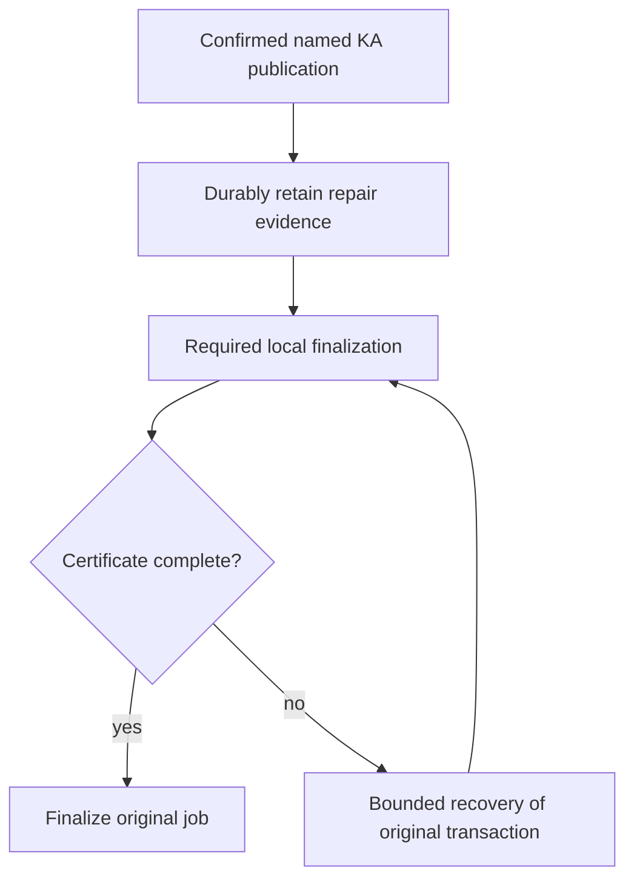

# PR 3017 lifecycle recovery takeover

## Outcome and scope

Take over https://github.com/OriginTrail/dkg/pull/3017 for issue https://github.com/OriginTrail/dkg/issues/2962, including the 2026-10-21 live reproduction. Resolve conflicts with testnet-canary, close remaining correctness and review gaps with regression tests, obtain completed remote review and green CI, then prove recovery on live testnet without a second publication. Report readiness; do not merge.

Initial PR head: 126b02816304417609bc3aa482ba97e3c324336c. Base fetched at f3b33cffb. Original workspace was clean and detached at the base. Working branch is the existing PR branch codex/fix-issue-2962-20261004. No applicable AGENTS.md found.

## Evidence and selected approach

The issue's latest reproduction shows inline named-KA completion terminalizing an uncertified local result after a scheduler queue timeout, while detached completion checks localFinalizationComplete. Current base extracted the queued tail into queued-publish-finalization.ts; the old PR still modifies the previous inline tail. Preserve that extraction and route required lifecycle projection through the PR's durable confirmed repair owner. Enforce the certificate specifically for named-KA completion, retaining raw-lift compatibility. Recover from original chain/receipt/content evidence through bounded durable job recovery, never replay publication to fix metadata.

Use the existing repair journal and publisher job recovery rather than another queue. Maintain deployment binding, per-KA serialization, persistence commitments, divergent drafts, and canonical provenance. Seven open remote threads cover retirement versus admission errors, historical records versus new commands, HTTP projection ownership, bounded repair concurrency, persistence docs, durable replacement reuse, and structured confirmation tails. Read all 61 threads, including resolved history, before replies. Remote reviewer observed: otReviewAgent; trigger/completion discovery remains required.

## Work and acceptance

1. Integrate base (owner: primary): inspect all 19 conflicting files and preserve both behavior sets; install native pinned dependencies. Build affected packages to detect cross-package changes.
2. Fix lifecycle completion (primary): add failing-before inline certificate/recovery tests; check detached success, missing/contradictory authority, cleanup failures, bounded backoff and restart. Assert exact descriptor roots/state/UAL and one original transaction.
3. Address seven outstanding findings (primary): verify each against integrated code, add meaningful regressions, simplify contracts without weakening durability or compatibility. Self-review concurrency, error precedence, and regression coverage in distinct passes; remote reviewer supplies independent review.
4. Validate and submit (primary): focused cohorts, package/type boundaries, lint/source caps/scalability and necessary integration. Inspect ignored paths and change-set size. Update coherent PR description and push normally; no force push. Reply with evidence and resolve addressed findings after checking new replies.
5. Remote convergence: up to 10 response rounds, two-minute sweeps and 30-minute observation window per substantive revision. Record head, deadline and round state here. Inspect all review/comment/check collections, including replies on resolved threads. No readiness claim for unconfirmed review or pending CI.
6. Live testnet (primary): native macOS Node 22/pnpm, configured DKG_TESTNET_POOL, isolated home, claimed batch after native build/SQLite verification. Inject required lifecycle writes failing after confirmed mint/update; restore and verify convergence without another publication, including restart. Cover normal sync/queued paths, divergent drafts and reads. Verify chain deployment, original receipt and version counts. Reconcile pending activity, stop owned writers, release claim; keep sanitized evidence/report.

## Flow

## Risks and review

A journal-retirement failure must retain automatic recovery instead of claiming admission failed. New commands require deployment proof; historical unbound entries remain retained without mutation. Concurrent independent repairs must retain same-KA fences and shutdown drain. Never substitute a second chain transaction for reconciliation. Live tests use only a claimed prepared wallet batch; no funding or production deployment is authorized. Durable storage certification remains strict for filesystem hosts. Rollback of source cannot undo a confirmed chain transaction; retain original evidence until reconciliation is proved.

Planning review: self-reviewed diagnosis, compatibility, durability and operational boundaries. Independent plan review not performed. Source inspection and targeted pre-fix tests will refine the exact implementation before edits.

## State and resources

- Discovery: issue and latest reproduction read; complete remote thread data downloaded (61 threads, no paginated replies); seven open threads enumerated. Historical threads reviewed, including new findings in resolved threads.
- Merge: 19 conflicts resolved; integrated with current base and pushed 9ac3465f0. GitHub reports mergeable.
- Response rounds: round 2/10 in progress. Round 1 head 9ac3465f0 observed from 2026-10-21T10:49:24Z to a planned 11:19:24Z deadline; otReviewAgent completed that revision at 10:56:59Z with five actionable findings. Round 2 groups those findings with CI failures; its next observation window begins only after substantive push.
- Checks: native runtime build passed; agent lifecycle cohort 180 passed; queued tail 61 passed; storage 51 passed; full publisher unit run 2295 passed/22 failed on obsolete fake certificates, followed by all 329 affected tests passing after compatibility fixes. CLI 62 passed plus managed WAL crash test passed on rerun. Graph marker producer regression failed before fix and all 90 affected lifecycle tests now pass. Lint and file-size guard pass. Further CI and live validation pending.
- New gaps closed: inline certificate enforcement, legacy handler receipts retained as tx-bearing work, journal retirement backoff, bounded 4-KA concurrency, explicit historical unbound records, domain/HTTP separation, shared durable replacement, stable journal encoding independent of lock namespace, real promote graph-marker destinations.
- Live setup: batch-2 claimed by lifecycle-recovery-3017-20261021; isolated .tmp/pr-3017-live; ownership .tmp/pr-3017-takeover/live/batch-claim.json. Base Sepolia 84532, authenticated 401/200, Hub/token verified, 7 checked signers funded with equal latest/pending nonces. Setup daemon stopped before exact revision validation. Detached mint KA 107 recovered across restart and inline mint KA 108 recovered without restart, each with original transaction, one chain root, exact VM payload and no extra publisher nonce. KA 108 update is staged for validation after the next commit. Node is stopped while rebuilding; batch claim remains held.

| Resource | Owner | Purpose | Cleanup condition |
| --- | --- | --- | --- |
| Current attached workspace | this task | PR integration | Retain for review/continuation |
| .tmp/pr-3017-takeover | this task | GitHub evidence and test logs | Retain compact diagnostic evidence through completion |
| Native dependencies | this task | builds/tests | Retain while workspace needed |
| .tmp/pr-3017-live + batch-2 claim | this task | live validation | Reconcile transactions and stop owned activity before release/removal |

## Round 2 and reviewability

Remote review and CI identified a tentative-result compatibility regression, duplicated lifecycle projection, repeated recovery ownership resolution, and stale restart/deployment fixtures. Restore no-chain/private-no-ACK/tentative-receipt transitions while keeping confirmed certificates. Consolidate projection, rendering and fallback into one mutation builder; share lock/current-version/commit policy between journal and queue recovery. Resolve ownership once after currency proof under the nonblocking lock. Strengthen restart testing to recover the original job to finalized.

The user authorized splitting into a stack when useful. Retain this PR: approximately two-thirds of changed lines are regression tests; source changes enforce one durability-to-finalization contract across storage, agent, publisher and CLI, and splitting would scatter the established review history. Keep a review map in the PR description. No separate PR is needed merely to reduce line count.

Owned container `dkg-pr3017-blazegraph`, localhost 57500, validates the real Blazegraph backend on native arm64. Remove it after local integration checks; it is not the testnet node store.

Round 2 executed: full publisher unit suite 126 files/2,322 tests passed; repair journal 89 tests passed; consolidated descriptor/lock/graph/policy cohort 92 tests initially exposed three obsolete mutation-count expectations, corrected and 22 projection tests passed; explicit real-EVM restart finalization, stale-promote, private-no-ACK and identityless-wallet cases passed; CLI route suite 122 passed; Blazegraph 2 passed; builds, lint and source-size guard passed.

Round 2 head 1c17a9129 pushed 2026-10-21T11:15:16Z; planned observation deadline 11:45:16Z. All five round-1 remote findings were addressed and replied to. Live update, healthy mint, inline failed-tail recovery and restart persistence passed on this runtime revision. CI exposed the new agent test's relative CLI helper import missing from delta routing; round 3 adds that route and its explicit routing test without changing runtime packages. All 17 routing tests pass. Round 3's observation begins at its substantive CI-fix push.

## Round 4

Round 3 head 4b24df864 completed routing/build checks; the reviewer identified a malformed legacy receipt still able to leave a job validated, plus two explicit-contract improvements. Save a usable transaction hash and flush before result mapping, propagate persistence errors without rolling back an accepted send, and suppress mapping errors only with recorded transaction evidence. Add certified/uncertified regressions that fail on the previous head and reopen disk before closing the original store, then expire the lease and recover without another execute.

Normalize journal and queue admission into one commit description; queue ownership translation stays at the queue caller. Carry confirmed/tentative/verified-descriptor discriminants, explicit workspace policy and one proof-preservation value through the mutation planner. Negative type contracts cover omitted versions, mixed graph coordinates, descriptor misuse and implicit policy. The CI catalog fixture now supplies the queued seal's actual lifecycle deployment before the shared currency check; its real catalog observer and failure cases remain intact.

Live validation through runtime 1c17a9129 passed detached/restart recovery, inline recovery, update recovery, healthy sync mint, readback/root checks and a reopened draft. All owned writers and the temporary Blazegraph container were stopped, and batch-2 was released with nine quiescent signing wallets. Round 4 will revalidate the final runtime after a fresh batch-2 claim. The current live home is retained but must not sign without that claim.

## Round 5: worker replacement certification

Remote review of 998969959 found acknowledged worker writes can be lost before a later flush reaches a replacement worker. Capture a persistence barrier before each lifecycle mutation attempt, bound to the current worker identity. Decorators must capture the inner barrier before their awaited drains; all stale barriers reject after replacement, even if another repair has since committed. A fresh attempt captures the replacement, reapplies its metadata and persists it before journal retirement. Preserve the unscoped commit API conservatively: it cannot certify across worker replacement. Prove the actual failure with a real worker killed while changelog era-guard save is paused, snapshots faulted, durable repair evidence retained, and restart readback after a successful retry.

The same response batch moves certificate policy into a typed named-KA result mapper, removes the shared transition override flag, and changes lifecycle fallback to explicit ordered replacement/removal operations plus append-only provenance. Correct two obsolete callback assertions without changing their shutdown/admission behavior. Validate focused worker/decorator/journal tests, projection equivalence/faults, publisher compatibility, builds and CI before another push. Live validation on 998969959 has completed and its batch is released; final-runtime readback will follow any additional runtime revision.

Round 5 validation: real-worker regression fails on the prior implementation with `repaired` instead of `pending`, then passes after fencing. It confirms metadata was acknowledged and actually lost, retains the journal, retries/reapplies with a fresh barrier, reopens durable data before close, and rejects multiple stale barriers after another writer progresses. Storage persistence/respawn/platform/directory-sync cohort: 34 passed; final focused rerun 32 passed. Agent worker/dispatch/projection/durable-file cohort: 38 passed; expanded journal/lock/process-local/descriptor cohort: 113 passed. Full publisher suite: 126 files / 2,325 tests passed. Builds/types, lint and source-size guard passed. The previous CI matrix's only test failure was the corrected callback assertion; coverage/gate failures were downstream of that failed shard. Batch-2 has been freshly reacquired for final-runtime validation.

## Round 6: one persistence protocol and checked evidence ownership

Make capture required on every certified adapter and remove the unscoped commit API. Stable adapters return their existing barrier; replaceable workers bind each captured barrier to its owner. Decorators capture synchronously before any queued drain. Migrate callers and retain the real worker crash/reapply/reopen regression with multiple stale barriers.

Narrow executor admission to resolved lifecycle author and proof-preservation policy. The executor constructs the applied command from the publication it checked, so admission cannot replace root, version, packed ID or deployment evidence. Add negative type contracts. Register the generated worker regression script with the repository load-closure audit; all 17 routing tests already pass with this declaration. Validate affected storage/agent/CLI cohorts, type contracts and builds before pushing this single response batch.

Round 6 checks passed: storage persistence/platform/respawn/Blazegraph cohort 114 tests; agent worker/process-local/recurring/journal/lock/dispatch/catalog cohort 125 tests; real managed-store WAL/SIGKILL regression one test; builds, negative type contracts, package-root boundary, lint, source-size guard, and all 17 CI routing tests. The real worker regression retains two independent stale-barrier rejections and successful durable reopen after reapply. Live round-5 validation completed and batch-2 was released; a fresh claim will precede final-runtime validation.

## Round 7: required confirmed identity and discoverable worker fixtures

Require the caller-resolved packed KA identity in executable confirmed commands and coordinates. Remove receipt identity fallbacks and impossible deployment-undefined handling from currency checks. Retain incomplete legacy identity/deployment only in historical journal records, which remain pending rather than executable. Verify normalization, old journal migration, synchronous/queued ownership and version fencing with negative type contracts and regressions.

Extract the three child-process worker scenarios and their preload hooks into checked-in fixture modules, passing temporary paths and input via arguments. Preserve built-package imports, real worker execution and crash/reapply/reopen assertions. Remove generated-script load-closure exceptions and validate normal fixture dependency discovery. Round-6 live inline recovery on c3a887636 passed with original transaction, one root and nonce 53→54; restart readback/cleanup is being completed before source rebuild.

Round 7 verification: 150 agent tests passed across journal, identity/evidence, deployment replay, real worker loss, shutdown, lock fences, graph markers and catalog recovery; 24 storage fixture/persistence tests passed. Builds, negative type contracts, lint, size guard and 17 routing tests passed. Legacy records missing either packed identity or deployment are retained without execution; new submissions reject missing identity. Live c3a887636 restart readback passed at block 48408577 for seven assets, six original jobs and both drafts; owned writers stopped, nine signing wallets quiescent, batch-2 released (`batch-release-round6.json`).

## Round 8: target-branch integration

Target testnet-canary advanced to 651607954 (PR #3343 write-preflight attribution) during round-7 review, leaving GitHub conflicting and CI unable to start. Merge the new base; the sole conflict is adjacent additions to the agent unit-test include list. Preserve both the three lifecycle tests and the new write-preflight attribution test. Check the automatically merged CLI test inclusion and routing, then run builds/types, both write-preflight suites plus lifecycle dispatch/lock/recovery, and routing before pushing. No runtime conflict requires choosing one implementation over another.

Integration review found a legacy admission edge: complete matching evidence resubmitted for an identity-less historical record reused that non-executable entry forever. The new regression fails before the fix (`pending` instead of `repaired`). Allow complete normalized evidence to replace a same-version historical entry after the existing root/version checks; unknown deployment records still use a distinct key and remain retained. Recheck deployment replay, journal replacement and lock fencing.

Round 8 checks passed: merged agent/preflight/lifecycle cohort 39 tests; CLI preflight + managed WAL/SIGKILL 23 tests; final legacy replay/journal/lock cohort 112 tests. The new legacy identity regression failed before the change and passed afterward. Agent/CLI builds and type checks, 17 routing tests, lint and size guard passed. The PR-relative diff has no whitespace errors; an existing EOF blank line belongs to the newly merged base.

## Round 9: complete the durability test fixture migration

CI reached 52 successful checks but agent shard 1 found three durable-file tests whose shared fixture omitted the newly required packed identity; fail-fast canceled shard 9. Correct the shared fixture and its wire-format assertion, type it as a confirmed command, and include this file in the agent type-check suite so future contract changes cannot silently leave the fixture stale. Preserve the actual EPERM/EIO fault and ancestry assertions. Runtime source stays identical to the live-validated 19783e1aa revision. Final live evidence passed on that runtime across faulted and clean restarts; all resources are stopped and the wallet batch released.

The fixture audit also found the same omission in the command-contract test, which was in the canceled/uncompleted matrix scope. Type-check both affected files, preserve explicit invalid-wire tests with string-encoded identities, and keep the valid tentative fixture free of confirmed-only fields. Existing negative root/version type contracts now supply a valid packed identity so their expected errors remain specific to the intended forbidden fields.

Round 9 validation passed: both fixture files (23 tests), the expanded agent type suite, lint, and diff hygiene. All runtime source is unchanged from the eight-asset live-validated 19783e1aa head. Previous CI's coverage/gate failures are downstream of the fixture failure and fail-fast cancellation; its EVM, native/platform, publisher, storage, CLI, UI and other completed agent checks passed.

## Round 10: integrate publisher control and respect its new size budget

Target branch advanced to bdcef4c07 with publisher live pause/resume controls and an AskStorage event fix. The clean synthetic merge reduced async-lift-publisher-impl's ratcheted budget to 3747 lines; CI failed that guard before tests. Merge the updated base and extract this PR's named-KA completion/checkpoint logic into a focused module, preserving the outer claim→job lock ownership, pre-mapping durable hash checkpoint, uncaught persistence faults, typed mapping and original-claim fencing. Keep mapping errors distinct from storage errors. Verify full publisher compatibility, new claim pause/resume tests, affected agent/CLI paths, routing/builds/types/lint/size, then revalidate final runtime on testnet. This is the tenth response batch; retain that count across any interruption.

Round 10 also integrates target 23ccf2fd3 (readiness shutdown cancellation and prefix evaluation) with no conflicts. Validation passed: all 128 publisher unit files / 2336 tests, 69 targeted agent tests including real worker replacement and durable-file faults, 60 CLI publisher-control/startup/preflight tests, 27 readiness shutdown tests, builds/types, 17 routing tests, lint and size guard (publisher implementation 3739 lines against 3747 budget). The two type-checked fixture regressions still reach their intended faults. Final live run is in progress on this runtime: one original broadcast retained alongside its repair journal, all six publisher claim gates paused, then restart while the fault remains held.

## Round 11: crash-safe payload certification and catalog recovery

User authorized continued convergence after round 10. Keep one PR: journal, queue completion and store ownership form one completion contract; splitting now creates unsafe intermediate merges. Merge target c1230bc0a (clean, currently staged) without dropping its catalog ownership/private-access/ACK changes.

Confirmed reproduction: after an acknowledged VM insert and failed snapshot, terminate the actual Oxigraph worker. Existing replay removes the journal and publishes lifecycle metadata while VM has zero quads, including a separate reopen before close. Evidence: `.tmp/pr-3017-takeover/payload-loss-diagnostic/result.log`. This invalidates readiness despite the successful nine-asset live timeout/restart matrix.

Selected design: carry the already verified public snapshot and canonical confirmed UAL metadata in the fsynced repair obligation. No private plaintext is journaled. Validate the snapshot's counts/private commitment/root; use the publisher materialization lock and version guard, restore missing/wrong VM data atomically, then stamp lifecycle metadata and commit under one captured worker fence. Preserve existing exact confirmed metadata and newer workspace drafts. Old entries without recovery snapshots may complete only after verifying existing VM content and its confirmed envelope; otherwise remain pending. A fresh complete same-version admission upgrades an old snapshot-less entry. This costs bounded-to-publication payload duplication in the journal; it avoids unsafe reliance on mutable SWM, which confirmation cleanup can already have removed. A new spool format or peer-fetch protocol would be a larger independent redesign.

Implementation owner: lead; independent correctness/regression review: existing remote reviewer. Steps: (1) add snapshot serialization/verification and producer wiring, shared materialization ownership/barrier, with fail-before/pass-after real-worker regression; (2) cover missing/tampered/old/private-commitment payloads, newer versions/drafts, legacy pending and worker replacement; (3) narrow queued stamp request type; (4) fix catalog fixture deployment evidence and run all 12 affected tests rather than raising CI timeout; (5) builds/types/routing/size and affected integration suites, push and request remote review; (6) fresh wallet claim and final-runtime testnet fault/restart/readback, stop/reconcile/release. No merge authorized. Review and CI must converge, then report readiness and remaining owner approval.

Rollback/recovery: retain failed obligations; never resubmit transactions from replay. Unsupported atomic graph replacement stays pending. Stale worker barriers cannot certify replacement-worker state. Newer confirmed versions are never replaced. Snapshot-less historical obligations are preserved when their payload cannot be independently verified. Testnet resources remain stopped until a fresh batch claim.

Round-11 implementation refinements: snapshot metadata uses the canonical seal KA UAL, distinct from the publication receipt label; packed identity remains authoritative for graph routing. Restore missing local access controls from the same admitted snapshot. Journal writes use version 3 so older metadata-only readers refuse new obligations; versions 1/2 remain readable with payload verification required. Catalog fixtures now supply deployment/version evidence, durable storage and real confirmed content; batch setup no longer drains a deliberately parked private-placement worker, and timing checks await completion with placements held instead of treating 250 ms of disk I/O as placement delay.

Round-11 pre-push evidence: focused lifecycle repair suite 90 passed; catalog completion suite 12 passed; lock fence 15 passed; queued tail 39 passed; foreign-author 36 passed; finalized-agent-lane 6 passed; snapshot/legacy/deployment contracts 25 passed; construction/recurring/catalog-applicability 14 passed. Live local Blazegraph 3 passed including SIGKILL/restart with restored VM payload; owned container removed. CLI build, expanded agent type checks, lint and size guard passed; routing 30 passed. Initial full agent run found only nine affected fixture/contract files (531 other files passed); their fixes are under a fresh complete 540-file run. Final real-worker replay check is also running after the final build. No live-testnet writer or wallet claim is active yet.

### Round 12 — exact access anchors and one persistence owner

Reviewer c75da429 identified inherited older access controls falsely satisfying recovery. Extend the publisher-owned selector with an exact-version/root selection mode, retain its existing inheritance default for sync, and use exact selection before restoring admitted controls. Add public-v1/restricted-v2 retry and durable reopen tests plus same-version preservation. Extract the lifecycle metadata mutation so the complete materialized attempt captures and invokes one barrier; preserve standalone durability behavior and worker-loss regressions. Freeze copied admission/decode evidence and encode only wire conversions, with a regression proving unrelated snapshots are not rehashed during settlement. Integrate base f73314e6f (async share recovery), preserving its execution authority import. Re-run focused agent/publisher/type/build/lint checks and review/CI. Live c75 recovery restored deliberately lost payload without republishing; repeat final-runtime validation after this revision. Windows Gate 0 timed out before networking on c75 CI; diagnose or rerun, and do not label CI green until verified.

Round 12 validation: 112 focused materialization/repair/command tests, 15 lifecycle lock tests, 39 queued-tail tests, 2 descriptor-recovery tests, 89 publisher metadata/control tests, 33 bound-share guards and 133 CLI worker/share recovery tests passed. The descriptor integration fixture now supplies its real content root and canonical confirmed envelope; its interrupted ordered writer and same-job/no-republication assertions remain intact. Two real worker-loss/reopen tests passed. Type checks, CLI dependency build, lint and size checks passed before final hygiene. The previous c75 full agent unit run passed 540 files / 10,037 tests (5 skipped); remote integration CI identified the descriptor fixture gap above and a Windows pre-network startup timeout, which remains pending a fresh CI run. c75 live testnet restored deliberately deleted KA119 content from its retained journal, finalized job b83a28d7-1785-4592-aa7c-d170698095bb on original tx 0x65cf1e3a018b5e04984edd43d22925a73003dc04be9088311f1f4ceee8a63829, one root, publisher nonce 60; approval nonce 58 and publication nonce 59 reconcile exactly. All ten assets, two retained drafts, and nine jobs read back correctly. No merge authorized.

### Round 13 — visible authorization and compact durable bookkeeping

Current-head review ce1860f48 identified a remaining visible-policy gap: immutable metadata/content equality does not establish equality of access policy read by AccessHandler. Reconcile visible controls inside the same captured materialization barrier, selecting exact-version trusted controls or the admitted snapshot, while preserving receipt/provenance and unrelated metadata. Verify unauthorized access denial after durable reopen when v2 content is already present with inherited public controls.

Persist immutable public recovery snapshots once in a content-addressed owned subdirectory. Version-4 retry journal records contain a hash reference; admission fsyncs snapshot first, then the compact journal, before graph I/O. Retry/failure/retirement update only compact metadata. Decode v1–v3 in-place, hydrate/hash-check v4 snapshots before canonical validation, and migrate historical inline snapshots on the next successful persistence. Remove blobs only after durable settlement no longer references them; failed journal persistence retains payloads. Test write-ahead failures, missing/tampered references, migration, independent settlement without rewriting other payloads, and restart restoring original content.

Remove the unused production metadata-only confirmed commit wrapper. Retain the shared metadata mutation and tentative entry point; move narrow projection-test convenience to fixtures, with runtime confirmed tests using the materialization owner. Preserve actual worker replacement and durability fault coverage. Run targeted cohorts/build/types/lint/CI, then final-runtime live replay/readback. ce1860f48 testnet completed successfully (eleven assets, two drafts, nine jobs), all wallets reconciled and batch released; claim freshly before further live work.

Round 13 additionally fixes the real curator/member EVM CI regression: preserve the authenticated member's exact-version sidecar instead of appending the curator identity, and capture that original publisher in both synchronous and queued recovery snapshots. The real two-agent EVM regression passes, including snapshot ownership. Focused validation passed 150 lifecycle/projection tests, then 42 final materialization/journal/lock/deployment tests (seven compact snapshot cases), 90 publisher controls/metadata tests, two actual worker-loss/reopen tests, agent build/types and package-root checks. Size guard passed. No production metadata-only confirmed entry point remains. New runtime live proof and remote review/CI remain pending.

### Round 14 — complete envelope and admission boundaries

Remote review of cb279da57 found four actionable gaps: optional remaining-SWM cleanup precedes repair admission; matching version/root/graph does not establish matching immutable counts/private commitment/identity; one-shot snapshot writers lose failed ancestor-sync state; and the CLI managed-WAL test still imports the removed metadata-only writer. Two maintainability requests concern repeated snapshot validation and repeated control selection. Keep one implementation owner and the remote reviewer for independent review; all live services are stopped and batch released.

1. Admit synchronous confirmed recovery before optional cleanup, preserve confirmation if cleanup fails, and keep independent tail execution. Reproduce cleanup timeout with a held lifecycle fault, then autonomous repair without a second publication.
2. Separate wire snapshot from immutable validated execution evidence. Retain a typed proof with copied/frozen quads at construction/admission/decode; reuse only objects produced by the validation boundary with matching coordinates. Encode only historical wire fields. Verify malformed/tampered evidence rejection and reuse across retries.
3. Reconcile the full immutable envelope (counts, private commitment, version, graph, root, packed identity), preserving existing same-version receipt provenance and unrelated rows. Verify durable reopen through the real confirmed-VM resolver, not only RDF field assertions.
4. Give the snapshot directory a long-lived DurableDirectory owner. It creates before any file writes and completes all retained ancestor fsyncs before a snapshot becomes durable. Fault an ancestor of initially absent nested dataDir, retry and assert every pending ancestor sync precedes apply.
5. Add a publisher-owned exact-control reconciliation operation that selects once, persists a validated admitted fallback only when missing, and returns rows for pure visible overlay. Preserve inherited selection for existing sync paths. Count control-history selections in regressions.
6. Migrate the real managed-Oxigraph held-WAL/SIGKILL test to complete materialization evidence and the production owner. Keep journal-retention, WAL barrier, payload/metadata and reopened-store assertions.

Run targeted agent/publisher/CLI durability and type/build/lint/size checks, then submit one coherent revision and repeat remote review/CI. Re-run final-runtime live recovery after the new source changes. cb279da57 passed twelve-asset/two-draft/nine-job clean-restart readback with only the original KA121 transaction, but does not establish the fixes above.

Round 14 verification: 181 targeted lifecycle/materialization/journal/deployment/lock/queued-tail tests passed, including seven immutable-envelope corruptions with real resolver readback and cleanup-fault recovery for synchronous mint/update. Both actual worker-loss tests and 15 durable-file tests passed, including same/different snapshot retries after ancestor-sync failure. 92 publisher metadata/control tests passed with one-selection checks. The current production managed WAL/SIGKILL regression passed; the previous-head CI timeout is confirmed to be that removed-writer test (102 other CLI files / 2,177 tests passed on the shard). Expanded types, publisher/agent compilation, package-root, lint and size checks passed. Final CLI rerun passed all three tests (curator/member EVM plus managed WAL/SIGKILL); the managed test now also fails immediately if repair returns before its held barrier. Review/CI/live validation remain pending.

Round 14 follow-up self-review reproduced a valid-receipt loss when a corrupt public count accompanies a semantically equal uppercase/0x-prefixed root literal. The strengthened corruption regression failed before the fix (receipt readback false). Same-version recovery now uses the publisher's canonical envelope parser to compare the stored root against admitted proof, preserving receipt/provenance across equivalent encodings. All 21 materialization tests pass after the fix; agent compilation passed. The live node was stopped before any new publication, retaining the batch claim for the final candidate.

### Round 15 — publisher-owned metadata reconciliation and shared content verification

Review of 7030f9205 found matching receiptless metadata could retire an admitted transaction receipt. Add a fail-before/pass-after durable-reopen regression, restoring admitted provenance only when no valid current provenance exists. Move immutable proof projection/comparison and RDF reconciliation into the publisher metadata layer; agent retains orchestration, locking, atomic replacement and the captured barrier. Use the existing exact graph verifier for count/root checks, preserving store error propagation. Retain corruption, access-policy, legacy, worker-loss and queued completion coverage; validate builds/types and affected integrations before pushing. Final 7030f9205 live sync and queued recovery passed with no second publication, fourteen assets, two drafts and ten jobs after clean restart; all nine signers reconciled and batch-2 released. Repeat relevant live validation on the revised runtime. User's continued-convergence authorization remains active; no merge.

Round 15 validation: receiptless exact-content regression failed before the fix, then all 23 materialization tests passed including durable reopen and actual receipt-backed evidence consumption. 92 repair tests, 68 lock/deployment/journal/queued-tail tests, 39 descriptor tests, 15 durability tests, two actual worker-loss tests, 92 publisher metadata/control tests and three managed-WAL/curator-member EVM tests passed. Exact-content store failures retain evidence without replacement. Publisher/agent compilation, expanded types, package exports/root, lint, size and diff checks passed. Final runtime live validation, new remote review and CI remain pending.

### Round 16 — explicit validated command boundary and direct canonical root parsing

Review of fb8ac5b9a requests removing the object-identity validation cache and synthetic-envelope root parsing. Normalize unknown admission/disk input once into a frozen validated internal command carrying bound coordinates and typed materialization proof; journal/executor/materialization consume that type directly, with explicit wire conversion and no execution-time normalization. Publication producers construct immutable admission evidence, while queue-owned legacy recovery normalizes at its admission boundary. Add compile-time rejection of raw execution commands and preserve tampering, coordinate binding, legacy retention, retry reuse and disk-roundtrip tests. Extract the existing canonical bytes32 literal parser for both envelope parsing and narrow stored-root comparison; test equivalent, missing, duplicate, malformed and different roots without unrelated envelope dependence. Re-run affected contracts, real worker/managed-store/EVM tests, builds/types/hygiene, then review/CI and final-runtime live proof. fb8ac5b9a live recovery and clean restart passed fifteen assets, two drafts and eleven jobs; services stopped and all nine signers reconciled before releasing batch-2. No merge authorized.

Round 16 validation: 201 focused command/evidence/materialization/journal/repair/lock/deployment/tail tests passed; 39 queue/foreign-author/descriptor-recovery tests, 39 descriptor-repair tests, 15 durability tests, two actual worker-loss tests, 92 publisher metadata/control tests and three managed-WAL/curator-member EVM tests passed. The retry regression observes one admission normalization and the same frozen proof across attempts; round-trip decoding reconstructs a fresh equal proof. Type tests reject raw execution commands and mutable coordinates. Four added root-ambiguity regressions preserve fail-closed receipt handling; the existing equivalent-root/corrupt-count regression still preserves valid provenance. Builds/types/package-root, lint, size and diff checks pass; final type-only refinements are being checked before push.

### Round 17 — persistence-independent lifecycle evidence ownership

The fd8bbe685 review requests separating executable evidence from journal migration. Consolidate raw/validated command and materialization models, fresh admission validation, immutable snapshot construction and wire projection in the lifecycle evidence module. Queue admission, repair admission and materialization execution depend on that domain boundary. Journal decoding alone handles optional historical deployment/identity, retained legacy records and disk-version/reference migration; complete records invoke the same strict fresh normalizer, without casting through historical unions. Shared field validators keep historical facts canonical without imposing disk compatibility on fresh commands. Preserve all command types, tampering/coordinate rejection, retry reuse, legacy retention and round-trip tests; rerun affected integration and durability cohorts before push, then review/CI and final-runtime live validation. fd8 live proof passed all sixteen assets, two drafts and twelve jobs, with all services stopped and batch-2 reconciled/released. No merge.

Round 17 validation: 208 focused evidence/command/materialization/repair/journal/lock/deployment/tail/integrity tests, 39 queue/foreign-author/descriptor-recovery tests, 39 descriptor-repair tests, 15 durability tests, two actual worker-loss tests and three managed-WAL/curator-member EVM tests passed (306 distinct targeted tests). Final serialization ownership refinements were rechecked with 46 boundary tests, all 17 worker/durability tests and all three CLI integrations. Builds, expanded types, package-root, lint, size and diff hygiene pass. Fresh evidence validation has no journal dependency; historical decoding produces a tagged retained/executable result without casting fresh commands through legacy unions. Runtime live validation and current-head review/CI remain pending.

### Review response round 18 — canonical identity conversion

Reuse `packKnowledgeAssetIdFromIdentity` at evidence admission and materialization execution. Both scopes are already parsed; retain mismatch rejection and run existing binding/materialization/identity regressions, builds/types and lint. Resume the pending live repair on this final runtime and verify clean restart without another publication.

Validation: 276 existing identity/evidence/materialization/repair/journal tests passed. Agent build, expanded command type checks, package-root validation, repository lint and diff hygiene passed. Both checks retain the same parsed scope and mismatch error behavior.

### Review response round 19 — partial directory creation and control ownership

Capture and retain the first existing parent before recursive mkdir can partially fail; preserve that pending range across retry and failed fsync. Add a failing-before regression that creates one parent then throws ENOSPC and requires its parent barrier before certification. Consolidate exact-anchor select/admit and pure control overlay in metadata's canonical control owner; publication and lifecycle recovery delegate, with low-level writer/predicate sets private. Preserve restoreMissing=false and inherited-selection defaults. Run storage directory/blob/persistence tests, publisher controls/metadata, agent materialization/repair/durability and real worker/curator tests; build dependents, lint and verify size. Revalidate final live runtime and complete review/CI.

Validation: the new partial-mkdir regression failed before the fix because preparation resolved despite an injected failure syncing the original existing parent. After the fix, 293 distinct targeted tests passed: 42 storage, 93 publisher metadata/control, 153 agent materialization/repair/command/journal/durability, two actual worker-loss, and three managed-WAL/SIGKILL/curator-member EVM tests. Storage/publisher/agent builds, expanded types, package root, lint, size and diff hygiene passed.

### Review response round 20 — legacy authorization and typed wire decoding

Require an exact-version trusted control selection before snapshot-less recovery may certify completion; leave missing authority pending. Add a failing-before regression with matching private v2 content, inherited public v1 policy and no v2 sidecar, retain the obligation across reopen, then admit authenticated v2 owner-only controls and verify durable access denial without publication. Preserve the successful snapshot-less path when exact controls exist. Move all journal version/tuple/key/reference validation into a typed wire decode stage; snapshot ownership only reads/hashes referenced payloads and caches verified references. Reuse the typed stage for synchronous historical decoding. Run command/journal/snapshot/materialization and real worker/CLI regressions, builds/types/lint/size, then final testnet/readiness checks.

Validation: the new snapshot-less v2 regression failed before the guard (reported repaired instead of pending), then passed with durable missing-authority retention and actual AccessHandler denial after exact-control recovery/reopen. All 297 distinct targeted tests passed: 144 materialization/command/journal/repair, 92 queue/tail/foreign-author/lock, 41 descriptor repair, 17 durability/actual-worker-loss and three managed-WAL/curator-member EVM tests. Successful snapshot-less fixtures now provide authenticated exact controls; a missing-controls queue case remains rejected. Build/types/package root/lint/size pass. Full agent unit suite is running after fixture failures justified broader coverage; results remain pending.
