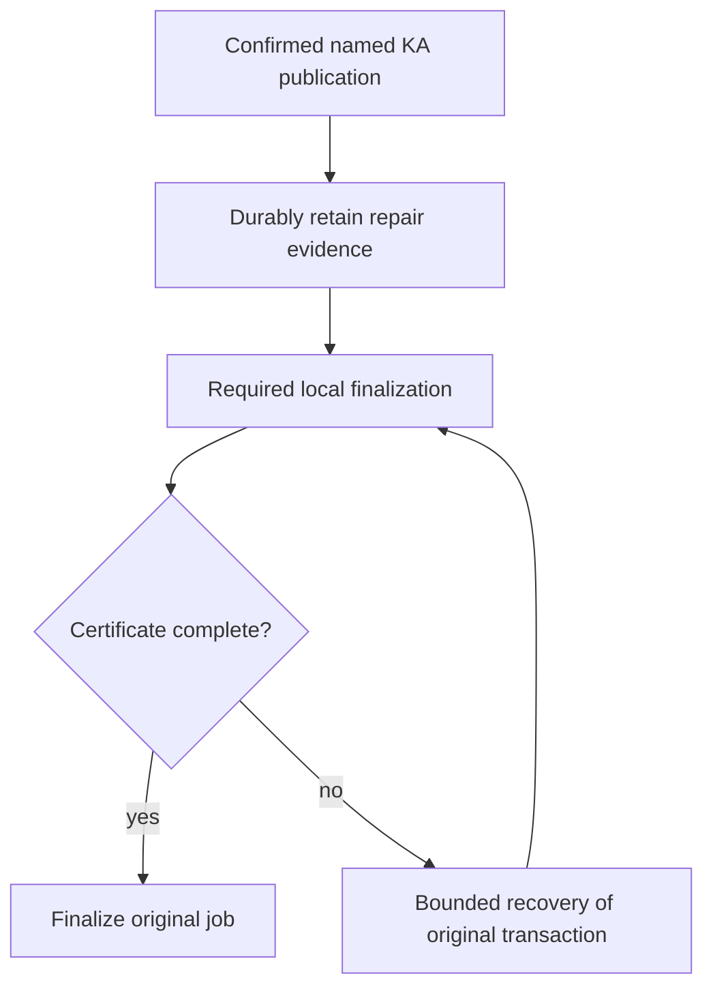

# PR 3017 lifecycle recovery takeover

## Outcome and scope

Take over https://github.com/OriginTrail/dkg/pull/3017 for issue https://github.com/OriginTrail/dkg/issues/2962, including the 2026-10-21 live reproduction. Resolve conflicts with testnet-canary, close remaining correctness and review gaps with regression tests, obtain completed remote review and green CI, then prove recovery on live testnet without a second publication. Report readiness; do not merge.

Initial PR head: 126b02816304417609bc3aa482ba97e3c324336c. Base fetched at f3b33cffb. Original workspace was clean and detached at the base. Working branch is the existing PR branch codex/fix-issue-2962-20261004. No applicable AGENTS.md found.

## Evidence and selected approach

The issue's latest reproduction shows inline named-KA completion terminalizing an uncertified local result after a scheduler queue timeout, while detached completion checks localFinalizationComplete. Current base extracted the queued tail into queued-publish-finalization.ts; the old PR still modifies the previous inline tail. Preserve that extraction and route required lifecycle projection through the PR's durable confirmed repair owner. Enforce the certificate specifically for named-KA completion, retaining raw-lift compatibility. Recover from original chain/receipt/content evidence through bounded durable job recovery, never replay publication to fix metadata.

Use the existing repair journal and publisher job recovery rather than another queue. Maintain deployment binding, per-KA serialization, persistence commitments, divergent drafts, and canonical provenance. Seven open remote threads cover retirement versus admission errors, historical records versus new commands, HTTP projection ownership, bounded repair concurrency, persistence docs, durable replacement reuse, and structured confirmation tails. Read all 61 threads, including resolved history, before replies. Remote reviewer observed: otReviewAgent; trigger/completion discovery remains required.

## Work and acceptance

1. Integrate base (owner: primary): inspect all 19 conflicting files and preserve both behavior sets; install native pinned dependencies. Build affected packages to detect cross-package changes.
2. Fix lifecycle completion (primary): add failing-before inline certificate/recovery tests; check detached success, missing/contradictory authority, cleanup failures, bounded backoff and restart. Assert exact descriptor roots/state/UAL and one original transaction.
3. Address seven outstanding findings (primary): verify each against integrated code, add meaningful regressions, simplify contracts without weakening durability or compatibility. Self-review concurrency, error precedence, and regression coverage in distinct passes; remote reviewer supplies independent review.
4. Validate and submit (primary): focused cohorts, package/type boundaries, lint/source caps/scalability and necessary integration. Inspect ignored paths and change-set size. Update coherent PR description and push normally; no force push. Reply with evidence and resolve addressed findings after checking new replies.
5. Remote convergence: up to 10 response rounds, two-minute sweeps and 30-minute observation window per substantive revision. Record head, deadline and round state here. Inspect all review/comment/check collections, including replies on resolved threads. No readiness claim for unconfirmed review or pending CI.
6. Live testnet (primary): native macOS Node 22/pnpm, configured DKG_TESTNET_POOL, isolated home, claimed batch after native build/SQLite verification. Inject required lifecycle writes failing after confirmed mint/update; restore and verify convergence without another publication, including restart. Cover normal sync/queued paths, divergent drafts and reads. Verify chain deployment, original receipt and version counts. Reconcile pending activity, stop owned writers, release claim; keep sanitized evidence/report.

## Flow

## Risks and review

A journal-retirement failure must retain automatic recovery instead of claiming admission failed. New commands require deployment proof; historical unbound entries remain retained without mutation. Concurrent independent repairs must retain same-KA fences and shutdown drain. Never substitute a second chain transaction for reconciliation. Live tests use only a claimed prepared wallet batch; no funding or production deployment is authorized. Durable storage certification remains strict for filesystem hosts. Rollback of source cannot undo a confirmed chain transaction; retain original evidence until reconciliation is proved.

Planning review: self-reviewed diagnosis, compatibility, durability and operational boundaries. Independent plan review not performed. Source inspection and targeted pre-fix tests will refine the exact implementation before edits.

## State and resources

- Discovery: issue and latest reproduction read; complete remote thread data downloaded (61 threads, no paginated replies); seven open threads enumerated. Historical threads reviewed, including new findings in resolved threads.
- Merge: 19 conflicts resolved; integrated with current base and pushed 9ac3465f0. GitHub reports mergeable.
- Response rounds: round 2/10 in progress. Round 1 head 9ac3465f0 observed from 2026-10-21T10:49:24Z to a planned 11:19:24Z deadline; otReviewAgent completed that revision at 10:56:59Z with five actionable findings. Round 2 groups those findings with CI failures; its next observation window begins only after substantive push.
- Checks: native runtime build passed; agent lifecycle cohort 180 passed; queued tail 61 passed; storage 51 passed; full publisher unit run 2295 passed/22 failed on obsolete fake certificates, followed by all 329 affected tests passing after compatibility fixes. CLI 62 passed plus managed WAL crash test passed on rerun. Graph marker producer regression failed before fix and all 90 affected lifecycle tests now pass. Lint and file-size guard pass. Further CI and live validation pending.
- New gaps closed: inline certificate enforcement, legacy handler receipts retained as tx-bearing work, journal retirement backoff, bounded 4-KA concurrency, explicit historical unbound records, domain/HTTP separation, shared durable replacement, stable journal encoding independent of lock namespace, real promote graph-marker destinations.
- Live setup: batch-2 claimed by lifecycle-recovery-3017-20261021; isolated .tmp/pr-3017-live; ownership .tmp/pr-3017-takeover/live/batch-claim.json. Base Sepolia 84532, authenticated 401/200, Hub/token verified, 7 checked signers funded with equal latest/pending nonces. Setup daemon stopped before exact revision validation. Detached mint KA 107 recovered across restart and inline mint KA 108 recovered without restart, each with original transaction, one chain root, exact VM payload and no extra publisher nonce. KA 108 update is staged for validation after the next commit. Node is stopped while rebuilding; batch claim remains held.

| Resource | Owner | Purpose | Cleanup condition |
| --- | --- | --- | --- |
| Current attached workspace | this task | PR integration | Retain for review/continuation |
| .tmp/pr-3017-takeover | this task | GitHub evidence and test logs | Retain compact diagnostic evidence through completion |
| Native dependencies | this task | builds/tests | Retain while workspace needed |
| .tmp/pr-3017-live + batch-2 claim | this task | live validation | Reconcile transactions and stop owned activity before release/removal |

## Round 2 and reviewability

Remote review and CI identified a tentative-result compatibility regression, duplicated lifecycle projection, repeated recovery ownership resolution, and stale restart/deployment fixtures. Restore no-chain/private-no-ACK/tentative-receipt transitions while keeping confirmed certificates. Consolidate projection, rendering and fallback into one mutation builder; share lock/current-version/commit policy between journal and queue recovery. Resolve ownership once after currency proof under the nonblocking lock. Strengthen restart testing to recover the original job to finalized.

The user authorized splitting into a stack when useful. Retain this PR: approximately two-thirds of changed lines are regression tests; source changes enforce one durability-to-finalization contract across storage, agent, publisher and CLI, and splitting would scatter the established review history. Keep a review map in the PR description. No separate PR is needed merely to reduce line count.

Owned container `dkg-pr3017-blazegraph`, localhost 57500, validates the real Blazegraph backend on native arm64. Remove it after local integration checks; it is not the testnet node store.

Round 2 executed: full publisher unit suite 126 files/2,322 tests passed; repair journal 89 tests passed; consolidated descriptor/lock/graph/policy cohort 92 tests initially exposed three obsolete mutation-count expectations, corrected and 22 projection tests passed; explicit real-EVM restart finalization, stale-promote, private-no-ACK and identityless-wallet cases passed; CLI route suite 122 passed; Blazegraph 2 passed; builds, lint and source-size guard passed.

Round 2 head 1c17a9129 pushed 2026-10-21T11:15:16Z; planned observation deadline 11:45:16Z. All five round-1 remote findings were addressed and replied to. Live update, healthy mint, inline failed-tail recovery and restart persistence passed on this runtime revision. CI exposed the new agent test's relative CLI helper import missing from delta routing; round 3 adds that route and its explicit routing test without changing runtime packages. All 17 routing tests pass. Round 3's observation begins at its substantive CI-fix push.

## Round 4

Round 3 head 4b24df864 completed routing/build checks; the reviewer identified a malformed legacy receipt still able to leave a job validated, plus two explicit-contract improvements. Save a usable transaction hash and flush before result mapping, propagate persistence errors without rolling back an accepted send, and suppress mapping errors only with recorded transaction evidence. Add certified/uncertified regressions that fail on the previous head and reopen disk before closing the original store, then expire the lease and recover without another execute.

Normalize journal and queue admission into one commit description; queue ownership translation stays at the queue caller. Carry confirmed/tentative/verified-descriptor discriminants, explicit workspace policy and one proof-preservation value through the mutation planner. Negative type contracts cover omitted versions, mixed graph coordinates, descriptor misuse and implicit policy. The CI catalog fixture now supplies the queued seal's actual lifecycle deployment before the shared currency check; its real catalog observer and failure cases remain intact.

Live validation through runtime 1c17a9129 passed detached/restart recovery, inline recovery, update recovery, healthy sync mint, readback/root checks and a reopened draft. All owned writers and the temporary Blazegraph container were stopped, and batch-2 was released with nine quiescent signing wallets. Round 4 will revalidate the final runtime after a fresh batch-2 claim. The current live home is retained but must not sign without that claim.

## Round 5: worker replacement certification

Remote review of 998969959 found acknowledged worker writes can be lost before a later flush reaches a replacement worker. Capture a persistence barrier before each lifecycle mutation attempt, bound to the current worker identity. Decorators must capture the inner barrier before their awaited drains; all stale barriers reject after replacement, even if another repair has since committed. A fresh attempt captures the replacement, reapplies its metadata and persists it before journal retirement. Preserve the unscoped commit API conservatively: it cannot certify across worker replacement. Prove the actual failure with a real worker killed while changelog era-guard save is paused, snapshots faulted, durable repair evidence retained, and restart readback after a successful retry.

The same response batch moves certificate policy into a typed named-KA result mapper, removes the shared transition override flag, and changes lifecycle fallback to explicit ordered replacement/removal operations plus append-only provenance. Correct two obsolete callback assertions without changing their shutdown/admission behavior. Validate focused worker/decorator/journal tests, projection equivalence/faults, publisher compatibility, builds and CI before another push. Live validation on 998969959 has completed and its batch is released; final-runtime readback will follow any additional runtime revision.

Round 5 validation: real-worker regression fails on the prior implementation with `repaired` instead of `pending`, then passes after fencing. It confirms metadata was acknowledged and actually lost, retains the journal, retries/reapplies with a fresh barrier, reopens durable data before close, and rejects multiple stale barriers after another writer progresses. Storage persistence/respawn/platform/directory-sync cohort: 34 passed; final focused rerun 32 passed. Agent worker/dispatch/projection/durable-file cohort: 38 passed; expanded journal/lock/process-local/descriptor cohort: 113 passed. Full publisher suite: 126 files / 2,325 tests passed. Builds/types, lint and source-size guard passed. The previous CI matrix's only test failure was the corrected callback assertion; coverage/gate failures were downstream of that failed shard. Batch-2 has been freshly reacquired for final-runtime validation.

## Round 6: one persistence protocol and checked evidence ownership

Make capture required on every certified adapter and remove the unscoped commit API. Stable adapters return their existing barrier; replaceable workers bind each captured barrier to its owner. Decorators capture synchronously before any queued drain. Migrate callers and retain the real worker crash/reapply/reopen regression with multiple stale barriers.

Narrow executor admission to resolved lifecycle author and proof-preservation policy. The executor constructs the applied command from the publication it checked, so admission cannot replace root, version, packed ID or deployment evidence. Add negative type contracts. Register the generated worker regression script with the repository load-closure audit; all 17 routing tests already pass with this declaration. Validate affected storage/agent/CLI cohorts, type contracts and builds before pushing this single response batch.

Round 6 checks passed: storage persistence/platform/respawn/Blazegraph cohort 114 tests; agent worker/process-local/recurring/journal/lock/dispatch/catalog cohort 125 tests; real managed-store WAL/SIGKILL regression one test; builds, negative type contracts, package-root boundary, lint, source-size guard, and all 17 CI routing tests. The real worker regression retains two independent stale-barrier rejections and successful durable reopen after reapply. Live round-5 validation completed and batch-2 was released; a fresh claim will precede final-runtime validation.
