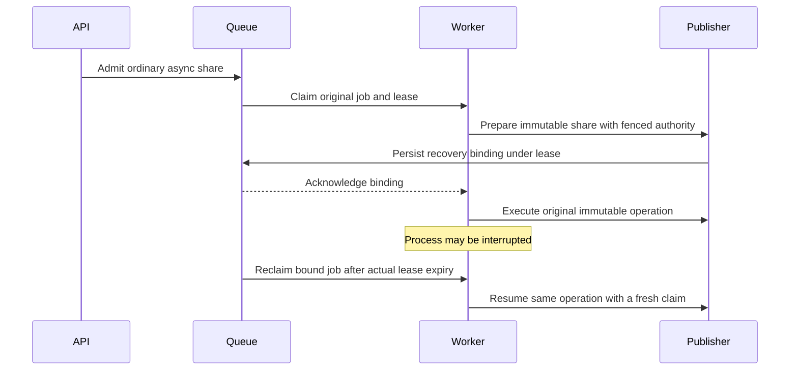

# Issue 3408: watchdog and interrupted-share investigation

Date: 2026-10-23. Status: investigation in progress. Owner: Codex. Branch: `codex/3408-worker-stall-recovery`, based on current `origin/testnet-canary` at `7c404bd5e246ae7188c98926c63829ef33d7a54c`. The user explicitly selected this target. The initial checkout was clean; previous issue-3350 evidence remains isolated and retained. No applicable AGENTS.md was found; `.github/CONTRIBUTING.md` requires canary PRs, maintainer approval and merging base updates rather than rebasing.

## Outcome and evidence

Determine whether a watchdog/worker-stall or interrupted-share recovery defect remains after merged #3395 and #3396. Reproduce and fix only an established remaining defect. Otherwise report current-code evidence without opening a redundant PR. The main risk is confusing an interrupted, possibly committed operation with a safe new attempt and duplicating SWM or gossip effects.

The [issue and referenced comment](https://github.com/OriginTrail/dkg/issues/3408#issuecomment-6360194050) describe release `7563618d2`, Blazegraph/Gnosis: watchdog replacement, interrupted publication response, and three later fatal share lease-expiry outcomes. They explicitly do not test the two merged fixes or establish the original stall's cause. Missing admission responses are ambiguous; remaining attempt counters are not execution authority.

- [#3395](https://github.com/OriginTrail/dkg/pull/3395), merged as `a3dfbe53d`, retains bounded transport observations and generation-bound restart diagnostics without changing watchdog policy. Its live interruption intentionally exposed the old unbound-share failure.
- [#3396](https://github.com/OriginTrail/dkg/pull/3396), merged as `f73314e6f`, prepares and binds new async shares under their original leases before promotion. Recovery reuses the immutable seal, operation and inventory obligation. Ambiguous older rows remain inspection-required.
- Current worker: `packages/cli/src/daemon/worker/async-promote-worker.ts`; execution fence: `promote-execution-authority.ts`; preparation: `packages/agent/src/internal/promote/durable-assertion-share.ts`; queue lease/recovery: `packages/publisher/src/async-promote-queue-impl.ts` and `async-promote-recovery-policy.ts`; diagnostics: `supervisor-liveness.ts`, `liveness-probe.ts`, `cli-supervisor.ts`.
- Existing real queue/agent/worker composition tests in `async-share-bound-recovery.test.ts` cover binding, interrupted SWM insertion, stale claims, uncertain acknowledgements, scoped lanes and private finalization. Their current-base results are not yet known.
- [SQLite RFC #202](https://github.com/OriginTrail/dkgv10-spec/pull/202) separately proposes queue/control-store and admission redesign. Those changes are excluded here.

## Invariants and design decision

Keep RDF queue persistence, queue formats, admission API and response semantics unchanged. Preserve claim-token fencing, lifecycle locks, uncertain-write handling, legacy exclusions and protection against ambiguous replay. Do not increase watchdog, lease, operation or consumer timeouts. No merge or auto-merge is authorized.

Start with characterization of the existing architecture. A product change is conditional on a deterministic failing check and causal evidence. Possible causes to distinguish are delayed lease renewal, event-loop stalls, store queue/service pressure and a genuinely interrupted process. Slow status or a watchdog restart alone cannot identify one.

Current flow after #3396:

Prefer a narrow correction within these execution/renewal/recovery boundaries if evidence identifies one. A persistence/admission redesign is outside authorization. Raising timeouts or blindly retrying terminal/ambiguous work does not establish ownership and is rejected. If current behavior passes, retain that evidence and the historical-stall uncertainty rather than inventing a change.

## Execution chunks

1. **C1 — current-base characterization.** Owner: lead. Verify both fixes are ancestors; build current native runtime and open SQLite. Run focused watchdog, lease, binding and worker regressions. Inspect relevant production composition for missing recovery boundaries. Save exact failures and distinguish unsupported fixtures from product defects. If a remaining hypothesis is credible, build a deterministic barrier/reproduction that fails current code. Do not claim a cause from association.
2. **C2 — bounded live control and interruption.** Owner: lead, after runtime readiness. Claim a prepared wallet batch from configured `DKG_TESTNET_POOL`, copy exactly its four files to a new home, preserve source bundles, disable auto-update, keep authenticated API and managed Oxigraph. Record chain/Hub/TRAC, signer addresses, balances, nonces, ports and source manifest. Carry forward any known per-author allocator watermark from retained task homes before using the same author. Use a fresh owned graph namespace. Establish share-only and publish-only controls, then concurrent async sharing/publishing with wall-clock timing, event-loop/store pressure and production watchdog observations. Interrupt the owned worker with SIGSTOP while a bound share and publication are in flight. Let the unchanged watchdog replace it and observe original IDs through the real lease expiry and terminal recovery. No client replay, row repair or lease rewriting. Capture immutable binding/operation identity before and after, canonical SWM contents, completion evidence, gossip operation/receiver dedup evidence, original publication receipt/root/membership and a fresh post-restart lifecycle. If external dependencies block a check, retain the boundary and distinguish it from a passing recovery.
3. **C3 — conditional fix and regression.** Owner: lead, only after C1/C2 prove a remaining defect. Update this plan with the causal chain, exact modules, selected approach and before/after flow before implementing. Aim for one cohesive PR of roughly 500 changed code/test lines or fewer; reassess around 1,000. Prove the regression fails without the fix, preserves old fencing/ambiguity safeguards, and passes with it. Run affected builds, type checks, lint, size/coverage and relevant tests. Rerun affected live boundaries on the executable candidate, preserving source identity and ownership. If no defect remains, skip C3/C4 and report evidence without a PR.
4. **C4 — conditional PR and remote convergence.** Owner: lead. Open into `testnet-canary`, attach the PR, provide accurate Mermaid before/after diagrams and observed evidence. Request `otReviewAgent` via the established reviewer workflow. Collect all comments, reviews, threads/replies including resolved/outdated threads and CI with pagination. Up to 10 coherent response rounds, each substantive revision observed every two minutes for up to 30 minutes. Persist head/deadline/round state; metadata and idle polling do not extend it. Maintainer approval and merge queue remain separate requirements. Do not merge.
5. **C5 — reconcile and report.** Owner: lead. Stop submissions, reconcile original native jobs and all transactions, verify canonical outcomes and duplicate-effect evidence, stop owned supervisors/workers/store/listeners, compare pending/latest nonces for selected signers, preserve allocator watermarks and compact evidence. Release only the matching batch/token after quiescence. Retain unresolved claims/activity rather than hiding ambiguity. Save a report under `run-reports/` even if setup fails.

## Acceptance and risk review

| Acceptance | Planned evidence |
| --- | --- |
| Existing fixes assessed on current canary | Ancestor proof, native build, focused real composition and watchdog tests |
| Remaining defect is reproduced before a fix | Causal trace and deterministic failing regression, or explicit no-reproduction outcome |
| Lease ownership survives delayed completion safely | Current/stale/competing claim tests and unchanged expiry/fencing behavior |
| Interruption resumes original admitted work | Real worker replacement, same native job IDs and immutable binding, eventual terminal outcomes |
| No duplicate protected effects | Canonical RDF, one immutable operation/receipt, retained completion evidence and gossip/dedup observations rather than row counts alone |
| Concurrent share/publish regression absent in exercised matrix | Separate controls and mixed workload, health/watchdog/store/event-loop evidence, post-restart lifecycle |
| Admission and queue architecture preserved | Focused diff review, no schema/API/time-budget changes |
| Wallet batch safely released | Terminal-job inventory, receipts/nonces, stopped processes/listeners and matching release result |

Pre-execution self-review (not independent): operations lens requires real lease-expiry observation and before/after operation identity, not a shorter observer timeout or forged clock. Validation lens requires distinguishing one local RDF result from gossip delivery attempts/receiver dedup and forbids inferring non-admission from a missing result. Scope lens excludes the SQLite redesign. Privacy lens keeps keys, auth, payloads and raw traces out of commits. The remote reviewer supplies independent implementation review if a fix is warranted. The historical environment was Gnosis/Blazegraph. Docker has the checkout-pinned Blazegraph image available, so use a new owned container with that backend instead of the initial managed-Oxigraph default. The native macOS campaign still uses the configured funded Base Sepolia pool, so historical root-cause attribution remains limited.

## Resources and current state

| Resource | Ownership/purpose | Retention/cleanup |
| --- | --- | --- |
| Existing checkout and installed dependencies | Current chat, branch isolated from completed #3350 | Preserve source and review/reproduction state |
| `.tmp/issue-3408/` | This investigation, build logs and new live home/evidence | Stop/reconcile before retiring owned runtime; retain compact evidence |
| `.tmp/issue-3350/` | Prior completed task | Preserve; do not restart its released home |
| Prepared external wallet pool | Shared immutable source | Claim after readiness; never modify or remove bundles |

Runtime package build started on current base. No wallet batch claimed and no live process started for #3408. Next: focused characterization tests and a source/lease boundary audit, then live readiness and claim.

Checkpoint: the current native runtime build/type/package-boundary checks and SQLite construction passed. Both merged fixes are verified ancestors. All 145 publisher queue/binding/terminal tests passed; CLI composition/watchdog tests are running. The selected image digest is `015e308ae0a296cdb87c83c10da976ed970d2bfa971290aa1147593df8cf445d`; create container `dkg-3408-blazegraph` with a task-owned journal under the new home and no automatic restart. Other Docker services are unrelated and excluded from cleanup.

### Live checkpoint and diagnostic follow-up

All 193 selected CLI tests passed. Prepared batch-2 is claimed by `issue-3408-20261023`; its matching token is private local evidence. Native SQLite carried forward allocator floor 142 before first use. API/store are 44960/44961. Fresh graph 950 registered on Base Sepolia. Auth, four live peers, Hub/token bindings and signer balances/nonces qualified. Initial read-only RPC qualification hit a shared quota and was throttled; the daemon's budgets are unchanged.

Five share controls and two publication controls passed. Twelve mixed rounds admitted three shares and one publication together per round: 42 share jobs total including the interruption target, and 15 publications. All publications finalized with independently verified successful receipts, historical Hub bindings, roots and graph membership. One early publication's quorum shortage healed through its original native retry; an observer initially mistook that retryable failed state for terminal, corrected without replaying admission. The mixed phases completed without a spontaneous watchdog restart.

At 11:32:22.513 UTC an external test wrapper paused worker 96680 after the target's original SWM/gossip call returned, with a separate publication claimed. Exactly one production watchdog restart retained five connected/no-header deadlines and a replacement generation. The original publication finalized at 11:38:34 UTC. The target's binding and lease were unchanged until real expiry at 11:47:18.740 UTC, then it was reclaimed under the original ID. Attempts 2, 3 and 4 failed before the traced gossip boundary with bounded `PROMOTE_RETRYABLE_FAILURE`. The queue correctly retained it for backoff instead of a fatal lease-expiry outcome, but successful recovery is not yet proven.

The original 22-minute observer window is retained through 11:57:59 UTC. Re-plan the dependent recovery verdict: while the share is parked and publications are finalized, perform one controlled graceful stop/start with external observational wrappers on prerequisite callbacks, capturing only closed error/cause identities and source frames. Preserve native job/binding/backoff, all queue rows and production source; do not manually recover or re-enqueue it. This diagnostic restart is distinct from the watchdog test. Identify the concrete prerequisite and establish whether it is an infrastructure boundary, supported safety refusal or remaining product defect before selecting a fix. No product implementation or PR is justified by the generic retry label alone. The claim remains held until the native owner is reconciled.

### C3 selected design: discovery racing provisional subscription activation

The original observer and separate diagnostic window both ended without recovery. The original job is retained in native backoff. Attempt 5's closed cause chain proves `afterDurableSwmPromotionV1` is waiting on `SWM_INVENTORY_HANDOFF_PENDING` / `inactive-lane`. SQLite still contains the correct subscribed graph-950 row; the process reports no active graph-950 subscription and no dormant recovery obligation. A third, observational stop/start on unchanged base captured the causal race at 12:14:16–20 UTC: `recordDiscoveredContextGraph` sees the provisional active row installed by deferred authority activation, re-saves identical metadata twice, advances its persistence revision and clears `authorityUnavailable`. The strict activation write then rejects the superseded revision and compensates its subscription; the original durable intent survives but the recurring recovery owner has lost the graph. No SWM/gossip replay is involved in this failure.

A real-agent regression reproduces an inactive graph with no recovery marker after unchanged discovery during the awaited reconciliation boundary. Existing repeated-subscribe tests explicitly require an unchanged explicit subscription to be persisted, so globally dropping no-op writes would violate that contract and is rejected. Weakening strict activation fences or the inventory obligation is also rejected.

Selected narrow correction: in `DKGAgent.recordDiscoveredContextGraph`, defer automatic catalogue enrichment when the existing row is active while its startup dormancy is still recorded. Such a row is provisional activation, not committed live intent. Do not change its object or lend it a persistence revision/status update. Dormant identity-only discovery and committed active enrichment retain their existing behavior; explicit subscribe/unsubscribe retain their separate owner and durable protocol. Once the activation owner commits and clears dormancy, ordinary discovery can enrich the graph on its next pass.

Implementation/validation, single lead owner:
1. Add deterministic real-agent tests for unchanged and changed discovery metadata during deferred authority activation, successful subsequent enrichment, and concurrent explicit unsubscribe/replacement fences. Prove the principal test fails current base before the source change.
2. Add the early provisional-row guard in `packages/agent/src/dkg-agent.ts`; keep all queue/API formats, budgets, fencing and ambiguity logic untouched. Run authority retry/activation/custody, discovery, unsubscribe persistence, row identity and bound-share composition regressions, build/type/lint checks.
3. Gracefully stop the owned worker while jobs are in backoff and publications finalized, rebuild and restart the same home on the candidate. Rehydrate the existing durable intent without manual subscription or job repair. Observe the original job through its unchanged next retry; compare its original binding, canonical SWM and operation/gossip trace. If recovery succeeds, publish that recovered asset once, run another mixed workload and a fresh interrupted share/publication boundary on the candidate, then reconcile all original IDs and receipts. Preserve the baseline's failed windows separately.
4. PR into testnet-canary, remote review and CI as C4; complete resource reconciliation as C5. Historical spontaneous-stall causation remains unproven, and this PR will address the demonstrated interrupted-share prerequisite race only.

Self-review: deferral is automatic discovery only, bounded by the activation owner's commit or rollback and next discovery pass; it grants no new read/author authority. It must not swallow explicit operator mutations or change repeated-subscribe durability. A stable subscribed SQLite row plus a process-local marker is necessary evidence; no inference from a missing API response or broad blind replay is permitted. Independent remote review remains required before readiness is reported.

### Candidate checkpoint and CI response

On candidate `a8cccb28d` (fix plus current canary #3431), native startup reactivated graph 950. The original share succeeded on its unchanged seventh attempt at 12:30:03 UTC, with identical binding, operation, 17 canonical triples and one head alias; no subscription/job repair or re-admission. All 42 original shares succeeded. Publishing that recovered asset finalized once; all 16 publications have independent receipt, pinned Hub/storage binding, Merkle-root and graph-membership proofs. The baseline's two failed observer windows remain separate evidence. Seven calls to the original gossip method used the identical payload hash and operation; do not mistake method calls for remote applied-effect counts. Receiver deduplication and fresh candidate interruption remain in validation.

PR #3434 is open into testnet-canary, attached, with otReviewAgent requested. Its two Mermaid diagrams rendered on GitHub. Initial CI found the oversized `dkg-agent.ts` ratchet (4364 lines): the 12-line inline guard exceeded it. Response round 1 extracts the pre-existing metadata projection plus guard into `context-graph-discovery-enrichment.ts`, keeps the same deferred-authority semantics, and lowers the class budget to 4359. Unrelated reducible budgets are excluded. This is an actual extraction, not a baseline increase. The extracted race/binding/unsubscribe tests passed 84 checks. Initial candidate tests: 182 focused agent checks plus 101 race/discovery checks (overlap), 119 bound-share/worker checks, integrated runtime/type/package build and repository lint passed. The helper's final native build and fresh live phase run after a graceful quiescent stop. No queue, admission, timeout, lease or ambiguity code has changed.
