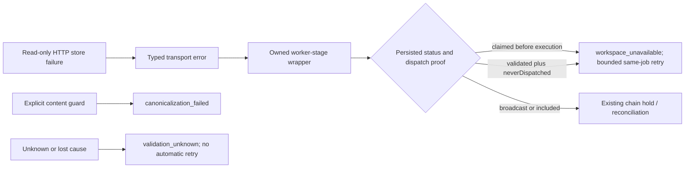

# #3419 — pre-validation transport provenance

2026-10-23 · In progress · `codex/3419-validation-transport-provenance` → `testnet-canary`

Risk: high. A mistaken retry can duplicate a chain publication. User authorized implementation, PR/reviewer convergence and live testnet validation; merge remains a maintainer action. Preserve local #3356 plan/report changes outside this PR.

## Outcome and evidence

The reported #3409 job ended from `claimed` with `canonicalization_failed` and only `fetch failed`. That evidence cannot identify the historical request or establish malformed RDF. Current native worker preflight reads assertion history and workspace heads over the store adapter; both SPARQL HTTP adapters already produce `StoreReadTransportFailure` at proven read-only boundaries. The publisher ignores that contract and defaults unknown pre-validation exceptions to canonicalization. Pure payload guards also throw generic errors, preventing reliable distinction.

Acceptance: persist a closed worker stage and typed cause category with sanitized diagnostics; distinguish known content rejection, dependency outage and unknown failure; retry typed outages only with persisted pre-dispatch proof; retain authority/stale-intent handling and all chain-evidence holds. Do not replay historical jobs, infer safety from missing hashes/messages, or change nonce/write-ahead/reconciliation policy.

## Design and tradeoffs

Choose a publisher-owned stage wrapper, explicit content-validation error and existing storage/chain typed contracts. Only unwrap the owned wrapper; arbitrary/lost cause chains stay unknown. Persist optional closed-enum stage/cause metadata through the existing payload codec. Unknown pre-validation failures become terminal `validation_unknown` (operator investigation), rather than asserting a content cause. This adds a failure code: old binaries cannot read new-code records, so rollback requires draining/quarantining those jobs rather than rewriting evidence. Existing records are not migrated.

Reject global `fetch failed`/timeout keyword retries: the same text can occur after dispatch. Replace pre-validation keyword inference with typed classification; preserve the separate broadcast/included mapper and structured authority/stale intent contracts. Explicit deterministic payload guards keep `canonicalization_failed`; unexpected exceptions inside those functions remain unknown.

## Work and verification

1. **Producer and classification:** reproduce an actual failed SPARQL HTTP read; add stage boundaries for native/raw worker preflight, snapshot resolution, payload validation/preparation. Preserve known typed causes; use fixed public diagnostic text, never raw RDF, response body, URL or credentials. Add focused mapper/producer tests, including misleading text and wrapped/lost causes.
2. **Durable observation and safety:** extend failure registry/codec; verify legacy decoding, new metadata round-trip, actual publisher state/retry projection, persisted-status mismatch, hash-bearing RPC errors, previous-attempt hashes and included holds. Run focused publisher tests, build, file-size and required repository checks. Scope is one coupled producer/policy/codec PR; reassess if unrelated changes emerge.
3. **Remote convergence:** open PR targeting `testnet-canary`, attach it to this chat and request `otReviewAgent`. Collect all comments, reviews and threads, address substantive findings and re-run affected checks. Maximum 10 substantive rounds; 30-minute window per revision, poll about every 2 minutes, no idle extension from metadata-only edits. Record exact reviewed/CI head.
4. **Live validation:** build native runtime and verify SQLite before claiming a wallet batch. Atomically claim an available existing batch, copy prepared secrets into an isolated mode-0600 home and preserve allocator floors (batch1: op0 25002, publisher0 2). Use a controlled, task-owned transport fault at a read-only preflight boundary after admission; observe persisted stage/cause, no publication hash and bounded same-job retry. Remove fault, complete a real testnet publish if network prerequisites permit, verify receipt/readback and normal lifecycle plus terminal negative controls. Report infrastructure limits separately from fix evidence.
5. **Cleanup/report:** stop only task-owned processes/proxies/containers; reconcile every created job/transaction and all signer pending/latest nonces before releasing the matching batch claim. Retain claim if any send is uncertain. Remove copied keys, preserve sanitized evidence/report, update this ledger. Reuse current worktree; retain it for review.

## Adversarial review before implementation

Self-review: typed read provenance alone is not proof of publication position; persisted `claimed` or write-ahead `neverDispatched` plus `validated` is also required. A previous-attempt hash must continue to hold even if the current exception is typed. Arbitrary wrappers must not manufacture proof. New diagnostics must serialize only closed values and fixed messages, since store errors can contain private response excerpts. Explicit content guards must not turn arbitrary failures in canonicalization code into content diagnoses. Final preflight must be wrapped too. Remote reviewer provides the independent implementation review.

## Execution ledger

| Work | State | Evidence / next step |
| --- | --- | --- |
| Investigation and plan | Complete | Native store read producer identified; historical exact request remains unknown |
| Implementation and local checks | In progress | Add red producer/classification regression first |
| PR and remote review | Pending | No PR yet |
| Live run and cleanup | Pending | No #3419 claim or live resources created |

Resource ownership: `.tmp/issue-3419/` is task scratch/evidence. Retain sanitized evidence and report; delete copied secrets at completion. No active #3419 resources yet.

### Review round 1 and live evidence

- Source head `0e1f68ed2316707e4b971d13aec02fefa3705047`: 2,402 publisher unit tests passed. Native live job `11a65348-ef19-48e7-bca8-eacafdf753e3` recorded an actual preflight connection refusal as `initial_preflight / store_read_transport`, projected bounded backoff without a hash, retried once as the same job and finalized on Base Sepolia. Receipt/readback verification continues. A malformed backend response terminated a separate job as sanitized `validation_unknown` without a send.
- Remote reviewer `otReviewAgent`, review `5626627386`, found five actionable items: adapter read deadline provenance; duplicate classifier branches; snapshot error ownership; a full-suite keyword fixture; missing preparation caller coverage. All are addressed in revision 2. Storage deadline errors preserve their prior timeout type and fields, with read-only tagging only inside proven read boundaries. Mutation/receipt deadlines remain excluded.
- Revision 2 focused checks: storage transport suite 24 passing; mapper/provenance 202 passing; full publisher worker integration suite 71 passing. Final full unit/build checks are running. No new reviewer window is started by documentation-only updates; substantive revision 2 gets one 30-minute window, maximum 10 rounds overall.
- Batch 1 claimed by `issue-3419-20261023`; ownership in ignored evidence. Native home uses API 19319 and managed store 19719; task-only preflight transport shim redirects a single read to refused port 19419, without touching signer/chain calls. Publisher and daemon are stopped during revision. All resources remain owned until final transaction/nonces reconciliation.
- One cohesive PR remains appropriate: producer typing, classification, codec and their callers must change together. The review additions are coupled regression coverage, not a separable feature.
