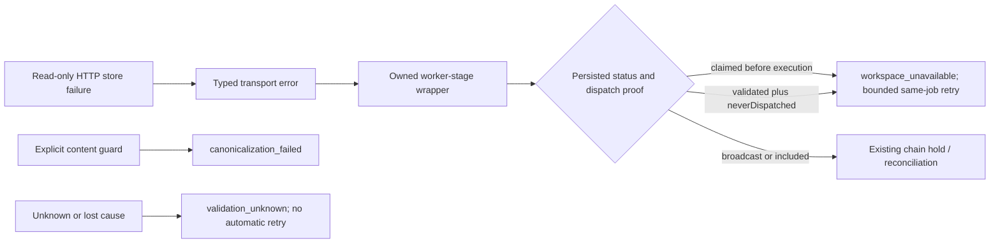

# #3419 — pre-validation transport provenance

2026-10-23 · In progress · `codex/3419-validation-transport-provenance` → `testnet-canary`

Risk: high. A mistaken retry can duplicate a chain publication. User authorized implementation, PR/reviewer convergence and live testnet validation; merge remains a maintainer action. Preserve local #3356 plan/report changes outside this PR.

## Outcome and evidence

The reported #3409 job ended from `claimed` with `canonicalization_failed` and only `fetch failed`. That evidence cannot identify the historical request or establish malformed RDF. Current native worker preflight reads assertion history and workspace heads over the store adapter; both SPARQL HTTP adapters already produce `StoreReadTransportFailure` at proven read-only boundaries. The publisher ignores that contract and defaults unknown pre-validation exceptions to canonicalization. Pure payload guards also throw generic errors, preventing reliable distinction.

Acceptance: persist a closed worker stage and typed cause category with sanitized diagnostics; distinguish known content rejection, dependency outage and unknown failure; retry typed outages only with persisted pre-dispatch proof; retain authority/stale-intent handling and all chain-evidence holds. Do not replay historical jobs, infer safety from missing hashes/messages, or change nonce/write-ahead/reconciliation policy.

## Design and tradeoffs

Choose a publisher-owned stage wrapper, explicit content-validation error and existing storage/chain typed contracts. Only unwrap the owned wrapper; arbitrary/lost cause chains stay unknown. Persist optional closed-enum stage/cause metadata through the existing payload codec. Unknown pre-validation failures become terminal `validation_unknown` (operator investigation), rather than asserting a content cause. This adds a failure code: old binaries cannot read new-code records, so rollback requires draining/quarantining those jobs rather than rewriting evidence. Existing records are not migrated.

Reject global `fetch failed`/timeout keyword retries: the same text can occur after dispatch. Replace pre-validation keyword inference with typed classification; preserve the separate broadcast/included mapper and structured authority/stale intent contracts. Explicit deterministic payload guards keep `canonicalization_failed`; unexpected exceptions inside those functions remain unknown.

## Work and verification

1. **Producer and classification:** reproduce an actual failed SPARQL HTTP read; add stage boundaries for native/raw worker preflight, snapshot resolution, payload validation/preparation. Preserve known typed causes; use fixed public diagnostic text, never raw RDF, response body, URL or credentials. Add focused mapper/producer tests, including misleading text and wrapped/lost causes.
2. **Durable observation and safety:** extend failure registry/codec; verify legacy decoding, new metadata round-trip, actual publisher state/retry projection, persisted-status mismatch, hash-bearing RPC errors, previous-attempt hashes and included holds. Run focused publisher tests, build, file-size and required repository checks. Scope is one coupled producer/policy/codec PR; reassess if unrelated changes emerge.
3. **Remote convergence:** open PR targeting `testnet-canary`, attach it to this chat and request `otReviewAgent`. Collect all comments, reviews and threads, address substantive findings and re-run affected checks. Maximum 10 substantive rounds; 30-minute window per revision, poll about every 2 minutes, no idle extension from metadata-only edits. Record exact reviewed/CI head.
4. **Live validation:** build native runtime and verify SQLite before claiming a wallet batch. Atomically claim an available existing batch, copy prepared secrets into an isolated mode-0600 home and preserve allocator floors (batch1: op0 25002, publisher0 2). Use a controlled, task-owned transport fault at a read-only preflight boundary after admission; observe persisted stage/cause, no publication hash and bounded same-job retry. Remove fault, complete a real testnet publish if network prerequisites permit, verify receipt/readback and normal lifecycle plus terminal negative controls. Report infrastructure limits separately from fix evidence.
5. **Cleanup/report:** stop only task-owned processes/proxies/containers; reconcile every created job/transaction and all signer pending/latest nonces before releasing the matching batch claim. Retain claim if any send is uncertain. Remove copied keys, preserve sanitized evidence/report, update this ledger. Reuse current worktree; retain it for review.

## Adversarial review before implementation

Self-review: typed read provenance alone is not proof of publication position; persisted `claimed` or write-ahead `neverDispatched` plus `validated` is also required. A previous-attempt hash must continue to hold even if the current exception is typed. Arbitrary wrappers must not manufacture proof. New diagnostics must serialize only closed values and fixed messages, since store errors can contain private response excerpts. Explicit content guards must not turn arbitrary failures in canonicalization code into content diagnoses. Final preflight must be wrapped too. Remote reviewer provides the independent implementation review.

## Execution ledger

| Work | State | Evidence / next step |
| --- | --- | --- |
| Investigation and plan | Complete | Native store read producer identified; historical exact request remains unknown |
| Implementation and local checks | Complete | Final unit 2,413; focused 216; storage 238; full worker 71; build/types/file-size passed |
| PR and remote review | In progress | PR #3431; source 2a96dc138a5061bcb91fc21f1924906e758b2222; reviewer clean, final CI pending |
| Live run and cleanup | Complete | Six confirmed publications; twelve receipts/all ten signer nonces reconciled; both claims released; homes removed |

Resource ownership: `.tmp/issue-3419/` is task scratch/evidence. Retain sanitized evidence and report; delete copied secrets at completion. No active #3419 live resources remain; sanitized evidence is retained.

### Review round 1 and live evidence

- Source head `0e1f68ed2316707e4b971d13aec02fefa3705047`: 2,402 publisher unit tests passed. Native live job `11a65348-ef19-48e7-bca8-eacafdf753e3` recorded an actual preflight connection refusal as `initial_preflight / store_read_transport`, projected bounded backoff without a hash, retried once as the same job and finalized on Base Sepolia. Receipt/readback verification continues. A malformed backend response terminated a separate job as sanitized `validation_unknown` without a send.
- Remote reviewer `otReviewAgent`, review `5626627386`, found five actionable items: adapter read deadline provenance; duplicate classifier branches; snapshot error ownership; a full-suite keyword fixture; missing preparation caller coverage. All are addressed in revision 2. Storage deadline errors preserve their prior timeout type and fields, with read-only tagging only inside proven read boundaries. Mutation/receipt deadlines remain excluded.
- Revision 2 focused checks: storage transport suite 24 passing; mapper/provenance 202 passing; full publisher worker integration suite 71 passing. Final full unit/build checks are running. No new reviewer window is started by documentation-only updates; substantive revision 2 gets one 30-minute window, maximum 10 rounds overall.
- Batch 1 claimed by `issue-3419-20261023`; ownership in ignored evidence. Native home uses API 19319 and managed store 19719; task-only preflight transport shim redirects a single read to refused port 19419, without touching signer/chain calls. Publisher and daemon are stopped during revision. All resources remain owned until final transaction/nonces reconciliation.
- One cohesive PR remains appropriate: producer typing, classification, codec and their callers must change together. The review additions are coupled regression coverage, not a separable feature.

### Review round 2 / final revision

- Reviewer found string timeout rejection extraction had diverged from the existing broadcast/included mapper; fixed by preserving string extraction there while keeping fixed unknown pre-validation diagnostics. Added durable broadcast/included string-timeout cases with retained hashes and valid timeout metadata.
- Added a real worker final-preflight hash-bearing RPC case: the owned wrapper does not qualify the error for dependency retry; it remains terminal unknown, with neither automatic nor manual reset. Existing persisted-hash and inherited-hash holds remain covered independently.
- Focused final checks: 205 tests passing; publisher build/type/package checks passed. Prior revision: full unit 2,405 passed; full worker 71 passed; storage regression 238 passed; native runtime build passed. Final unit/CI run follows the final source commit.
- Live revised-head UPDATE recovered after the injected read fault and finalized. A normal CREATE first hit the existing LU-5 policy-lookup deadline before `publisher.publish` (`dkg-agent-publish.ts` inline-encryption resolution); targeted manual retry followed verified pre-send producer/journal evidence, never absence of a hash alone. Reducing the isolated publisher subset to its first prepared wallet and using the verified history-capable RPC as primary allowed that same job to finalize. No product policy gate was bypassed. Record this infrastructure interruption in the final report.

### Review round 3 / explicit policy and precise type boundary

- Reviewer requested direct metadata construction for known staged-state conflicts instead of a synthetic English error sent through the legacy mapper. Codes/messages/holds remain identical; conflict policy is now explicit.
- Read provenance now returns the precise read-specific subclass union with erased nominal markers, retaining timeout inheritance without narrowing ordinary mutation timeouts to `never`. Public-package type fixtures verify both negative ordinary-timeout handling and positive read-error diagnostics during publisher build.
- Both package builds and the focused 205 tests passed; final prior-head unit suite passed all 2,408 tests. The first live run fully reconciled six successful transactions and all ten signers, removed its isolated home and released Batch 1.
- To validate the final review head directly, reclaim the same available Batch 1 into a fresh home only after native build readiness; require all wallet nonces to equal the prior release record and carry allocator floors 25007/2. Reuse already registered graph 947, publish one new tiny KA with the same preflight fault, then reconcile the additional transaction and release again. Preserve both ownership/release records. No historical job replay.

### Review round 4 / cross-realm transport recording

- Reviewer found timeout metadata still disagreed with the publish mapper for cross-realm errors. Exported the internal throw-safe `readPublishErrorFacts` helper for use by both mapping and post-dispatch timeout detection. Unknown pre-validation diagnostics remain fixed and terminal. Added durable cross-realm/serialized timeout cases for broadcast/included and a cross-realm unknown pre-validation case.
- Prior source `de87b5c98de067f6112c282233f4de4e752160eb` passed all 2,408 publisher unit tests and the storage 238-test regression set. It also passed the live read-fault → same-job retry → confirmed publication check in fresh namespace/context slot 949.
- Fresh-home setup did not reuse slot 947: registration produced 948, and cores correctly refused that reused namespace because it was already bound to 947. Its job exhausted bounded quorum retries without signing a publish transaction; the native guarded exact-job clear succeeded and its journal/evidence is retained. A new namespace registered slot 949 and confirmed successfully. Both additional registrations are included in nonce/receipt reconciliation. This is a setup correction, not a product-policy bypass.
- Keep this second isolated home and matching Batch 1 claim stopped through final review. Its reconciled allocator floor is now 25009 (default author), 2 (secondary author). Restart at the final source head and confirm an UPDATE in slot 949, then reconcile and release. Preserve both claim cycles and all public evidence.

### Final execution evidence

- PR #3431 targets `testnet-canary`; reviewed source `2a96dc138a5061bcb91fc21f1924906e758b2222`. Review 5627125897 by `otReviewAgent`: “Review Agent completed this review and found no issues.” All review threads resolved; five substantive source revisions.
- Final publisher unit suite: 133 files / 2,413 tests passed. Focused mapper/provenance/message 216; storage regressions 238; full worker integration 71. Package builds/types/exports, native runtime build and file-size guard passed.
- Final source confirmed job `2d332425-bb7b-40aa-98b1-2d9507801f0e` as an UPDATE in context slot 949 after one preflight connection refusal and same-job retry. Across both claim cycles, six publications succeeded with exact RDF readback, on-chain roots/publishers/membership and successful receipts. Unknown/stale/input/auth/restart and chain-evidence controls passed.
- All twelve submitted transactions succeeded; every consumed nonce is accounted for and all ten wallets ended pending == latest. All nine admitted jobs are settled (six finalized, two terminal negative controls, one guarded cleared pre-send setup-conflict job). Both Batch 1 claims released and both isolated homes removed. No active live resources remain.
- Preserve Batch 1 native allocator floors: default author `0x247b02c301b34e52e9021728f34c3457f81f2dfc` next 25009; secondary `0xaddff5d971ec77276bd38d77aad2822c41c72611` next 2.
- Full report: `run-reports/2026-10-23-issue-3419-testnet.md`; sanitized evidence `.tmp/issue-3419/evidence/`. Validation is posted at https://github.com/OriginTrail/dkg/pull/3431#issuecomment-6363233332. Final run report and ledger are retained locally rather than changing the reviewed CI source head. Final remote CI remains the only pending work at this note. No merge performed.

### Final CI coverage correction

- All fifty test/build checks passed at `2a96dc138a5061bcb91fc21f1924906e758b2222`, but merged changed-line coverage failed at 61/68 (89.71%) against the required 90%, causing the dependent CI gate to fail. No coverage policy was weakened.
- Added a real worker negative control for a resolved payload count mismatch: persisted `claimed / content_validation / content`, terminal `canonicalization_failed`, no retry/hash, and zero executor calls. This covers the explicit deterministic content guard at `async-lift-validation.ts` and fulfills the content-versus-dependency acceptance case. Focused set now passes 217 tests.
- The correction changes tests and this execution ledger only. Publisher/storage production trees remain byte-identical to the reviewed and live-validated `2a96dc138a5061bcb91fc21f1924906e758b2222`; no further wallet activity or live replay is warranted. Re-run CI and remote review for this final test-only revision, with the same bounded 30-minute revision window.
- Focused V8 measurement confirmed the public mismatch guard was already covered; the missing changed line is the private count guard at line 62. The worker regression now covers both public and private mismatches; line 62 has one measured statement hit, and all 218 focused tests pass. The final follow-up remains test-only, with unchanged production trees and no new live activity.
