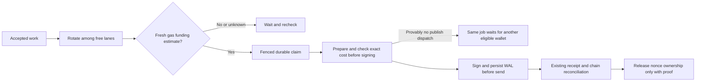

# Issue 3591 — fair, funding-aware async publishing

Date: 2026-10-29. Status: in progress. Owner: Codex (single implementation owner).
Base: `testnet-canary`, explicitly requested; discovery pinned to `002dd09cfd6e58b631023c4be6b1f9a7118e93de`.
Branch: `codex/3591-fair-funded-wallets`.

## Outcome and evidence

Sparse arrivals currently wake six fixed wallet loops in array order; the first loop can repeatedly take the only accepted job. Burst concurrency already works. Funding failures are returned jobs, so the runner's exception backoff does not pace an underfunded wallet. The issue's 377 successful receipts and 48 insufficient-funds failures establish the reported imbalance and failures, but do not establish idle workers during backlog. Source: https://github.com/OriginTrail/dkg/issues/3591 (no comments at discovery).

Use a rotating pool of free wallet execution lanes, keeping six concurrent calls and skipping busy lanes. Add fresh native-gas eligibility before acquiring new jobs, a bounded funding cooldown, and a fresh exact prepared-transaction cost check before signing. Funding observations are estimates, not authority to replay. Requeue the original logical job only when the existing write-ahead boundary proves no publish was dispatched and the fenced current record carries no transaction evidence. Transaction-bearing funding failures stay with existing chain reconciliation; no error-message-based reassignment. The main risk is losing nonce/transaction ownership during a funding race.

## Design and alternatives

- Rotating only wake order is smaller but leaves timer races and immediate fixed-loop reacquisition. Choose an in-process free-wallet pool, with a cursor updated after actual non-null processing; durable claim locks remain authoritative. Fairness means sparse rotation and no starvation, not equal counts when service times differ.
- A queue/storage redesign is unnecessary. Keep RDF job schemas, admission APIs, claim tokens, durable WAL and existing chain proof.
- Per-job exact gas estimation before claiming requires publisher/ACK preparation under no ownership. Instead use a documented advisory initial gas estimate, learn prepared gas limits, and apply current fee policy/cap plus fresh balance. Confirm exact maximum cost immediately before signing. Unknown/stale reads wait with bounded pacing; they never mean insufficient funds or authorize execution.
- Do not turn historical failed jobs into automatic retries. New proof-safe pre-dispatch resets preserve job ID, immutable request/admission, journals and lease fencing. A recorded hash (including inherited recovery evidence), prior acceptance, timeout, nonce conflict or ambiguous endpoint outcome excludes that reset.
- After any funding failure cool down the wallet. Fresh observations re-enable it after replenishment. If all are ineligible, accepted jobs remain visible and unclaimed.
- Export bounded per-wallet scheduling/funding observations (claims, completion/failure, busy duration, eligibility reason and observation age); never raw errors, signed payloads, RPC credentials or keys.

## Execution and acceptance

1. **Characterize (in progress):** real current runner fixture for 60 sparse jobs and 60 burst jobs; inspect funding, claim and recovery contracts. Build baseline and retain observed failures. Scope: publisher runner tests, chain safety tests and CLI runtime composition.
2. **Implement:** free-wallet scheduling; chain-owned gas funding capability and exact pre-sign guard; publisher eligibility checks outside canonical locks, freshness recheck at claim, and narrowly fenced pre-dispatch reset. Keep current state/nonce owners and recovery paths. Register new tests in native unit CI. One cohesive PR is preferred; reassess near 1,000 authored changed lines and split only if independently reviewable boundaries improve safety.
3. **Verify:** sparse fairness, bursts/sustained backlog, heterogeneous durations, one/all ineligible, RPC unknown/stale reads, replenishment, changed fees/balance between claim and send, concurrent claims, shutdown/restart, stale executor fencing and ambiguous/prior accepted sends. Run affected publisher/chain/CLI suites, build, lint, file-size and CI policy checks. Self-review separately for scheduling, transaction safety, and coverage; independent implementation review is the configured remote reviewer, not a claimed independent plan review.
4. **PR and review:** open into `testnet-canary`, attach, request established remote reviewer, collect all paginated comments/reviews/threads/checks (including resolved/outdated), address at most ten response rounds. Each substantive revision gets the skill's bounded 30-minute observation window; preserve deadlines and round count. Do not merge or enable auto-merge.
5. **Live testnet:** native macOS/Node 22, claimed prepared batch, isolated home, authenticated API and oxigraph-server. Record chain/Hub/token/PCA/nonce/allocator baselines. Run sparse plus burst mixed async sharing/publishing, read/query/updates and restart regressions. Use a clearly labeled local RPC fault proxy for one/all funding read rejection, replenishment, pre-send race and ambiguous send; do not drain/fund wallets or claim injected faults are real balance changes. Require actual successful chain receipts, canonical content/root and native job evidence, exact transaction history and no duplicates; preserve every failed attempt. Compare the same sparse/burst workload on baseline and candidate where funded budget permits. Separate latency/throughput from fairness and avoid claiming gains from synthetic tests alone.
6. **Handoff/cleanup:** reconcile every job/send and all used signer pending/latest nonces, stop owned writers/listeners, restore only run-created PCA bindings, verify immutable pool originals and remove disposable key copies before releasing the claim. Retain PR source and compact evidence until the user's manual merge. After merge is verified, archive only the task-owned managed worktree and retire eligible test state. No cleanup of prior tasks, shared services or caches.

## Review and recovery constraints

Self-review findings incorporated: do not perform funding RPCs while holding the queue's canonical claim mutex; an eligibility observation can expire while waiting for that lock, requiring a synchronous age check before committing a claim. Existing signed-hash write-ahead is not proof of acceptance or absence. A response lost after a send must keep its original wallet/nonce. A new pre-sign guard must cover create and update and leave unrelated signer transactions unchanged. Restart must recover persisted jobs without trusting process-local eligibility state. No independent plan reviewer was used.

Stop affected live mutations if a receipt/hash/nonce cannot be reconciled, ownership is uncertain, current testnet bindings differ, or a result/root mismatches; retain the wallet claim and evidence. Do not blind-replay a timed-out request. Rollback removes advisory scheduling/funding behavior; it cannot undo chain effects. No durable job schema migration is planned.

## Resources and current state

| Resource | Owner/purpose | Retirement condition |
| --- | --- | --- |
| `/Users/richardsutton-tracer/.codex/worktrees/3591-wallet-scheduling/dkg` | This task; managed source, dependencies, ignored scratch | After manual merge and retained evidence/handoff |
| `.tmp/3591/` in that checkout | This task; private local test evidence, no committed credentials | After reconciled live run and preserved report |
| Prepared wallet pool | Shared immutable source; not owned | Never remove/change source bundles |

- Dependency install, baseline runtime build and native SQLite construction passed. Baseline sparse test reproduced 60/0/0/0/0/0; candidate sparse tests (including unequal preparation delays) produce 10/10/10/10/10/10. Burst/backlog test proves six concurrent executions and progress past a slow wallet.
- Selection is ordered only through the optional prepared-attempt capability (`claimScheduling`), then execution continues concurrently. This closes the race where unequal funding RPC latency could defeat a rotation of calls alone. Legacy publisher implementations retain the prior method contract.
- Initial complete publisher unit run: 3,730 passed and three fixture failures: old `processNext` spies no longer observed the scheduled capability. Updated those fixtures to observe the new entry point without changing their behavioral assertions; all 39 affected/new scheduling tests passed. Chain gas/fee/send checks passed (29 plus one pre-existing skip), adapter parity 22 passed, native funding composition two passed, targeted CLI/runtime/recovery 55 passed. Build/type/package checks, lint and file-size guards passed; final pre-submit refresh pending.
- Moved the existing publish-plan declarations and pinned-wallet handler unchanged into focused modules to obey existing one-way file-size budgets; no budget or ignore rules were relaxed.
- Live resources: `/Users/richardsutton-tracer/Projects/dkg-3591-validation-20261029/{home,evidence}` owned by this run. Claimed batch-1 under run `issue3591-20261029`; source pool untouched. Ten signer pending/latest counts matched at baseline. Base Sepolia 84532, configured Hub verified. Reused owned PCA21 (valid through November 2, remaining allowance positive); original six publisher bindings were zero. Six temporary registrations and one fresh public/open context registration completed and are recorded in the durable setup ledger. Ports API19391/store19491. Owned daemon foreground exec session72315; no measured workload started yet. Preserve claim until full send/job reconciliation and cleanup.
- New per-author allocator floor `1793308438672` exceeds observed chain25368 and prior native campaign allocations, separating this run from unpublished reservations. Retain this watermark for handoff; never lower it.
- PR: https://github.com/OriginTrail/dkg/pull/3605, open into testnet-canary, reviewer otReviewAgent explicitly requested. Initial head2b3378e2d3; initial observation window21:21:33–21:51:33UTC. Review response rounds0/10. Complete paginated sweeper and deadline state are retained in ignored task evidence.
- The refreshed complete publisher unit run passed all3,733 tests across174 files on2b3378e. Native gas adapter checks, 55 CLI checks, parity22, lint/build/size checks also passed.
- Pre-live trace inspection exposed a new edge case in the initial free-pool implementation: staggered empty polls could all choose the same free ineligible wallet, preventing discovery of replenishment without new admission. A new regression first failed with six visits to wallet0; keep a polling rotation separate from the actual-work rotation and reset the latter only on work notifications. Integration coverage checks discovery of a replenished later wallet without any notification. The affected scheduling suites passed75 checks before adding the final replenishment case; final case and CI refresh pending. No measured live workload had started, and the owned daemon was stopped before replacing its build. Proxy remains owned on19591.
- Next action: commit/push the polling correction, rebuild/restart the same claimed home and run the measured workload plus funding/transport fault cases; continue bounded remote review. No merge authorized.

## Review response round 1

Six remote findings collected across both reviews, including complete thread histories. The polling correction was already present in089603; added a real runner + funding-policy + retained-job replenishment test as requested. Funding observations now start concurrently before ordered claim admission. Shutdown settles these started reads without admitting work. Durable retain/reset/fail decisions now live together in `async-lift-execution-failure.ts`, with explicit `fundingRecoveryPolicy` independent of routing: CLI selects proof-first, libraries default to legacy. Both raw and named executors use the same fenced session transition.

Strengthened post-WAL ownership tests with another accepted job, an expired funding cooldown, restart and a fresh funding policy. An original wallet cannot take waiting work; another funded wallet can. Added inherited-transaction coverage: an unaccounted earlier hash cannot be erased or called ineffective because the new attempt lacks funds. It remains held under the existing wallet_unavailable code, excludes automatic/manual reacceptance and preserves its original evidence. No durable format change.

Validation:336 targeted checks passed before the last shutdown case; final new/expanded cases24 passed, plus publisher build/type/package checks, lint and size guards. Full publisher run on2b3378e passed3733; CI validates the revised whole. One cohesive PR retained: correctness crosses scheduling, native fee observations and existing ownership; roughly300 lines are documentation or unchanged module relocations and the extra safety cases are directly tied to the changed boundaries. No size thresholds/budgets or assertions were weakened.

Live setup smoke on089603: WM sealing and async sharing succeeded, but publish returned503 async_publisher_unavailable while the runtime was still starting. Source route returns this before intent resolution or enqueue; no publish job was admitted. Retain the failed smoke verdict and its SWM fixture. The daemon was stopped, not replayed. Main measured phases wait for explicit publisher availability and live peers and will use fresh fixture names. No live publication improvement is claimed yet.

## Review response round 2 and matched baseline protocol

Four further findings addressed together: use one wallet-bound, single-use prepared-attempt capability for runner and direct processing; refresh expired funding observations after a slow preceding scheduling turn, outside the canonical lock; share a lightweight ASK availability read rather than decode queue payloads for every wallet; and prove six real publisher/coordinator executions enter before any handler completes. New availability calls are declared and driven through the queue boundary oracle on both store capability stacks, preserving caller lanes rather than consuming control slots.

The complete publisher run passed3,747 checks and caught one missing static audit declaration for the new query. Correct that declaration and add observed lane coverage; retain the failed log. Targeted scheduling/funding/ownership checks110 passed and CLI regression checks55 passed. Recheck the audit, build, lint and file-size guards before pushing. No assertions or budgets are relaxed.

Live f935cfa results so far: smoke-ready publication7.594s; sparse12/12 with exactly two publications per wallet; mixed18/18 with six concurrent sharing/publishing pipelines. Every successful asset independently passed canonical receipt, signer/nonce, sealed/chain root and exact VM payload checks. Queries had no failures. These results qualify f935cfa only; the final revision still requires live validation. The original pre-admission503 smoke failure remains retained. Funding and ambiguous-send fault cases are still pending. Node stopped before rebuilding round2; proxy remains owned on19591. The current durable recovery note supersedes older process snapshots above.

After review convergence, pin both target testnet-canary and final PR SHAs. Run the identical 12-item serial and18-item six-pipeline workloads on each checkout, using the same claimed wallet set, PCA/context, home/allocator, payload size sequence32/128/64, chain RPC proxy in normal mode, settings and2s query observer. Use distinct equal-length asset names and retain both input manifests. Only one daemon may use the home at a time. Record first/last admission and completion, per-stage admission and confirmed-publication latencies, completed throughput, retries, query failures and wallet distribution. Keep setup, cooldown drains, builds and independent post-run verification outside timed intervals. Report small-sample/network/order limitations and any failed requests; do not equate improved wallet distribution with lower latency. If a measurable slowdown appears, investigate and repeat paired phases before recommending merge. User explicitly requested this baseline after convergence.

## Review response rounds 3–4: funding boundaries and RPC latency

Round3 adds the actual exported PublisherGasFundingError to the pre-dispatch reset test, preserving RPC-text coverage;20 funding cases passed. Round4 separates native-gas recovery from job-specific TRAC/PCA shortfalls. Keeping the broad reset would repeatedly select an oldest publication costing more TRAC than its wallet/PCA can cover. A job-specific retry eligibility schedule could also solve that starvation, but would add mutable job state, retention/restart semantics and queue policy outside this issue. Choose the existing terminal failed-job contract for those shortfalls; only typed native-gas guards or explicit native-gas RPC errors enter same-ID automatic reset/cooldown. Broad funding recognition still protects inherited unresolved transaction evidence, independently of the narrower reset rule. All post-WAL outcomes retain proof-first ownership.

Fee pricing and pending-balance acquisition now overlap; cost construction is pure and observation time starts before both reads. Preserve the prepared transaction's local gas limit across the exact pre-sign balance await. Gated tests prove both reads start before either completes. A real coordinator test blocks candidate selection, expires funding after preparation and requires accepted status with no persisted wallet lock; fresh preparation then claims the same job.

Live progress is recorded on PR3605. The original timing harness masked upstream HTTP413 log-range responses as502; retain its measurements and one manually recovered LU5 policy-read failure separately. Normal-mode proxy pass-through was corrected and tested against actual413/200 batches. Fresh6d5b timing:12serial and18concurrent publications independently verified, no publication retries, one query503 from a2.5s live chain-authority deadline. This does not establish regression or improvement without the matched baseline. The round4 fee-read change requires a fresh final-candidate series before comparison. Baseline remains pending review convergence; source/keys/claim custody is retained safely, node stopped for revision.

## Review response round 5: preserve the native-gas cause through enrichment

The chain can wrap a native-gas estimation failure in InsufficientPublisherFundsError when its selected signer is the only signer in that adapter. Retain that native distinction by inspecting only this library-owned wrapper's immediate cause, using the same native-gas facts predicate; never walk arbitrary cause chains. A TRAC/PCA wrapper with a token-revert cause remains job-specific and failed. Add wrapped native RPC coverage to same-ID reset/cooldown and post-WAL hold cases, and a concrete token-revert cause to the unaffordable-then-affordable test. No schema or successful-publication path changes.

The repeated live pre-sign race on040ff reproduced this exact gap: the job became failed insufficient_funds before any signed hash; its failed verdict and native snapshot are preserved. Stop the observation driver and daemon, keep custody, and retain that historical terminal failed test job as a non-retryable, unsigned reproduction; do not clear or revive it to hide the failure. Fresh final-revision all-ineligible/race tests must then demonstrate automatic same-ID failover; do not overwrite the040ff failure.

Retry-contract clarification from source inspection: insufficient_funds is terminal, so neither automatic nor manual retry reaccepts it. Retain the040ff unsigned failed race as an explicitly accounted terminal reproduction; fresh final-revision fixtures prove automatic same-ID native-gas recovery. Guarded clear/resubmit remains available to operators after funding repair, but is unnecessary for preserving this campaign's evidence.

## Live response round 6: the selector owns its native-shortfall evidence

The fresh3d7 live race found a distinct earlier producer: _assessFundedCandidates can reject a fresh zero-native snapshot before estimation and construct InsufficientPublisherFundsError without any cause. Preserve that positive native-floor evidence at its authoritative owner with an optional nativeGasShortfall marker, set only if every refreshed unfunded candidate has a known native balance at or below its own policy floor. Unknown native observations and native-healthy TRAC/PCA shortfalls do not receive the marker. The publisher consumes it only on the known chain-owned error class, alongside the immediate native RPC cause. No balances/thresholds are reinterpreted in the publisher, no new job state, and library legacy failure policy remains unchanged.

Drive the real selector in tests across zero, equal-floor, above-floor and unknown native balances with inadequate TRAC. Exercise its cause-less marker through same-ID publisher recovery/cooldown while preserving the TRAC rejection and post-WAL tests. Preserve both historical unsigned failed race jobs natively as terminal reproductions; fresh fixed fixtures must prove automatic failover. The custody audit allows only those exact terminal IDs after checking no transaction evidence, no automatic retry, an unminted identity and complete signer nonce reconciliation.

Same response batch includes remote feedback4418930708/4418930712: chain owns the throw-safe native-funding normalization, while publisher owns routing/recovery policy. Canonical retry disposition now exposes one status-independent unaccounted-hash predicate, reused by failure disposition; failed included-origin evidence remains an additional unconditional condition in hasBroadcastEvidence. Preserve live-hash precedence over older accounted recovery metadata.

## Review response round 7: recovery policy stays with failure disposition

Remove the recovery-only funding wrapper from the wallet eligibility implementation. Its sole consumer now expresses the unchanged native-or-broader-funding retention predicate locally in executionFailureDisposition, using the two imported canonical classifiers. This removes recovery's dependency on concrete routing state and preserves inherited-hash/TRAC handling without adding an abstraction.

Liveb19 validation passed the repeated all-ineligible/replenishment3-job case and the exact pre-sign selector race that had failed on040ff/3d7. The raced job retained its ID, reset from validated with no transaction history, and finalized through the expected other funded wallet; independent receipt/root/exact32-triple proof passed. Both superseded unsigned terminal reproductions remain preserved.

## Live response round 8: reduce the measured funding-read cost

The first post-convergence pair had nearly equal publishing medians, but two sharing authority retries reduced candidate pipeline throughput. A reverse baseline repeat reproduced severe authority/RPC timeouts without the PR and was aborted with every admitted job later reconciled. Preserve both results. A subsequent three-provider pair completed all18 concurrent publications on both revisions with no query failures, but the candidate was slower: median accepted-to-claim2.2s versus6ms, and two upstream429 responses. This is not a passing no-regression result.

Apply two small IO optimizations before another comparison: reuse an eligible observation only within its existing5s freshness bound (cooldown/revocation still takes precedence), and overlap independent latest-block and suggested-priority-fee reads in advisory funding acquisition. Reuse the canonical fee arithmetic and cap helpers; leave ordinary transaction pricing unchanged. Exact prepared-transaction balance checks remain authoritative. Test the freshness boundary, immediate revocation and gated parallel reads, then request review of the new revision and repeat a matched live comparison with the prepared three-provider configuration. Do not attribute all observed slowdown to these reads; periodic chain scans and public-RPC rate limits also varied.

## Live response round9: eliminate duplicate healthy-job probes

On47def the overlapping/cached observations reduced median accepted-to-claim delay from2200ms to788ms and improved concurrent publication median34846ms→29843ms. Healthy concurrent traffic still issued61balance and61tip calls versus baseline18balance/36tip calls. The later baseline serial sample was faster; its concurrent phase failed four publications before any transaction with LU5 unknown policy, plus eight query failures. A six-pipeline baseline warmup then retried four shares for chain-access-policy-timeout before all six completed. Preserve these failed/limited controls; they do not establish a clean no-regression result.

The pre-claim advisory is duplicating checks already owned by native execution. Compare retaining per-job probes with a shared market-quote cache against checking at startup and after known failures. A shared cache adds cross-adapter state and still performs speculative balance reads. Choose startup-and-failure probing for the native runtime: probe all wallets concurrently once before availability, retain positive eligibility until a proven native-gas failure, then defer30s and require a fresh successful observation before reopening. Existing selector checks and the exact prepared maximum-cost balance guard still run for every publication; none of these hints authorizes signing. A later depletion can cause one safe same-ID pre-dispatch reset before the wallet is excluded. Unknown/insufficient startup probes stay gated. Library `before-claim` mode keeps its existing5s freshness policy and legacy recovery defaults.

This removes healthy-job advisory RPCs without adding a shared quote cache or changing durable job state. Startup must drain started probes and recheck its lifetime before exposing a runtime. Validate one-time startup reads, later balance loss and same-ID reset, all-deferred retention/replenishment, unknown observations, startup cancellation and post-WAL ownership. Live all-low validation must allow transient unsigned claims after previously healthy balances drop, require eventual accepted jobs/no signed publication while all balances are zero, then prove recovery without a wake. Re-run final serial/concurrent workloads and report all baseline failures and residual cost explicitly.
