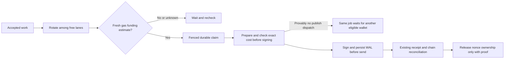

# Issue 3591 — fair, funding-aware async publishing

Date: 2026-10-29. Status: in progress. Owner: Codex (single implementation owner).
Base: `testnet-canary`, explicitly requested; discovery pinned to `002dd09cfd6e58b631023c4be6b1f9a7118e93de`.
Branch: `codex/3591-fair-funded-wallets`.

## Outcome and evidence

Sparse arrivals currently wake six fixed wallet loops in array order; the first loop can repeatedly take the only accepted job. Burst concurrency already works. Funding failures are returned jobs, so the runner's exception backoff does not pace an underfunded wallet. The issue's 377 successful receipts and 48 insufficient-funds failures establish the reported imbalance and failures, but do not establish idle workers during backlog. Source: https://github.com/OriginTrail/dkg/issues/3591 (no comments at discovery).

Use a rotating pool of free wallet execution lanes, keeping six concurrent calls and skipping busy lanes. Add fresh native-gas eligibility before acquiring new jobs, a bounded funding cooldown, and a fresh exact prepared-transaction cost check before signing. Funding observations are estimates, not authority to replay. Requeue the original logical job only when the existing write-ahead boundary proves no publish was dispatched and the fenced current record carries no transaction evidence. Transaction-bearing funding failures stay with existing chain reconciliation; no error-message-based reassignment. The main risk is losing nonce/transaction ownership during a funding race.

## Design and alternatives

- Rotating only wake order is smaller but leaves timer races and immediate fixed-loop reacquisition. Choose an in-process free-wallet pool, with a cursor updated after actual non-null processing; durable claim locks remain authoritative. Fairness means sparse rotation and no starvation, not equal counts when service times differ.
- A queue/storage redesign is unnecessary. Keep RDF job schemas, admission APIs, claim tokens, durable WAL and existing chain proof.
- Per-job exact gas estimation before claiming requires publisher/ACK preparation under no ownership. Instead use a documented advisory initial gas estimate, learn prepared gas limits, and apply current fee policy/cap plus fresh balance. Confirm exact maximum cost immediately before signing. Unknown/stale reads wait with bounded pacing; they never mean insufficient funds or authorize execution.
- Do not turn historical failed jobs into automatic retries. New proof-safe pre-dispatch resets preserve job ID, immutable request/admission, journals and lease fencing. A recorded hash (including inherited recovery evidence), prior acceptance, timeout, nonce conflict or ambiguous endpoint outcome excludes that reset.
- After any funding failure cool down the wallet. Fresh observations re-enable it after replenishment. If all are ineligible, accepted jobs remain visible and unclaimed.
- Export bounded per-wallet scheduling/funding observations (claims, completion/failure, busy duration, eligibility reason and observation age); never raw errors, signed payloads, RPC credentials or keys.

## Execution and acceptance

1. **Characterize (in progress):** real current runner fixture for 60 sparse jobs and 60 burst jobs; inspect funding, claim and recovery contracts. Build baseline and retain observed failures. Scope: publisher runner tests, chain safety tests and CLI runtime composition.
2. **Implement:** free-wallet scheduling; chain-owned gas funding capability and exact pre-sign guard; publisher eligibility checks outside canonical locks, freshness recheck at claim, and narrowly fenced pre-dispatch reset. Keep current state/nonce owners and recovery paths. Register new tests in native unit CI. One cohesive PR is preferred; reassess near 1,000 authored changed lines and split only if independently reviewable boundaries improve safety.
3. **Verify:** sparse fairness, bursts/sustained backlog, heterogeneous durations, one/all ineligible, RPC unknown/stale reads, replenishment, changed fees/balance between claim and send, concurrent claims, shutdown/restart, stale executor fencing and ambiguous/prior accepted sends. Run affected publisher/chain/CLI suites, build, lint, file-size and CI policy checks. Self-review separately for scheduling, transaction safety, and coverage; independent implementation review is the configured remote reviewer, not a claimed independent plan review.
4. **PR and review:** open into `testnet-canary`, attach, request established remote reviewer, collect all paginated comments/reviews/threads/checks (including resolved/outdated), address at most ten response rounds. Each substantive revision gets the skill's bounded 30-minute observation window; preserve deadlines and round count. Do not merge or enable auto-merge.
5. **Live testnet:** native macOS/Node 22, claimed prepared batch, isolated home, authenticated API and oxigraph-server. Record chain/Hub/token/PCA/nonce/allocator baselines. Run sparse plus burst mixed async sharing/publishing, read/query/updates and restart regressions. Use a clearly labeled local RPC fault proxy for one/all funding read rejection, replenishment, pre-send race and ambiguous send; do not drain/fund wallets or claim injected faults are real balance changes. Require actual successful chain receipts, canonical content/root and native job evidence, exact transaction history and no duplicates; preserve every failed attempt. Compare the same sparse/burst workload on baseline and candidate where funded budget permits. Separate latency/throughput from fairness and avoid claiming gains from synthetic tests alone.
6. **Handoff/cleanup:** reconcile every job/send and all used signer pending/latest nonces, stop owned writers/listeners, restore only run-created PCA bindings, verify immutable pool originals and remove disposable key copies before releasing the claim. Retain PR source and compact evidence until the user's manual merge. After merge is verified, archive only the task-owned managed worktree and retire eligible test state. No cleanup of prior tasks, shared services or caches.

## Review and recovery constraints

Self-review findings incorporated: do not perform funding RPCs while holding the queue's canonical claim mutex; an eligibility observation can expire while waiting for that lock, requiring a synchronous age check before committing a claim. Existing signed-hash write-ahead is not proof of acceptance or absence. A response lost after a send must keep its original wallet/nonce. A new pre-sign guard must cover create and update and leave unrelated signer transactions unchanged. Restart must recover persisted jobs without trusting process-local eligibility state. No independent plan reviewer was used.

Stop affected live mutations if a receipt/hash/nonce cannot be reconciled, ownership is uncertain, current testnet bindings differ, or a result/root mismatches; retain the wallet claim and evidence. Do not blind-replay a timed-out request. Rollback removes advisory scheduling/funding behavior; it cannot undo chain effects. No durable job schema migration is planned.

## Resources and current state

| Resource | Owner/purpose | Retirement condition |
| --- | --- | --- |
| `/Users/richardsutton-tracer/.codex/worktrees/3591-wallet-scheduling/dkg` | This task; managed source, dependencies, ignored scratch | After manual merge and retained evidence/handoff |
| `.tmp/3591/` in that checkout | This task; private local test evidence, no committed credentials | After reconciled live run and preserved report |
| Prepared wallet pool | Shared immutable source; not owned | Never remove/change source bundles |

- Dependency install, baseline runtime build and native SQLite construction passed. Baseline sparse test reproduced 60/0/0/0/0/0; candidate sparse tests (including unequal preparation delays) produce 10/10/10/10/10/10. Burst/backlog test proves six concurrent executions and progress past a slow wallet.
- Selection is ordered only through the newly optional durable-claim acknowledgement (`processNextScheduled`), then execution continues concurrently. This closes the race where unequal funding RPC latency could defeat a rotation of calls alone. Legacy publisher implementations retain the prior method contract.
- Initial complete publisher unit run: 3,730 passed and three fixture failures: old `processNext` spies no longer observed the scheduled capability. Updated those fixtures to observe the new entry point without changing their behavioral assertions; all 39 affected/new scheduling tests passed. Chain gas/fee/send checks passed (29 plus one pre-existing skip), adapter parity 22 passed, native funding composition two passed, targeted CLI/runtime/recovery 55 passed. Build/type/package checks, lint and file-size guards passed; final pre-submit refresh pending.
- Moved the existing publish-plan declarations and pinned-wallet handler unchanged into focused modules to obey existing one-way file-size budgets; no budget or ignore rules were relaxed.
- Live resources: `/Users/richardsutton-tracer/Projects/dkg-3591-validation-20261029/{home,evidence}` owned by this run. Claimed batch-1 under run `issue3591-20261029`; source pool untouched. Ten signer pending/latest counts matched at baseline. Base Sepolia 84532, configured Hub verified. Reused owned PCA21 (valid through November 2, remaining allowance positive); original six publisher bindings were zero. Six temporary registrations and one fresh public/open context registration completed and are recorded in the durable setup ledger. Ports API19391/store19491. Owned daemon foreground exec session72315; no measured workload started yet. Preserve claim until full send/job reconciliation and cleanup.
- New per-author allocator floor `1793308438672` exceeds observed chain25368 and prior native campaign allocations, separating this run from unpublished reservations. Retain this watermark for handoff; never lower it.
- PR: https://github.com/OriginTrail/dkg/pull/3605, open into testnet-canary, reviewer otReviewAgent explicitly requested. Initial head2b3378e2d3; initial observation window21:21:33–21:51:33UTC. Review response rounds0/10. Complete paginated sweeper and deadline state are retained in ignored task evidence.
- The refreshed complete publisher unit run passed all3,733 tests across174 files on2b3378e. Native gas adapter checks, 55 CLI checks, parity22, lint/build/size checks also passed.
- Pre-live trace inspection exposed a new edge case in the initial free-pool implementation: staggered empty polls could all choose the same free ineligible wallet, preventing discovery of replenishment without new admission. A new regression first failed with six visits to wallet0; keep a polling rotation separate from the actual-work rotation and reset the latter only on work notifications. Integration coverage checks discovery of a replenished later wallet without any notification. The affected scheduling suites passed75 checks before adding the final replenishment case; final case and CI refresh pending. No measured live workload had started, and the owned daemon was stopped before replacing its build. Proxy remains owned on19591.
- Next action: commit/push the polling correction, rebuild/restart the same claimed home and run the measured workload plus funding/transport fault cases; continue bounded remote review. No merge authorized.
