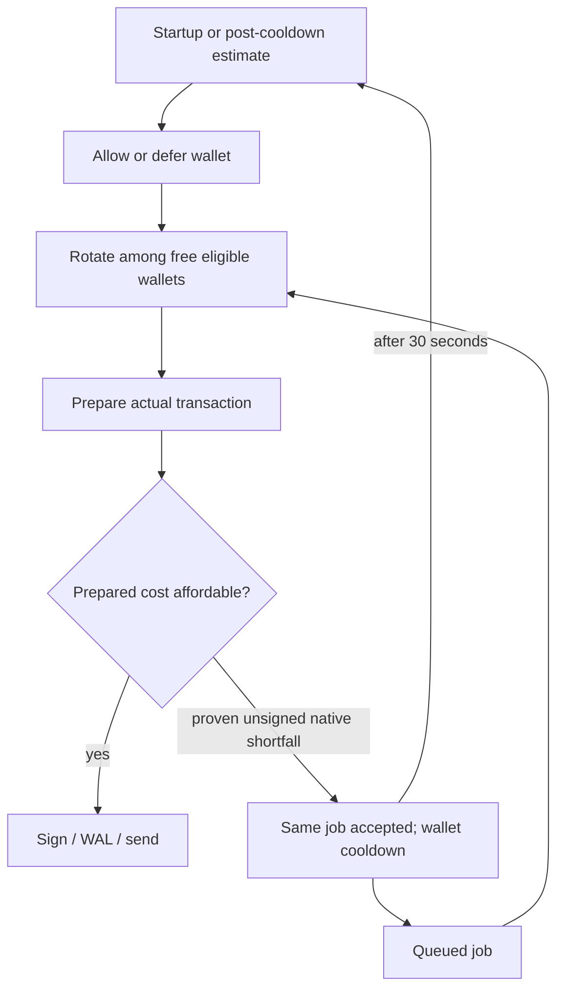
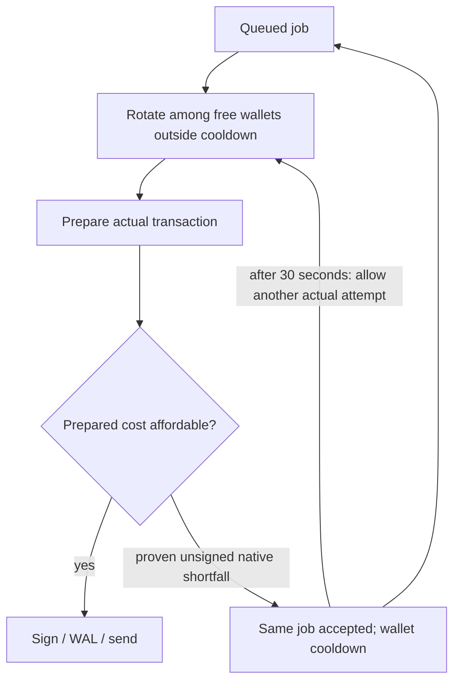

# Simplify async publisher gas recovery — stacked child of PR3605

Status: implementation and local verification complete; remote review and live qualification pending. Owner: this task, single implementation writer. Date: 2026-10-30.
Base: `codex/3591-fair-funded-wallets` at `fa2a547c212190a8bd6b12d2831c192e5667348b` (PR3605). Child: `codex/3591-simple-gas-recovery`.
The user explicitly requested a child PR into the existing PR branch, followed by remote review and comprehensive live validation. Parent retains `testnet-canary` per clarification. Neither PR may be merged by this task. Retain source/evidence through the user's manual merge, then clean only task-owned resources.

## Executive summary

Remove the assumed one-million-gas/previous-transaction funding gate from wallet scheduling. Round-robin selects a free wallet unless it is on a short cooldown. Existing job-specific transaction preparation and the parent's fresh prepared-cost check decide affordability; a positively identified native-gas shortfall can return the same unsigned job to accepted and defer that wallet for 30 seconds. Cooldown expiry allows another actual-job attempt without an advisory RPC probe. Preserve all signed-transaction recovery, TRAC/PCA and terminal-revert policy. Principal tradeoff: repeated preparation can occupy a lane and consume RPC/ACK/store resources when wallets remain underfunded.

## Evidence and boundaries

- Parent code: `async-lift-wallet-funding.ts`, `publisher-runner.ts`, `publisher-gas-funding.ts`, execution-failure disposition and transaction-evidence helpers.
- The early gate uses 1,000,000 gas initially and the previous prepared limit later, rather than simulating the current job. A wallet below that budget can remain excluded even when it could afford a smaller current job. The final prepared-cost guard is job-specific and remains authoritative before signing.
- Original evidence is preserved at `/Users/richardsutton-tracer/Projects/dkg-3591-validation-20261029/REPORT.md`. A live unsigned gas-failure attempt took about 1.7 seconds; a separate positive concurrent pair took about 25–28 seconds median from validation to ACK quorum. Neither measures this proposed child's net overhead; do not claim a speedup from them.
- Final parent comparison:60 publications per arm; baseline versus parent median35.611/34.107s, p9576.347/73.308s, pipeline7.443/8.595 per minute. Earlier18-item parent sample was slower. Sustained query failures on both revisions remain a limitation, not a claimed fix.
- Existing fee pricing, gas estimation and buffer remain unchanged. Base additionally charges L1 data and potentially operator fees ([official documentation](https://docs.base.org/specifications/transactions/network-fees)); the local multiplication covers prepared execution gas plus native value. No arbitrary extra balance threshold or new fee-oracle subsystem is introduced. Native fee failures encountered during preparation follow the existing recognized-native/error-evidence recovery; an error after WAL still retains transaction ownership. This child does not claim a complete all-fee affordability guarantee on Base.
- No queue schema, authorization, asset identity, nonce, WAL or admission change. New observer APIs introduced only by the unmerged parent can be removed coherently in this stack; preserve unrelated released interfaces and optional eligibility injection.

## Approach and flow

Keep the current observer: avoids preparation for estimated-low wallets, but adds speculative reads/state and can block affordable work. Choose cooldown-only scheduling: no assumed cost, no observation cache, and no startup funding reads. Do not add another buffer to replace the removed guessed threshold.

Before:

After:

## Execution chunks

1. **Scheduling and removal:** replace the parent's new funding observer with an explicit cooldown-only capability; remove native startup funding probes, observation freshness/read modes and guessed-budget learning. Retain coalesced queue availability, wallet-bound single-use preparation, eligibility recheck under canonical claim ordering and concurrent executions. No balance/fee I/O under the scheduling lock. Retain unknown/unconfigured wallet refusal.
2. **Chain guard:** retain the exact prepared execution-cost check and native error evidence; remove only the unused advisory observation API/fee fanout and mutable learned budget. Preserve gas/fee arithmetic and real create/update signing boundaries, allowance recovery and error classification.
3. **Tests and docs:** replace tests of removed observation behavior with actual-job admission below the old assumed budget, immediate eligibility without balance calls, cooldown boundaries and newer deferral, all-low repeated attempts/replenishment without re-enqueue, concurrent healthy progress, TRAC/revert terminal behavior and signed/WAL ownership. Keep existing runner/fairness/recovery checks. CLI startup must perform no funding probes and retain cancellation ownership. Document Base fee scope and preparation costs without universal claims.
4. **Review:** child incremental diff only against pinned parent; target roughly <=500 authored changed lines, inspect deletions and test preservation if larger. Run focused tests/build/type/lint/size checks, self-review concurrency and failure evidence separately, then open/attach child PR with diagrams, file table and executed/planned validation distinguished. Use configured remote reviewer. Track a new child-PR review state with up to10 coherent response rounds and 30-minute revision observation windows; parent review history/budget is separate and is not reset.
5. **Live after code-review convergence:** native macOS Node22/pnpm; checkout-pinned runtime, claimed original wallet batch only, isolated authenticated home/Oxigraph. Prefer reusing the already reconciled prior test state/context only after reacquiring its exact original batch and checking all10 signer nonces, binding/PCA budget, allocator and source identities. Otherwise wait for that batch; no borrowing another run's home or creating an unprovisioned set. No wallet funding or profile provisioning. Record all process ownership and new setup mutations before execution.
6. **Matched live matrix:** parent versus child, same six-wallet/home/PCA/payload/RPC/query settings. Healthy serial12 and concurrent30–60 pipelines per arm with async shares overlapping publications; measure publish and admission median/p95, end-to-end pipeline throughput, query/RPC failures and retries. Underfunded comparisons must include a nonzero wallet below the old assumed estimate but above a small job's actual prepared cost; a true late shortfall after ACKs; all-low cooldown/replenishment; record per-attempt wasted wall time, balance RPC count and ACK/store work. Preserve signed/lost-response/restart recovery, sync-share→async-publish and update content/root checks. No synthetic balance or fault outcome is passed off as an actual transfer/depletion.
7. **Evidence and quiescence:** independently verify receipts/signers/nonces/canonical blocks, exact roots/root counts and exact VM payload, including wrong-content negative controls. Preserve failed first attempts and separate any supplementary proof. Reconcile paginated jobs/shares, every setup/approval/publication/cancellation transaction and all10 nonce ranges. Restore only temporary bindings created by this child campaign, stop all owned writers/supervisors/store/proxies, preserve final monotonic allocator, byte-verify/remove expendable key copies, release original claim token only when quiescent. Report limitations and retain both PRs unmerged.

## Review and recovery constraints

All unsigned resets require the parent's positively recognized native shortfall, fenced never-dispatched evidence and no durable transaction history. A cooldown alone never releases nonce/hash ownership. TRAC/PCA or contract reverts must not be converted into native-gas retries. Unknown RPC results do not establish shortfall or absence. Backward clock movement must not accidentally bypass a newer cooldown. Timer expiry permits an attempt, not authority to sign or resend. On startup/restart, process-local cooldown state may reset; chain recovery and canonical wallet locks remain authoritative.

Rollback before merge is simply not integrating this child. No durable-state migration is introduced. A newly discovered signed/ambiguous send retains wallet custody until reconciled; no unconditional release trap. A base/head change, unexpected nonce, unknown writer or stale asset identity stops dependent live mutations and triggers plan revision.

## Acceptance and current state

Executed so far: runtime build passed; focused publisher/cooldown51, chain/signing33 and CLI startup/live-control42 tests passed. Full publisher suite3755 passed; registered chain type checks, lint and file-size checks passed. The first lint found an obsolete unused type import after removing advisory fee code; it was removed and lint passed without budget changes. An attempted typecheck used a nonexistent tsconfig.test.json; it was corrected to the repository's tsconfig.type-tests.json and is not counted as a passed check. Complete only when the incremental PR is reviewed on its final head, relevant checks pass, matched final live results and fault matrix are recorded with honest limitations, all test custody is safely released, and the PRs remain unmerged. Resource inventory is kept under `.tmp/3591-simple/` and durable validation evidence outside the managed worktree. Implementation/review currently have a single owner; the independent domain/regression assessment is the configured remote reviewer, with separate local safety/test self-review passes before submission.

### CI and resources discovered during execution

The standard CI pull_request trigger only accepts main/testnet-canary bases, so the child targeting a feature branch needs a manual standard-profile ci.yml dispatch on its exact branch/head. The workflow's manual path runs checks; no release/deployment workflow is requested. The independent reviewer remains otReviewAgent.

Task-owned worktree: `/Users/richardsutton-tracer/.codex/worktrees/3591-simple-gas-recovery/dkg`, app attachment created from exact parent HEAD, no source changes to the parent worktree. Native dependencies installed and built in the child. The previous campaign's home is stopped and uncredentialed; batch-1 was available at the read-only status check, but is not yet claimed for this campaign.

Change-set size review: the incremental diff is about780 lines added+removed, dominated by removal/replacement of tests for the deleted observer and the documented plan. Production changes remove the observer, startup API/probes and learned budget in one coherent simplification; splitting those would leave a half-wired runtime. Existing proof/transaction safety cases remain in the renamed cooldown suite, real create/update signer tests remain, and the new small-job regression explicitly covers an affordable balance below the removed assumed threshold. No test/lint/size budget or ignore changes.

Local safety self-review: cooldown is only a routing hint; canonical locks and the unchanged execution disposition own replay authority. Prepared-attempt and in-lock newer-cooldown races are covered. All signed and inherited-hash cases remain in the cooldown suite, and real create/update exact-boundary tests remain in chain. Startup lifetime tests now prove absence of funding reads, with existing identity/recovery cancellation tests retained.
