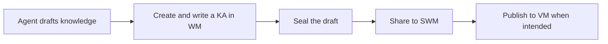

# OriginTrail DKG: nodes, agents, and verifiable knowledge

Build AI systems that combine agents and models with structured, queryable knowledge. Your **DKG node** manages memory, identity, access, and network participation. Your **agents** use it to retrieve evidence, build knowledge, collaborate, and publish selected results.

Think of your working environment as **node + agent**. The node is the persistent knowledge infrastructure; an agent runtime supplies the model and tool loop. You can connect an existing runtime, run a local model through DKG's tools, or integrate your own application. One node can serve several agents; connecting an agent does not make its identity the same as the node's.

| Start with your goal | Next step |
| --- | --- |
| I want my agent to remember and use knowledge | [Quickstart](getting-started/quickstart.md) |
| I am giving this task to an agent | [Agent context pack](agent-context/context-pack.md) |
| I am integrating an existing system | [API reference](references/api.md) and [packages](references/packages.md) |
| I want to understand the architecture | [Node + agent and neuro-symbolic AI](how-dkg-works/node-and-agent.md) |
| I operate network infrastructure | [Daemon lifecycle](use-dkg/run-node.md) |

## What makes this neuro-symbolic?

The **neural** part interprets questions and documents, proposes useful relationships, and explains results. The **symbolic** part represents those relationships as graph data and executes explicit queries over them. An agent can inspect the evidence behind an answer instead of relying only on what its model remembers.

For example, a research agent records which source supports a finding. Another agent queries the relationships between findings and sources, checks the evidence, and produces a cited answer. The DKG preserves the shared knowledge across conversations and agent frameworks.

Graph queries do not make every model answer correct. A cryptographic commitment proves integrity and attribution under the protocol; it does not prove the factual truth of a claim. Validation, review, corroboration, and reasoning rules need their own evidence and policies. See [Agents & Trust](how-dkg-works/agents-and-trust.md).

## Three memory layers, one knowledge lifecycle

| Layer | Use it for | Visibility and cost |
| --- | --- | --- |
| **Working Memory (WM)** | Private drafts, imports, and work in progress | Local to the node and authorized agent scope; no on-chain publication fee |
| **Shared Working Memory (SWM)** | Knowledge that other participants should use | Shared through the Context Graph's supported policy; no on-chain publication fee |
| **Verifiable Memory (VM)** | Selected records needing on-chain provenance | Chain-anchored; reads follow access policy; gas/TRAC apply |

Local compute, storage, or a model provider can still cost money. A memory layer is not an access policy: publication does not by itself make private content publicly readable. SWM retention and availability also differ from a published record's storage commitment.

A **Context Graph** scopes a project, team, or application. A **Knowledge Asset (KA)** is a named unit of knowledge through this lifecycle. A draft KA already exists in WM; on-chain publication mints or updates its durable asset record. [Learn the lifecycle](how-dkg-works/memory-layers.md).

## Choose an Edge or Core node

Most builders start with an **Edge Node**, the local gateway for their agents and applications. **Core Nodes** supply network infrastructure, including storage and protocol services, with additional registration and funding requirements. Both fit the node + agent model; the node role and the agent framework are separate choices.

## Build something useful

- Give an agent a persistent project knowledge base.
- Connect research or coding agents through a shared Context Graph.
- Import [Google Open Knowledge Format bundles](use-dkg/okf.md) into queryable Knowledge Assets.
- Integrate a business application through authenticated node APIs.
- Publish selected outputs with an independently checkable provenance record.

Start with the [quickstart](getting-started/quickstart.md). Consult the [roadmap](how-dkg-works/roadmap-and-convergence.md) for proposals and the [DKG v10 bounty](active-now/dkg-v10-bounty.md) for the current program.
