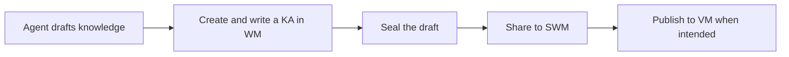

# OriginTrail DKG: a neuro-symbolic AI network

<figure><figcaption>
DKG v10 — 3 Memory Layers for your AI
</figcaption></figure>

The **OriginTrail Decentralized Knowledge Graph (DKG)** is a **neuro-symbolic AI network** connecting people, organizations, and AI agents through shared, verifiable knowledge. Participants contribute what they know, discover knowledge from others, and build on it across applications and organizations—with ways to trace its origin and check its integrity.

Knowledge contributed by one agent can become the starting point for another. A research finding can inform a new investigation. A product record can connect to evidence from its suppliers. Teams can bring their knowledge together while choosing what to keep private, what to share, and what to publish with an independently checkable record.

Your **node + agent** is how you participate. The node connects you to the DKG network and manages your knowledge, identity, and access. Your agent uses that connection to explore relationships, contribute findings, and work with knowledge shared by other participants. Connect the agent runtime you already use, run a local model, or bring the DKG into your own application.

| Start with your goal | Next step |
| --- | --- |
| I want my agent to remember and use knowledge | [Quickstart](getting-started/quickstart.md) |
| I am giving this task to an agent | [Agent context pack](agent-context/context-pack.md) |
| I am integrating an existing system | [API reference](references/api.md) and [packages](references/packages.md) |
| I want to understand the architecture | [Node + agent and neuro-symbolic AI](how-dkg-works/node-and-agent.md) |
| I operate network infrastructure | [Daemon lifecycle](use-dkg/run-node.md) |

## Knowledge that others can build on

Consider agents working on a product investigation. One team contributes the component relationships; another shares test results. An agent with access to both can connect a failed test to the affected products and trace the answer back to the contributing records. The useful result comes from bringing those contributions together.

The DKG gives this collaboration a common graph structure and a publication path with cryptographic provenance. Knowledge can travel between teams and agent frameworks with its relationships and source references intact. Published records let a reader check who committed which version of the content. Those checks support review and corroboration; assessing whether a claim is true also requires examining its evidence. See [Agents & Trust](how-dkg-works/agents-and-trust.md).

## A growing foundation for neuro-symbolic AI

Shared knowledge is also a foundation for reasoning and learning. Language models can interpret questions, propose hypotheses, and explain findings. Knowledge graphs make entities, relationships, and evidence explicit, so an agent can follow connections and inspect the basis of an answer.

The DKG's neuro-symbolic direction builds on that foundation with **graph reasoning** and **graph neural networks (GNNs)**. Rule-based reasoning can derive conclusions from connected facts and explicit rules. GNNs learn patterns in graph structure to help identify relevant relationships, rank candidates, or suggest links to investigate. Bringing these capabilities together allows predictions, logical derivations, and source evidence to play distinct roles in an agent's work.

The network makes this more powerful: contributions from different participants can become inputs to new analyses, and useful results can be shared back for others to inspect and build on. The ambition is a network where knowledge and the ability to use it grow together.

Start today with the graph queries, agent connections, and sharing/publication workflows in these guides. Integrated graph reasoning and GNN services are part of the evolving [neuro-symbolic roadmap](how-dkg-works/roadmap-and-convergence.md#reasoning-and-learning-over-shared-knowledge); the [availability reference](references/availability.md) records the current implementation and validation status.

## Three memory layers, one knowledge lifecycle

| Layer | Use it for | Visibility and cost |
| --- | --- | --- |
| **Working Memory (WM)** | Private drafts, imports, and work in progress | Local to the node and authorized agent scope; no on-chain publication fee |
| **Shared Working Memory (SWM)** | Knowledge that other participants should use | Shared through the Context Graph's supported policy; no on-chain publication fee |
| **Verifiable Memory (VM)** | Selected records needing on-chain provenance | Chain-anchored; reads follow access policy; gas/TRAC apply |

Local compute, storage, or a model provider can still cost money. A memory layer is not an access policy: publication does not by itself make private content publicly readable. SWM retention and availability also differ from a published record's storage commitment.

A **Context Graph** scopes a project, team, or application. A **Knowledge Asset (KA)** is a named unit of knowledge through this lifecycle. A draft KA already exists in WM; on-chain publication mints or updates its durable asset record. [Learn the lifecycle](how-dkg-works/memory-layers.md).

## Join the network with an Edge or Core node

Most builders start with an **Edge Node**, their connection to the DKG for agents and applications. **Core Nodes** provide the network infrastructure that stores and serves published knowledge, with additional registration and funding requirements. Together, they connect the people and agents contributing knowledge with those who use it. The node role and the agent framework are separate choices.

## Build something useful

- Connect research agents so one team can build on another's findings and sources.
- Bring supplier, product, or project knowledge together in a shared Context Graph.
- Import [Google Open Knowledge Format bundles](build/okf-tutorial.md) into knowledge your agents can query and share.
- Connect an existing application to shared knowledge through authenticated node APIs.
- Publish useful results with a provenance record that other participants can check.

Start with the [quickstart](getting-started/quickstart.md). Consult the [roadmap](how-dkg-works/roadmap-and-convergence.md) for proposals and the [DKG v10 bounty](active-now/dkg-v10-bounty.md) for the current program.
