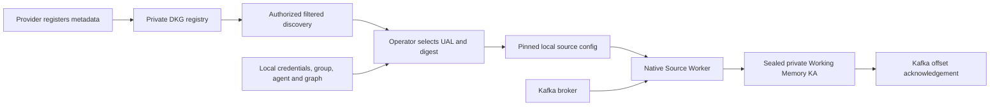

# Generic Kafka registry, discovery and Source Worker enrollment

The registry describes a Kafka stream; the Kafka Source Worker consumes an
explicitly selected stream. Both use `dkg-streams:KafkaStream` and a shared
descriptor contract. Neither requires a customer package, tenant hierarchy,
device type or manufacturing ontology.

## Registry contract

The existing Kafka route plugin owns registration, asynchronous publication and
discovery. New optional descriptor fields are `clusterId`, `providerIri`,
`schemaIri` and `about[]`. References are flat RDF IRIs; arbitrary nested schemas
remain outside this contract. Extensions retain their own namespaces and cannot
override the core namespace through aliases or `@vocab`.

The authenticated requester is stamped as `registeredByAgentAddress`. The actual
signing publisher can differ under curation and is read from native
`prov:wasAttributedTo` metadata, not a request field. Provider references remain
assertions about the source system, not broker ownership or delegated authority.
Generic graph writers can make RDF assertions outside this registration route;
trust decisions should use native publisher provenance and the configured
registry's admission policy, not a provider name or registrar literal alone.

Registrations use the existing private-by-default publication envelope. Graph
and subgraph scope, caller identity and private-read authorization remain in the
canonical DKG query path. Counts and page queries apply identical filters before
pagination; payload hydration fetches only the selected page's exact graphs.
Both legacy and rootless V2 content layouts remain readable.

The `includeRegistry=true` response adds a versioned envelope with the selected
UAL, context graph, optional publisher, normalized descriptor and SHA-256 digest.
Default response shapes remain unchanged. Old registrations lacking a registrar
do not receive an inferred identity. A configured registry can contain multiple
providers, including multiple registrations of the same topic. Each registration
is selected independently; there is no global broker/topic uniqueness rule.

## Enrollment and recovery

Enrollment reads one operator-selected registration through its configured
registry URL and API identity. It verifies the response scope and digest and
combines connection metadata with local consumer authority. Credentials, consumer
group, consuming agent, destination graph and initial-offset policy are not read
from provider metadata. Optional expected publisher and digest checks bind an
earlier inspection to the exported snapshot.

The local source config carries the complete normalized snapshot. The worker
checks its hash and connection settings before Kafka/journal activity. It does
not discover replacement registrations or re-resolve a mutable latest pointer
while polling. This preserves the consumer's existing durable HTTP cooldown and
uncertain-write protections. Changing a selected stream requires deliberate
operator configuration/state handling; it never resets offsets automatically.

Enrolled records reference their registry UAL and descriptor digest. Their
identity includes that pin. Existing manually configured sources retain their
identity algorithm and recovery behavior. Kafka acknowledgement still follows
exact sealed private-WM readback, including the registry provenance triples.

## Scope and verification

This implementation covers registration metadata, filtered discovery, explicit
enrollment and the existing private-WM ingestion lane. A registered stream is
not a health/freshness signal or a grant of Kafka access. Topic enumeration,
network-wide crawling, automatic subscription, UI screens, schema decoding and
deployment to partner nodes are separate work.

Unit tests cover immutable pins, identity spoofing through extensions, local
transport/credential policy, safe resolver errors and file permissions. Real RDF
tests cover legacy/V2 queries, multiple providers, optional entity links,
pre-pagination filters and query-like search strings. The live-daemon E2E covers
registration/discovery, authorized enrollment, native sealed readback and replay;
its documented broker mode also uses real KafkaJS consumption and offset readback.
