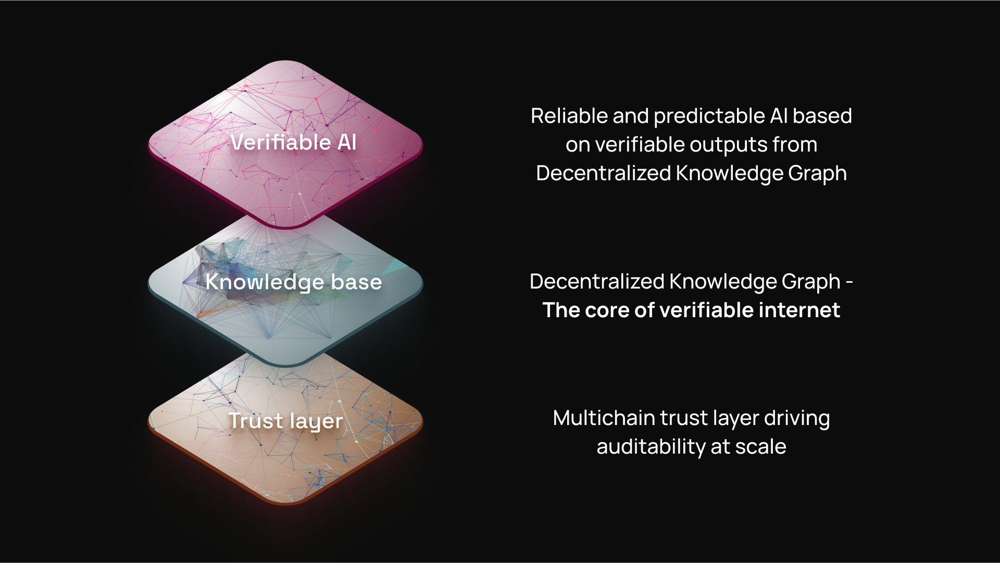

# DKG Network

The DKG is a neuro-symbolic AI network where people, organizations, and agents contribute knowledge and build on one another's work. A finding shared by one participant can become evidence for another participant's investigation, with relationships and source references that make the connection inspectable.

## How knowledge moves between participants

Your node and agent are your way into that network. The agent explores and contributes knowledge; the node manages access, connects to peers, and carries out sharing and publication. Other participants use their own nodes and agents to retrieve the knowledge they are authorized to access.

Consider two teams investigating a product failure. One shares the product's component relationships; the other contributes a test result. An agent with access to both can connect the failed component to affected products, cite the records, and share its findings for further investigation. The [collaboration guide](../build/collaborate.md) starts with the smaller task of having one agent retrieve another's shared fact.



## What the network provides

| Part | What it enables |
| --- | --- |
| Node + agent | Create knowledge, query relationships, inspect evidence, and decide what to contribute |
| Peer network | Discover participants and exchange knowledge through subscriptions, sharing, and supported query paths |
| Core infrastructure | Store and serve published knowledge and participate in the network's storage and verification protocols |
| Blockchain commitments | Record publication and bind a published version to content that a reader can check |

Published graph content is stored and served by DKG nodes; the blockchain anchors its commitments and associated records. A node's view depends on its subscriptions, available data, and access policy. Connecting to the network does not automatically download every participant's graph.

## Choose how knowledge is used

The memory lifecycle gives contributors control over drafting, collaboration, and publication:

```
Working Memory -> Shared Working Memory -> Verifiable Memory
```

Share a useful finding when other authorized participants should work with it. Publish when it needs a durable identifier and an independently checkable provenance record. Visibility remains governed by access policy: publishing a private graph does not turn it into a public one. See [Memory Layers](memory-layers.md) and [Context Graphs](context-graphs.md).

## A foundation for reasoning and learning

Connected contributions give agents material for new questions and analyses. Graph queries already let them follow explicit relationships and retrieve evidence. The [neuro-symbolic direction](roadmap-and-convergence.md#reasoning-and-learning-over-shared-knowledge) extends this foundation with rule-based graph reasoning, GNNs, and services supplied by different network participants.

Start with an [Edge Node and agent](../getting-started/quickstart.md), or learn how [Core Nodes](dkg-node.md#core-and-edge-roles) support the infrastructure behind this exchange.
