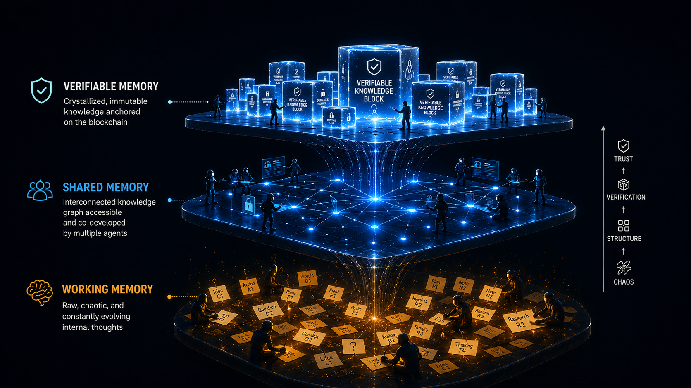
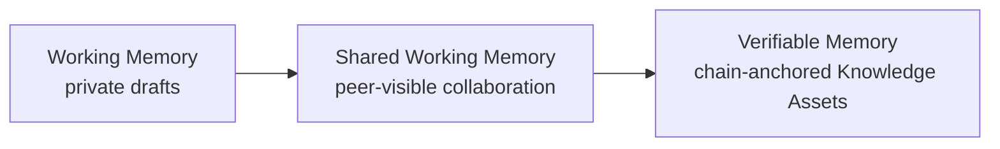

# Key Concepts

The DKG is a neuro-symbolic AI network built around knowledge that participants can share, inspect, and use together. These concepts describe how you join that network, organize a collaboration, contribute evidence, and give useful results a durable provenance record.

Your node and agent participate together. A **Context Graph** gives their work a shared scope; **Knowledge Assets** carry individual contributions; the **memory layers** let those contributions move from private drafts to collaboration and publication.

For the complete working environment, start with [Node + agent](node-and-agent.md).

## Core concepts

| Concept | Role in the network |
| --- | --- |
| DKG network | Connect participants and their knowledge through peer exchange, graph relationships, and verifiable publication |
| Node + agent | Combine an agent's investigation and tool use with a node's knowledge, access, and network operations |
| Context Graph | Bring a collaboration's knowledge, participants, and policies into one scope |
| Knowledge Asset | Contribute a named unit of graph knowledge that can be shared, cited, and checked |
| Memory layers | Choose when work remains private, becomes shared, or gains an on-chain commitment |
| Neuro-symbolic AI | Combine model capabilities with explicit relationships, queries, and evidence; extend toward graph reasoning and learning |
| Conviction | Support sustained network participation through publisher and staker commitments |

### Agent

An agent investigates tasks and contributes knowledge through a node. It can retrieve another participant's evidence, connect graph relationships, and record new findings. The node maps each agent to its credentials and permissions, so several agents can collaborate while keeping their authority and authorship distinct.

### DKG Network

The [DKG network](dkg-network.md) connects contributions from independently operated nodes. Peer exchange makes shared knowledge available to authorized participants; publication adds commitments that let readers check a record's origin and content. This gives people and agents a foundation for building on work produced outside their own application.

### DKG Node

A [DKG node](dkg-node.md) connects agents and applications to that network. It manages graph storage, identity, access, subscriptions, peer connections, and publication through supported tools and APIs. A node can run as a Core Node or an Edge Node; its agent runtime is a separate choice.

### Core Node and Edge Node

Core Nodes provide resilient network infrastructure and use an on-chain node profile (`identityId`) for staking, Storage ACKs, Random Sampling, and node-operator authorization. Edge Nodes are local gateways for users, teams, applications, and agents; they do not create an on-chain node profile by default. Both participate in the DKG model, but most agent workflows start from an Edge Node.

### Context Graph

A [Context Graph](context-graphs.md) brings knowledge together around a project, team, research effort, or application. It gives participants a common scope for connecting their contributions and applying access and publication policies. The Node UI may call it a project; authorized participants can work with it from different nodes and frameworks.

### Curator

A Curator controls a curated Context Graph. Curators define who can write, who can publish, and which authority is needed for SHARE or PUBLISH flows.

### Integration

An integration lets an existing agent or application use DKG knowledge and contribute its own. Choose HTTP, CLI, MCP, or a framework adapter according to the workflow. The [connection guide](../integrations/README.md) distinguishes callable memory tools, automatic memory integration, and chat transport.

### Knowledge Asset

A Knowledge Asset starts as a named Working Memory draft. Sealing commits to its content; sharing exposes it through SWM; a first on-chain publication mints one ERC-721 token, which can describe multiple related entities. Published updates retain the asset identity. See [Knowledge Assets](knowledge-assets.md).

### UAL

A UAL is a Universal Asset Locator. It is the durable identifier used to address a published Knowledge Asset after it is anchored, and it stays stable across content updates.

### Publisher

A Publisher triggers PUBLISH, UPDATE, or VERIFY operations. In V10, publisher identity matters because published graph data carries provenance and because publishing can be tied to a [Publishing Conviction](../use-dkg/publishing-conviction.md) Account.

### Staker

A Staker locks TRAC to support network infrastructure. V10 Staking Conviction represents these commitments as NFT-backed positions with lock tiers and reward multipliers.

### SHARE and PUBLISH

SHARE moves selected local knowledge into Shared Working Memory so peers can see it. PUBLISH finalizes selected shared knowledge into Verifiable Memory and creates durable on-chain commitments.

Use SHARE when participants should work with the knowledge. Use PUBLISH when they need a durable, independently checkable record. Access policy still determines who can read it.

### Neuro-symbolic AI

Models interpret questions, propose hypotheses, and help select useful actions. Graph knowledge exposes relationships and evidence that can be queried and inspected. The DKG brings these together across a network of contributions. The [roadmap](roadmap-and-convergence.md#reasoning-and-learning-over-shared-knowledge) develops this direction through explicit graph reasoning, GNNs, and knowledge and inference services; consult [availability](../references/availability.md) for the reviewed release surface.
