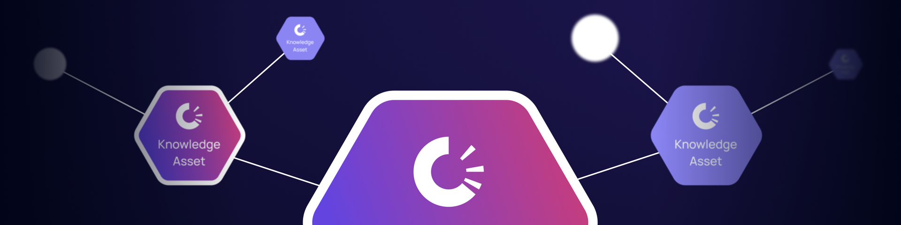

# Knowledge Assets

A Knowledge Asset (KA) is a named unit of graph knowledge. It starts as a Working Memory draft, can be sealed and shared, and can then be published on-chain. A new on-chain publication mints one ERC-721 token that can describe multiple related entities; later content updates retain the asset identity. Its commitments let readers check attribution and content integrity.

Publish a Knowledge Asset when knowledge needs an on-chain provenance record:

* facts that must be independently verifiable
* records that should have a durable identifier
* data that another party may endorse or verify
* final outputs from a multi-agent workflow

Creating a KA in Working Memory does not mint a token or spend TRAC. Sealing signs the draft; sharing makes it available through SWM; publishing creates or updates the on-chain record. These are separate decisions. Integrity and attribution do not establish that the source claim is factually true.

## Knowledge Assets and UALs

The Knowledge Asset is minted to its author as an ERC-721 token; the publisher pays the TRAC cost. After publication, the asset is addressed through a UAL of the form `did:dkg:{chainId}/{contract}/{kaId}`, where `kaId` is the ERC-721 token id. The UAL stays the same even when the asset's content is updated, so citations remain valid across revisions.

Use the UAL when another workflow needs to cite, fetch, or verify published knowledge. Use the Context Graph when the workflow needs the larger scoped memory domain around that asset.

## Publisher Authority

Publishing records who finalized the knowledge. When a Publishing Conviction Account is active, a registered publishing agent can use that account's conviction path. If the agent is not registered or the account is not eligible for the publish, the publisher path falls back to direct spend.
