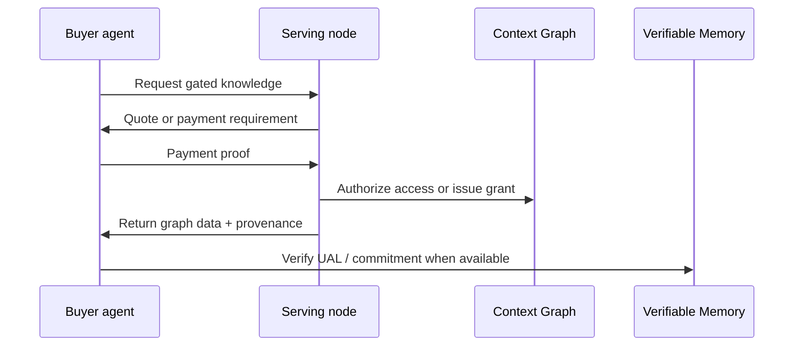

# Knowledge Commerce

A participant may contribute valuable knowledge, specialize in graph reasoning, or offer a model that helps others analyze the graph. Knowledge commerce is the direction in which those contributions and capabilities become services other participants can discover and pay to use.

The DKG gives this exchange a shared knowledge structure, attributable participants, and provenance that consumers can inspect. An agent could combine a graph query from one provider with analysis from another, then retain the sources behind the result. The service and payment workflows are under development.

For the broader public direction, see the [NeuroSymbolic Marketplace RFC](https://github.com/OriginTrail/OT-RFC-repository/tree/main/RFCs/OT-RFC-27_NeuroSymbolic_Marketplace) and [feature availability](../references/availability.md). The RFC covers knowledge and inference services; x402 is a separate payment integration direction, not a synonym for the marketplace.

## A possible paid-access exchange

## Current status

The public roadmap describes knowledge-service and context-oracle directions, and the codebase includes payment-proof and x402-related hooks. The diagram illustrates a possible paid-access exchange; it is not the complete marketplace settlement design or a released endpoint contract. Use the [roadmap](roadmap-and-convergence.md#knowledge-and-intelligence-services-across-the-network) for the broader service direction and prototype evidence.

Current DKG V10 users should rely on:

* Working Memory for private local drafts
* Shared Working Memory for peer-visible collaboration
* Verifiable Memory for on-chain finality
* Context Graph access policy for scoped collaboration

## x402

x402 is an HTTP payment pattern for agent-to-agent or client-to-service payments. In the V10 roadmap, it is a possible way to pay for knowledge endpoints and premium graph data. A usable integration will need the serving node's supported endpoint, access policy, payment requirements, and verification procedure.

Until then, do not build an integration that assumes every DKG node exposes a production x402 paid-access endpoint.
