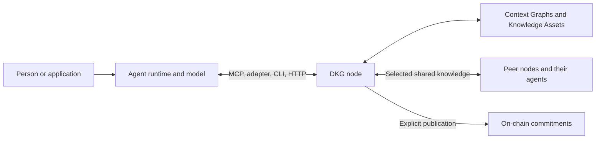

# Node + agent and neuro-symbolic AI

Your node and agent work together as a participant in the DKG network. The node connects your knowledge to other nodes and manages how it is stored, accessed, shared, and published. The agent explores that knowledge, contributes new findings, and acts on the evidence it retrieves.

A node can serve several agents and applications. Those agents can work across conversations and frameworks, and collaborate with participants who operate their own nodes. The shared graph provides a way to connect their contributions; identities, access policies, and publication records make those contributions attributable and govern how they are used.

## How the pieces work together

| Component | Responsibility |
| --- | --- |
| Agent runtime and model | Interpret a task, select tools, inspect results, and answer with evidence |
| Adapter or MCP client | Connect the runtime to supported node tools; memory automation depends on the integration |
| DKG node | Authenticate callers, scope operations, persist graph data, execute queries, share with peers, and publish |
| Context Graph | Bound a project's knowledge and its access/publication policy |
| Application | Define its data model, user permissions, review policy, and how it consumes results |

**Identity is not interchangeable.** An agent authors and accesses knowledge under its credentials. A peer ID identifies a networking participant. A Core node's on-chain profile identifies infrastructure. A payer funds transactions. Keep these roles distinct even when the same operator manages them.

## From a question to shared evidence

Suppose your agent needs to identify which products could be affected by a component failure. A manufacturer has contributed product-component relationships, and a testing team has shared a result about one component. With access to both sets of records, the agent can connect the test result to the relevant products and cite the records behind its answer.

This is a useful starting point for neuro-symbolic AI: the model interprets the question and selects tools; the graph supplies explicit relationships that can be followed and inspected. The [Atlas quickstart](../getting-started/quickstart.md) exercises a smaller version of that pattern:

1. Ask which database a project uses and what source supports the answer.
2. Have the agent discover the graph's vocabulary and query the relevant relationships.
3. Inspect the returned evidence and its memory layer.
4. Have the agent answer with the project, database, and source.
5. Share useful findings so another authorized participant can retrieve and build on them.

## Reasoning and learning from the graph

The broader neuro-symbolic direction extends this loop. **Symbolic graph reasoning** applies explicit rules to connected facts to derive conclusions. A rule might say that a product requires investigation when it contains a component with a failed test. Recording the input facts, rule, and derivation would let another participant inspect how that conclusion was reached and, with the same inputs and engine, reproduce it.

**Graph neural networks (GNNs)** offer a complementary approach: learning from the pattern of entities and relationships. A model could rank which connected products merit investigation, suggest a missing relationship, or help retrieve relevant evidence. Its prediction is a candidate for evaluation; the graph can retain the source data and model context needed to assess it.

An agent can coordinate these steps: use a learned model to find promising leads, use queries and rules to examine them, and explain the result with supporting evidence. As participants share useful findings, others gain new material for their own investigations. This is the longer-term value of combining neural methods, symbolic knowledge, and a decentralized network.

The guides currently exercise explicit queries and the knowledge lifecycle. Integrated reasoning and GNN services are development directions, described in the [roadmap](roadmap-and-convergence.md#reasoning-and-learning-over-shared-knowledge), rather than prerequisites for the quickstart. See [feature availability](../references/availability.md) for the reviewed release baseline.

## Choose a connection

Choose the runtime that will supply your agent's model and tool loop. Use a framework adapter for that runtime's integrated experience; use MCP for clients that support tool discovery; use the CLI for terminal workflows; use HTTP for a service you control. Discover the runtime's actual tools before relying on automatic recall or persistence. Chat transport, callable memory tools, and automatic primary-memory integration are different capabilities.

Start with [Quickstart](../getting-started/quickstart.md). Read [Key concepts](key-concepts.md), [Agents & Trust](agents-and-trust.md), and [Memory layers](memory-layers.md) for the shared model.
