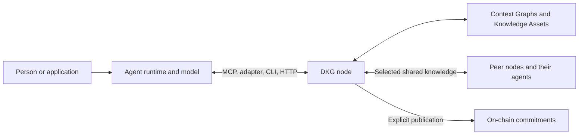

# Node + agent and neuro-symbolic AI

A useful DKG deployment combines a node with one or more agents or application clients. The node stores and serves knowledge; the agent decides which tools to call for a task. The runtime can be local or connected through a supported interface. A running node alone does not imply that a model or framework runtime is installed.

## Responsibilities

| Component | Responsibility |
| --- | --- |
| Agent runtime and model | Interpret a task, select tools, inspect results, and answer with evidence |
| Adapter or MCP client | Connect the runtime to supported node tools; memory automation depends on the integration |
| DKG node | Authenticate callers, scope operations, persist graph data, execute queries, share with peers, and publish |
| Context Graph | Bound a project's knowledge and its access/publication policy |
| Application | Define its data model, user permissions, review policy, and how it consumes results |

**Identity is not interchangeable.** An agent authors and accesses knowledge under its credentials. A peer ID identifies a networking participant. A Core node's on-chain profile identifies infrastructure. A payer funds transactions. Keep these roles distinct even when the same operator manages them.

## A concrete neuro-symbolic loop

1. A person asks, “Which project uses Oxigraph, and what evidence supports that?”
2. The agent discovers the graph's vocabulary and available tools.
3. It executes a graph query joining the project's database relationship to the database name and the source record.
4. The node returns matching bindings from the requested memory layer.
5. The agent answers with the returned project, database, source, and memory layer. If no match exists, it reports the gap instead of inventing a relationship.
6. New findings can become WM drafts, then be shared or published when the task calls for those transitions.

This pattern works with explicit SPARQL queries today. Neural extraction and natural-language query generation remain model-dependent. Advanced inference, learned retrieval, and marketplace services have their own implementation and release status; the term “neuro-symbolic” does not promise that every node runs every proposed reasoning engine.

## Choose a connection

Use a framework adapter for that runtime's integrated experience; use MCP for clients that support tool discovery; use the CLI for terminal workflows; use HTTP for a service you control. Discover the runtime's actual tools before relying on automatic recall or persistence. Chat transport, callable memory tools, and automatic primary-memory integration are different capabilities.

Start with [Quickstart](../getting-started/quickstart.md). Read [Key concepts](key-concepts.md), [Agents & Trust](agents-and-trust.md), and [Memory layers](memory-layers.md) for the shared model.
