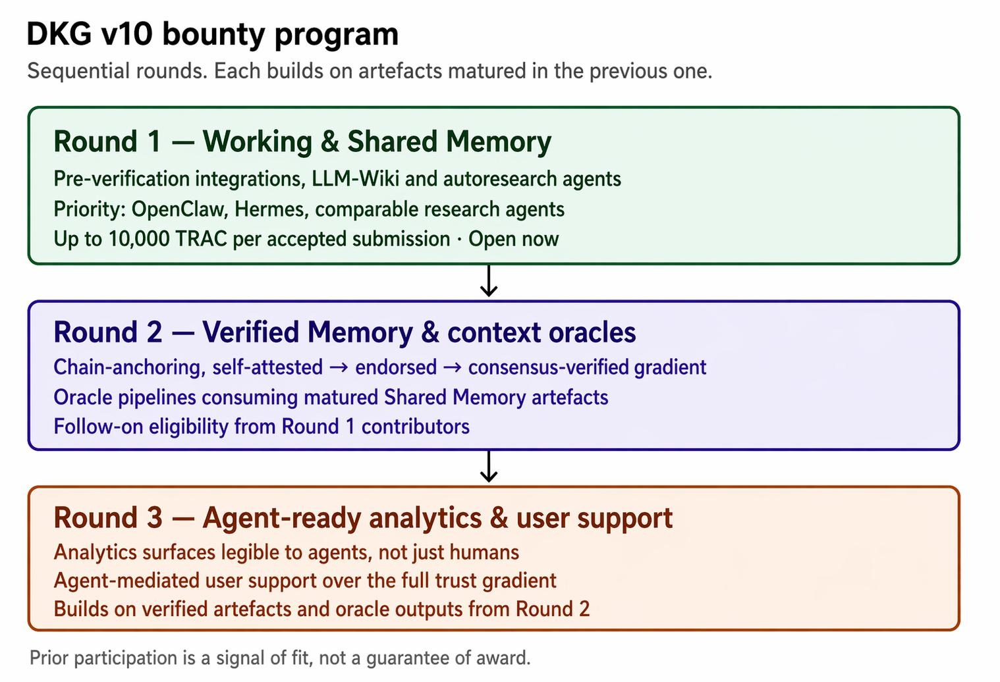
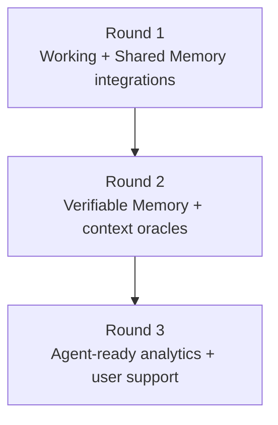

# Roadmap & Convergence

DKG V10 is aimed at one problem: agents are producing knowledge faster than teams can preserve, share, and verify it. Proprietary assistant memories solve part of that problem for one product. DKG solves it as a shared network layer where memory is portable, graph-native, ownable, and verifiable.

## Why does it matter?

Multi-agent systems need a substrate where many agents can contribute without turning every claim into a verifiable truth. The DKG model separates drafting, collaboration, and finality:

* Agents draft in Working Memory
* Teams and swarms collaborate through Shared Working Memory
* Selected knowledge becomes Verifiable Memory through on-chain publication

That makes DKG useful for research agents, coding agents, operational agents, and applications that need provenance instead of one-off chat history.

## Four convergence areas

<table><thead><tr><th width="230">Area</th><th>Direction</th></tr></thead><tbody><tr><td>DePIN infrastructure</td><td>Local nodes become agent hosts, query endpoints, and network participants.</td></tr><tr><td>Multi-agent memory</td><td>Agents use shared graph memory instead of isolated logs or vector-only stores.</td></tr><tr><td>DKG applications</td><td>Apps ground predictions, research, operations, and support in queryable Knowledge Assets.</td></tr><tr><td>Truth-seeking algorithms</td><td>Verification, conviction, and payment rails align publishers, stakers, and consumers.</td></tr></tbody></table>

## Availability is part of the contract

See [Feature availability](../references/availability.md) for reviewed baselines and recorded validation. A feature on a development branch is not necessarily in the published npm package. Use `dkg --version`, the running node's status, and its served skill to establish the installed surface.

The builder journey covers WM/SWM workflows, explicit VM publication, Context Graphs, MCP/framework connections, Google OKF, and local-model integration. The maturity of each connection differs: for example, Prime Agent currently supplies chat transport without advertised primary-memory integration.

## Direction

The DKG combines agents and models with graph knowledge: neural interpretation and tool use, symbolic queries and evidence, shared knowledge, and explicit provenance. Richer reasoning/retrieval and governed service composition extend that model. A proposal needs a released implementation, a callable interface, and an exercised workflow before it becomes an operational how-to.

The public [NeuroSymbolic Marketplace RFC](https://github.com/OriginTrail/OT-RFC-repository/tree/main/RFCs/OT-RFC-27_NeuroSymbolic_Marketplace) proposes query, reasoning, graph-ML, and inference services. It includes prototype evidence; that does not establish generally available support in every DKG node. Keep proposed settlement/economics and deployed node behavior distinct.

Publisher conviction has a documented [PCA workflow](../use-dkg/publishing-conviction.md). Staking has its own [staking/migration guide](../active-now/staking-migration.md). Context-oracle and x402 concepts must not be inferred to have a complete operator workflow unless the installed contract and current guide supply one. Private planning documents inform development but are not a public API specification.

## Sequence

Round 1 seeds the pre-verification layer with useful integrations. Round 2 is expected to move more of that output into Verifiable Memory and oracle-ready workflows. Round 3 is expected to make the resulting network easier for agents and humans to inspect, support, and operate.

The binding program details live in the official [DKG V10 Bounty Program](../active-now/dkg-v10-bounty.md) page.
