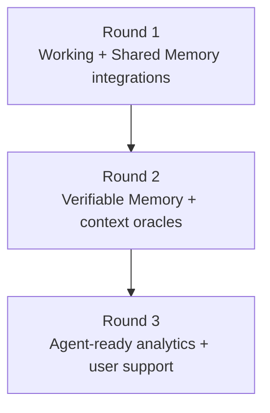

# Roadmap & Convergence

The DKG's direction is a network where people and agents can contribute knowledge, discover what others have learned, and combine those contributions into new insights. Shared graph knowledge and verifiable publication provide the foundation. Reasoning, graph learning, and distributed AI services expand what participants can do with it.

## Knowledge that keeps becoming useful

An agent's finding can become evidence for another agent's investigation. A collection of related findings can support a rule-based conclusion or become input to a learned model. Sharing the resulting knowledge lets that work continue across teams and applications.

The memory lifecycle gives participants control over this process:

* Working Memory holds drafts and work in progress.
* Shared Working Memory lets teams and agents collaborate on knowledge.
* Verifiable Memory anchors selected records on-chain so others can check their provenance and integrity.

The opportunity grows as relevant contributions connect, while source quality, access policy, and evidence remain essential to the usefulness of the result.

## Four convergence areas

<table><thead><tr><th width="230">Area</th><th>Direction</th></tr></thead><tbody><tr><td>DePIN infrastructure</td><td>Local nodes become agent hosts, query endpoints, and network participants.</td></tr><tr><td>Multi-agent memory</td><td>Agents use shared graph memory instead of isolated logs or vector-only stores.</td></tr><tr><td>DKG applications</td><td>Apps ground predictions, research, operations, and support in queryable Knowledge Assets.</td></tr><tr><td>Truth-seeking algorithms</td><td>Verification, conviction, and payment rails align publishers, stakers, and consumers.</td></tr></tbody></table>

## Reasoning and learning over shared knowledge

The neuro-symbolic direction combines several ways of working with the graph:

| Capability | Contribution to an agent's work | Availability in these guides |
| --- | --- | --- |
| Graph queries and evidence retrieval | Follow known relationships and return inspectable source records | Exercised in the quickstart and integration recipes |
| Symbolic graph reasoning | Apply explicit rules to derive conclusions and retain their supporting facts and derivation | Development direction for integrated reasoning workflows |
| Graph neural networks (GNNs) and graph learning | Learn from connected data to rank candidates, predict relationships, and guide retrieval | Development direction for integrated graph-ML services |
| Language and other AI models | Interpret requests, propose hypotheses, and explain evidence | Model/tool connections exist; capabilities depend on the selected runtime |

These methods can work together. A GNN might identify a promising relationship, an agent could retrieve the relevant records, and a reasoner could evaluate an explicit rule over the available facts. The resulting prediction or derivation can be recorded with its inputs so another participant can assess it. Publication establishes provenance and integrity; evaluating the inference still depends on the inputs, method, and evidence.

OriginTrail's [Verifiable Internet for AI whitepaper](https://origintrail.io/documents/Verifiable_Internet_for_Artificial_Intelligence_whitepaper_v3_pre_publication.pdf) places graph neural networks and neural-symbolic reasoning within the wider AI architecture. This is the architectural direction; individual services still need their own implementation and release evidence.

## Knowledge and intelligence services across the network

The public [NeuroSymbolic Marketplace RFC](https://github.com/OriginTrail/OT-RFC-repository/tree/main/RFCs/OT-RFC-27_NeuroSymbolic_Marketplace) proposes a network of query, reasoning, graph-ML, and inference services. Participants could combine knowledge and capabilities supplied by different nodes through a common service experience.

The RFC reports prototype transactions for graph queries and model inference between separately operated peers. Those experiments demonstrate part of the path toward the proposed marketplace; the broader service and settlement design remains under development.

## What you can build with now

The builder journey covers WM/SWM workflows, explicit VM publication, Context Graphs, MCP/framework connections, Google OKF, and local-model integration. Connection capabilities differ: Prime Agent currently supplies chat transport without advertised primary-memory integration.

Use [Feature availability](../references/availability.md) for reviewed baselines and recorded validation. Check `dkg --version`, the running node's status, and its served skill to match the instructions to your installation. The reasoning and GNN directions above describe where the architecture is going; the procedural guides describe the interfaces you can use in the reviewed release.

Publisher conviction has a documented [PCA workflow](../use-dkg/publishing-conviction.md). Staking has its own [staking/migration guide](../active-now/staking-migration.md). Context-oracle and x402 concepts must not be inferred to have a complete operator workflow unless the installed contract and current guide supply one. Private planning documents inform development but are not a public API specification.

## Sequence

Round 1 seeds the pre-verification layer with useful integrations. Round 2 is expected to move more of that output into Verifiable Memory and oracle-ready workflows. Round 3 is expected to make the resulting network easier for agents and humans to inspect, support, and operate.

The binding program details live in the official [DKG V10 Bounty Program](../active-now/dkg-v10-bounty.md) page.
