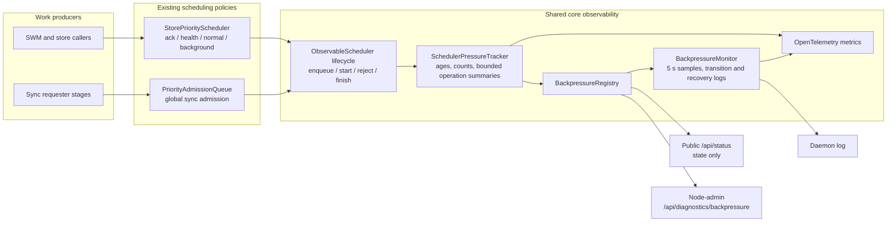

# Backpressure observability

DKG exposes one common pressure model for its in-memory schedulers. It answers
four questions without requiring scheduler-specific log archaeology:

1. Which scheduler and lane are under pressure?
2. Is work waiting, rejected, or admitted but possibly stuck?
3. Which bounded operation classes account for that work?
4. Did the scheduler recover?

This is an observability layer only. It does not change queue ordering,
concurrency, reservation, displacement, timeout, or retry behavior.

## Architecture



The tracker records references to bounded labels and timestamps, not work
closures or payloads. A snapshot can contain a maximum of eight queued and
eight active operation summaries per lane. Labels are sanitized and truncated
before they reach metrics, logs, or the diagnostics response.

The first registered sources are:

- `store`: the external-store priority scheduler and its `ack`, `health`,
  `normal`, and `background` lanes;
- `sync-global`: the process-wide sync admission queue and its sync lanes;
- `store-control-share` and `store-control-publisher`: the two small schedulers
  of the queue control path, one `control` lane each. They exist only while the
  control path is on (see [Queue control schedulers](#queue-control-schedulers)).

The sources divide capacity differently, and every lane row names the model it is
reported under in its `capacityModel` field:

| `capacityModel` | Meaning | Source |
| --- | --- | --- |
| `partitioned` | The lane holds a private queue allocation and fills independently of its neighbours. Nothing validates the scheduler-level limit against the lane allocations — a scheduler may publish their sum (`store` does), or cap its total lower — so read a lane's own limit for lane pressure and the scheduler's for the rollup, and derive neither from the other. | `store`, `store-control-*` |
| `shared` | Every lane draws on one queue and one concurrency pool. The lane's `queueLimit`/`inflightLimit` **are** that pool's ceilings — the same number on every lane, never to be summed. | `sync-global` |

Three counts sit on every lane row beside the two ceilings, and they differ only under `shared`:

| Field | Meaning |
| --- | --- |
| `queued` | This lane's own backlog — *who* is waiting. The attribution signal. |
| `pressureQueued` | The depth the lane's `state` was classified against, and the numerator that belongs with `queueLimit`. Equal to `queued` for a `partitioned` lane, and the whole pool's depth for a `shared` lane **that has work waiting against a ceiling**. Where no depth applies to a shared lane — an empty backlog, or a pool with no `queueLimit` — nothing was classified on depth and the lane reports its own `queued`, so it never reads as utilized. |
| `pressureInflight` | The count that belongs with `inflightLimit`: this lane's own under a `partitioned` allocation, and on a `shared` row the pool's occupancy, **always** — it has none of `pressureQueued`'s fallbacks, because no state is ever classified on concurrency, so a shared row's ratio is a pool ratio by construction and cannot contradict the row's own state. |

So compute utilization from **`pressureQueued / queueLimit`**, never from `queued`, and no consumer has
to special-case the model. All three are optional on the type, so a scheduler written against an older
`dkg-core` still satisfies it: absent `capacityModel` means `partitioned`, absent `pressureQueued` means
`queued`, and absent `pressureInflight` means `inflight`.

### Queue control schedulers

The async share and async publish queues can run their own store calls on two
small schedulers of their own, beside `store` (OT-RFC-73 S1), so that queue
bookkeeping does not wait behind client reads or data-plane work. They take
nothing from `store`: its lanes, limits and totals are exactly as before, and a
queue call reaches its own scheduler only when the call names its queue
(`controlQueue` in the store call's options), never through a priority or an
ambient lane.

| `scheduler` | Lane | Concurrency ceiling (`inflightLimit`) |
| --- | --- | --- |
| `store-control-share` | `control` | at most 1 |
| `store-control-publisher` | `control` | at most 2 |

Each reports exactly one lane, `control`. Its `inflightLimit` is the scheduler's
slots, its `queueLimit` is the queue limit of the `store` scheduler's `normal`
lane, and the scheduler totals are taken from that lane. A refusal on the control
path is the same retryable, not-started `503` (`STORE_SCHEDULER_BUSY`) as on
`store`, with `"priority": "control"` in the body. The control schedulers feed
every diagnostic described here under their own ids: `/api/status`,
`/api/diagnostics/backpressure`, the common OpenTelemetry gauges (`scheduler` is
the id, `lane` is `control`), the `priority="control"` attribute of the
`dkg.store.scheduler_*` metrics, the `async_admission_usage` store fields
(`store-control-share/control`) and the `resource_usage` line
(`store_control_share=0/1 store_control_share_queued=0`). A queue-wait timeout
warning from a control scheduler names only that scheduler's own active work.
That warning is rate-limited (at most 16 per 60 s, and one per priority and
operation per 60 s) **per scheduler instance**: each control scheduler has its
own budget beside the one of `store`, so with the path on a node can log up to
16 timeout diagnostics per minute from each of the three schedulers (48 in all),
not 16 in total.

The path is switched by `DKG_STORE_CONTROL_RESERVED_SLOTS`, read once at daemon
start (a change needs a restart). The daemon logs the effective geometry once
at start (`Store control path: ...`).

| Value | Effect |
| --- | --- |
| unset (the variable does not exist) | The built-in default. In this release the path is **off** |
| set but blank (empty or only spaces) | Refused with a warning, and the path stays **off**. A blank value is a typo, never the default, so a mistyped rollback can not leave the path on once the default is switched on |
| `0` | Off. No scheduler is built or registered, and a call that names its queue behaves exactly like one that does not |
| `share:1,publisher:2` | The slots per queue, up to a cap of 1 for `share` and 2 for `publisher`. A queue left out gets 0. An explicit value is honoured on any host, hosts with 2 or fewer CPUs included |
| a number above a queue's cap | Clamped to the cap, with a warning |
| anything else | Refused with a warning, and the path stays **off** (as for `0`), so a mistyped rollback can never leave it on |

When the default is later switched on, hosts with 2 or fewer CPUs keep 0 added
slots unless an explicit value is set.

### Attributing `sync-global` pressure to a trigger

The `lane` of a `sync-global` entry says *what kind of work* is queued
(`durable`, `changelog`, `shared_memory`, `swm_recovery`), but every trigger
funnels into the same few lanes. Its `operation` label therefore pairs the
collapsed work class with the **admission source** — the trigger that enqueued
it — as `<work class>:<source>`:

| Source | Trigger |
| --- | --- |
| `catchup-foreground` | explicit Context Graph catch-up (`POST /api/context-graph/subscribe`) |
| `catchup-background` | automatic post-approval / reconcile catch-up |
| `on-connect` | sync-on-connect after a peer dial |
| `reconcile` | the periodic sync reconciler |
| `vm-recovery` | foreground repair of specific missing Knowledge Assets |
| `swm-recovery` | curator-targeted shared-memory recovery |
| `unspecified` | a caller that did not declare an origin |

### Tuning foreground catch-up

Two knobs govern the foreground Context Graph catch-up that most often shows up
as `catchup-foreground` pressure. Both are read once at daemon start.

| Variable | Default | Effect |
| --- | --- | --- |
| `DKG_CATCHUP_STOP_ON_PROOF` | on | The catch-up walks peers in escalating waves and stops once the resolved curator has settled every requested plane. Set to `0`, `false`, `no`, or `off` to restore the previous behaviour: every sync-capable peer, both requested planes, no early stop. Use this if a graph ever lands short — foreground catch-up optimises for one authoritative payload, while breadth remains the background reconcile lane's job. |
| `DKG_CATCHUP_BACKPRESSURE_MAX_WAIT_MS` | `180000` | Wall-clock budget one foreground plane may spend being **refused** by local `sync-global` admission before the job reports a retryable `deferred`. Measured from before the first attempt, so an attempt's own queue time counts against it. It does not cancel a round the scheduler has already accepted — that one is doing real work and is bounded by `SYNC_TOTAL_TIMEOUT_MS`. The default sits above both a full head-of-line round (120 s) and the queue waits that motivated it. An explicit `0` disables retries; a blank value is treated as unset. |
| `DKG_CATCHUP_MAX_CONCURRENT_PEERS` | `4` | Caps in-flight per-peer sync rounds, and therefore the widest escalation wave. Raising it above the `sync-global` queue depth lets a single catch-up saturate the scheduler against itself. |

So `{"operation":"durable:catchup-foreground","count":4,"oldestAgeMs":109000}`
in a `queuedOperations` summary reads as "four explicit catch-up durable
admissions are queued, the oldest for 109 seconds", and the matching
`activeOperations` entry gives the same view for admitted work. Both halves are
closed sets, so the label space stays bounded (5 × 8) and, as before, no Context
Graph id or peer id ever reaches a metric, log line, or diagnostics response —
an unrecognized source is clamped to `unspecified`.

The sync **responder** limiter is a separate queue and is not instrumented, so
its `pre_authorization` and `responder` lanes appear in no snapshot, metric, or
log line. `sync-global` covers requester-side admission only.

Other schedulers can extend `ObservableScheduler` and call its protected
lifecycle methods at their existing admission boundaries. They keep complete
ownership of policy, and declare how their lanes divide capacity through
`capacityModel` — a scheduler that declares nothing is `partitioned`, and a lane
of a partitioned scheduler that publishes no limit of its own is simply not
classified on depth.

## Pressure states

| State | Meaning |
| --- | --- |
| `healthy` | No age, utilization, rejection, or active-duration threshold is crossed. |
| `degraded` | A queue is old or at least 75% utilized, but is not full. |
| `saturated` | A queue is full or an admission rejection occurred in the recent visibility window. |
| `stalled` | The oldest admitted operation crossed the scheduler's active-duration threshold. |

State precedence is `stalled` > `saturated` > `degraded` > `healthy`. A recent
rejection remains visible for 60 seconds so a short full-queue event is not
missed between monitor samples.

"A queue is full" means the queue that lane's work is actually waiting behind.
For a `partitioned` lane that is its own allocation. For a `shared` lane it is
the pool, so **every lane holding queued work reports the pool's pressure** —
one lane at 1 of a full pool of 4 is `saturated`, because the next admission in
that lane is the one that gets rejected. A lane with nothing queued stays
`healthy` however full the pool is: it is not being held back, and per-lane
`queued` and `queuedOperations` remain the attribution signal for who is. A log
line whose `pressureQueued` differs from its `queued` carries both for this
reason, and because the scheduler's own `lane: "all"` line is emitted only while
the rollup outranks every lane — which, on an all-shared scheduler, it never
does.

These states describe evidence, not root cause. For example, a stalled store
operation can be caused by Blazegraph, Oxigraph, disk, or a caller that never
settles. Use the operation summary and surrounding store logs to continue the
investigation.

## Read current pressure

`GET /api/status` is public and includes only the aggregate state:

```json
{
  "backpressure": {
    "state": "degraded",
    "schedulers": [
      { "scheduler": "store", "state": "degraded" },
      { "scheduler": "sync-global", "state": "healthy" }
    ],
    "diagnosticsAvailable": "/api/diagnostics/backpressure"
  }
}
```

The detailed route requires the node-level admin token. Agent-scoped tokens are
rejected because the response describes node-wide work.

```bash
TOKEN=$(dkg auth show)
curl -sS \
  -H "Authorization: Bearer $TOKEN" \
  http://127.0.0.1:9200/api/diagnostics/backpressure | jq
```

The response reports current queue/inflight counts and limits, oldest ages,
cumulative lifecycle/rejection counts, and bounded operation summaries. It
does not expose request bodies, SPARQL text, graph or peer identifiers, work
closures, or durable queue payloads.

## Log behavior

The daemon samples registered sources every five seconds. It emits:

- a warning immediately when a lane enters or changes a non-healthy state;
- one warning summary per minute while that state persists;
- an info message when the lane recovers.

All messages start with `[backpressure]` and carry a JSON object:

```text
[warn] [backpressure] {"event":"transition","scheduler":"store","lane":"normal","state":"degraded","previousState":"healthy","queued":3,"queueLimit":4,"inflight":4,"inflightLimit":4,"oldestQueuedAgeMs":15234,"oldestActiveAgeMs":19310,"rejectedTotal":0,"queuedOperations":[{"operation":"blazegraph.query","count":3,"oldestAgeMs":15234}],"activeOperations":[{"operation":"publisher.swm.graphScopedReplace","count":4,"oldestAgeMs":19310}]}
```

Per-item enqueue/start logs are deliberately avoided. Transition and periodic
summary logging make sustained pressure visible without creating a log storm
that competes with the overloaded scheduler.

## Metrics

The common OpenTelemetry instruments use bounded `scheduler` and `lane`
attributes:

| Metric | Type | Purpose |
| --- | --- | --- |
| `dkg.backpressure.queue_depth` | gauge | Current waiting work in this lane — the attribution signal |
| `dkg.backpressure.pressure_depth` | gauge | The depth this lane's state was classified against. **Divide this by `queue_limit` for utilization**, not `queue_depth`: on a `shared` lane the limit is the pool's, so pairing it with the lane's own backlog underreports. Equal to `queue_depth` on a `partitioned` lane |
| `dkg.backpressure.queue_limit` | gauge | Configured queue capacity |
| `dkg.backpressure.inflight` | gauge | Current admitted work in this lane — attribution |
| `dkg.backpressure.pressure_inflight` | gauge | The admitted count `inflight_limit` bounds — this lane's own under `partitioned`, the pool's under `shared` |
| `dkg.backpressure.inflight_limit` | gauge | Configured concurrency |
| `dkg.backpressure.oldest_queued_age_ms` | gauge | Head-of-line age |
| `dkg.backpressure.oldest_active_age_ms` | gauge | Oldest admitted duration |
| `dkg.backpressure.events_total` | counter | Lifecycle and rejection events |
| `dkg.backpressure.queue_wait_ms` | histogram | Completed queue waits |
| `dkg.backpressure.active_duration_ms` | histogram | Completed admitted durations |

Like the lane `queueLimit`/`inflightLimit` they pair with, `pressure_depth` and
`pressure_inflight` **must never be summed across lanes** on a `shared`
scheduler: every lane reports the same pool figure, and the `lane="all"` row
carries the scheduler's own totals under the same instrument names, so a `sum()`
without a lane filter double-counts on every scheduler.

Operation names are intentionally excluded from the common current-value
gauges. They remain available in bounded diagnostic/log summaries, while
metrics retain predictable cardinality.

## Async admission usage line

The daemon logs one `async_admission_usage` line every five minutes (and once at
start), so an operator can tell whether the slow part of async share and async
publish is admission, the store, or the workers. The line is the primary signal:
OpenTelemetry export is opt-in, and the store scheduler's timeout warning is
rate-limited. The line is never rate-limited and is logged when the node is idle.
It is logfmt, like `resource_usage`:

```text
async_admission_usage interval_s=300 store_rejections=store/background/publisher.asyncLift/queue_full:3 store_max_wait_ms=store/ack:80,store/background:812,store/health:0,store/normal:120 store_wait_n=store/ack:40,store/background:10,store/health:0,store/normal:1 store_wait_p95_ms=store/ack:4,store/background:869,store/health:0,store/normal:129 store_wait_buckets=store/ack:4x38|80x2,store/background:31x9|869x1,store/health:-,store/normal:129x1 http=publish_async/enqueue/202/-:41,publish_async/snapshot_preflight/503/STORE_SCHEDULER_BUSY:2,share_async/enqueue/200/-:120 http_share_n=120 http_share_p50_ms=40 http_share_p95_ms=211 http_share_max_ms=900 ...
```

### Cumulative counters and interval windows

- **Counters are cumulative since the process started** and reset on restart.
  Subtract two lines to get a rate; divide two counters to get a ratio (for
  example share `503`s over share requests).
- **Latency, wait and pick-up figures cover the five minutes before the line**,
  each with its sample count (`*_n`). An empty window prints `-` for its
  percentiles. A cumulative P95 over days would hide a regression, so the
  windows are not cumulative; the OpenTelemetry histograms give the cumulative
  view.
- **Depths and gauges are read when the line is built.**
- Lists are `a/b/c:n,...`, sorted by key, with `-` when empty. Millisecond values
  are whole milliseconds.

### Fields

| Field | Kind | Meaning |
| --- | --- | --- |
| `interval_s` | seconds | Time since the previous line (`0` for the first) |
| `store_rejections=<scheduler>/<lane>/<family>/<reason>:<n>` | cumulative | Store scheduler rejections by the lane, the operation family (the first two segments of the caller's `source`, such as `publisher.asyncLift`) and the reason (`queue_full`, `queue_wait_timeout`), for every registered scheduler (the queue control schedulers appear as `store-control-share/control/...` and `store-control-publisher/control/...` while that path is on) |
| `store_max_wait_ms=<scheduler>/<lane>:<ms>` | window | The longest queue wait that ended in the interval, per lane; `0` for a lane with none |
| `store_wait_n=<scheduler>/<lane>:<n>` | window | How many queue waits ended in the interval, per lane. Every started operation counts, including one that starts at once, as a wait of about 0 ms; so do operations that timed out in the queue or were cancelled there. A rejection on a full queue never queued and is not counted. It is the sample count behind `store_wait_p95_ms`; on a quiet lane most of it is those instant starts; read a P95 of a handful of waits with care |
| `store_wait_p95_ms=<scheduler>/<lane>:<ms>` | window | The 95th-percentile queue wait that ended in the interval, per lane, over the same waits as `store_wait_n` (instant starts included), as a **bucket upper bound** (see below); `0` for a lane with none. `store/ack` is the **storage-ACK queue-wait P95**, the figure the testnet test (G2) and the mainnet monitoring (G3) read as "ACK queue-wait P95" |
| `store_wait_buckets=<scheduler>/<lane>:<bound>x<n>\|<bound>x<n>...` | window | The wait counts behind the P95: for each bucket that holds a wait, its upper bound in ms and the count, ascending; `infx<n>` for waits past 10000 ms; `-` for a lane with none. Counts of several lines add up, so they give the P95 of a longer window (see below) |
| `http=<route>/<phase>/<status>/<code>:<n>` | cumulative | Admission requests by route (`share_async`, `publish_async`), answering phase, HTTP status and error code (`-` for none). Every outcome is counted, 2xx included, so rates have a denominator. Status `0` is a client that left before any answer (`client_closed`). After 64 distinct series, a new code counts as `other` for its route, phase and status, so the list can exceed 64 entries (bounded) |
| `http_share_*`, `http_publish_*` (`_n`, `_p50_ms`, `_p95_ms`, `_max_ms`) | window | Admission latency per route, request start to response, every outcome |
| `share_depth=<state>:<n>` | gauge | Share jobs per state (`queued`, `running`, `failed_retrying`, `succeeded`, `failed`); `-` if unreadable |
| `lift_depth=<state>:<n>` | gauge | Publisher jobs per state; `accepted` is the accepted-but-unclaimed backlog; `-` if unreadable |
| `lift_journal` | gauge | Entries in the append-only publisher admission journal |
| `depth_errors` | cumulative | Depth reads that failed or timed out (15 s), plus lines whose read was skipped because an earlier read was still running; every `-` in the depth fields adds at least one |
| `share_reclaimed`, `share_abandoned` | cumulative | Expired share leases the sweep requeued, and ones it gave up on (the job failed for inspection). Share lease expiries are `share_reclaimed + share_abandoned` |
| `lift_reclaimed` | cumulative | Publisher jobs reset to accepted by recovery, for any recovery reason (not only an expired lease), so it is not the publisher's lease-expiry count |
| `lift_stale_claims` | cumulative | Publisher workers that found their claim no longer matched |
| `share_hb_n`, `_p95_ms`, `_p99_ms`, `_max_ms` | window | Share lease renewals: from the timer's call until `heartbeat` settles, so a renewal waiting behind the queue's mutex counts as late |
| `share_hb_pending`, `share_hb_oldest_pending_ms` | gauge | Renewals still waiting at line time, and the age of the oldest; a renewal stuck behind the mutex is invisible until it settles otherwise |
| `share_claim_n`, `_p50_ms`, `_p95_ms`, `_max_ms` | window | Share `claimNext` duration, mutex wait and idle polls included |
| `share_attempted`, `share_succeeded`, `share_failed_terminal`, `share_failed_retrying` | cumulative | The share worker's own counters (since the worker started); `-` while no worker runs |
| `lift_wallets` | gauge | Wallets that run publisher workers |
| `lift_pickup_n`, `_p50_ms`, `_p95_ms` | window | Publisher pick-up: ready to claimed, every job |
| `lift_pickup_free_n`, `_p50_ms`, `_p95_ms` | window | The same, only for jobs that became ready while a configured wallet held no lock (worker-free pick-up) |
| `lift_pickup_unclassified` | cumulative | Jobs whose wallet state at ready time could not be determined, and which are left out of the worker-free sample |
| `lift_c2f_n`, `_p50_ms`, `_p95_ms` | window | Claim-to-finish: claimed to finalized |
| `lift_finalized`, `lift_failed` | cumulative | Publisher jobs that reached a terminal state through a worker; with the share counters these give completions per minute |
| `preflight_flights` | cumulative | Write preflight probes started for a request that could share one: the probes the store was actually asked for. The second pass of a write that waited for its graph starts one too |
| `preflight_joins` | cumulative | Requests that joined a probe already in flight instead of starting one |
| `preflight_cache_hits`, `preflight_cache_stores` | cumulative | Requests served from the fast-accept result cache, and probes kept in it (one probe shared by several requests is kept once). Both stay `0` while the cache is off, which is the default |
| `preflight_direct` | cumulative | Requests probed outright: coalescing is switched off, or the agent gives no identity to share by (including the unresolved-write window after a policy write ended with an unknown outcome: two minutes by default, the rest of the process when `DKG_WRITE_PREFLIGHT_UNRESOLVED_WRITE_WINDOW_MS=0`; see [Write preflight coalescing](./write-preflight-coalescing.md#a-policy-write-whose-outcome-is-unknown)) |
| `share_retention`, `share_retention_ticks`, `_deleted`, `_kept`, `_skipped`, `_errors`, `share_retention_pass_scanned`, `_pass_would_delete`, `_pass_deleted` | cumulative, gauge | **Only while a share retention sweep runs** (`queueRetention.share.mode` is `report` or `delete`); with retention off the line has none of them. The mode, the ticks run, and the jobs deleted (by class), kept (by reason), skipped (by reason) and failed (by phase) since the process started; the `_pass_` fields are a gauge of the latest complete pass, `-` until one completes, and in `report` mode `_pass_would_delete` is the would-delete count by class that delete-gate item 1 reads. The publisher queue's sweep will print the same fields under `lift_retention`. See [promote-queue-operations.md](../promote-queue-operations.md#reading-the-async_admission_usage-line) |


### Write preflight coalescing

Every share and publish request probes its target context graph before it is
admitted. Concurrent requests for the same graph and the same caller can share
one probe ([Write preflight coalescing](./write-preflight-coalescing.md)), and
the `preflight_*` counters say how often they did. Each request is counted once,
as a start, a join, a cache hit or a direct probe, so between two lines:

```text
join rate = Δpreflight_joins / (Δpreflight_flights + Δpreflight_joins + Δpreflight_cache_hits + Δpreflight_direct)
```

is the share of requests that did not read the store themselves. A low rate
under load means the requests rarely overlap on one graph and caller, or that
writes to the policy graphs and subscription changes keep ending the probes in
flight; the qualification run (the mixed cell) reads it for exactly that. The
counters start at zero when the daemon starts.

### Queue-wait P95 is a bucket upper bound

The scheduler does not keep every wait; it counts them in fixed buckets and the
line reports the P95 from those counts. A lane's `store_wait_p95_ms` is the upper
bound of the bucket that holds the 95th-percentile wait (rank `ceil(0.95 * n)` of
the interval's `n` waits). The inclusive upper bounds are these 83 values in
milliseconds, plus an overflow bucket for anything longer. They grow by about
10 % per step (`round(1.1 ** k)`, duplicates dropped, then 10000, the default
queue-wait timeout):

```text
1 2 3 4 5 6 7 8 9 10 11 12 13 14 16 17 19 21 23 26 28 31 34 37 41 45 50 55 60 66 73 80
88 97 107 117 129 142 156 172 189 208 229 252 277 304 335 368 405 446 490 539 593 653
718 790 869 956 1051 1156 1272 1399 1539 1693 1862 2048 2253 2479 2726 2999 3299 3629
3992 4391 4830 5313 5844 6429 7072 7779 8557 9412 10000
```

The list does not change between builds, so a figure from one build compares
with a figure from another.

- The true P95 is **at most** the printed value and up to one step lower. From
  7 ms up a step is at most 15 %, so a printed value is within 15 % above the
  truth, and two printed values can be held to a margin such as "not worse than
  25 %" with that much slack. Below 7 ms the steps are whole milliseconds, so a
  relative margin on a P95 of a few milliseconds is a difference of a millisecond
  or two, within clock noise; pair it with an absolute floor.
- A lane whose waits all took 3 ms prints `3`, and a lane with one 120 ms wait
  prints `129`, which is above its `store_max_wait_ms` of `120`. Do not read a
  printed value as "exactly that many ms". A threshold between two bounds
  behaves like the bound above it, so set P95 thresholds on a bound.
- **Work that starts at once counts**, as a wait of about 0 ms, as it does in the
  `dkg.storage_ack.queue_wait_ms` OpenTelemetry histogram. On a quiet ACK lane
  most of `store_wait_n` is such instant starts, and the P95 then prints `1`, the
  first bound. The P95 is over all operations that ended a wait, not only over
  the ones that actually queued.
- Past `10000` ms the rank falls in the overflow bucket and the value is that
  lane's longest wait of the interval, the same figure as `store_max_wait_ms`. The
  default queue-wait timeout is also 10 s, so a wait that times out in the queue
  ends here or in the last bucket.
- An interval with no waits prints `0` for the P95 and for `store_wait_n`, and `-`
  for `store_wait_buckets`.
- Like `store_max_wait_ms`, these fields cover the five minutes before the line
  and start over after each one. The max stays on the line because it shows the
  one slow wait that a P95 hides.

**The P95 of a longer window** (a test cell of 30 minutes, a monitoring window of
7 days) comes from the counts, not from the lines' P95s. P95s of different
intervals cannot be averaged, and the largest of them is not the window's P95
either. For one lane, over the lines whose interval lies inside the window:

1. Add the counts of each bound over the lines (`store_wait_buckets`). Let `n` be
   the sum of all counts.
2. Walk the bounds upward, adding their counts, until the running total reaches
   `ceil(0.95 * n)`. That bound is the window's P95.
3. If the walk ends in `inf`, the P95 is the largest `store_max_wait_ms` of that
   lane over the lines.

`estimateQueueWaitPercentileMs` in `@origintrail-official/dkg-storage` does steps 2
and 3 on the summed counts. The first line after a restart has `interval_s=0` and
covers the time since the process started; leave it out when the window should
not include start-up.

For example, three lines of `store/ack` with `store_wait_p95_ms` of `1`, `718` and
`41` and these counts:

```text
store/ack:1x400
store/ack:1x70|718x30
store/ack:1x90|41x10
```

add up to `1x560|41x10|718x30`: `n` is 600, the rank is 570, and the running
total passes it at the bound `41`. The window's P95 is `41`, which is neither the
mean (253) nor the largest (718) of the three printed P95s.

### Admission phases

The phase is the step that answered the request, so a rejection can be pinned on one
pre-queue read:

| Phase | Covers |
| --- | --- |
| `request` | Everything before the first read: rate limiting, in-flight load shedding, authentication, body and option validation, the worker or publisher availability `503`, and, on the share route, the storage-lane read for a node-level token that names an author |
| `write_preflight` | The context-graph write preflight and its readiness wait (both routes) |
| `intent_resolution` | The publish route's finalized-assertion intent resolution reads |
| `snapshot_preflight` | The publish route's workspace snapshot reads |
| `enqueue` | The enqueue itself, and every 2xx answer |

### Pick-up definitions

- **Ready** is the latest of `acceptedAt`, `lastRetriedAt` and `lastRecoveredAt`,
  so a job that was retried or recovered is measured from that moment.
- **Worker-free** counts a job only if, when it became ready, at least one of the
  configured wallets held no wallet lock (each wallet runs one publisher worker).
  Busy intervals come from wallet-lock writes and deletes, not job finish times.
  Slow pick-up while every wallet is busy is worker capacity, not queue admission,
  and stays out of this figure.
- **Unclassified** jobs became ready before the node had seen the lock state of
  enough wallets to say (for example right after a restart, when locks written
  before the restart are only learned at the first claim attempt). They are counted
  in `lift_pickup_unclassified` and never in the worker-free sample.
- **Claim-to-finish** is sampled on the worker's normal transition to `finalized`.
  `lift_finalized` and `lift_failed` count terminal transitions made through that
  same path; a failed job has no claim-to-finish sample, and a job finalized or
  failed by recovery or chain-proof resolution is not counted at all.

### OpenTelemetry

When metrics export is enabled, each recorder also feeds an instrument:

| Instrument | Type | Attributes |
| --- | --- | --- |
| `dkg.async_admission.outcomes_total` | counter | `route`, `phase`, `status`, `code` |
| `dkg.async_admission.latency_ms` | histogram | `route` |
| `dkg.async_queue.lease_recoveries_total` | counter | `queue` (`share`, `lift`), `outcome` (`reclaimed`, `abandoned`) |
| `dkg.async_queue.stale_claims_total` | counter | `queue` |
| `dkg.async_queue.heartbeat_lateness_ms` | histogram | none |
| `dkg.async_share.claim_next_ms` | histogram | none |
| `dkg.async_lift.pickup_ms` | histogram | `worker_free` (`true`, `false`, `unknown`) |
| `dkg.async_lift.claim_to_finish_ms` | histogram | none |
| `dkg.async_queue.depth` | gauge | `queue`, `state` |
| `dkg.async_queue.journal_entries` | gauge | none |
| `dkg.async_lift.configured_wallets` | gauge | none |

The store scheduler's `dkg.store.scheduler_rejections_total` carries the same
`operation_family` as `store_rejections`.

### Monitoring reads

The depth reads are `COUNT ... GROUP BY` queries on the store's background lane
under their own sources (`publisher.queueUsage.share`, `.lift`, `.liftJournal`), apart
from the queues' own sources, so a monitoring read the scheduler refuses does not
inflate the queue-source rejection counts it is there to measure. They take neither
the share mutex nor the publisher claim lock.

## Failure containment

Instrumentation is fail-open:

- metric recording failures do not alter admission or completion;
- one broken source is reported in the registry's `failures` array without
  hiding healthy sources;
- log callback failures do not stop the monitor;
- the monitor timer is unreferenced and is stopped during daemon shutdown.

### Shared-pool lane triage

Shared-pool lane rows include `stateReasons`: all active `depth`, `age`, `rejection`, and `active_age` signals. A full pool can make several lanes `saturated`, but only a lane whose oldest queued operation exceeds the configured age threshold includes `age`. Read this field in `/api/diagnostics/backpressure` and `[backpressure]` log records to distinguish delayed lanes without calculating thresholds. State precedence and partitioned store rows are unchanged.
