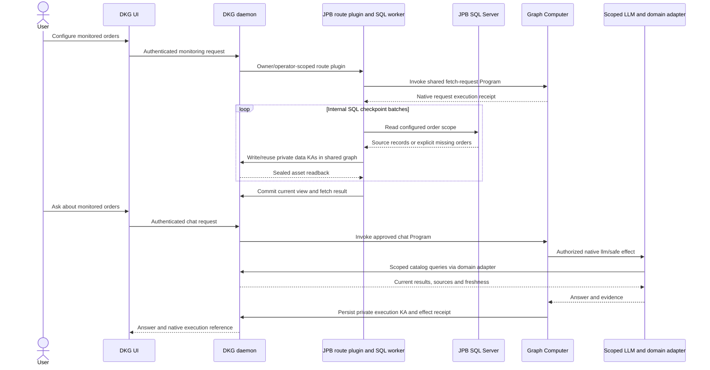

# JPB DKG integration consolidation

JPB has used a pinned Graph Computer/editor build with selected runtime and UI
overlays. This change brings the DKG fixes into one review branch, including the
four patches previously stored only in `OriginTrail/jbp_digital_twin`. The SQL
worker, mapping, query definitions, PLCA calculation and domain adapters remain
in that repository.

## Review base and included changes

The base is `codex/dmaast-program-editor-deploy-20260921`, pinned during this
consolidation at `ba0d433d84ae9a77e17991f1e637a6bb50c0ca04`. It already includes
the reviewed domain-adapter loading from #3055 and the Node 26 chain transport
fix from #3142. The consolidation preserves those changes and the existing
Graph Computer/editor prerequisites. It is not a standalone backport to main.

| Source | Included behavior |
| --- | --- |
| [#3033](https://github.com/OriginTrail/dkg/pull/3033) | Immutable, hash-bound TypeScript source bundles; pure library imports without host filesystem or network access; dependency editing in the Program editor. |
| [#3068](https://github.com/OriginTrail/dkg/pull/3068) | Native scoped LLM invocation from approved Programs, configuration and adapter pins, session ownership, cancellation, effect receipts and revocation checks. |
| [#3080](https://github.com/OriginTrail/dkg/pull/3080) | Chat and Program requests work on private HTTP node URLs; early failures reach the UI. |
| [#3092](https://github.com/OriginTrail/dkg/pull/3092) | Targeted Context Graph authority reads for operators and a graph's authenticated curator. |
| [#3196](https://github.com/OriginTrail/dkg/pull/3196) | Explicit model context-overflow recovery without repeating completed tools, required-domain-tool checks and catalog filtering before loading historical generations. |
| `private-local-first-write-50acc958.patch` | Authorized first writes to node-created private graphs without enabling gossip or accepting replicated RDF as local provenance. |
| `monitoring-runtime-50acc958.patch` | Chunked large execution receipts with exact, isolated readback; approval quotas scoped to each Context Graph. |
| `wm-default-dataset-50acc958.patch` | Authorized Working Memory joins between separate KAs, using the resolved graph/agent allow-set. |
| `jpb-monitoring-50acc958.patch` | Native Sources controls, one shared data graph, SQL coverage/absence display, fetch receipts, bounded notification fanout and one refresh in flight. |

Original PR commits remain in the branch history. Patch changes have separate
commits. The only source conflict required retaining both the LLM adapter and
execution-output codec imports in `semantic-runtime.ts`.

## What runs where

The host worker performs SQL I/O and schedules refreshes after completion.
The shared fetch Program accepts and records the request; SQL does not run
inside its Wasm guest. Automatic post-ingest PLCA currently runs host-side
preparation/calculation helpers and writes result KAs. This consolidation does
not turn every host-side workflow step into a Graph Computer Program.

The Sources page uses the JPB route plugin's `/api/jpb-monitor` endpoints.
The plugin, worker and reviewed adapter/profile must still be installed and
configured separately. DKG credentials and SQL credentials are not sent to
the model. Private graph authorization, read-only model tools, Program grants
and configuration pins remain enforced.

## Validation and deployed state

### UI loading and graph rendering

The UI now lists assertions in cursor pages of 50. It reads membership and UALs
from metadata first, then loads triple-count badges only for the visible page. The count read binds those exact data graphs directly, rather
than joining an open graph variable against all content.
Old physical aliases are suppressed in favor of their canonical lifecycle rows;
published aliases do not reappear in the Shared Working Memory list. Explicit
bulk share/publish actions still apply to all eligible assertions across pages,
with query-catalog configuration excluded from the bulk scope.

Graph reads discover at most five storage partitions inside the selected Context
Graph, then read at most 5,000 triples per layer page. Partition discovery uses
existence probes; data reads use an exact graph set and seek cursors. A visible notice and
**Load more graph data** replace the old silent cutoff. Counts describe loaded
data and remain lower bounds when a layer is clipped or unavailable. A failed
page retries its last successful cursor, including graph, subject, predicate and
RDF object identity (node kind, lexical value, language and datatype). Graph-change events reset the read and invalidate
cached pages; these pages are a live browse view, not an immutable SQL snapshot.

Recent graph reads and assertion pages are cached for five minutes within the
same authenticated session. The cache has a 64-entry / 32 MiB serialized-size
budget; this is an estimate, not a measured heap ceiling. Graph-list caching is
separately limited to one entry / 2 MiB. Graph changes, refreshes, authentication
changes and authorization failures invalidate the appropriate cache. Ordinary
query execution remains fresh, and updates are never cached.

Clicking a graph resource performs a scoped lookup of its own and incoming
triples, including facts outside the loaded overview pages. Loading, failures
and the 1,000-triple-per-layer detail limit are explicit. Blank nodes remain
connected, URI-shaped literals remain literals, and stale tab/refresh responses
cannot overwrite a newer view. Click handlers use the latest React callback,
and the 2D picking region matches the visible node radius.

Large graphs disclose the existing 3,000-node connected-view limit. **Show all
loaded nodes** includes disconnected components in the already fetched data;
it does not claim that every SQL record or graph page has been loaded. Loading
and drawing more nodes increases client cost. Refreshing a graph whose previous
focal resource was removed now selects a valid resource instead of drawing an
empty graph.

Cleanup disconnects resize observers, cancels pending parses and animation
frames, releases GPU labels/textures/materials on replacement and unmount,
prunes removed icons and initializes 3D only once for concurrent callers.
These fixes address reproduced lifecycle leaks; a browser heap soak test is
still a rollout check rather than a claimed result.

The [UI validation receipt](jpb-ui-validation-20261013.json) records the earlier
local regression tests and read-only live JPB API checks. Its local browser
preview was blocked with `ERR_BLOCKED_BY_CLIENT`. The native UI was subsequently
deployed on JPB from `f42564295107e9be308d0a6f79a8add60f2426f5`; see the separate
[deployment receipt](jpb-ui-deployment-20261013.json) for served-file verification
and browser checks. Activation exchanged the static directories atomically,
retained old hashed assets for open tabs, and preserved a rollback directory.
Neither DKG nor ingestion was restarted. Backend modules, worker configuration,
private data and authorization were preserved. The failed CI build had passed
every test before exhausting its 896 MiB build heap; the production UI build
now has a bounded 1,536 MiB allowance. This changes build capacity, not browser
runtime memory limits.

The accompanying [validation receipt](jpb-dkg-consolidation-20261013.json) records source coverage,
local checks and the live source comparison. The `JPB DKG integration` workflow
runs the combined regression suites on this feature-base PR; normal protected
branch CI still applies when the changes are proposed to a protected branch.

Local validation uses Node 25.2.1 and pnpm 10.28.1. For the browser test lane,
`NODE_OPTIONS=--no-experimental-webstorage` prevents Node's experimental storage
global from replacing the browser test environment's storage. Native Rust/Wasm
artifacts are reused locally only after verifying the identical checked-in
artifact lock, every artifact hash and the ABI. Hosted integration CI builds
them from the pinned Rust source/toolchain instead.

All **997 targeted checks in 58 test files** pass: 295 CLI, 119 local-LLM,
410 query, 109 UI, 24 semantic-runtime, 34 SDK, three source-bundle and three
MCP-adapter tests. The CLI dependency TypeScript build, production UI build,
workflow parsing, NUL-byte audit and diff whitespace checks also pass.
The native CLI cases exercise Wasm execution, receipts, approval/revocation
and replay; model responses in these regression tests are fixtures.

Repository-wide lint is not green on the prerequisite branch: seven oxlint
fingerprints and four expired/incomplete test-exception declarations remain.
An isolated checkout of the untouched base produced byte-identical oxlint
diagnostics and the same disabled-test audit (64 existing findings, zero
additions). This consolidation adds no lint findings and does not change those
unrelated exceptions. The chain-backed notification suite requires its
Hardhat/global-setup lane; the targeted lane here checks the authenticated,
bounded notification fanout without starting a chain.

The complete backend consolidation has not been deployed. The node remains based on
`50acc9581297910065b272d1827b2f7649cae1b7` with selected overlays, including the
LLM/catalog files from `766f601693ecb0a698a4c074b1ee6decf3646831`. Source inspection
confirmed the private-write, receipt, quota, Working Memory, authority,
notification and LLM/catalog overlays. The live compiler does not yet have the
immutable bundle implementation from #3033. The served static UI now includes
the consolidated Sources coverage/absence display and the loading/graph fixes,
while backend source files retain their previous overlays. The UI deployment
is not a deployment of the complete combined backend.

The worker shutdown/recovery fix remains in
[JPB #20](https://github.com/OriginTrail/jbp_digital_twin/pull/20), with deployed
runtime commit `9e823207538e47f5bbfd3024707187d283057080`. Full recovered-cycle and
next automatic-refresh verification remains incomplete. The user stopped its
observer and paused the follow-up automation; ingestion remains active. Local DKG
tests do not prove that operational check completed. SQL coverage also does
not establish complete lot genealogy or measured PLCA impacts.

## Future rollout

1. Build the reviewed combined commit and retain the existing runtime/static
   assets and private state backups. Preserve graph data, approvals, source
   checkpoints, SQL grants, the order watchlist and the schedule.
2. Install the existing JPB route plugin and reviewed adapter/profile against
   that build. Compare configured grants and Program source/configuration
   digests before activation; bundle changes require renewed source approval.
3. Switch the runtime and production UI during an agreed worker pause. Reuse
   the worker's durable checkpoints on resume. No graph deletion or RDF schema
   migration is required by this DKG consolidation.
4. Verify authorized private writes/readback, catalog cross-KA queries,
   Program-backed LLM execution/replay and Sources coverage. Check unauthorized
   and foreign-graph rejection. Then observe the scheduled refresh and unchanged
   asset/checkpoint identities independently.

The historical patch files remain useful as deployment provenance. An operator
must not apply them again over this combined source tree.
