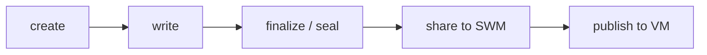

# Knowledge Asset Lifecycle CLI

Use `dkg knowledge-asset ...` or its short alias `dkg ka ...` for named Knowledge Asset work:



## One-shot WM to SWM

```bash
dkg ka create notes \
  --context-graph-id my-project \
  --input-file ./notes.ttl \
  --share
```

This creates the KA named `notes`, writes RDF from `--input-file`, finalizes the draft, and shares it to Shared Working Memory. It does not publish to Verifiable Memory.

`-f` is a short alias for `--input-file`. Prefer `--input-file <path>` in scripts and docs so the local payload source is never confused with the positional KA `<name>`.

## Step-by-step Lifecycle

```bash
dkg ka create notes -c my-project
dkg ka write notes -c my-project --input-file ./notes.ttl
dkg ka finalize notes -c my-project
dkg ka share notes -c my-project
dkg ka publish notes -c my-project
```

Use `dkg ka publish-async notes -c my-project` for an async VM publish job. `dkg publisher publish-async my-project notes` remains an operational alias.

Async VM publish requires the async publisher to be enabled and backed by publisher wallets with native gas plus PCA registration or TRAC for direct spend. Publisher wallet node identity is optional attribution: if the wallet resolves to identity `0`, the publish runs in no-attribution mode. Use `--publisher-node-identity-id 0` to force no-attribution for one publish. See [Async Publisher Wallets](async-publisher-wallets.md).

## Editing a published Knowledge Asset

```bash
dkg ka pull-from notes -c my-project --layer vm
dkg ka write notes -c my-project --input-file ./notes-v2.ttl
dkg ka finalize notes -c my-project
dkg ka share notes -c my-project
dkg ka publish notes -c my-project
```

`pull-from` re-opens the published (or shared) content as a new WM draft; `--on-conflict replace` replaces a draft that already exists. An update is published as the version **one above the KA's latest confirmed version**, and `finalize` seals the draft with that number (`assertionVersion` in the `wm/finalize` response). Because the number comes from the confirmed version, a finalized draft that you abandon — you edit again, discard it, or `pull-from` over it — does not use up a number: the next draft is numbered the same.

If a finalized update carries a different number (it was sealed by an older node, or the published version moved on in the meantime) the node refuses it before anything is staged or sent — `409 PUBLISH_INTENT_STALE`, naming the two numbers — instead of failing later as a retryable publish error. If you sent this publish before, check that job first (`dkg publisher job <job-id>`): `finalized` with your seal means the update is already published ([Retry safely](../build/async-jobs.md#retry-safely)). If it is still running or [held](async-publisher-wallets.md#held-jobs), wait until it finalizes or fails and is no longer held, then check again. Otherwise recover with `dkg ka pull-from <name> -c <cg> --layer swm` (`--layer vm` when the published version moved on; then re-apply your edits), `finalize`, `share`, and publish again. Read a failed async job that still holds the KA before you clear it ([Stale update intents](async-publisher-wallets.md#stale-update-intents)).

A core that already ACK-signed the abandoned draft declines its replacement transiently for a few minutes (`DKG_STORAGE_ACK_PENDING_TX_WINDOW_MS`, 5 minutes by default); retry the publish after that. Peers that already hold an earlier shared draft of the KA may keep showing it in Shared Working Memory until the update is published. Finalizing a replacement draft also replaces the private payload sealed under the same number, so an earlier shared draft that carried private content can no longer be re-opened from Shared Working Memory once its replacement is finalized.

## Synchronous share failures

`dkg ka share` (`POST /api/knowledge-assets/<name>/swm/share`) returns `503` when a temporary prerequisite, store failure or recovery interruption prevents completion. First inspect `recoveryState` and `recoveryJobId`. If recovery is `pending`, observe `recoveryStatusUrl` or `dkg ka share-job <job-id>`: the worker owns the original operation and no HTTP replay is needed. The existing `retryAction: resume_existing_knowledge_asset` hint remains on domain errors for compatibility; it does not override durable ownership. If admission is unconfirmed, inspect the returned job ID before deciding whether another request is needed. If no owner was admitted, retry the same asset only after the unavailable prerequisite recovers; never create a replacement to repair this share. A share whose Shared Working Memory commit completed, but whose catalog inventory handoff waits on a temporary authority change, is not a `503`: it answers as a success with `catalogHandoff: { state: "pending", reason, recoveryJobId, recoveryStatusUrl }` (see [Durable synchronous sharing](#durable-synchronous-sharing)).

| `code` | What happened | What to do |
|---|---|---|
| `PROMOTE_RETRYABLE_FAILURE` | Something the share depends on was temporarily unavailable, so the share did not complete. | Observe the recovery job when owned; otherwise wait for the prerequisite and retry the same asset. |
| `KA_SHARE_INVENTORY_SIGNER_UNAVAILABLE` | The graph requires a signed inventory head, but the node cannot sign as this asset’s author. | Configure that local or external author signer, then retry the same sealed asset. No recovery owner was admitted and WM was not consumed. |
| `PROMOTE_POST_COMMIT_FAILURE` | Shared Working Memory was written, but a step after it failed. | Observe the recovery job; the worker repairs the same operation automatically. |

`PROMOTE_RETRYABLE_FAILURE` usually means the node could not confirm, at that moment, who may read the Context Graph. A share into a private Context Graph is encrypted to the graph's current members, and the node accepts a member list only if it could read it from the chain and from its own metadata without either changing during the read. For a private roster the node checks the roster again after the lookup, and both the graph's peer allowlist and the members' keys and routes by revisions that only a write to that allowlist, a key, a route or a revocation moves, so unrelated writes (queue bookkeeping, other graphs, knowledge-asset content) do not make it refuse. This is most likely straight after a Context Graph is registered, while the node is still settling the new graph's subscriptions, and while chain RPC is slow or unreachable. The node repeats the read on its own for a short time (about two seconds at most) before it answers, so a brief gap is not visible to the caller.

The same answer also covers a share that arrives while the node retires the legacy Shared Working Memory marker of the same asset, right after that asset's publish was confirmed (a share of another asset is not held back by that), and a share of any asset of a Context Graph while the node applies a catalog update for it or retires republished markers. These retirements are usually short; on a slow store they can last tens of seconds and can recur, and one lasts as long as the shares it waits for are still being committed. Until it ends the node holds back the shares it covers, so the identical share goes through once it has. The daemon log then carries the `causeCode` `RFC64_LEGACY_SWM_BOUNDARY_RETIREMENT_IN_PROGRESS`.

After this answer nothing is lost and the content is unchanged, but the request was not a no-op. The share seals the draft before it shares, so the asset is now at least `wm-sealed` (see `dkg ka history`), and whatever the share had already recorded is reused by the next attempt. Do not write to the asset or recreate it while recovery is unfinished. Observe the owned job, or retry the same asset only when no owner was admitted. Publish only after the share has succeeded; a success answer that carries a pending `catalogHandoff` counts.

The daemon log names what was unavailable: the event `knowledge_asset_share_prerequisite_unavailable` carries the share `step` and, when known, a `causeCode` and `causeReason`. An async share (`dkg ka share-async`) that meets the same failure is retried by the queue as `failed_retrying`; its first retry is due about a minute later, and sharing the same asset again meanwhile answers `409` with the existing job, which you follow with `dkg ka share-job`; only a `queued` job can be cancelled, so a retrying one is left to finish. The worker log event `async_promote_attempt_failed` carries the same `causeCode`, and for an authority failure an `authoritySite` that names the check that refused it (`transport-unavailable`, `transport-changed`, `revision-moved` or `recipient-set-changed`); a raw store failure behind an attempt is named in `storeFailure` (`queue_wait`, `queue_full`, `store_timeout_not_started` or `store_timeout_indeterminate`). A one-shot create with `--share` keeps what it created. Once its share has a durable recovery owner, a transient share failure answers `503` with the sealed asset, `partial: true`, `failedPhase: swm-share` and a `recoveryJobId`; observe that job without submitting another share. The exception is a share that committed while only its catalog handoff is pending: that answers `201` with `status: swm-shared` and `catalogHandoff`, and `alsoPublishVm` continues. A failure before durable admission cannot promise automatic recovery.

A pre-signed attestation remains valid for sealing. In a graph that requires catalog inventory, sharing also needs the author to sign the inventory head. The node checks that capability before admitting the share; it never substitutes a payer key. After a successful handoff, restart discovery reads durable inventory heads, including authors that are not registered locally. Catalog writes still require current graph authority.

A synchronous publish into a private Context Graph (`dkg ka publish`, `POST /api/knowledge-assets/<name>/vm/publish`) reads the same member list before it encrypts the payload, and repeats that read within the same short bound as a share. If the graph's authority still cannot be read, or keeps changing, the publish answers `503` with `code: CONTEXT_GRAPH_AUTHORITY_UNAVAILABLE`, `retryable: true` and `Retry-After: 1`. Nothing was signed or sent, so send the same publish again. The daemon log event `knowledge_asset_publish_authority_unavailable` carries the `causeReason` and, for the member-list check, a `causeSite`. A `vm/publish-async` job retries this failure by itself.

## Async share recovery

Use `dkg ka share-job <job-id>` to observe an accepted async share. A `failed_retrying` job follows the queue's existing backoff and attempt limit; do not submit another share to restart it. The queue makes five attempts in all, waiting about 1, 2, 4 and 8 minutes between them (each wait varies by up to 20 %, so jobs that failed together do not come back together). A job that spends them ends `failed` with `retryable: true`; `dkg ka recover-share-job <job-id>` starts it again. What each async share response means, and how to reconcile a share whose replies were all lost, is in [Async Share and Publish Jobs](../build/async-jobs.md).

The queue returns the terminal or retrying failure transition only after its write and flush complete; the worker consumes it without another outcome read. If the worker cannot acknowledge a promotion failure write, the `async_promote_failure_bookkeeping_uncertain` log event identifies the affected job and bookkeeping stage. This event does not establish whether promotion changed SWM. A result already saved in the queue remains authoritative. Otherwise, the job can remain `running` until its lease expires (15 minutes by default), after which ordinary queue polling or startup recovery reconciles it. An unbound async promotion with uncertain effects becomes an explicit **partial promote ambiguity** inspection hold. Version-4 synchronous recovery jobs carry an immutable seal and operation binding; an expired started lease can reclaim only that validated operation. For an unbound inspection hold, inspect SWM/VM state before explicit recovery; do not blindly reshare or reset its retry budget.

Genuine fatal operation failures still become terminal, and a successfully saved retryable failure still uses normal automatic retry. A bookkeeping outage alone does not justify an immediate fatal asset verdict.

If the share committed but the node then failed to record its `swmCurrentAssertion` lifecycle pointer, the job is never reported as `succeeded` and the asset keeps its share operation id. A store failure that is known not to have started is retried directly (`failed_retrying` with a `nextRetryAt`). Any other failure is recorded as `failed`, with `lastError.code: fatal` and `lastError.diagnosticCode: PROMOTE_POST_COMMIT_FAILURE`. The daemon's recovery sweep runs at startup and every 30 seconds; until that sweep the job remains `failed`. This deliberate delay lets the existing durable sweep own bounded replay and avoids another immediate store scan under queue pressure. While the job is within its automatic recovery budget, `clear` rejects it as `nonterminal` and cannot remove its repair evidence. The sweep requeues the same share with normal backoff and the same attempt budget. Its `failed_retrying` row keeps the classification and diagnostic but reports `lastError.retryable: true`. Exhausted or operator-held jobs remain available for inspection and explicit recovery. Synchronous sharing uses the durable ownership contract below. The existing unbound async job retains this deliberate 30-second sweep window.

### Durable synchronous sharing

`POST /api/knowledge-assets/<name>/swm/share` and one-shot create with `alsoShareSwm` prepare the finalized asset, then atomically persist and lease a share job **before** committing SWM. A successful request keeps its existing response.

A share can be admitted while the graph's catalog authoring lane is open and then find that lane closed when it hands its inventory to the catalog: responsibility or authority changed after admission (for example while a newly created graph settles, or during a registration, a revocation or a binding change). Before answering, the request runs one responsibility pass for the graph and, if that reopens the lane, commits the inventory once more under the same lane check. If the handoff still waits, the committed share is answered as shared, with `swmShared`, `promotedCount`, `sealed`, `publishReady: true`, `shareOperationId` and a `catalogHandoff` object: `state: pending`, a `reason` (`inactive-lane`, `authority-transition`, `projection-admission` or `authority-not-ready`), `recoveryJobId` and `recoveryStatusUrl`. `catalogHandoff` is absent when nothing is pending. If a VM publish of the same version was confirmed before the handoff, the handoff instead takes over the confirmed catalog ownership, and while that waits, or fails for any reason, the request keeps the `503` recovery answer. While a handoff is pending the share job stays `failed_retrying` with its durable obligation and completes only after the inventory write; remote catalog visibility follows that job's success; write, discard, reopen and `wm/pull-from` keep returning `409 KA_PROMOTE_RECOVERY_REQUIRED`; the job cannot be cancelled or cleared; a repeated share answers `503 SHARE_OWNER_CONFLICT` with `recoveryState: pending`; and a VM publish is accepted. A later replay can still fail, for example after a real policy change, and is then held for inspection, so follow `recoveryStatusUrl` for the catalog part. The daemon log records the event `knowledge_asset_share_catalog_handoff_pending` with the `causeReason` and `recoveryJobId`. If the asset is published and then updated before the job finishes, the replay accepts a proven, strictly newer confirmed version that owns the same VM graph (its public payload and that version's private triples must match the confirmed roots and counts) and transfers the admitted version's confirmed catalog ownership as for a plain publish. That replay writes nothing to Verified Memory, private content or gossip; as on any VM no-op it clears a stale share-complete marker. Anything it cannot prove stays held for inspection; a store failure that interrupts the proof is classified like any other replay failure, and the daemon log keeps the original mismatch.

A transient or post-commit interruption returns `503` with `recoveryJobId`, `recoveryState: pending` and `recoveryStatusUrl`. The existing `retryAction: resume_existing_knowledge_asset` field remains on post-commit errors for compatibility; observe the owned job rather than replaying the HTTP request. A replay may report `promotedCount: 0` while completing the original operation.

The ordinary worker automatically resumes the same seal, version, payload and immutable operation envelope. It rechecks current authority and curator requirements, skips resealing, and acknowledges completion only after the SWM pointer and required durable catalog inventory write. Signed catalog projection continues asynchronously from that inventory, including after restart. If projection admission is refused or temporarily loses accepted authority after the inventory commit, the original share job stays retryable; replay preserves the existing row and requests projection again. Confirmed public VM replay also retains its owner until projection of the committed inventory removal is admitted. Private VM placement transfers recovery to its durable repair marker. Permanent or unclassified refusals remain held for inspection. A temporary authority transition retains the obligation; a policy or identity mismatch fails closed for inspection. Recovery never republishes a chain transaction or resets a publisher nonce. The daemon also fences domain execution: publisher and inventory/gossip mutation sections validate the current claim and serialize replacement attempts, so an expired executor cannot resume after replacement success and invalidate it. Heartbeats remain independent while an executor waits. This execution fence assumes one daemon owns the queue namespace; it is not a distributed lock across independent daemons. An explicit `awaitCuratorAck: true` cannot reuse an existing operation whose immutable intent did not require acknowledgement: it returns `409 KA_PROMOTE_ACK_REQUIREMENT_CONFLICT` instead of silently skipping that requirement. An original required acknowledgement cannot be weakened on replay.

For these bound jobs, post-commit failures enter `failed_retrying` immediately; `lastError.diagnosticCode` retains `PROMOTE_POST_COMMIT_FAILURE` and `lastError.retryable` is true. Recognized transient failures continue beyond the ordinary five-attempt budget with capped, jittered backoff. `attempts` stops at `maxAttempts`, and the attempts made past the budget are counted in `recoveryAttempts`. An unfinished bound obligation cannot be cancelled or cleared, including an inspection-held failure. Operator recovery remains available after the underlying integrity or authority issue is resolved. While that bound obligation is unfinished, seal-changing operations such as discard or `wm/pull-from` return `KA_PROMOTE_RECOVERY_REQUIRED`. Finalization, including explicit `wm/finalize` and implicit share sealing, takes that lock before reading or changing WM and refuses an unfinished owner. A repeated synchronous request with an unfinished owner skips resealing and follows the original binding-validation and conflict path, so it cannot recreate WM after the owner cleans it. Admission and those mutations share the same lifecycle lock, so reopening cannot remove the original seal between binding validation and persistence of its owner. Reopening is allowed after the job succeeds.

A deterministic gossip-size rejection can safely retire its bound owner only when the publisher certifies that the original first attempt had no prior operation claim, no committed SWM payload and no external confirmation dispatch. The fenced failure transition persists that proof with `PROMOTE_NO_EFFECT_REJECTION`. The response retains its ordinary size-error status, the failed job can be cleared, and the asset can be discarded and corrected. A retired job cannot be recovered; submit the corrected asset as a new share. Error wording, an arbitrary cap classification, a later attempt, uncertain bookkeeping, or already committed content never grants this exception. Missing proof retains the recovery fence for inspection.

After process death or unacknowledged queue bookkeeping (including the pre-promotion start marker), recovery waits for the existing lease to expire (15 minutes by default); startup and ordinary polling then reclaim the bound operation with a fresh claim token. If admission itself cannot be acknowledged, `recoveryState: admission-unconfirmed` means the row may or may not have persisted. No inline content mutation starts in that case. Use the returned job ID to inspect it; do not infer ownership merely from the error response.

Deliberate legacy, named-subgraph and kill-switch lanes carry no catalog obligation. The legacy public-only catalog fallback also excludes a private graph when an accepted policy proves that exclusion; a request policy option cannot grant it. If that fallback cannot determine its accepted policy, admission fails before SWM mutation until policy is available. Temporary authority inactivity never clears an existing bound obligation.

Durable synchronous sharing requires an available share worker and a store supporting atomic subject replacement for every queue transition. Unsupported admission fails before sharing. Disabling the worker suspends recovery; re-enable it and retain the home/store. Downgrading to a daemon that predates version-4 recovery bindings while unfinished bound jobs exist is unsupported: older daemons cannot safely interpret those obligations. Legacy queue records keep their prior recovery and ambiguity rules. A stale concurrent preparation returns `409 SHARE_ADMISSION_STALE`, with the winning recovery job/status when it can be observed. A fully completed pre-intent SWM share retains its existing read-only no-op response after the original seal, empty WM, exact SWM/private payload, completion marker and durable operation tail are verified. It is not admitted as a replay job. An unfinished bound owner prevents this legacy shortcut: a missing intent revokes stale completion evidence and requires inspection of the original owner. Incomplete pre-intent operations still require inspection; the node never invents their missing original intent.

## Command Reference

| Command | Purpose |
|---|---|
| `dkg ka create <name> -c <cg> [--input-file <rdf>] [--share]` | Create a WM draft; optionally write/finalize/share in one call |
| `dkg ka write <name> -c <cg> --input-file <rdf>` | Append RDF payload quads |
| `dkg ka import-file <name> -c <cg> --input-file <file>` | Extract a local document into WM |
| `dkg ka extraction-status <name> -c <cg>` | Check document extraction status |
| `dkg ka finalize <name> -c <cg>` | Seal the WM draft |
| `dkg ka share <name> -c <cg>` | Share finalized WM to SWM |
| `dkg ka share-async <name> -c <cg>` | Enqueue async WM-to-SWM share |
| `dkg ka share-jobs [--context-graph-id <cg>] [--state <states>] [--limit <n> \| --all [--page-size <n>] \| [--page-size <n>] [--cursor <cursor>]]` | List async share jobs: all of them, up to `--limit`, every one by paging (`--all`), or one page at a time ([details](../references/api.md#listing-async-jobs)) |
| `dkg ka share-job <job-id>` | Show one async share job |
| `dkg ka cancel-share-job <job-id>` | Cancel a queued share job (a retrying one cannot be cancelled) |
| `dkg ka recover-share-job <job-id>` | Recover a failed share job |
| `dkg ka publish <name> -c <cg>` | Synchronously publish finalized, fully shared SWM to VM |
| `dkg ka publish-async <name> -c <cg> [--publisher-node-identity-id 0]` | Enqueue VM publish |
| `dkg ka pull-from <name> -c <cg> --layer swm|vm` | Seed WM from SWM or VM |
| `dkg ka discard <name> -c <cg>` | Discard a WM draft |
| `dkg ka query <name> -c <cg>` | Read WM quads |
| `dkg ka history <name> -c <cg>` | Read lifecycle descriptor |

`dkg assertion ...` remains as compatibility for older document import/query/promote flows. New docs and agents should prefer `dkg ka ...`.
