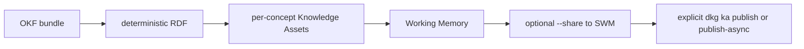

# OKF Import, Export, and Verify

`dkg okf` maps Google Open Knowledge Format bundles into named per-concept Knowledge Assets. Import uses the normal lifecycle: create, write, finalize, optional share. It never publishes directly to Verifiable Memory.



## Import

```bash
dkg okf import ./bundle --context-graph-id okf-demo --create-context-graph
dkg okf import ./bundle --context-graph-id okf-demo --share
dkg okf import ./bundle --context-graph-id private-okf --private --create-context-graph
```

Important flags:

| Flag | Meaning |
|---|---|
| `--context-graph-id <id>` | Target context graph |
| `--create-context-graph` | Create the context graph if needed |
| `--share` | Share imported per-concept KAs to SWM after WM import/finalize |
| `--replace` | Replace existing imported concept assets |
| `--manifest <path>` | Resume or inspect staged import progress from a custom manifest |
| `--private` | Create/use a private context graph for imports |
| `--sub-graph-name <name>` | Import into a registered sub-graph |
| `--relate <predicate>` | Override relation mapping for concept links |
| `--dry-run` / `--print-nquads` | Validate and print deterministic RDF without mutating the node |

Private allowlisting currently uses the OKF command's implemented flags. The broader product decision about exposing `--allowed-agent` alongside or instead of `--allowed-peer` remains open.

## OKF v0.2 trust signals

The importer targets OKF v0.2 and reads v0.1 bundles under the spec's fallbacks (`timestamp` → `generated.at`, legacy `# Citations` still parsed). Every v0.2 family is carried as queryable RDF, so a Context Graph answers the five questions the spec poses from frontmatter alone:

| Question | OKF field | In the graph |
|---|---|---|
| Provenance | `sources[]` | one `okf:Source` node per entry (`okf:resource`, `okf:author`, `okf:usageCount`, `schema:dateModified`) plus a `prov:wasDerivedFrom` edge to every source that has an IRI |
| Trust | `generated`, `verified[]` | `okf:generatedBy`, `schema:dateModified`; one `okf:Verification` node per event (`okf:verifiedBy`, `okf:verifiedAt`); derived `okf:trustTier` |
| Freshness | `stale_after` | `okf:staleAfter` (consumers compare against now) |
| Lifecycle | `status` | `okf:status` (absent ⇒ stable) |
| Attestation | `runtime`, `parameters`, `computation`, `executor`, `attester` | `okf:runtime`, `okf:Parameter` nodes, `okf:computation`, `okf:executorResource` / `okf:executorReceipt`, `okf:attesterResource` |

`okf:` is `http://dkg.io/ontology/okf/`. The full mapping table is in the package README.

The import summary (and `--dry-run`) reports the trust picture next to the triple counts:

```json
{
  "concepts": 9,
  "triples": 321,
  "sources": 9,
  "derivedFromConcepts": 8,
  "trustTiers": { "humanReviewed": 8, "machineConfirmed": 0, "unverified": 1 },
  "draft": 0,
  "deprecated": 1,
  "stale": 0,
  "attestedComputations": 2
}
```

`stale` is evaluated against the current time at summary time; it is never part of the deterministic mapping. Malformed families (a `generated` without `by`, an unknown `status`, a timestamp without an explicit offset, an `Attested Computation` without `runtime`), footnotes that join no `sources[].id`, unresolved `.md` paths and unknown `okf_version` values are reported as warnings and never reject the bundle.

Once shared, the signals are plain SPARQL. Only human-reviewed, non-deprecated metrics:

```sparql
PREFIX okf: <http://dkg.io/ontology/okf/>
PREFIX schema: <http://schema.org/>
SELECT ?metric ?name WHERE {
  ?metric a schema:Metric ; schema:name ?name ; okf:trustTier "human-reviewed" .
  FILTER NOT EXISTS { ?metric okf:status "deprecated" }
}
```

Everything a computation ultimately derives from (lineage through any number of sources):

```sparql
PREFIX prov: <http://www.w3.org/ns/prov#>
SELECT ?root WHERE { <urn:okf:computations/revenue-ytd> prov:wasDerivedFrom+ ?root }
```


## Export

```bash
dkg okf export okf-demo ./out
dkg okf export okf-demo ./out --view shared-working-memory
dkg okf export okf-demo ./out --view verifiable-memory
dkg okf export okf-demo ./out --sub-graph-name science
```

Export reads a context graph view and writes an OKF v0.2 bundle to the output directory (the root `index.md` declares `okf_version: "0.2"`). Use export views to choose Working Memory, Shared Working Memory, or Verifiable Memory.

Export is graph-faithful, not byte-faithful: bodies are regenerated structurally, the v0.2 families come back in their original order, derived triples (`okf:trustTier`, `prov:wasDerivedFrom`) are re-derived on the next import rather than written, and a concept that only carries a last-modified time (a v0.1 import) is written with the legacy `timestamp` key because `generated` requires a `by` actor the exporter will not invent.

## Verify

```bash
dkg okf verify ./bundle --context-graph-id okf-demo
dkg okf verify ./bundle --context-graph-id okf-demo --list-missing 20
dkg okf verify ./bundle --context-graph-id okf-demo --sub-graph-name science --list-missing 20
```

Verify compares the deterministic RDF expected from the local OKF bundle with triples currently visible from the node. Without `--sub-graph-name`, it retains the existing context-graph read including SWM. With the flag, every count and missing-concept query reads only that sub-graph's SWM, using the same scope as export. Match the scope and mapping flags used for import:

```bash
dkg okf import ./bundle --context-graph-id okf-demo --sub-graph-name science --share
dkg okf export okf-demo ./out --sub-graph-name science
dkg okf verify ./out --context-graph-id okf-demo --sub-graph-name science --list-missing 20
```

## VM Capstone

After an OKF import has been shared to SWM, publish selected named KAs explicitly:

```bash
dkg ka publish-async <concept-ka-name> --context-graph-id okf-demo
```

There is no OKF import-and-publish one-shot.
