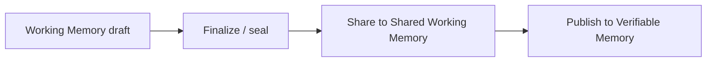

# Publish & Query

The default DKG V10 write lifecycle is:

```
Working Memory -> Shared Working Memory -> Verifiable Memory
```

Use Working Memory first when an agent is drafting or iterating. Share to Shared Working Memory when peers should see it. Publish to Verifiable Memory only when the knowledge needs durable on-chain finality, and the wallet has funds.



## Start with a known result

Complete the [Atlas quickstart](../getting-started/quickstart.md) or [HTTP application example](../build/http-application.md) first. Both include supplied data and an expected answer. For documents, inspect [extraction status](../build/import-documents.md) before sealing or sharing.

## Optional on-chain publication

Continue only after the selected named KA is sealed and its full share has succeeded. Use the exact Context Graph ID and KA name from that workflow. Confirm that the configured network, author, access policy, and funded payer match the intended publication. [Funding](funding.md) explains the wallets.

```bash
dkg status
dkg wallet
dkg ka history atlas -c "$CG"
# Run this funded step only when on-chain publication is intended:
dkg ka publish atlas -c "$CG"
```

The supported per-KA publish path can register the Context Graph on first publication; that registration also has on-chain prerequisites/costs. Explicit registration remains available with `dkg context-graph register`. It is not required for the private draft tutorial.

Inspect the returned UAL, transaction result, and lifecycle state. A partial result or a transaction awaiting local reconciliation is not a completed workflow. Retrieve the published content from the VM view and check it against the intended version before reporting success.

For batching, enable/configure the async publisher and its wallets before using `dkg ka publish-async`. Persist the returned job ID and follow [Async Publisher Wallets](async-publisher-wallets.md) through chain finality and local completion. An accepted job is not proof of publication; retrying under another name can duplicate it.

Use [the edit lifecycle](knowledge-asset-lifecycle.md#editing-a-published-knowledge-asset) for updates. A stable UAL identifies the asset across revisions; record the version/commitment when an audit needs the exact historical content.

## Agent shape

Agents should follow the Node Skill lifecycle (create → write → finalize → share → publish):

* `dkg_knowledge_asset_create`
* `dkg_knowledge_asset_write`
* `dkg_knowledge_asset_finalize`
* `dkg_knowledge_asset_query`
* `dkg_knowledge_asset_share` (formerly `dkg_assertion_promote`)
* `dkg_knowledge_asset_publish`

Do not publish to Verifiable Memory just because data exists. Publishing spends gas/TRAC and should be an explicit finality choice.

## Query Knowledge

Use `memory_search` (`dkg_memory_search` on the MCP runtime) for free-text recall and `dkg_query` for precise SPARQL.

### Free-text Recall

Use memory search when the user asks what the node remembers about a topic:

```
memory_search({ query: "relay discovery", limit: 10 })
```

Search ranks higher-trust memory above lower-trust memory:

```
Verifiable Memory > Shared Working Memory > Working Memory
```

### Structured Query

Use SPARQL when you know the graph pattern:

```sparql
SELECT ?s ?p ?o
WHERE {
  GRAPH ?g { ?s ?p ?o }
}
LIMIT 25
```

When querying sub-graph-routed data, use named graph patterns with `GRAPH ?g { ... }`. Many empty-query bugs come from asking the default graph while the data lives in named graphs.
