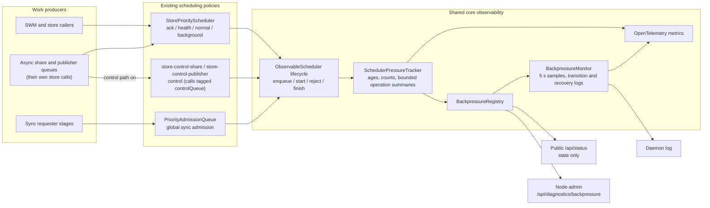

# @origintrail-official/dkg-core

Foundation package for DKG V10. Provides P2P networking, protocol messaging, cryptographic primitives, and shared utilities used by every other package in the stack.

## Features

- **libp2p node** — full P2P networking: TCP + WebSocket transports, Noise encryption, Yamux multiplexing, AutoNAT, circuit relay, DCUtR hole-punching
- **GossipSub** — pub/sub message broadcast across the network, with per-topic subscription management
- **Protocol router** — request/response protocol streams over libp2p with handler registration
- **Peer discovery** — mDNS for local networks, Kademlia DHT + bootstrap peers for global discovery
- **Ed25519 crypto** — peer identity generation, signing, and verification
- **Protobuf messages** — efficient serialization for all DKG protocol messages
- **Event bus** — centralized internal event system (`DKGEvent`) for decoupled component communication
- **Logger** — structured logging with operation context tracking
- **Genesis ontology** — built-in DKG ontology quads and system contextGraph definitions
- **Constants** — network IDs, protocol paths, topic naming conventions

## Usage

```typescript
import { DKGNode, Logger } from '@origintrail-official/dkg-core';

const node = new DKGNode(config);
await node.start();
```

## Backpressure observability

`backpressure-observability.ts` gives the node's in-memory schedulers one pressure model. The operator guide, [Monitor Store and Queue Pressure](../../docs/use-dkg/backpressure-observability.md), covers the states, the diagnostics route, the log lines and the metrics. This section covers how the model is built.



The tracker records references to bounded labels and timestamps, not work closures or payloads. A snapshot holds at most eight queued and eight active operation summaries per lane. Labels are sanitized and truncated before they reach metrics, logs or the diagnostics response.

The registered sources are:

- `store`: the external-store priority scheduler and its `ack`, `health`, `normal` and `background` lanes;
- `sync-global`: the process-wide sync admission queue and its sync lanes;
- `store-control-share` and `store-control-publisher`: the store control path's schedulers, one `control` lane each, registered only while the path is on for that queue (`packages/storage/src/store-control-path.ts`).

### Capacity models

The sources divide capacity differently, and every lane row names its model in its `capacityModel` field:

| `capacityModel` | Meaning | Source |
| --- | --- | --- |
| `partitioned` | The lane holds a private queue allocation and fills independently of its neighbours. Nothing validates the scheduler-level limit against the lane allocations — a scheduler may publish their sum (`store` does), or cap its total lower — so read a lane's own limit for lane pressure and the scheduler's for the rollup, and derive neither from the other. | `store`, `store-control-*` |
| `shared` | Every lane draws on one queue and one concurrency pool. The lane's `queueLimit`/`inflightLimit` **are** that pool's ceilings — the same number on every lane, never to be summed. | `sync-global` |

Three counts sit on every lane row beside the two ceilings, and they differ only under `shared`:

| Field | Meaning |
| --- | --- |
| `queued` | This lane's own backlog — *who* is waiting. The attribution signal. |
| `pressureQueued` | The depth the lane's `state` was classified against, and the numerator that belongs with `queueLimit`. Equal to `queued` for a `partitioned` lane, and the whole pool's depth for a `shared` lane **that has work waiting against a ceiling**. Where no depth applies to a shared lane — an empty backlog, or a pool with no `queueLimit` — nothing was classified on depth and the lane reports its own `queued`, so it never reads as utilized. |
| `pressureInflight` | The count that belongs with `inflightLimit`: this lane's own under a `partitioned` allocation, and on a `shared` row the pool's occupancy, **always** — it has none of `pressureQueued`'s fallbacks, because no state is ever classified on concurrency, so a shared row's ratio is a pool ratio by construction and cannot contradict the row's own state. |

So compute utilization from **`pressureQueued / queueLimit`**, never from `queued`, and no consumer has to special-case the model. All three are optional on the type, so a scheduler written against an older `dkg-core` still satisfies it: absent `capacityModel` means `partitioned`, absent `pressureQueued` means `queued`, and absent `pressureInflight` means `inflight`.

Each control-path scheduler reports exactly one lane, `control`. Its `inflightLimit` is the queue's slots (share at most 1, publisher at most 2), its `queueLimit` is the queue limit of the `store` scheduler's `normal` lane, and the scheduler totals are taken from that lane. Its queue-wait timeout warning is rate-limited per scheduler instance (at most 16 per 60 s, and one per priority and operation per 60 s), so with the path on a node can log up to 16 timeout diagnostics per minute from each of the three store schedulers.

### Adding a scheduler

Other schedulers can extend `ObservableScheduler` and call its protected lifecycle methods at their existing admission boundaries. They keep complete ownership of policy, and declare how their lanes divide capacity through `capacityModel` — a scheduler that declares nothing is `partitioned`, and a lane of a partitioned scheduler that publishes no limit of its own is simply not classified on depth.

The sync **responder** limiter is a separate queue and is not instrumented, so its `pre_authorization` and `responder` lanes appear in no snapshot, metric or log line. `sync-global` covers requester-side admission only.

## Internal Dependencies

None — this is the base package. All other `@origintrail-official/dkg-*` packages depend on it.
